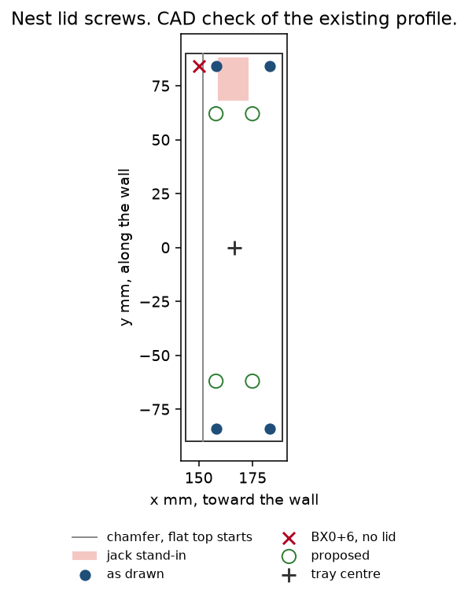
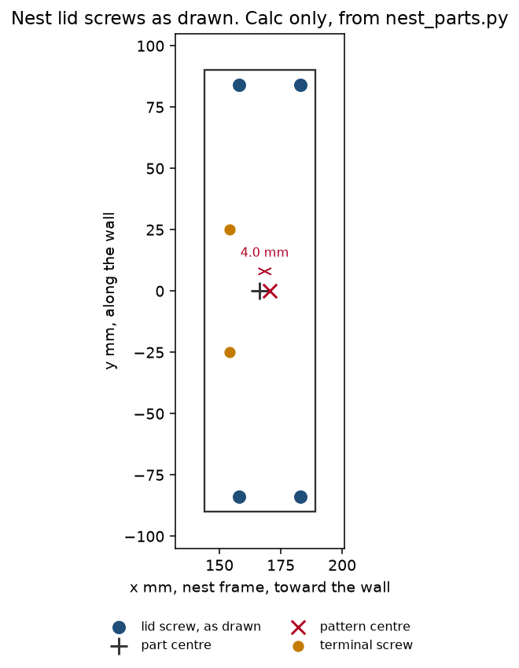
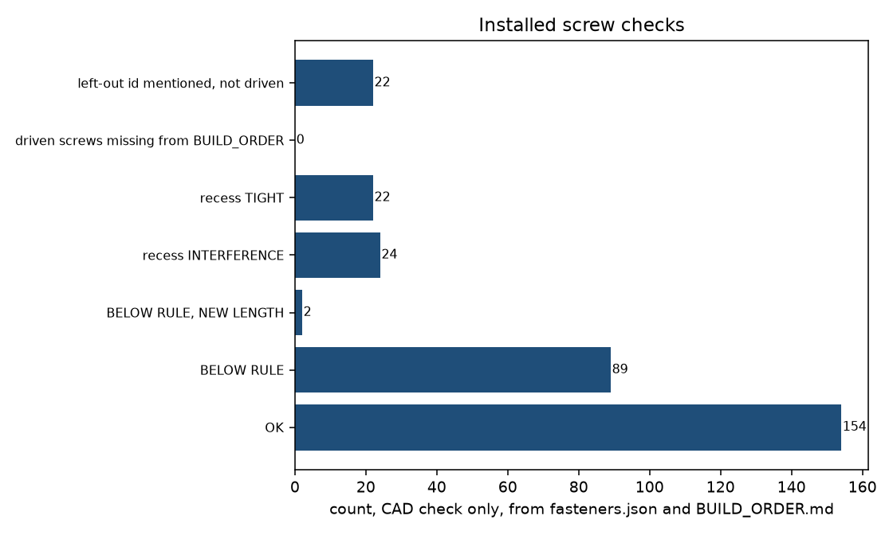

# Fastener audit

This folder measures the screws, inserts, nuts, and washers already drawn for the duck and the nest. It does not add a screw, a hole, or a mount. Nothing here is copied into `print/`.

What it reuses:

- `fasteners/fasteners.json` and `fasteners/FASTENERS.md` (every robot screw already scheduled)
- `twin/assembly/BUILD_ORDER.md` and `twin/assembly/asm_geom_summary.json` (the existing build order and its tool cast)
- `twin/holes/data/sym_checks.json` and `twin/holes/HOLES_TWIN.md` (D39 and D42 on the installed set)
- `twin/dock/nest/cad/nest_parts.py` (the nest screws already chosen there)
- `twin/structure/topology/stl/` and `twin/structure/shin_eye/stl/` (the pads already drawn)
- `twin/structure/shin_eye/eye_geom.py` (the head recess already drawn for the shin)
- `docs/assembly_guide.md` and BOM 19 (Loctite 243 on metal into the motor metal)
- RLS installation guide TTD01_03, issue 03, 6 Dec 2023 (the torque table, and the depth line that keeps it from applying here)

Files:

| File | What it is |
|---|---|
| `schedule.json` | Every robot screw, and the nest joints. One row per screw. |
| `SCHEDULE.md` | How to read that file. Torque, threadlocker, washers. |
| `CHECKS.md` | D39, D42, the later CAD, wires, tools. |
| `ASSEMBLY.md` | The existing build order, the lines that are wrong, the nest steps. |
| `PROPOSED_EDITS.md` | Exact edits for files this folder does not own. Not applied. |
| `audit.py` | The measurements. Run it again to refresh the JSON. |
| `lid_check.py` | Nest lid profile check. Does not write the nest STL. |
| `lid_proposal.png` | Drawn posts, the rejected BX0+6 axis, and the proposed posts. |
| `nest_lid_screws.png` | The nest lid as drawn. Calc only. |
| `installed_screw_checks.png` | Counts from `fasteners.json` and `BUILD_ORDER.md`. CAD check only. |
| `findings.json` | The same measurements, including the head-recess rows. |

Labels: **cad** is a measurement on a mesh or on `fasteners.json`. **calc** is arithmetic on those numbers. **cited** is a page. A sim is not in this folder. None of these numbers are a hardware test.

## Follow-up

`BUILD_ORDER.md` now uses M2x12 for F127 and F129, M2x5 for F344 and F347, drops the 12 left-out screws from the drive counts, and adds F356 to F361. A re-run finds no missing fitted screw and no length mismatch (cad).

The nest lid change is a proposal, not applied (`PROPOSED_EDITS.md`). BX0+6 has 0.0 mm of lid (cad). Proposed posts are (158, 62), (158, -62), (174.9, 62), (174.9, -62). Mirror error 0.0 mm (calc). A longer insert does not raise the 4.0 mm engagement. M3x8 into a bore deepened to 6.3 mm engages 5.7 mm and stays 0.3 mm off the floor (calc), using BOM 17a and BOM 16.

Wire gaps now use cable segments and finite cylinders (cad). F249 clears D3 by 0.13 mm. F027 overlaps P1 by 0.90 mm. No wire was moved.

## Open items

Each line is a BLOCKER. This audit does not close it.

- Charger board: no outline, no holes, no seat (`CHARGER_BOARD.md`). No mount is proposed here.
- Nest ring lug: named in `NEST_CAD.md`, no BOM line, no catalog part chosen here.
- Jack wrench: the nut comes with PJ-005A. The wrench size is not in the repo.
- Terminal engagement: the lug thickness is not in the CAD, so NT1 and NT2 have no engagement number.
- Copying a no-recess topology or shin STL into `print/` would bury the existing horn screws (cad). Do not copy them.
- Chest hole stays open until the STL owner fills the cut `chest_hole.py` already defines.
- Wall card: `CLOSEUP.md` names no fastener. None is added here.
- Flush wells and nest pin pockets are two layouts. Neither is in `print/`. Do not cut both.
- Build torque: the cited TTD01_03 table does not meet its own depth line on these joints. No torque is set.
- Pull-out of inserts and of self-tappers, bag screw sizes, and the camera board thickness stay the open items already in `FASTENERS.md` and the screws twin. Not re-tested here.
- Hot and wet PA6-CF stay the open item already in the shin study. Not re-tested here.

