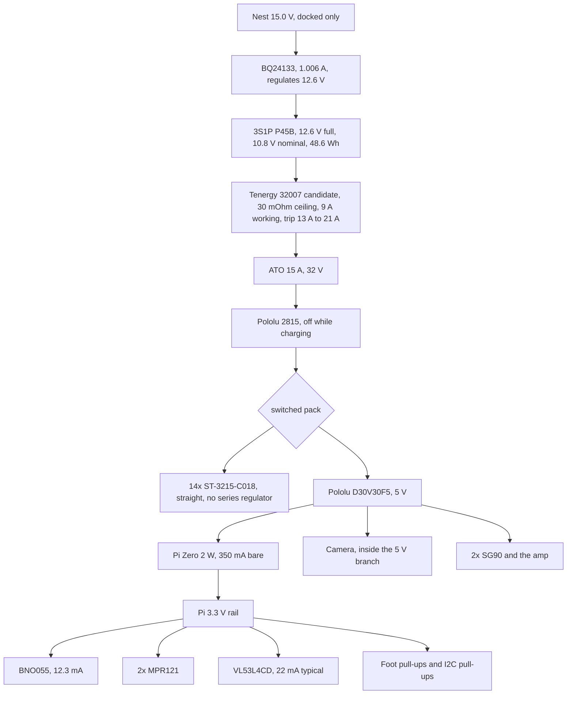

# System voltage and pack size

Calc only, sim pass only, cited, or BLOCKER, on every number below. Nothing was bought. The policy was not retrained. D61 was not edited. The Castle set point of 16 V is invalid and is not used here.

The question was whether 12 V had been shown to be the best system voltage. It had not. The 3S pack and the 12 V STS3215 (C018) were chosen to stop the servo slowdown on a sagging 2S bus (problems/STALL.md, problems/STS12.md). This pass compares the rails and the cells that fit the bay.

Script: `problems/system_voltage.py`. Tables: `problems/system_voltage_calc.json`, `problems/system_voltage_sim.json`.

## Short answer

The winner is **3S1P Molicel P45B, ST-3215-C018, servo rail straight from the pack**. Score 60.8 against 56.6 for the same pack through a Castle CC BEC Pro set to 12.0 V. Both walk 60 s with no fall on run C (sim pass only). The straight rail is ahead on run time, pack current, knee volts, mass, and the parts bill. The 12.0 V regulator does not hold 12.0 V while walking: the pack at the regulator input is under 12.3 V, so the existing solver is in dropout for the whole walk.

A 4S P30B pack with the Castle actually regulating at 12.0 V walks a little faster and draws less current. It fails the bay, a cited 4S protection board, and the 15 V nest, so those three gates keep it out of the ranking.

## The 16 V set point

Castle's adjustable output stops at 12.5 V (POWER.md section 3, and the chart cited in twin/battery/BATTERY_STUDY.md: 4.9 V to 12.5 V). A set point of 16 V is outside that range. The earlier 3S walks used 16 V so the solver would pass the pack through minus the 0.3 V dropout assumption. That is a model trick, not a legal Castle setting.

`verify/check_power_limits.py` is not on this branch. Pull request 84 adds it and moves the 3S studies to 12.0 V. That pull request was open and not merged, so its check was not run. This file uses 12.0 V, which sits inside 4.9 V to 12.5 V. It does not edit the files that pull request touches.

## What was compared

Servos that share the STS3215 case (45.2 x 24.7 x 35 mm, SERVO_UPGRADE_OPTIONS.md): C001, C018, STS3250. Robotis XM430-W350-T is 28.5 x 46.5 x 34 mm and 82 g, stall 4.10 Nm at 12.0 V (cited, https://en.robotis.com/shop_en/item.php?it_id=902-0124-000). It does not fit the duck horn. It is in the table and it is out of the ranking.

Cells: P45B and P30B with the digitized discharge curves in twin/electromech. P50B from its data sheet (no curve in the twin, so no walk). Samsung 50S from BATTERY_STUDY.md section 8.2, where the DC resistance was not found.

Rails: Castle buck (existing solver: output is the minimum of the set point and the input minus 0.3 V, efficiency 0.85). A wire (efficiency 1, drop 0). A held rail (buck-boost), which has no cited part at the walk current. Pololu S13V25F12 is 12 V at 2.5 A typical from 2.8 V to 22 V (cited, https://www.pololu.com/product/4984). The walk bus is above 2.5 A.

The 5.00 A column is one pack current on every architecture so the voltages can be compared. It is calc only. It is next to the 5.144 A mean in problems/FIT3.md. It is not a new walk.

## Hard gates

A row is eligible when every gate is clear.

| Gate | Rule |
|---|---|
| Fit | Grown two-cell bay (twin/battery/BAY.md) or the FIT3 single-cell blister. A 2 by 2 block is a new bay. |
| Servo window | Adopted ranges. C018: Feetech page 4 V to 14 V and Waveshare 6 V to 12.6 V. The PDF that prints only 12.0 V is recorded and is not adopted, same as problems/STS12.md. |
| Converter | A cited part carries the current, or the rail is a wire. |
| Protection | A cited board. A peak inside the trip band is a watch, the same call as problems/FIT3.md. A peak above the top of the band fails. |
| Nest | The 15.0 V nest can finish the charge. BQ24133 recommended input tops at 17 V (cited, SLUSAF7D). The EVM note wants the supply about 1 V above the regulation voltage (problems/NEST3.md). |
| Shipping | Pack at or under 100 Wh, so it stays in IATA PI 967 Section II for lithium ion batteries contained in equipment (cited, IATA lithium battery guidance, and the FAA lithium battery chart). |
| Walk | The as-built 2S sheet walk already falls (problems/STALL.md, problems/BUS_SAG.md). A servo the run C policy was not trained on is not ranked from a new walk. |

## Architectures

| Id | Pack | Servo | Rail | Wh | Fit | Full-charge rail | 50% SOC rail at 5 A | Cost delta | Gates |
|---|---|---|---|---|---|---|---|---|---|
| A | 2S1P P45B | C001 | Castle 7.2 V | 32.4 | grown bay | 7.2 V | 6.585 V | -$33.81 | sheet walk falls (cited sim) |
| B | 2S1P P45B | C001 | hold 7.4 V | 32.4 | grown bay | 7.4 V | 7.4 V | -$33.81 | no converter at the current |
| C | 2S1P P45B | C018 | hold 12.0 V | 32.4 | grown bay | 12.0 V | 12.0 V | -$10.99 | no converter at the current |
| D | 2S2P P30B | C001 | Castle 7.2 V | 43.2 | 2 by 2 does not fit | 7.2 V | 6.620 V | -$17.83 | bay |
| E | 3S1P P45B | C018 | wire | 48.6 | FIT3 blister | 12.6 V | 10.488 V | -$54.95 | none |
| F | 3S1P P45B | C018 | Castle 12.0 V | 48.6 | FIT3 blister | 12.0 V | 10.188 V | $0.00 | none |
| G | 3S1P P30B | C018 | Castle 12.0 V | 32.4 | FIT3 blister, 18650 inside the 22.2 mm circle | 12.0 V | 10.118 V | -$3.00 | none, walk not run |
| H | 3S1P P50B | C018 | wire | 54.0 | FIT3 blister | 12.6 V | 10.662 V | -$48.95 | no digitized curve |
| I | 3S1P 50S | C018 | wire | 54.0 | same sleeve class | 12.6 V | BLOCKER | -$54.95 | resistance not opened |
| J | 3S1P P45B | STS3250 x14 | Castle 12.0 V | 48.6 | FIT3 blister | 12.0 V | 10.188 V | +$747.04 | run C is not this servo |
| K | 4S1P P30B | C018 | Castle 12.0 V | 43.2 | 2 by 2 does not fit | 12.0 V | 12.0 V | BLOCKER | bay, no 4S board, nest |
| L | 4S1P P45B | C018 | Castle 12.0 V | 64.8 | 2 by 2 does not fit | 12.0 V | 12.0 V | BLOCKER | bay, no 4S board, nest |
| M | 3S1P P45B | XM430 | Castle 12.0 V | 48.6 | case does not fit | 12.0 V | 10.188 V | +$3489.78 | horn |

Wh is n times the cell's cited watt-hours (P45B 16.2, P50B 18.0, P30B 10.8, 50S 18.0). Cost delta is against the current order: 14 C018 at $20.63, three P45B at $9.99, Tenergy 32007 at $23.99, Castle at $54.95. The wire row drops the Castle. STS3250 is $73.99 each and XM430-W350-T is $269.90 each, both from the pages cited above, read with the earlier servo study or the shop page. Prices are list prices. Shipping is not in them.

At 5 A the 3S buck (F, G, J) is already below 12.0 V. The input at 50% SOC is 10.488 V on the P45B wire, and 12.0 plus the 0.3 V dropout needs 12.3 V. The 4S rows are the ones that still read 12.0 V at 50% SOC and at 25% SOC. By 10% SOC the 4S P30B rail is 11.605 V (calc only).

Path resistance, typical corner, cell ohms not included because the cell curve already has them: 74.17 mOhm on the 2S board (25 mOhm) and 79.17 mOhm on the 3S board (30 mOhm). The 4S rows reuse 30 mOhm so the path is not drawn thinner than the 3S board. That reuse is not a cited 4S resistance. BLOCKER for the real board. Holder 10 mOhm, fuse 6 mOhm, and XT30 1 mOhm per contact are the existing assumptions in sim/power_path_sim.py. At 5 A the path loss is 1.85 W on 74.17 mOhm and 1.98 W on 79.17 mOhm (calc only).

## Run C walks (sim pass only)

Same sheet patch as problems/sts12.py, run C policy, backlash, 60 s, both corners, commands 0.15 m/s and 0.40 m/s. MuJoCo 3.3.4. The trunk before the extra cells was 1.0654 kg at x -56.5 mm, which matches the 1.065 kg and -56.5 mm in problems/FIT3.md. The wire rail then adds one 70 g P45B at the FIT3 rear seat and takes off the Castle that the mass budget already seats: 29.0 g for the body (user guide, without wires), 4.6 g of output leads, 1.4 g of tape, and 1.0 g for splices JB+ and JB-, 36.0 g together, at the bec_pro seat (-64.5, -0.5, -9.8) mm. The trunk after that is 1.0994 kg, centre of mass x -62.3 mm, z 36.1 mm (sim pass only). The buck row keeps the Castle, so its trunk is 1.1354 kg at x -62.4 mm, the FIT3 figure for the cell alone. The rerun of the wire walk, with that mass gone, printed the same speed and the same pack current as the heavier body, to the digits in the table. The mass script stops on a bead-lead gauge it does not price. Those leads were taken as 0 g for this model. They did not move the trunk off the published mass.

The 4S mass is four P30B in place of two P45B, +48 g, on seats that are not a CAD check. The walk still ran, so the electrical result is real and the fit gate still fails.

| Rail | Cmd | Corner | Fall | Speed | Knee min L / R | Pack mean | Pack RMS | Pack peak | 100 ms peak | Servo rail min |
|---|---|---|---|---|---|---|---|---|---|---|
| E wire | 0.15 | typical | none | 0.1183 m/s | 11.095 / 11.197 V | 4.682 A | 4.810 A | 8.114 A | 6.500 A | 11.406 V |
| E wire | 0.15 | high-side | none | 0.1167 m/s | 10.712 / 10.894 V | 4.697 A | 4.821 A | 7.779 A | 6.282 A | 11.267 V |
| E wire | 0.40 | typical | none | 0.2648 m/s | 10.171 / 10.198 V | 8.367 A | 8.613 A | 14.451 A | 11.793 A | 10.575 V |
| E wire | 0.40 | high-side | none | 0.2551 m/s | 9.703 / 9.759 V | 8.265 A | 8.516 A | 13.956 A | 11.572 A | 10.368 V |
| F buck 12.0 | 0.15 | typical | none | 0.1158 m/s | 10.659 / 10.800 V | 5.334 A | 5.484 A | 9.211 A | 7.103 A | 10.964 V |
| F buck 12.0 | 0.15 | high-side | none | 0.1131 m/s | 10.192 / 10.434 V | 5.337 A | 5.488 A | 9.314 A | 7.272 A | 10.746 V |
| F buck 12.0 | 0.40 | typical | none | 0.2545 m/s | 9.739 / 9.760 V | 9.360 A | 9.651 A | 15.710 A | 13.334 A | 10.124 V |
| F buck 12.0 | 0.40 | high-side | none | 0.2434 m/s | 9.241 / 9.221 V | 9.248 A | 9.535 A | 15.402 A | 13.012 A | 9.853 V |
| K 4S buck 12.0 | 0.15 | typical | none | 0.1211 m/s | 11.669 / 11.719 V | 4.099 A | 4.234 A | 7.421 A | 5.731 A | 12.000 V |
| K 4S buck 12.0 | 0.15 | high-side | none | 0.1187 m/s | 11.426 / 11.497 V | 4.116 A | 4.249 A | 7.444 A | 5.684 A | 12.000 V |
| K 4S buck 12.0 | 0.40 | typical | none | 0.2790 m/s | 11.506 / 11.575 V | 7.839 A | 8.130 A | 16.468 A | 11.704 A | 12.000 V |
| K 4S buck 12.0 | 0.40 | high-side | none | 0.2757 m/s | 11.184 / 11.270 V | 7.865 A | 8.168 A | 16.526 A | 11.900 A | 12.000 V |

On F, the regulator input minimum is 0.300 V above the rail minimum (11.264 V and 10.964 V on the 0.15 typical row). That is the dropout equation, checked. On K the rail mean and the rail minimum are both 12.000 V, and the input minimum is 15.403 V at 0.15 m/s and 14.067 V at 0.40 m/s, both above 12.3 V. That row is regulating.

The published run C table at a 16 V set point, 0.15 m/s typical, is 0.108 m/s and knees 10.829 / 10.925 V (problems/retrain_sts12/eval_table.md, sim pass only). This pass at 12.0 V is 0.1158 m/s and 10.659 / 10.800 V. Same regime: no fall, about 0.11 m/s, knees near 10.7 V. The two are not one session.

Chain current, worst 100 ms mean (sim pass only). The lab's Mini-SPOX figure is 3 A (SERVO_UPGRADE_OPTIONS.md, verify/c7_current_ratings.py).

| Rail | Cmd | SP1 | SP2 | SP3 |
|---|---|---|---|---|
| E | 0.15 typical | 2.998 A | 2.978 A | 0.978 A |
| F | 0.15 typical | 2.900 A | 2.889 A | 0.959 A |
| K | 0.15 typical | 3.008 A | 3.068 A | 0.994 A |
| E | 0.40 typical | 4.910 A | 4.742 A | 2.153 A |
| F | 0.40 typical | 4.720 A | 4.672 A | 2.061 A |
| K | 0.40 typical | 5.242 A | 4.736 A | 2.189 A |

The 0.15 m/s walk sits on the 3 A line. The 0.40 m/s command is over it on every rail. The score uses the 0.15 m/s duty. The 0.40 m/s command is a watch on the connector, and on F and K it also passes the XT30 15 A line cited in POWER.md (peaks 15.710 A and 16.468 A). E at 0.40 m/s peaks at 14.451 A.

Protection, 0.15 m/s, Tenergy 32007: working 9 A, trip 17 A plus or minus 4 A, so 13 A to 21 A (cited, problems/FIT3.md). E mean 4.682 A, peak 8.114 A, 100 ms 6.500 A. All under 9 A. F mean 5.334 A, peak 9.211 A, 100 ms 7.103 A. The sample peak is just over the 9 A working line and under 13 A. At 0.40 m/s, E peaks at 14.451 A and F at 15.710 A, inside the trip band. That is the same watch FIT3 recorded. The scored duty does not enter the band.

## Run time, heat, charge, shipping

Run time holds the sim's mean pack power and walks the digitized curve until the curve ends (calc only). At this power the rail is still above 6 V when the curve ends, so the 6 V Waveshare floor is not what stops the pack.

| Rail | Pack power | Minutes to the end of the curve | Minutes to a 9 V rail |
|---|---|---|---|
| E, 12.229 V x 4.682 A = 57.26 W | 57.26 W | 50.4 min, 4445 mAh | 45.6 min |
| F, 12.193 V x 5.334 A = 65.04 W | 65.04 W | 44.2 min, 4446 mAh | 37.8 min |
| K, 16.311 V x 4.099 A = 66.86 W | 66.86 W | 35.5 min, 2753 mAh | still at 12.0 V when the P30B curve ends |

Nameplate check: 48.6 Wh / 57.26 W is 50.9 min, and 48.6 / 65.04 is 44.8 min (calc only). The curve is a few tenths of a minute shorter because the 1C capacity read from the figure is 4600 mAh and the tracked end is 4450 mAh (p45b.py).

Heat at the 0.15 m/s typical RMS (calc only on the sim currents):

| Piece | E wire | F buck, dropout | K 4S, regulating |
|---|---|---|---|
| Cells, sheet DC resistance | 1.04 W (3 x 4.810^2 x 0.015) | 1.35 W (3 x 5.484^2 x 0.015) | 1.22 W (4 x 4.234^2 x 0.017) |
| Pack path, 79.17 mOhm | 1.83 W | 2.38 W | 1.42 W |
| Servo regulator | 0 W, it is a wire | 1.23 W if the only loss is 0.3 V x 4.11 A | 8.9 W at the 0.85 assumption, because this row is actually regulating |
| 5 V branch, 5 W at 0.85 | 0.88 W | 0.88 W | 0.88 W |

The solver also divides by 0.85 while F is in dropout. Pack power is 65.04 W on F and 57.26 W on E, a 7.8 W gap. About 1.2 W of that is the 0.3 V drop. The rest is the 0.85 factor. Castle publishes no efficiency (twin/thermal/EFFICIENCY.md). The score uses the 0.3 V term and does not treat the extra 6 W as measured heat. If a bench log shows the dropout loss really is near 15%, F's heat and run time get worse, and E's lead grows.

Charge at 1.006 A (calc only, circuitry/BQ24133_BOARD.md) plus the 0.50 h tail used in circuitry/CHARGER_BOARD.md:

Charger loss is the switcher formula, Vbat times current times (1/efficiency - 1). The efficiency is 0.929 at 1.00 A, AVCC 15 V, 3 cells, from the Figure 10-4 chart read in twin/thermal/BQ24133_HEAT.md. The trace does not print the battery voltage, so that note uses the same 0.929 at 10.8 V and at 12.6 V. (15 V minus the pack) times the charge current is the linear-regulator formula. It is not this chip.

| Pack | Regulation | Nest can finish | Hours | Loss at the end of charge | Loss at nominal |
|---|---|---|---|---|---|
| 2S | 8.4 V | yes. 9.4 V needed, nest is 15.0 V | 4.97 h on a 4.5 Ah cell | BLOCKER. No 15 V, 2-cell trace. The nearest chart read is 12 V in, 2 cells, 0.916 at 1.00 A. | BLOCKER |
| 3S | 12.6 V | yes. 13.6 V needed, nest is 15.0 V, chip top is 17 V | 4.97 h on P45B, 3.48 h on P30B | 0.969 W at 12.6 V and 1.006 A (calc only) | 0.830 W at 10.8 V and 1.006 A (calc only) |
| 4S | 16.8 V | no. 17.8 V needed | BLOCKER | BLOCKER | BLOCKER |

0.969 W is the same case as the 0.963 W sit already run at 1.00 A into 12.6 V (twin/thermal/BQ24133_HEAT.md, sim pass only for the shell). Loss at 3.0 V per cell is BLOCKER: Figure 10-4 was not read there. The old 6 W figure was the linear formula and is withdrawn.

Shipping. Every pack in the eligible set is under 100 Wh (48.6 Wh for 3S P45B, 32.4 Wh for 3S P30B, 54.0 Wh for 3S P50B). PI 967 Section II applies to lithium ion batteries at or under 100 Wh contained in equipment, passenger aircraft allowed, 5 kg net per package (cited, IATA guidance and the FAA chart). A 4S2P P45B would be 129.6 Wh and would leave Section II. That pack also does not fit. UN 38.3: the P30B cell has a test summary, and the P45B product page lists a UN report. A spot-welded pack is a battery of its own and needs its own UN 38.3 summary. BLOCKER before the duck is shipped by air, on every series count. The gap is the same for every row, so the ranking does not move.

## Converters on the winner

| Stage | Part | Efficiency | Current |
|---|---|---|---|
| Servo rail | none. The harness is the rail. | 1, plus I2R | walk mean 4.682 A, peak 8.114 A (sim pass only, 0.15 m/s typical) |
| 5 V: Pi Zero 2 W, camera, two SG90, amp | Pololu D30V30F5, item 4892 | sim uses 0.85. AWAKE_LOAD cites 94 to 97 percent. That graph was not re-read at 12 V in. BLOCKER for the point. | branch is the existing 5 W assumption. Pi Zero 2 W bare board is 350 mA, 1.75 W (cited, circuitry/AWAKE_LOAD.md). The camera is inside the branch, not a separate measured current. |
| 3.3 V: BNO055, two MPR121, VL53L4CD, mics, foot pull-ups | the Pi's own regulator | BLOCKER. Topology not copied. | about 45 mA typical, about 62 mA with the ToF peak (POWER.md section 10, calc only). Under 0.2 W even at half efficiency. |
| Charger, docked, servo rail off | TI BQ24133, nest 15.0 V | heat is (15 V minus pack) times 1.006 A, the board note's method | 1.006 A. The rail is held off by the Pololu 2815 interlock (circuitry/SERVO_RAIL.md) so the servos do not see 15 V. |

The Pololu 2815 is the switch, not a regulator. At 4.7 A to 5.3 A mean it is under the 6 A point that reaches 55 C and under the "around 16 A" line on the page read for circuitry/SERVO_RAIL.md.

## Score

Eligible and walked: E and F. G passes the gates and was not walked. Its rail is F's rail and its pack is 32.4 Wh against 48.6 Wh, so it does not take the run-time lead. K, and every other row, fails a gate.

Scales are fixed, so a small gap does not take the whole weight. Higher is better. The 0.15 m/s typical row is the duty, except the knee margin, which uses the worse high-side knee.

| Term | Weight | E | F |
|---|---|---|---|
| Run time / 60 min | 25 | 50.4 min, 21.0 | 44.2 min, 18.4 |
| Speed / 0.15 m/s | 20 | 0.1183 m/s, 15.8 | 0.1158 m/s, 15.4 |
| (knee min - 6 V) / 6 V | 10 | 10.712 V, 7.9 | 10.192 V, 7.0 |
| (13 A - peak) / 13 A | 15 | 8.114 A, 5.6 | 9.211 A, 4.4 |
| 1 - mass delta / 150 g | 10 | +34 g, 7.7 | +70 g, 5.3 |
| 1 - heat / 10 W | 10 | 3.75 W, 6.2 | 5.85 W, 4.2 |
| 1 - charge hours / 8 | 5 | 4.97 h, 1.9 | 4.97 h, 1.9 |
| dollars saved / 100 | 5 | $54.95, 2.7 | $0, 0 |
| Full-charge ceiling | penalty | 12.6 V is the Waveshare maximum, -8 | 12.0 V, 0 |
| Total | | 60.8 | 56.6 |

## Why this one

The straight 3S rail wins because the walk never gives the Castle a legal 12.0 V job. Holding 12.0 V needs 12.3 V at the input with the 0.3 V dropout assumption, and the walked input is about 11.3 V to 11.4 V. The part is then asked to do the thing Castle has not published: pass the input through, or shut off. The wire does not depend on that. It also drops 36.0 g and $54.95. The sim pack current is 4.682 A mean against 5.334 A on the buck. Taking the 36.0 g off the body and walking again left those currents and the 0.1183 m/s speed where the first wire run had them, at the printed digits.

The cost of the wire is the top of charge. Three cells at the nameplate 4.20 V are 12.60 V, which is the Waveshare maximum with no margin, and 1.40 V under the Feetech page's 14 V. The digitized rest voltage is 12.525 V (3 x 4.175 V, the curve extended to 0 mAh). The Castle set to 12.0 V clamps that rest voltage when the input is above 12.3 V, which is the no-load full pack, and then it drops out as soon as the duck walks.

## What would change the answer

- Treat the Waveshare 12.6 V line as disqualifying, or adopt the PDF that allows only 12.0 V. The penalty in the score is 8 points. At about 13 points the Castle row passes the wire. Adopting the PDF removes both E and F, because the walked knees are near 11 V, and it removes K as a fitted robot. No eligible row would remain until a buck-boost part exists or a 4S bay is drawn and a charger can finish 16.8 V.
- A measured Castle efficiency near 0.95 and a dropout near 0. The two 3S rows then converge, and the clamp is the remaining difference. The Castle row would win.
- A measured shutdown below the set point. The Castle row would not walk. The wire would.
- A cited buck-boost that holds 12.0 V at more than the walk peak (8 A to 15 A) and fits the belly. Pololu's 12 V buck-boost is 2.5 A. TI's 6.35 A parts were already under the bus peaks in sim/POWER_FIX.md. None was found here.
- A drawn 4S bay, a cited 4S protection board, and a charger that finishes 16.8 V inside a 17 V input. The 15 V nest cannot. On the walk score, K is faster (0.1211 m/s and 0.2790 m/s) and shorter (35.5 min) and would still sit under E even if those gates were waived, because of the run time and the regulator heat while it is actually regulating.
- A digitized P50B curve. The sheet is 5.0 Ah, 12.8 mOhm, 71 g, 60 A, same 21.55 x 70.15 mm sleeve (cited, Molicel P50B data sheet). About 11% more energy than the P45B in the same bay. That can change the cell. It does not change the rail. The P45B stays the cell the walk was run on. The P50B stays the in-stock alternate already named in twin/battery/BAY.md.
- Samsung 50S resistance, if a sheet is opened. It is 5.0 Ah and 25 A continuous in BATTERY_STUDY.md, with the resistance missing. It cannot be ranked until that ohm exists.

## Power tree, winner

The servo rail is the pack. The Castle is not in this tree. The netlist still shows the Castle, because this study does not edit the netlist.

While the duck is on the mat the 2815 is held off, so the 15.0 V nest does not reach the servos (circuitry/SERVO_RAIL.md). The charger branch and the walk branch are not on together.

## Open BLOCKERs

- Castle minimum input, and what it does below the set point. The 0.3 V dropout and the 0.85 efficiency are assumptions.
- C018 PDF that prints 12.0 V as both limits. Not adopted. If it is the governing sheet, no walked rail is inside it.
- Waveshare maximum is 12.6 V. The wire at nameplate full charge sits on that number.
- Tenergy 32007 is a cited candidate. The netlist still names the 2S board. The 32007 page does not give a weight.
- 4S protection board: no part opened.
- 4S bay: not drawn. 2S2P and 4S1P are the same 2 by 2 block.
- Nickel strip resistance: the path still uses the holder assumption, 10 mOhm.
- BEC lead gauge: still unpublished. The wire winner does not use those leads.
- 5 V efficiency at a 12 V input: the 94 to 97 percent graph was not re-read at that point.
- Pi 3.3 V regulator efficiency, and the pin's current limit.
- Charger loss at 3.0 V per cell. Figure 10-4 was not read there. The 12.6 V loss is 0.969 W (calc only), the same case as the 0.963 W sit already run.
- 2S charger loss on the 15 V nest. The nearest chart read is a 12 V input.
- UN 38.3 summary for the welded pack, as distinct from the cell.
- P50B discharge curve, and Samsung 50S DC resistance.
- Mini-SPOX at the 0.40 m/s command: the 100 ms chain current is over 3 A on every walked rail.
- `verify/check_power_limits.py` is not merged, so it was not run on these configs.
