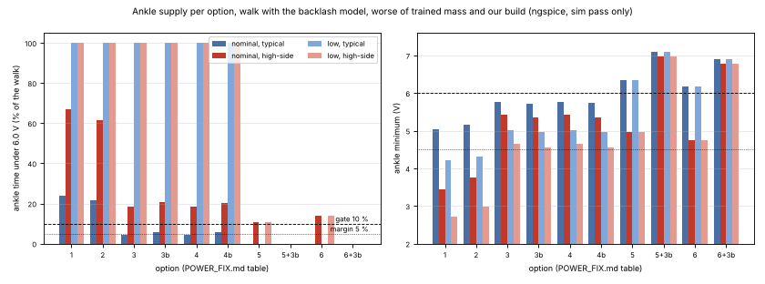
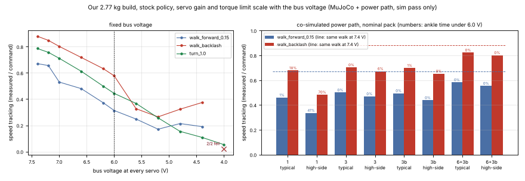

# POWER_FIX: getting the ankle servos through the TEST_PLAN section 9 gate (sim pass only)

Written 2026-11-02 by agent PW (power path). Script: sim/power_fix.py (imports sim/power_path_sim.py). Figures: sim/power_fix_options.png, sim/power_fix_ankle_trace.png, sim/power_fix_voltage_walk.png. All simulation results are sim pass only. Tags: [L] lab script (sim/power_fix.py and the step named), [I] page read with plain curl on 2026-11-02, [U] upstream.

Update 2026-11-02 about 2:10 AM ET (agent PWR): D23 built option 3b, and the netlist now has its cut lengths. sim/power_fix.py option `ab` is option 3b with every length and gauge read from wiring/netlist.yaml (SP4 390 mm and SP5 420 mm instead of the 545 mm rule estimate, P11 100 mm, the pack side as cut with P9 and P14, which this study left out, and the D15 data-lead grounds). sim/power_path_sim.py topology `as_built` runs it, and VERIFICATION.md E6, E6b and C7 check it. Its numbers are in sim/POWER_PATH_SIM.md "As built": nominal pack, our 2.65 kg build, ankle time under 6.0 V 6.2 % (typical) and 21.4 % (high-side); the knee is now the lowest leg servo and the head roll the lowest servo in the high-side corner; pack RMS 5.90 to 5.92 A (99 % of the Pololu 2815's 6.0 A point at 55 C). With the study's values option ab gives the 3b numbers to the third decimal; the step-by-step difference is in that section. The tables below stay as the study.

Update 2026-11-02 about 6:16 AM ET (agent SFX): the as-built case was run again on the netlist after agent CAB's later cut changes (SP4 400 mm and SP5 430 mm for the D25 twist take-up). Nominal pack, our 2.65 kg build: ankle time under 6.0 V 6.4 % (typical) and 21.4 % (high-side), right knee 9.8 % (typical), head roll 33.5 % (high-side), pack RMS 5.91 to 5.93 A (99 % of the Pololu 2815's 6.0 A point at 55 C) (sim/POWER_PATH_SIM.md 'As built'). TEST_PLAN 5 is now three bands per conductor (lead decision L3, DECISIONS.md D23 note): pass up to 28 mOhm, warn over 28 up to 40 mOhm (the walking log decides and the 3S plan of option 6 is made ready for Ahmed), fail over 40 mOhm. The 40 mOhm gate in item 1 of 'Items from the verification agent' and in the exact text for TEST_PLAN 5 below is the study's proposal from before L1 and L3.

## Recommendation

The cheapest change that passes the section 9 gate with margin in both resistance corners is **option 6+3b**: a 3S pack, so the Castle CC BEC Pro regulates 7.2 V at every charge state, plus a second 22 AWG power feed from the belly splices into the free BUS 1 port of each ankle servo (ID 24, ID 14). Both ankles then stay at 6.78 V or more and never go under 6.0 V, at nominal and low charge, in both corners, and still 6.65 V or more with 40 mOhm contacts, 0.15 A servo idle current or any BEC dropout [L run, extra]. No cheaper change passes: every 2S option fails the high-side corner (best 18.5 % of the walk under 6.0 V) because at nominal charge the BEC is in dropout and its own output is already under 6.0 V for 5.7 % of the walk; the buck-boost (5) has no part that fits; 22 AWG made leg leads (2) gain only 2 to 5 points because the two contacts per hop, not the wire, set the hop resistance [L check, run]. The 3S half is not drop-in and needs Ahmed's decision (proposed D22, the next free number): 3 x 18650 cannot fit the battery bay, whose free box is exactly the 2S holder (20 x 41 x 76.5 mm) [L bay], so it takes a 3S pouch pack of at most that size (sourcing left to SERVO_UPGRADE_OPTIONS.md), a 3S BMS (Tenergy 9 A, $23.99, 2.8 mm longer than the BMS slot) [I], a 3S USB-C charger, a pack voltage monitor (Adafruit INA260, $9.95) [I] and an over-voltage guard for the servos. **Build the 3b half now**: two 545 mm two-wire leads from BOM spares (nothing new to buy, +11.7 g along the legs) cut the nominal-pack ankle time under 6.0 V from 24 to 6 % (typical) and from 67 to 21 % (high-side), halve the peak current in the first-servo contacts and the cross current in the adapter ground, and the 3S bus needs them too [L run, dgnd]. Option 7 says the gate is too weak rather than too strict: co-simulated in MuJoCo, our 2.77 kg build with 3b passes the dip gate in both corners yet walks at 65 to 79 % of its 7.4 V speed, because the policy's speed follows the mean servo voltage (forward walk: 98 % at 7.2 V, 79 % at 7.0 V, 47 % at 6.0 V); 6+3b walks at 83 to 93 % [L cosim].

## The options

Ngspice, walk with the backlash model (10 to 16 s), worse of the trained-mass trace and our 2.77 kg build; nominal pack 7.4 V and low pack 6.6 V open circuit; "typ" and "high" are the two resistance corners of sim/power_path_sim.py. Time under 6.0 V is counted as time, not as samples, as in power_path_sim.py. Pass with margin = 5 % or less (half the gate) at nominal in both corners [L run].

| # | Change | Worst ankle minimum (V): nominal typ / high; low typ / high | Ankle time under 6.0 V (%): nominal typ / high; low typ / high | Cost (new purchases) | Added mass, where | Verdict |
|---|---|---|---|---|---|---|
| 1 | Baseline: D15 star as built (SP leads 22 AWG) | 5.03 / 3.44; 4.23 / 2.71 | 23.9 / 67.0; 100 / 100 | $0 | 0 | fails |
| 2 | 22 AWG made leads on all 8 leg hops (contingency X1/X2) | 5.15 / 3.76; 4.32 / 2.97 | 21.7 / 61.7; 100 / 100 | $13.06 | +14.7 g, along both legs | fails |
| 3 | Second feed to each knee, spliced into a made S5 lead | 5.76 / 5.42; 5.01 / 4.64 | 4.4 / 18.6; 100 / 100 | $0 (BOM spares) | +13.0 g, thigh and shin | typical corner only |
| 3b | Second feed into each ankle's free BUS 1 port | 5.72 / 5.35; 4.96 / 4.57 | 5.8 / 20.5; 100 / 100 | $0 (BOM spares) | +11.7 g, belly to ankle | typical corner only; build now |
| 4 | 2 + 3 | 5.76 / 5.43; 5.01 / 4.64 | 4.2 / 18.5; 100 / 100 | $13.06 | +23.3 g | typical corner only |
| 4b | 2 + 3b | 5.73 / 5.35; 4.97 / 4.57 | 5.5 / 20.4; 100 / 100 | $13.06 | +26.4 g | typical corner only |
| 5 | Buck-boost holding 7.4 V from 2S (ideal part) | 6.35 / 4.97; 6.35 / 4.97 | 0.0 / 10.8; 0.0 / 10.8 | no part fits | n/a | fails high-side; no part |
| 5+3b | 5 + 3b | 7.09 / 6.97; 7.09 / 6.97 | 0 / 0; 0 / 0 | no part fits | n/a | passes; not buildable |
| 6 | 3S pack, BEC Pro at 7.2 V | 6.17 / 4.74; 6.17 / 4.74 | 0.0 / 13.8; 0.0 / 13.8 | +$33.94 plus pack and charger (detail 6) | pack swap in the bay | fails high-side |
| 6+3b | 6 + 3b | 6.89 / 6.78; 6.89 / 6.78 | 0 / 0; 0 / 0 | as 6 | as 6, plus 11.7 g on the legs | **passes with margin: recommended (D22)** |

Every run reached the end of its window (5998 ms) [L run]. At the low pack the 2S options read 100 % because the BEC output itself is about 5.6 to 5.8 V; the battery guard stops walking at about 3.57 V per cell (bench/battery_guard.py), so a 2S robot does not walk there, while a 3S robot walks as at nominal [L run].



## Details

### Why the baseline fails, and where "30 to 34 %" came from
- From 7.4 V open circuit to the BEC input there is 95 mOhm (typical) or 125 mOhm (high-side) of cells, holder, BMS, wires, fuse and switch [L, power_path_sim.py parameters]. At the walking current (pack 5.4 to 5.7 A mean) the bus sits at 6.86 to 6.70 V, the BEC drops its assumed 0.3 V, and its output averages 6.55 V (typical) or 6.38 V (high-side) [L run, our build]. In the high-side corner the BEC output itself is under 6.0 V for 5.7 % of the walk [L check], so no wiring change can get an ankle below that.
- The ankle then sits behind the SP lead and 4 kit hops in series, each hop 27.6 mOhm (typical) or 65.1 mOhm (high-side) per conductor, mostly the two contacts and the servo board [L].
- The 30 to 34 % figure (software/SOFTWARE.md, bench/tests/data/sim_profiles_summary.json) is the same ngspice run sampled at 50 Hz in phase with the 50 Hz command updates, when each servo's current peaks. Weighted by time it is 21 % (that run) to 24 % (our build). Sampled at the other phases of the 20 ms control period the same run reads 10 to 14 % at best and 32 to 34 % at worst [L run]. A 50 Hz Present Voltage log can therefore land anywhere in that range depending on when in the control cycle it reads; see the TEST_PLAN text below.
- The as-built baseline (22 AWG SP leads, P11 60 mm) and the power_path_sim.py star model (20 AWG, P11 200 mm) give the same answer within 0.6 points: the thinner SP leads and the shorter P11 cancel [L run, 1 against 1m].

### Option 2: 22 AWG made leads on every leg hop
- Hop per conductor: kit cable 12.6 mOhm (24 AWG, typical) or 20.1 mOhm (26 AWG, high-side) against 8.2 to 11.1 mOhm for a 155 to 210 mm 22 AWG lead; the 2 contacts (10 or 40 mOhm) and the board (5 mOhm) stay, so a hop goes from 27.6 to 23 to 26 mOhm (typical) and 65.1 to 53 to 56 mOhm (high-side) [L]. Result: 2.2 points (typical) and 5.3 points (high-side) [L run].
- Parts: X1 (20 Molex 50-37-5033, Newark 57H1785, $2.86, https://www.newark.com/search?st=50-37-5033) and X2 (60 Molex 08-70-1040, Newark 54H5573, $10.20, https://www.newark.com/search?st=08-70-1040) [L BOM.md contingency]; 4.4 m of 22 AWG from BOM line 24 (25 ft per colour).
- Netlist: S2 to S5 and S7 to S10 become made leads, 22 AWG x 3, cut 155, 180, 195, 210 mm (CABLE_MAP rule lengths 152.3 to 208.7 mm), 50-37-5033 + 08-70-1040 at both ends.
- Risks: 48 more crimps and 16 housings to make and inspect (TEST_PLAN section 1); stiffer 22 AWG silicone leads across every leg joint. Use them only if the kit cables fail the length test fit (B17), not for voltage.

### Options 3 and 3b: a second feed per leg
- 3 (knee): the knee servo has no free port, so S5 (S10) becomes a made 22 AWG lead (210 mm) and the feed pair is spliced into its V and G 20 mm from the knee housing, as JG20 is today. Feed length 420 mm per conductor: CABLE_MAP rule on belly splice to ID 20 (64.8 mm, what the 150 mm SP1 cut implies) + S2, S3, S4 polylines (56.6, 82.3, 92.1 mm) + 85.2 mm ends + 10 mm per radian over hip yaw, roll and pitch (3.67 rad) = 417.7 mm [L, audit/cables.json].
- 3 in netlist terms: S5 and S10 change from kit cable to made leads (22 AWG x 3, cut 210 mm, 50-37-5033 + 08-70-1040 at both ends); new splices JK23V, JK23G (and JK13V, JK13G) on the S5 (S10) V and G wires 20 mm from the knee-end housing; new cables SP4K, SP5K (22 AWG pair, cut 420 mm, SPV/SPG to those splices, joints hip yaw, roll and pitch). Parts from spares: 4 housings, 12 terminals (Need 9 of Buy 10 and 25 of Buy 30, so X1/X2 is the backup for failed crimps).
- 3b (ankle port): the feed pair ends in a Mini-SPOX housing with V and G only (data cavity empty) in the free BUS 1 port of ID 24 and ID 14. Length 545 mm per conductor (rule 541.2 mm: the knee feed plus S5's 92.1 mm and 31.4 mm for the knee's 3.14 rad) [L].
- Results: 3 is 0.7 to 2.3 points better than 3b in every case (it feeds the knee, the largest load, directly) [L run]. Both pass the typical corner; neither passes the high-side corner (18.6 and 20.5 %), for the source reason above. With the 3S bus both reach 0 %.
- Currents, 3b, our build, nominal, worse corner [L traces]: each feed 0.98 to 1.04 A mean, 1.46 to 1.53 A worst 100 ms, 2.95 to 3.23 A peak (2 ms); the first-servo contacts (SP1, SP2) drop from 2.44 to 2.54 A worst 100 ms to 1.05 to 1.25 A, which also answers the 3 A contact note in VERIFICATION.md C7. Fall after a push: feed 2.77 to 2.80 A peak [L run].
- Why 3b first: no change to any chain cable, 4 crimps per leg, and it unplugs, so the floor log can be taken with and without it. Choose 3 instead if S5 and S10 must become made leads anyway after the B17 length test fit (kit 150 mm against the 208.7 mm rule).
- Risks: each leg chain becomes a loop, so a broken kit hop no longer drops the supply to the servos below it (the data loss still shows it); the 545 mm pair crosses 4 joints including the knee and is tied along S2 to S5; the BEC output current peaks rise slightly (up to 9.1 A, within its 20 A peak rating) [L run; POWER.md].

### Options 4 and 4b
Made leads on top of a feed buy 0.1 to 0.3 points (the feed already carries the knee and ankle current around the hops) [L run]. Not recommended.

### Option 5: buck-boost regulator, 7.4 V from the whole 2S range
- No fitting part found (about 10 A peak, 6.0 to 8.4 V in, 47 x 33 x 26 mm seat, US supplier, full data):
  - Pololu buck-boost family: 3 A at most (S13V30F5) [I https://www.pololu.com/category/133/step-up-step-down-voltage-regulators].
  - TI TPS55289 / TPS55288: integrated 4-switch buck-boost, programmable output current limit up to 6.35 A, output set over I2C; evaluation boards only [I https://www.ti.com/product/TPS55289, https://www.ti.com/product/TPS55288, https://www.ti.com/tool/TPS55289EVM]. 6.35 A is under the 9.0 to 9.3 A bus peaks of 5+3b [L run].
  - TI LM51772: buck-boost controller with external MOSFETs, so a custom board [I https://www.ti.com/product/LM51772].
  - Generic LTC3780-class modules on Amazon: no maker datasheet, and Amazon refuses plain curl, so not checked.
- Even an ideal part fails the high-side corner on its own (10.8 %) [L run], and holding 7.4 V from a sagging 2S pack raises the pack current at low charge to 7.1 to 7.9 A RMS with 16 to 21 A peaks, against the Tenergy board's 10 A working rating and 17 to 27 A trip band [L run; BOM line 8].

### Option 6: 3S pack with the BEC regulating over the whole range
- Battery bay: ray casts from the 2S holder (holder.stl) against every other part give 0 to 0.6 mm of free space on every side, so the bay is a 20.0 x 41.0 x 76.5 mm box [L bay]. 3 x 18650 needs about 60 mm side by side, 36 mm deep as a triangle, or 200 mm end to end: none fits [L bay]. Only a 3S pouch (LiPo) pack of at most 76 x 41 x 20 mm including leads fits, held by the battery_pack_lid; the spring holder goes. Pack sourcing (capacity, mass, US seller) is left to SERVO_UPGRADE_OPTIONS.md, not written yet.
- BMS: Tenergy 3S board "Working 9A, Cutoff 17A": over-current detection 17 +/- 4 A, main loop 30 mOhm or less, 50 x 16 x 3.5 mm, $23.99, in stock [I https://power.tenergy.com/protection-circuit-module-pcb-for-11-1v-3s-li-ion-battery-pack-working-9a-cutoff-17a/]. It is 2.8 mm longer than the measured BMS slot (17.75 x 47.2 x 5.33 mm, MOUNTING.md), so it needs a new seat. 3S pack current: 4.0 to 4.8 A RMS, 8.1 to 10.0 A peak walking, 7.4 to 7.6 A in the fall case [L run]: the RMS sits inside its 9 A working rating and the peaks under its 13 A lowest trip.
- Charger: a 3S (12.6 V) USB-C board for the 38.2 x 18.1 x 5.2 mm seat with 14.4 mm hole pitch; not sourced (Amazon refuses plain curl).
- Fuse: the 15 A, 32 V ATO stays (12.6 V is under 32 V and the pack current falls by about a third). Pololu 2815: 4.5 to 32 V [L POWER.md]. Pololu D30V30F5: 5 to 45 V input [I https://www.pololu.com/product/4892]. CC BEC Pro: rated 2S to 4S [L POWER.md].
- Battery guard: with a regulated bus the servo Present Voltage stays near 7.2 V until the pack is nearly empty, so bench/battery_guard.py can no longer read the charge from the servos. Add a pack monitor: Adafruit INA260, 36 V, 15 A continuous, 2 mOhm shunt, I2C, 22.9 x 22.8 x 2.7 mm, $9.95, in stock [I https://www.adafruit.com/product/4226], on the Pi I2C bus next to the BNO055.
- Over-voltage: if the BEC failed in pass-through, 3S would put up to 12.6 V on 7.4 V servos (2S puts at most 8.4 V, the upstream build's normal state). An over-voltage cut in front of SPV is needed; not specified here.
- Cost: +$33.94 (3S BMS, INA260) plus the pouch pack, the charger and the over-voltage cut; it drops BOM lines 6, 7, 8 and 11 ($58.95 of 2S parts, none bought yet) [L BOM.md]. Mass: the holder and two cells are 119 g at the back of the trunk [L MASS_BUDGET.md]; a lighter pouch pack moves the centre of mass forward, the safe direction (ADDED_MASS_SIM.md table 7).
- Netlist terms: PACK becomes 3 cells with two mid taps (CELL_MID1, CELL_MID2) to the 3S BMS sense pads; domain PACK_6V0_8V4 becomes 9.0 to 12.6 V (it feeds the BEC, U3 and the 2815 only); new component for the INA260 inline on PACK_P (seat not checked) on the BNO055's I2C wires (D2, Pi pins 1, 3, 5, 9), about 150 mm further down the trunk; the over-voltage cut between JB+ and SPV; SP4 and SP5 as 3b.
- Alone, 6 fails the high-side corner (13.8 %): from a stiff 7.2 V the hops still drop the ankle to 4.74 V [L run]. With 3b it passes everywhere (detail table above).

### Option 7: is the 6.0 V, 10 % gate the right gate?
- Training: the policy saw the servo position gain randomized by x U(0.9, 1.1) but never a lower torque limit [U Open_Duck_Playground b9be205 playground/common/randomize.py lines 88 to 95]; the MJCF limit is 3.23 Nm, the 7.4 V value (kp 13.37, or 17.11 in the backlash model) [U MJCF, L compiled model].
- Model: MuJoCo walk of our 2.77 kg build (sim/added_mass_sim.py model), stock policy and control loop, with both the position gain and the torque limit scaled by V/7.4 every 2 ms (servo PWM duty times bus voltage, the BAM model). (a) every servo at a fixed bus voltage; (b) co-simulated: each servo's voltage from a Python DC solve of the netlist of this study every 2 ms, which matches ngspice within 1.7 mV on the same trace [L check, cosim]. 2 runs per case (start jitter seeds), 20 s, statistics after 4 s.

Fixed bus voltage at every servo (speed tracking = measured / commanded; in brackets, share of the 7.4 V value) [L cosim]:

| Bus voltage | Walk forward 0.15 m/s | Walk, backlash model | Turn 1.0 rad/s | Torso pitch, forward walk |
|---|---|---|---|---|
| 7.4 V | 0.67 (100 %) | 0.88 (100 %) | 0.79 (100 %) | +2.9 deg |
| 7.2 V | 0.66 (98 %) | 0.85 (96 %) | 0.76 (96 %) | +3.3 deg |
| 7.0 V | 0.53 (79 %) | 0.80 (91 %) | 0.71 (90 %) | +3.1 deg |
| 6.6 V | 0.48 (72 %) | 0.72 (82 %) | 0.61 (78 %) | +4.1 deg |
| 6.2 V | 0.37 (56 %) | 0.63 (72 %) | 0.50 (63 %) | +5.3 deg |
| 6.0 V | 0.31 (47 %) | 0.58 (66 %) | 0.44 (56 %) | +5.3 deg |
| 5.6 V | 0.25 (37 %) | 0.33 (37 %) | 0.37 (47 %) | +7.4 deg |
| 5.2 V | 0.17 (25 %) | 0.26 (30 %) | 0.26 (33 %) | +9.6 deg |
| 4.8 V | 0.21 (32 %) | 0.32 (37 %) | 0.15 (20 %) | +12.0 deg |
| 4.4 V | 0.19 (28 %) | 0.37 (43 %) | 0.11 (14 %) | +11.7 deg |
| 4.0 V | fell 2 of 2 | fell 2 of 2 | 0.05 (7 %) | |

Co-simulated power path, nominal pack (in brackets, share of the 7.4 V speed; then ankle time under 6.0 V and mean servo voltage) [L cosim]:

| Option, corner | Walk forward 0.15 m/s | Walk, backlash model |
|---|---|---|
| 1 baseline, typical | 0.46 (69 %); 1.1 %; 6.56 V | 0.68 (77 %); 18.2 %; 6.41 V |
| 1 baseline, high-side | 0.34 (50 %); 40.7 %; 6.29 V | 0.48 (55 %); 70.5 %; 6.05 V |
| 3, typical / high-side | 0.50 (75 %) / 0.47 (70 %); 0.0 / 0.3 % | 0.70 (80 %) / 0.67 (76 %); 0.4 / 6.3 % |
| 3b, typical / high-side | 0.49 (74 %) / 0.44 (65 %); 0.0 / 0.4 % | 0.70 (79 %) / 0.65 (74 %); 0.7 / 8.9 % |
| 6+3b, typical / high-side | 0.58 (87 %) / 0.55 (83 %); 0 %; 7.13 / 7.08 V | 0.82 (93 %) / 0.80 (91 %); 0 %; 7.11 / 7.04 V |

At the low pack the baseline walks at 24 to 38 % of its 7.4 V speed and the backlash walk falls in the high-side corner (2 of 2); 6+3b is unchanged [L cosim].

What this means:
1. The policy keeps walking (slowly) down to about 4.4 V and falls at 4.0 V, so the 4.5 V "never" gate is the right brown-out guard [L cosim].
2. Its speed follows the mean voltage, not the dips: 98 % at 7.2 V but 79 % at 7.0 V and 47 % at 6.0 V. The ankle dip gate (6.0 V, 10 %) is passed by 3 and 3b in the co-simulation even in the high-side corner, while the robot walks at 65 to 80 % of its trained speed [L cosim]. So the gate is too weak, not too strict, and a mean-voltage gate is what protects the trained walk (proposed text below). Only a regulated bus meets it at nominal charge.
3. The co-simulated servo draws less current when the bus sags (it gets weaker), so it reads fewer dips than the ngspice replay, which holds the commanded power (3b high-side: 8.9 % against 20.5 %). The replay stays the conservative number for wiring.
4. Measure the gate in time, not in 50 Hz samples (detail above).
5. The 7.2 V setpoint costs 2 to 4 % of speed against 7.4 V (fixed-bus table). If TEST_PLAN 4.1 shows the setpoint holds within +/- 0.05 V, 7.3 V is worth a try; D3 caps it at 7.4 V.



### Items from the verification agent (VERIFICATION.md)
1. **E6b, hop gate (TEST_PLAN section 5).** Without a second feed no hop passes: even 17.6 mOhm per conductor (contacts at zero) leaves 15.4 % [L sweep]. With 3b (typical pack side) the ankle reads 5.8 % at 27.6 mOhm, 7.2 % at 37.6 mOhm, 9.5 % at 57.6 mOhm and fails from about 70 mOhm; with 3 it holds to 137.6 mOhm (9.7 %); with 6+3b every hop up to 145 mOhm gives 0 % and ankles at 6.52 V or more [L sweep, sweep2]. Gate that matches the recommendation: keep 40 mOhm per conductor while the robot is on 2S with 3b; 100 mOhm once the 3S bus is in. The pack side matters more than the hop once a feed exists: with 3b, a high-side pack side alone gives 17.7 % [L extra], so TEST_PLAN 3.2 and 4.1 get tighter limits (text below).
2. **22 AWG SP leads.** Used in every run except 1m. With the netlist's 60 mm P11 as well, the worst ankle moves by 0.01 V or less against the 20 AWG model (the 0.04 V of VERIFICATION.md kept the model's 200 mm P11) [L run]. Star rows for POWER_PATH_SIM.md: below, exact text.
3. **Pololu 2815 at 97 % of 6 A.** Pack RMS current, our build: baseline 5.81 to 5.99 A, 3b 5.94 to 6.05 A (99 to 101 % of the 6 A at 55 C rating), buck-boost up to 7.9 A, 3S 4.13 to 4.82 A (69 to 80 %) [L run]. The HP is already the top of Pololu's family (LV 3.0 A, SV 2.0 A, MP 4.0 A, HP 6.0 A at 55 C; 16 A at 150 C) [I https://www.pololu.com/product/2815], and the Big Pushbutton Power Switch HP is the same 16 A class [I https://www.pololu.com/category/121/pololu-power-switches]. The 2815 sits on foam tape on the PLA battery_pack_lid. Recommendation: on 2S, add the 10-minute 6 A thermal check to TEST_PLAN 4.2 (text below); if the board goes over 50 C, fit a second 2815 (Pololu #2815, $8.49, https://www.pololu.com/product/2815) in parallel directly below the first: the CAD has 40.8 mm free below the seat over every hip yaw, hip roll and neck pitch limit [L seat], and the two boards share by on-resistance (inference; Pololu does not describe paralleling). With the 3S bus one 2815 has margin.
4. **Return current through the adapter (D15 data-lead grounds).** Modelled with the SP grounds split at JG20, JG10, JG30, the SD1 and SD2 ground conductors, the H3 and H5 contacts, the adapter copper and the USB cable ground to the Pi and P13 (USB ground 0.25 ohm ASSUMPTION) [L dgnd]. RMS / worst 100 ms / peak through the adapter headers: baseline 0.18 to 0.22 A / 0.28 A / 0.76 A (11 % of a leg's 1.9 A RMS return, as VERIFICATION found); with 3b 0.08 A / 0.12 A / 0.35 A; through the USB cable ground 0.06 A / 0.08 A / 0.15 A, about 15 to 40 mV across it [L dgnd]. Against the adapter's "MAX:6A" header (D15) and the 3 A contacts this does not matter, and the ankle results move by 0.1 point at most. If D15's "data only" must hold exactly, 10 ohm in each data-lead ground at JG20, JG30 and JG10 cuts the adapter current to 3 mA RMS [L dgnd]; not recommended without a bench check of the data edges, because the data line's return current would also see the resistor.

### Changes for the lead (exact text)

**wiring/netlist.yaml** (3b; checked: audit/erc.py on a patched copy gives 0 ERROR, 0 WARN, 5 INFO, as today, cables 51, wires 122 [L]):
- SPV and SPG `part:` text: `(P11 in, SP1 to SP5 out)`.
- SV24 and SV14: BUS1.V `dir: pwr`, BUS1.G `dir: gnd`, source `"[L] second feed SP4 (sim/POWER_FIX.md option 3b)"` (SP5 for SV14); BUS1.D stays `nc`; component source `BUS 1 takes the second power feed SP4, data position empty (sim/POWER_FIX.md option 3b)`.
- cables, after SP3:
```
  - {id: SP4, status: active, desc: second power feed of the left leg, SPV and SPG to ID 24 BUS 1 (V and G only; data position empty), regions: [belly, trunk_bottom, left_leg], joints: [left_hip_yaw, left_hip_roll, left_hip_pitch, left_knee], polyline_mm: 387.9, rule_mm: 541.2, source: "[L] sim/POWER_FIX.md option 3b", note: "polyline = belly splice to ID 20 64.8 (what the SP1 cut implies) + S2 to S5 polylines; tie along the kit cables S2 to S5; crosses the knee next to S5"}
  - {id: SP5, status: active, desc: second power feed of the right leg, SPV and SPG to ID 14 BUS 1 (V and G only; data position empty), regions: [belly, trunk_bottom, right_leg], joints: [right_hip_yaw, right_hip_roll, right_hip_pitch, right_knee], polyline_mm: 387.4, rule_mm: 540.7, source: "[L] sim/POWER_FIX.md option 3b", note: "as SP4, mirrored"}
```
- wires, after SP3:
```
  - {cable: SP4, from: SPV.S, to: SV24.BUS1.V, net: SERVO_7V2, gauge: 22 AWG, color: red, cut_mm: 545, i_mean_a: 0.98, i_peak_a: 1.46, i_fall_a: 2.8, ends: [splice, Molex 50-37-5033 housing (data position empty) + 08-70-1040 crimp], source: "[L] sim/POWER_FIX.md option 3b", note: "currents: ngspice, our build, nominal pack (sim pass only)"}
  - {cable: SP4, from: SPG.S, to: SV24.BUS1.G, net: GND, gauge: 22 AWG, color: black, cut_mm: 545, i_mean_a: 0.98, i_peak_a: 1.46, i_fall_a: 2.8, ends: [splice, Molex 50-37-5033 housing (data position empty) + 08-70-1040 crimp], source: "[L] sim/POWER_FIX.md option 3b"}
  - {cable: SP5, from: SPV.S, to: SV14.BUS1.V, net: SERVO_7V2, gauge: 22 AWG, color: red, cut_mm: 545, i_mean_a: 1.04, i_peak_a: 1.53, i_fall_a: 2.9, ends: [splice, Molex 50-37-5033 housing (data position empty) + 08-70-1040 crimp], source: "[L] sim/POWER_FIX.md option 3b", note: "currents: ngspice, our build, nominal pack (sim pass only)"}
  - {cable: SP5, from: SPG.S, to: SV14.BUS1.G, net: GND, gauge: 22 AWG, color: black, cut_mm: 545, i_mean_a: 1.04, i_peak_a: 1.53, i_fall_a: 2.9, ends: [splice, Molex 50-37-5033 housing (data position empty) + 08-70-1040 crimp], source: "[L] sim/POWER_FIX.md option 3b"}
```

**BOM.md**: line 21 Need 5 -> 7 (Buy 10 unchanged), line 22 Need 13 -> 17 (Buy 30 unchanged), line 24 note: + 1.09 m red and 1.09 m black for SP4, SP5 (25 ft per colour bought). No new line and no price change for 3b. For D22 (6+3b), if decided: replace lines 6, 7, 8, 11 by the 3S pouch pack, the Tenergy 3S 9 A board ($23.99, link above) and a 3S USB-C charger; add the Adafruit INA260 ($9.95, https://www.adafruit.com/product/4226) and an over-voltage cut.

**CABLE_MAP.md**: add rows SP4 and SP5 (as the cables above: 22 AWG x 2, cut 545 mm, rule 541.2 / 540.7 mm, polyline 387.9 / 387.4 mm, 4 joints, 6.81 rad); connector parts: housings 7 (data cavity empty at ID 24 and ID 14 BUS 1), terminals 17; wire totals: 22 AWG 1.85 -> 4.03 m.

**WIRING.md** section 2 table, new row: `| Second feeds (3b) | SP4 from SPV/SPG to ID 24 BUS 1 V and G; SP5 to ID 14 BUS 1 | none (data cavity empty) | n/a | [L] sim/POWER_FIX.md |`; and change "The last servo of each chain (24, 33, 14) has BUS 1 free" to "(33) has BUS 1 free; 24 and 14 take SP4 and SP5 on BUS 1".

**TEST_PLAN.md**:
- 3.2, pass line: `Pass: under 0.10 V total (10 mOhm) and no contact gets warm in 30 s. The section 9 gate needs the typical pack side (sim/POWER_FIX.md: with a 30 mOhm holder the ankle is under 6.0 V 17.7 % of the walk at nominal even with the second feed). Also read the voltage at the Pololu 2815 output at 10 A: pack open circuit minus that reading under 0.95 V (95 mOhm cells to switch).`
- 4.1, add: `Dropout pass: output at least input minus 0.30 V at 7.0 V in and 6 A out (sim/POWER_FIX.md: 0.6 V of dropout takes the ankle from 5.8 to 20.9 % under 6.0 V with the second feed).`
- 4.2, add: `Then 10 minutes at 6.0 A (TE4), switch on its seat with the foam tape: board under 50 C. Over 50 C: add a second 2815 in parallel below the first (sim/POWER_FIX.md).`
- 5, gate: `Gate: 40 mOhm per conductor with the second feeds SP4/SP5 on a 2S pack (sim: the ankle gate holds to about 60 mOhm); 100 mOhm with a 3S bus (D22). Without the second feeds no hop value passes section 9 (15.4 % at 17.6 mOhm).`
- 9, pass line: `Pass: no servo under 4.5 V at any time; no ankle under 6.0 V for more than 10 % of the walking time at nominal, counted in time: read Present Voltage on a timer that is not a multiple of the 20 ms control period (for example every 27 ms), because a 50 Hz read locked to the control loop reads anywhere from 10 to 34 % for 21 to 24 % of the time (sim/POWER_FIX.md); no checksum errors. Record, and make it a pass line once D22 is decided: median servo voltage (5 s mean) while walking at nominal, at least 7.0 V (a 2S build cannot meet it: the sim reads 6.3 to 6.6 V with 3b). Log the forward speed (distance in 20 s) at full and at nominal charge: a drop of more than 15 % means the servo voltage limits the walk (sim: 2S with the BEC in dropout walks at 65 to 79 % of the 7.4 V speed, a regulated 7.2 V bus at 83 to 93 %).` Compare line: `sim/POWER_FIX.md (second feeds 3b, typical corner: worst ankle 5.7 V, under 6 V 6 % of the time at nominal; high-side 5.3 V, 21 %).` Replace the bullet that quotes 30 % and 34 %: `Log with bench/power_log.py --walk. The 30 % and 34 % of the star replay (software/SOFTWARE.md section 8) are 50 Hz samples taken in phase with the control updates; weighted by time the same replay gives 21 % (24 % at our 2.77 kg mass). A 25 Hz log (--decimate 2) is also locked to the 20 ms period, so read the voltages on their own timer (sim/POWER_FIX.md).`

**sim/POWER_PATH_SIM.md**, results table, new rows (6 s walk window, trained-mass trace as the existing rows) [L rows]:
```
| Star (D15 as built, 22 AWG power leads), full (8.4 V), typical | 7.92 V | 7.20 V | 5.1 / 11.1 / 5.4 A | left ankle 5.99 V, 6.89 V | 0.00 s | 0.00 s |
| Star (D15 as built, 22 AWG power leads), full (8.4 V), high-side | 7.75 V | 7.17 V | 5.2 / 10.6 / 5.5 A | right ankle 4.40 V, 6.48 V | 0.84 s | 0.00 s |
| Star (D15 as built, 22 AWG power leads), nominal (7.4 V), typical | 6.88 V | 6.57 V | 5.4 / 10.8 / 5.7 A | right ankle 5.03 V, 6.25 V | 1.21 s | 0.00 s |
| Star (D15 as built, 22 AWG power leads), nominal (7.4 V), high-side | 6.72 V | 6.41 V | 5.4 / 10.2 / 5.7 A | right ankle 3.44 V, 5.72 V | 3.69 s | 0.32 s |
| Star (D15 as built, 22 AWG power leads), low (6.6 V), typical | 6.07 V | 5.75 V | 5.6 / 10.5 / 5.8 A | right ankle 4.23 V, 5.44 V | 6.00 s | 0.10 s |
| Star (D15 as built, 22 AWG power leads), low (6.6 V), high-side | 5.90 V | 5.58 V | 5.6 / 10.0 / 5.8 A | right ankle 2.71 V, 4.91 V | 6.00 s | 1.19 s |
| Star (D15 as built, 22 AWG power leads), fall after a push, low (6.6 V), high-side (3 s) | 6.07 V | 5.76 V | 4.2 / 11.1 / 4.5 A | left ankle 3.07 V, 5.28 V | 3.00 s | 0.29 s |
```
and under "What this means", item 4: `Superseded by sim/POWER_FIX.md: the 22 AWG leg leads do not fix it (19 to 22 %); a second feed into each ankle's free BUS 1 port does in the typical corner (6 %), and only a regulated bus plus that feed passes both corners (D22).`

**DECISIONS.md**, proposed: `D22 Servo bus supply (proposed by agent PW, sim/POWER_FIX.md). (a) Now: second 22 AWG power feeds SP4 and SP5 from the belly splices into BUS 1 of ID 24 and ID 14 (no new parts). (b) For Ahmed: 3S pouch pack (at most 76 x 41 x 20 mm), 3S BMS and charger, pack monitor and over-voltage cut, so the BEC regulates 7.2 V at every charge state; the only change that passes TEST_PLAN section 9 with margin in both resistance corners, and in sim it walks at 83 to 93 % of the trained speed instead of 65 to 79 %. Until decided: 2S with the tightened bench gates (TEST_PLAN 3.2, 4.1, 4.2, 5).`

Also for the owners: MASS_BUDGET.md +11.7 g of wire on the legs (3b); HARNESS_BUILD.md: make SP4 and SP5 with the SP leads; software/SOFTWARE.md and bench/sim_profiles.py: the 30 to 34 % is a 50 Hz phase-0 sample, time weighted it is 21 % (detail above).

### Method and checks
- Builder: this script's netlist with the power_path_sim.py star values reproduces power_path_sim.py exactly (nominal, typical: right ankle 5.036 V, 21.3 %; high-side 3.44 V, 62.6 %) [L check]. Then the D15 servo side as wired: P11 16 AWG 60 mm, SP1 to SP3 22 AWG 150/150/180 mm with one contact, kit hops as power_path_sim.py (cable + 2 contacts + board).
- Traces: sim/current_budget.py (trained mass, identical to the traces the earlier runs used) and sim/added_mass_sim.py's run on the "ours" model (2.767 kg, bus mean 3.43 A in the backlash walk, as ADDED_MASS_SIM.md) [L].
- Sources: 2 or 3 cells with the corner resistances; 3S BMS 30 mOhm [I Tenergy]; the spring holder kept in the 3S runs (conservative for a pouch pack). Buck-boost: output fixed, efficiency 0.90 ASSUMPTION.
- Python solver for the co-simulation: the same network solved as DC points (ngspice sees no reactive part, so each of its time points is one); worst difference over all 14 servos 1.7 mV (baseline, high-side), 0.8 mV (3b), 0.7 mV (6+3b, low pack) [L check].
- Sensitivities on our build at nominal [L extra]: BEC dropout 0.1 / 0.6 V (3b: 0.8 / 20.9 % typical, 12.1 / 50.8 % high-side), servo idle 0.15 A (3b: 14.8 / 45.8 %), contacts 40 mOhm (3b: 24.1 %), welded pack with a 3 mOhm holder (3b: 2.2 / 10.6 %), 24 s windows (3b, backlash walk: 5.9 / 20.1 %; plain forward walk: 0.0 / 5.8 %). 6+3b stays at 0 % with ankles at 6.65 V or more in all of them.
- Commands: see the docstring of sim/power_fix.py; JSON in ODM_OUT (power_fix_run.json and one file per step). About 260 ngspice runs at about 5 s each, one at a time, nice 10.

### Limits
- Sim pass only. The corner resistances are partly assumptions (power_path_sim.py table); the BEC dropout, the servo idle current and the pack side move the 2S results by 10 to 30 points, so the bench values (TEST_PLAN 3.2, 4.1, 5, 8.1) decide which corner the robot is in.
- Two servo load models bracket the truth: the ngspice replay holds the commanded power (conservative for voltage), the co-simulation scales the PWM with the bus (fewer dips, slower walk). Whether the Feetech firmware compensates for bus voltage is not published.
- No bus capacitance; the data-lead grounds and the USB ground path are only in the dgnd runs; the co-simulation uses the symmetric network.
- The 3S pouch pack, the 3S charger and the over-voltage cut are not sourced; the second 2815 seat is a ray-cast check, not a fit test.
- Servo loads come from the sim servo model, which issue #48 shows can differ from real servos (UPSTREAM_ISSUES.md G1).
