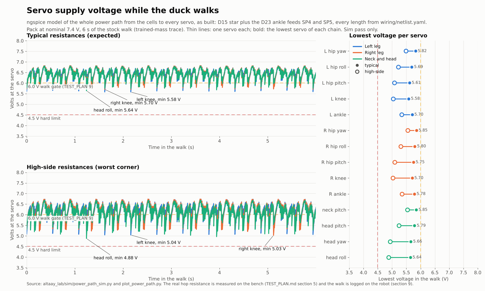

# Power path circuit simulation (ngspice, sim pass only)

Run 2026-11-01 (America/New_York) in this session's container with ngspice 42. Star rows and D23 rows added 2026-11-02 from sim/POWER_FIX.md (agent PW). As-built section added 2026-11-02 about 2:05 AM ET by agent PWR (power path); the checks E6, E6b and C7 now run that case. Script: sim/power_path_sim.py. Inputs: per-servo traces from sim/current_budget.py (backlash model walk and the push run, accelerometer bias removed, see SIM_WALK.md note) and, for our build, from sim/added_mass_sim.py at the sim/MASS_BUDGET.md mass (the verify/c8_policy_mass.py run). Outputs (JSON) stayed in the session scratch folder, not in git and not yet on F:.

Why: the lab rule is that electricity is checked before parts are bought or printed. A block diagram cannot show how far the voltage falls at the last servo of a daisy chain during a knee current peak. This model can.

## As built: D15 star plus the D23 ankle feeds SP4 and SP5

This is the robot as it will be wired now, and the case VERIFICATION.md E6, E6b and C7 check. Sim pass only.

How it is modelled:
- sim/power_path_sim.py topology `as_built` (its default) reads every length and gauge of the power path from wiring/netlist.yaml when it runs, and runs sim/power_fix.py option `ab`: the option 3b network of POWER_FIX.md (D23) with those values. One model of the D23 wiring, not two: given the study's lengths, option ab gives the 3b numbers to the third decimal.
- Netlist read for the numbers below: sha256 44c0e8ea30, saved 2026-11-02 2:05 AM ET (agent CAB cut the P7 line piece to 30 mm, the SP ground tails to 30 mm and the SD1 ground stem to 45 mm at 1:59 AM ET during this run; the 2:05 AM change, SD1 branch b data 170 mm, carries no servo current). Values used: P1 and P2 16 AWG 120 mm; P6 150 mm; P7 250 mm (30 + 90 + 90 + 40, the fuse holder leads included); P8 150 mm; P14 140 mm and P9 90 mm (the earlier models left both out); P10 150 mm; P13 20 AWG 550 mm; P11 16 AWG 100 mm plus the two BEC leads (as shipped; gauge and length not published, so 2 x 22 AWG x 100 mm in parallel, ASSUMPTION as before); SP1 and SP2 22 AWG 150 mm, SP3 180 mm (grounds 130, 130 and 160 mm to JG20, JG10 and JG30, then a 30 mm tail to the housing); SP4 22 AWG 390 mm to BUS 1 of ID 24 and SP5 420 mm to BUS 1 of ID 14 (V and G); kit hops 150 mm each.
- Each leg chain is a loop: SP1 (SP2) feeds BUS 2 of the hip yaw servo, SP4 (SP5) feeds BUS 1 of the ankle. The neck chain has only SP3.
- Ground side as wired: the SP grounds through JG20, JG10 and JG30; the D15 data-lead grounds SD1 (stem 45 mm, branches 120 and 140 mm) and SD2 (140 mm), the adapter copper, and the USB cable ground to the Pi (0.25 ohm, ASSUMPTION from POWER_FIX.md) with P12 to the regulator ground. Solder splices count as 0 ohm.
- Everything else as in "What is modelled" further down: cells, holder, BMS, fuse, switch, BEC (7.2 V, 0.3 V dropout, 0.85 efficiency), contacts, kit cable gauge, servo boards, the servo load model and the two resistance corners.
- Run: `ODM_TRACES=<traces> ODM_OUT=<folder> ODM_SAVE_V=1 python3 sim/power_path_sim.py` (7 cases: full, nominal and low pack in both corners, and the fall after a push); it prints the table rows below. verify/e6_power_path.py runs it on the trained-mass traces (E5) and, with `ODM_FALL=0`, on our build's traces (C8; our build does not fall in the push run).

### Results (6 s of walking, backlash model, 10 to 16 s)

Time under a voltage is counted in time (ngspice time steps weighted by their length). In brackets: what a 50 Hz Present Voltage log locked to the 20 ms control period would read, from the best to the worst sampling phase (POWER_FIX.md; TEST_PLAN 9 asks for time).

| Pack, corner | Trace | Bus mean | BEC out mean | Pack current mean / max / RMS | Lowest servo: min (mean) | Ankle time under 6.0 V | Knees (L / R), head roll: time under 6.0 V | Any servo under 4.5 V |
|---|---|---|---|---|---|---|---|---|
| full (8.4 V), high-side | trained mass (E5) | 7.72 V | 7.17 V | 5.2 / 11.2 / 5.53 A | left knee 5.91 V (6.95 V) | 0.0 % (50 Hz: 0.0 to 0.0 %) | 0.2 / 0.0 %, 0.0 % | 0 ms |
| full (8.4 V), typical | trained mass (E5) | 7.89 V | 7.20 V | 5.1 / 11.3 / 5.43 A | left knee 6.52 V (7.07 V) | 0.0 % (50 Hz: 0.0 to 0.0 %) | 0.0 / 0.0 %, 0.0 % | 0 ms |
| nominal (7.4 V), high-side | trained mass (E5) | 6.69 V | 6.37 V | 5.5 / 10.7 / 5.76 A | head roll 4.88 V (6.11 V) | 19.3 % (50 Hz: 10.4 to 33.7 %) | 27.7 / 27.8 %, 32.6 % | 0 ms |
| nominal (7.4 V), typical | trained mass (E5) | 6.86 V | 6.54 V | 5.5 / 11.1 / 5.74 A | left knee 5.58 V (6.42 V) | 4.7 % (50 Hz: 0.0 to 14.7 %) | 5.6 / 7.8 %, 5.1 % | 0 ms |
| low (6.6 V), high-side | trained mass (E5) | 5.87 V | 5.55 V | 5.7 / 10.5 / 5.91 A | head roll 4.19 V (5.26 V) | 100.0 % (50 Hz: 100.0 to 100.0 %) | 100.0 / 100.0 %, 100.0 % | 125 ms |
| low (6.6 V), typical | trained mass (E5) | 6.04 V | 5.72 V | 5.6 / 10.7 / 5.89 A | right knee 4.82 V (5.59 V) | 100.0 % (50 Hz: 98.7 to 100.0 %) | 100.0 / 99.9 %, 100.0 % | 0 ms |
| fall after a push, low (6.6 V), high-side (3 s) | trained mass (E5) | 6.05 V | 5.74 V | 4.2 / 11.6 / 4.50 A | head roll 3.99 V (5.57 V) | 97.3 % (50 Hz: 96.7 to 98.7 %) | 98.4 / 97.8 %, 100.0 % | 37 ms |
| full (8.4 V), high-side | our build (C8) | 7.70 V | 7.16 V | 5.4 / 10.9 / 5.70 A | left knee 5.96 V (6.94 V) | 0.0 % (50 Hz: 0.0 to 0.0 %) | 0.2 / 0.0 %, 0.0 % | 0 ms |
| full (8.4 V), typical | our build (C8) | 7.87 V | 7.20 V | 5.3 / 11.0 / 5.60 A | left knee 6.57 V (7.07 V) | 0.0 % (50 Hz: 0.0 to 0.0 %) | 0.0 / 0.0 %, 0.0 % | 0 ms |
| nominal (7.4 V), high-side | our build (C8) | 6.67 V | 6.35 V | 5.7 / 10.5 / 5.92 A | head roll 4.88 V (6.09 V) | 21.4 % (50 Hz: 11.4 to 37.3 %) | 30.9 / 30.4 %, 33.4 % | 0 ms |
| nominal (7.4 V), typical | our build (C8) | 6.84 V | 6.52 V | 5.6 / 10.9 / 5.90 A | left knee 5.61 V (6.39 V) | 6.2 % (50 Hz: 0.0 to 18.0 %) | 6.2 / 9.6 %, 6.9 % | 0 ms |
| low (6.6 V), high-side | our build (C8) | 5.85 V | 5.53 V | 5.8 / 10.1 / 6.02 A | head roll 4.09 V (5.25 V) | 100.0 % (50 Hz: 100.0 to 100.0 %) | 100.0 / 100.0 %, 100.0 % | 211 ms |
| low (6.6 V), typical | our build (C8) | 6.02 V | 5.71 V | 5.8 / 10.4 / 6.02 A | head roll 4.86 V (5.57 V) | 100.0 % (50 Hz: 100.0 to 100.0 %) | 100.0 / 100.0 %, 100.0 % | 0 ms |

TEST_PLAN.md section 9 gates on the sim, worse of the two traces:
- No servo under 4.5 V at full or nominal pack: met in both corners (lowest 4.88 V, head roll, nominal, high-side).
- No ankle under 6.0 V for more than 10 % at nominal, counted in time: met in the typical corner (4.7 % trained mass, 6.2 % our build), missed in the high-side corner (19.3 %, 21.4 %). A 50 Hz log locked to the control loop would read 0 to 18 % (typical) and 10 to 37 % (high-side) for the same walks.
- At the low pack (6.6 V open circuit) every servo is under 6 V nearly all the time because the BEC passes its input through; the battery guard (D16, bench/battery_guard.py) stops walking before that.

### Lowest servo per chain, before and after (nominal pack)

Before: the D15 star as E6 checked it until now (sim/power_path_sim.py topology `star`, trained mass). After: as built.

| Case | Left leg: lowest servo; most time under 6.0 V | Right leg | Neck and head | Pack RMS |
|---|---|---|---|---|
| Before, typical | ankle 5.09 V; ankle 21.3 % | ankle 5.04 V; ankle 20.5 % | head roll 5.72 V; head roll 3.8 % | 5.71 A |
| As built, typical, trained mass | knee 5.58 V; knee 5.6 % | knee 5.70 V; knee 7.8 % | head roll 5.64 V; head roll 5.1 % | 5.74 A |
| As built, typical, our build | knee 5.61 V; knee 6.2 % | knee 5.73 V; knee 9.6 % | head roll 5.72 V; head roll 6.9 % | 5.90 A |
| Before, high-side | ankle 3.85 V; ankle 62.6 % | ankle 3.44 V; ankle 62.1 % | head roll 5.00 V; head roll 29.0 % | 5.66 A |
| As built, high-side, trained mass | knee 5.04 V; knee 27.7 % | knee 5.03 V; knee 27.8 % | head roll 4.88 V; head roll 32.6 % | 5.76 A |
| As built, high-side, our build | knee 5.09 V; knee 30.9 % | knee 5.15 V; knee 30.4 % | head roll 4.88 V; head roll 33.4 % | 5.92 A |

What this means:
1. SP4 and SP5 do what D23 wanted for the ankles: in the typical corner the ankle time under 6 V falls from about 21 % to 5 to 6 %, and in the high-side corner the lowest leg servo rises from 3.44 V to 5.03 V.
2. The ankle is no longer the low point of a leg. The knee, farthest from both feeds, is now the lowest leg servo (5.58 V typical), and in the typical corner the right knee is under 6 V for 7.8 to 9.6 % of the walk, close to the 10 % the gate allows the ankles. TEST_PLAN 9 times only the ankles, while its log has all 14 servos: the gate should time the knees and the head roll too. With a 40 mOhm hop (the section 5 gate) the right knee reaches 13.1 %; every servo stays under 10 % only up to about 29 mOhm per conductor, against 27.6 mOhm in the typical corner (E6b).
3. The neck chain has no second feed and gets a little worse than before (head roll 5.64 V typical, 4.88 V high-side, the lowest servo of the robot in that corner): the legs draw more power from a stiffer supply, and the pack side as cut (P9, P14 and the longer P6 and P7) adds about 4.5 mOhm. It stays above 4.5 V in both corners.
4. The high-side corner still misses the ankle gate (19 to 21 %), as POWER_FIX.md found for 3b: at nominal charge the BEC is in dropout. The bench gates (TEST_PLAN 3.2, 4.1 and 5) keep the robot out of that corner; the 3S plan (POWER_FIX.md option 6+3b, held by D23) passes it.

### Currents in the parts (as built)

- Pack (cells, BMS, XT30, fuse and the Pololu 2815): RMS while walking 5.43 to 5.76 A (trained mass) and 5.60 to 5.92 A (our build) at full and nominal; 5.89 to 6.02 A at the low pack, past the battery guard; mean up to 5.66 A, worst 100 ms 7.04 A, 2 ms maximum 11.6 A (fall after a push). The Pololu 2815 is rated 6.0 A continuous with its MOSFETs at 55 C and 16 A at 150 C, at 12 V, 22 C ambient, still air (https://www.pololu.com/product/2815, read 2026-11-02 1:32 AM ET): our build at nominal is at 99 % of the 55 C point. C7 warns and points to the TEST_PLAN 4.2 heat check (10 minutes at 6.0 A on its seat, board under 50 C; over 50 C a second 2815 in parallel).
- BEC: output RMS up to 4.51 A walking (15 A continuous rating with air), peak 9.4 A in the fall (20 A peak rating); 2.26 A RMS per output lead against 5 A.
- First leads and feeds (ngspice, our build, nominal, mean / worst 100 ms / peak, worse corner): SP1 0.75 / 1.17 / 2.37 A, SP4 1.00 / 1.47 / 2.97 A, SP2 0.77 / 1.10 / 2.10 A, SP5 1.05 / 1.54 / 3.07 A, SP3 0.83 / 1.40 / 3.79 A. In the star wiring SP1 and SP2 carried a whole leg (worst 100 ms up to 4.03 A in C7).
- Kit hops (C7: five walks at 6.0 V currents, both corners): worst 100 ms 2.10 A (S7) against 2.2 A for 26 AWG, the smallest plausible kit gauge; in the star wiring six hops were over it (S7 3.91 A). No 5264 contact goes over 3 A in the worst 100 ms (four did in the star wiring).
- Return current through the adapter (D15 data-lead grounds): 0.15 A worst 100 ms in ngspice, 0.35 A in C7's split at 6.0 V currents over five walks; harmless against the adapter's MAX:6A header and the 3 A contacts.

### Why the as-built numbers differ from option 3b in POWER_FIX.md

Same network, different inputs. Trained mass, nominal pack, one input changed at a time (sim/power_fix.py option ab, first with the study's values, then the netlist's):

| Step | Typical: ankle min, time under 6 V | High-side: ankle min, time under 6 V | Lowest servo, typical / high-side |
|---|---|---|---|
| 3b as in POWER_FIX.md: SP4/SP5 545 mm, P11 60 mm, pack side of the earlier models, no data-lead grounds | 5.72 V, 3.6 % | 5.35 V, 18.0 % | left knee 5.61 V / head roll 4.92 V |
| option ab with the same values | 5.72 V, 3.6 % | 5.35 V, 18.0 % | left knee 5.61 V / head roll 4.92 V |
| + SP4 390 mm and SP5 420 mm (cables3d route plus slack, not the 545 mm rule estimate) | 5.76 V, 3.0 % | 5.39 V, 17.1 % | left knee 5.64 V / head roll 4.92 V |
| + P11 100 mm | 5.75 V, 3.3 % | 5.38 V, 17.3 % | left knee 5.63 V / head roll 4.92 V |
| + pack side as cut: P6 150, P7 250, P8 150 mm, plus P9 90 and P14 140 mm that the earlier models left out | 5.70 V, 4.8 % | 5.33 V, 19.3 % | left knee 5.58 V / head roll 4.88 V |
| + SP ground tails 30 mm | 5.70 V, 4.8 % | 5.33 V, 19.3 % | left knee 5.58 V / head roll 4.87 V |
| + data-lead grounds = as built | 5.70 V, 4.7 % | 5.33 V, 19.3 % | left knee 5.58 V / head roll 4.88 V |

POWER_FIX.md's 3b row (5.72 / 5.35 V; 5.8 / 20.5 %) is the worse of the trained mass and its 2.77 kg build (before D22); for our 2.65 kg build the as-built table above gives 6.2 / 21.4 %.

## Earlier models (kept for history)

Below: the model and results from before the as-built section. The Tnkr wiring, the Y-lead (D14) and the D15 star as modelled at the decision (20 AWG SP leads, P11 200 mm, no second feeds, the pack side lengths of that time) still run with `ODM_TOPOS=tnkr,y_at_adapter,star`. The figure above replaces the star-wiring figure that was here.

### What is modelled
- 2 cells (OCV per case) with internal resistance, spring holder contacts, Tenergy BMS on the low side, P1/P2/P6/P7/P8/P9/P10/P11/P13 at their CABLE_MAP lengths and gauges, XT30 contacts, the 15 A ATO fuse, the Pololu 2815 switch, the Castle CC BEC Pro (behavioral: 7.2 V, or input minus dropout when the input is too low; input current from output power and efficiency), its two output leads in parallel, the adapter board, then both servo daisy chains hop by hop (kit cable conductor, two connector contacts, the servo board between its two ports) with separate return conductors, and the 5 V branch through the neck to the regulator in the head.
- Each servo is a voltage-limited H-bridge driving the BAM motor model: applied voltage is the policy's command capped at the local bus voltage, motor current (u - kt w) / R, supply current u x I / V_bus, no credit for braking energy, plus a quiescent current. When the bus sags the servo saturates and loses torque, as a real one would.
- Two resistance corners, because several values are not published:

| Parameter | High-side corner | Typical corner | Source |
|---|---|---|---|
| Cell resistance | 20 mOhm | 15 mOhm | ASSUMPTION (P30B datasheet not read in this session) |
| Holder contacts, total | 30 mOhm | 10 mOhm | 30 mOhm = the bench pass limit in POWER.md |
| BMS main loop | 25 mOhm | 25 mOhm | Tenergy spec table (max) |
| Pololu 2815 | 13 mOhm | 13 mOhm | Pololu table (max at 4.5 V gate) |
| Fuse, XT30 contact | 6 mOhm, 1 mOhm | same | ASSUMPTION |
| BEC dropout, efficiency | 0.3 V, 0.85 | same | ASSUMPTION (Castle publishes neither) |
| Mini-SPOX/5264 contact | 20 mOhm | 5 mOhm | ASSUMPTION |
| Kit servo cable conductor | 26 AWG, 150 mm | 24 AWG, 150 mm | ASSUMPTION (Feetech does not publish the gauge) |
| Servo board pass-through | 5 mOhm | 5 mOhm | ASSUMPTION |
| Servo quiescent | 0.05 A | 0.05 A | ASSUMPTION (0.15 A run as an upper bound, see CURRENT_BUDGET.md) |
| 5 V branch | 5 W | 5 W | average with margin (typical 3 W, peak 12 W) |

### Results (6 s of walking, backlash model)
| Case | Bus mean | BEC out mean | Pack current mean / max / RMS | Worst servo: min, mean | Time below 6 V | Time below 4.5 V |
|---|---|---|---|---|---|---|
| Tnkr wiring, full pack (8.4 V OCV), typical | 7.91 V | 7.20 V | 5.2 / 11.2 / 5.5 A | head roll 5.25 V, 6.46 V | 0.49 s | 0 |
| Tnkr wiring, nominal (7.4 V), typical | 6.88 V | 6.56 V | 5.5 / 10.9 / 5.8 A | head roll 4.26 V, 5.80 V | 3.83 s | 0.03 s |
| Tnkr wiring, nominal, high-side | 6.71 V | 6.39 V | 5.6 / 10.2 / 5.8 A | head roll 2.01 V, 4.60 V | 5.94 s | 2.45 s |
| Y-lead at adapter, full, typical | 7.92 V | 7.20 V | 5.1 / 11.0 / 5.4 A | left ankle 5.77 V, 6.81 V | 0.06 s | 0 |
| Y-lead at adapter, nominal, typical | 6.88 V | 6.57 V | 5.4 / 10.7 / 5.7 A | right ankle 4.78 V, 6.18 V | 1.53 s | 0 |
| Y-lead at adapter, nominal, high-side | 6.72 V | 6.41 V | 5.4 / 10.2 / 5.7 A | right ankle 2.92 V, 5.57 V | 4.27 s | 0.48 s |
| Y-lead at adapter, low (6.6 V), typical | 6.07 V | 5.75 V | 5.6 / 10.4 / 5.8 A | right ankle 4.02 V, 5.37 V | 6.0 s | 0.22 s |
| Y-lead at adapter, fall after a push, low, high-side (3 s) | 6.07 V | 5.76 V | 4.3 / 11.1 / 4.5 A | left ankle 2.68 V, 5.15 V | 3.0 s | 0.44 s |
| Star (D15 as built, 22 AWG power leads), full (8.4 V), typical | 7.92 V | 7.20 V | 5.1 / 11.1 / 5.4 A | left ankle 5.99 V, 6.89 V | 0.00 s | 0.00 s |
| Star (D15 as built, 22 AWG power leads), full (8.4 V), high-side | 7.75 V | 7.17 V | 5.2 / 10.6 / 5.5 A | right ankle 4.40 V, 6.48 V | 0.84 s | 0.00 s |
| Star (D15 as built, 22 AWG power leads), nominal (7.4 V), typical | 6.88 V | 6.57 V | 5.4 / 10.8 / 5.7 A | right ankle 5.03 V, 6.25 V | 1.21 s | 0.00 s |
| Star (D15 as built, 22 AWG power leads), nominal (7.4 V), high-side | 6.72 V | 6.41 V | 5.4 / 10.2 / 5.7 A | right ankle 3.44 V, 5.72 V | 3.69 s | 0.32 s |
| Star (D15 as built, 22 AWG power leads), low (6.6 V), typical | 6.07 V | 5.75 V | 5.6 / 10.5 / 5.8 A | right ankle 4.23 V, 5.44 V | 6.00 s | 0.10 s |
| Star (D15 as built, 22 AWG power leads), low (6.6 V), high-side | 5.90 V | 5.58 V | 5.6 / 10.0 / 5.8 A | right ankle 2.71 V, 4.91 V | 6.00 s | 1.19 s |
| Star (D15 as built, 22 AWG power leads), fall after a push, low (6.6 V), high-side (3 s) | 6.07 V | 5.76 V | 4.2 / 11.1 / 4.5 A | left ankle 3.07 V, 5.28 V | 3.00 s | 0.29 s |

Star rows: sim/POWER_FIX.md (2026-11-02), same 6 s window and trained-mass trace as the rows above.

D23 rows (second feeds SP4 and SP5), from the sim/POWER_FIX.md options table: walk 10 to 16 s, worse of the trained-mass trace and the 2.77 kg build model of that run (before D22), time under 6.0 V counted as time. Row 6+3b is the 3S pack that D23 holds until the TEST_PLAN 9 walking log.

| # | Change | Worst ankle minimum (V): nominal typ / high; low typ / high | Ankle time under 6.0 V (%): nominal typ / high; low typ / high | Cost (new purchases) | Added mass, where | Verdict |
|---|---|---|---|---|---|---|
| 1 | Baseline: D15 star as built (SP leads 22 AWG) | 5.03 / 3.44; 4.23 / 2.71 | 23.9 / 67.0; 100 / 100 | $0 | 0 | fails |
| 3b | Second feed into each ankle's free BUS 1 port | 5.72 / 5.35; 4.96 / 4.57 | 5.8 / 20.5; 100 / 100 | $0 (BOM spares) | +11.7 g, belly to ankle | typical corner only; build now |
| 6+3b | 6 + 3b | 6.89 / 6.78; 6.89 / 6.78 | 0 / 0; 0 / 0 | as 6 | as 6, plus 11.7 g on the legs | **passes with margin: recommended (D22)** |

In the 6+3b row "(D22)" is POWER_FIX.md's proposal number; the decision that holds it is D23 (D22 is the light print profile).

With the Y-lead, the head roll servo never goes below 4.5 V at a nominal pack in either corner (it does for 2.45 s out of 6 s on the Tnkr wiring at high-side resistances). One run (Tnkr, low pack, high-side) stopped after 2.8 s in ngspice; its numbers are left out of the table.

### What this means (decisions in DECISIONS.md)
1. Parts are fine on current: pack RMS about 5.8 A, peaks about 11 A, switch about 0.4 W. Tenergy (10 A working, 22 +/- 5 A trip), the 15 A fuse and 16 AWG all have margin.
2. The BEC only regulates near full charge. Under load the pack sags about 0.8 V (cells, holder, BMS, wires, switch), so from mid-charge down the BEC passes its input through and the servos see about 6.4 to 6.6 V at nominal and 5.6 to 5.8 V at 3.3 V per cell. The policy was trained for 7.4 V. Stop walking and charge at about 3.5 V per cell under load (about 7.0 V at the pack). In that range the servo Present Voltage tracks the pack, so check_voltage.py works as a battery reading there; above about 7.5 V it only shows 7.2 V.
3. D14: the neck chain gets its own Y-lead from the adapter. Hanging it off the left ankle (Tnkr wiring) puts the 4 neck servos behind 5 leg hops that carry the left leg's knee peaks. (Superseded by D15, the star wiring as built: star rows above.)
4. Superseded by sim/POWER_FIX.md: the 22 AWG leg leads do not fix it (19 to 22 %); a second feed into each ankle's free BUS 1 port does in the typical corner (6 %), and only a regulated bus plus that feed passes both corners (3S pack, held by D23 until the TEST_PLAN 9 walking log). Earlier text: the leg chains sag at their far end (ankles) during knee peaks, 25% of the time below 6 V in the typical corner, 71% in the high-side corner; the gate is the TEST_PLAN.md hop measurement and walking log.
5. A lower-resistance pack (spot-welded 2S with 16 AWG leads instead of the spring holder) raises every number above by about 0.1 to 0.2 V at walking current. The bench holder test in POWER.md decides it.

## Limits
- Sim pass only. Resistances in the table are partly assumptions; the two corners bracket them. The servo electronics, brown-out threshold and the real BEC dropout are not published.
- Servo loads come from the sim model of the servo, which issue #48 shows can differ from real servos (register 85, firmware, see UPSTREAM_ISSUES.md G1).
- No capacitance on the bus (servo boards and the adapter have some); real dips will be a little shorter than here.
- As built: the BEC output leads, the USB cable ground and the solder splices are assumed (gauge and length of the BEC leads not published); the model follows the netlist only for the cables E6 lists, and E6 fails if an active power cable is missing from it.
