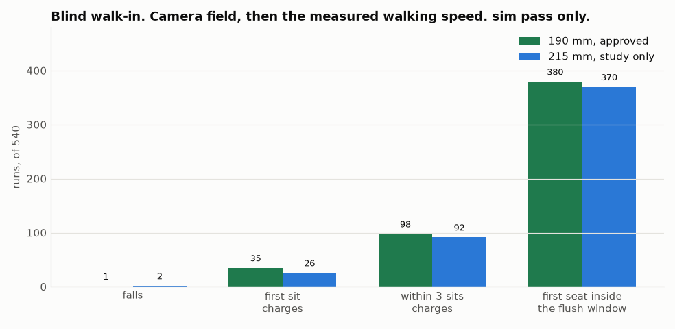

# Blind walk-in: the camera field, then dead reckoning. sim pass only

2026-11-12 ET. Duckie, Open Duck Mini v2. Simulation only. Nothing was built or bought. The approved sun
distance is still 190 mm. The 215 mm run is a study only. The nest CAD and DECISIONS.md were not edited.
The flush-contact folder was not edited. Its window is used as published there (calc only).

Every count below is **sim pass only** unless it says **calc only**. Source: `score.py` on the run files
in this folder. 0 crashed runs.

## Plain summary

The duck does not get the true pose. It gets a pose only while the sun centre is inside the camera field
(66 degrees up and down, 41 degrees left and right, on the head). The last fix is at about 0.58 m
(median). After that it walks on the speed it measured while it could still see the sun, not on the raw
command. Same 540 seeds as the nest matrices. The walk law is the mixed one from the nest sim v3: steering
at 6.0 V, a straight crossing at 7.2 V, two 1 mm steps, aim 20 mm right at 7.2 V.

At 190 mm (the approved distance): **1 fall**. The first sit charges in **35 of 540**. Within 3 sits,
**98 of 540**. The first seat lands inside the flush window in **380 of 540**. The same controller with
the pose stand-in charged at the first sit in 531 of 540 (sim pass only, nest sim v3). Taking the pose
away drops that to 35.

Moving the sun to 215 mm does not fix it (study only): **2 falls**, first sit **26 of 540**, within 3
sits **92 of 540**, first seat in the window **370 of 540**.

Integrating the raw walk command, instead of the measured speed, is worse. The duck stops about 280 mm
short of the sun. **0 of 540** charge, and **1 of 528** first seats fall in the window (sim pass only,
`blind_runs_command.json`).

`F1_blind.png`

## 1. What the camera is allowed to know

From the camera twin (altaay_lab/twin/camera/CAMERA_TWIN.md). A level head on the tall body does not see
the disc or the ring at 0.50 m. The disc centre crosses into the 66 degree field at 0.64 m (calc only in
that file). This sim does not use that fixed distance. It puts the pupil 40 mm in front of the head body
origin and tests the sun centre against the 66 by 41 degree rectangle on the live head, every control
step. The stock policy moves the head. The schedule's pitch-0 command is not what the head does
(BLOCKER in the camera twin, and still true here).

The last time a fix was taken, horizontal range from the pupil to the sun centre (sim pass only):

| | runs with a fix | median | 10th | 90th |
|---|---|---|---|---|
| 190 mm, all | 528 | 0.584 m | 0.504 m | 0.724 m |
| 190 mm, 6.0 V | 267 | 0.537 m | 0.486 m | 0.593 m |
| 190 mm, 7.2 V | 261 | 0.643 m | 0.580 m | 0.789 m |
| 215 mm, all | 519 | 0.584 m | 0.499 m | 0.727 m |

That is the "about 0.5 m" loss, measured on the walking head rather than typed in. At 6.0 V the median
is 0.54 m. At 7.2 V it is 0.64 m, because the head is carried differently.

While the sun centre is in the field, the estimate is the true trunk pose plus the nest sim's noise
schedule (low, mid, or high), 5 to 10 Hz, 70 to 170 ms late. That noise is not a measured detector. The
camera twin has no detector. It is there so a visible sun is not perfect truth. When the sun centre
leaves the field, no new pose arrives.

Dead reckoning after that: the forward speed is the speed measured on the fixes from the last 0.8 s,
divided by the forward command in that same window, and clipped to 0.35 to 1.15. Later forward commands
are multiplied by that scale. Yaw still follows the yaw command. Median scale at 190 mm: 0.48. The gait
covers about half of what the command asks. A pure integral of the command is the file
`blind_runs_command.json`. It is not the reported controller.

Before the first fix, the duck turns in place at 0.5 rad/s so the field can sweep onto the sun. 12 runs
at 190 mm and 21 at 215 mm never see it. None of those sit.

After the turn the camera looks into the room. The sit does not see the cloth (camera twin, section 5).
Re-sits get no new view of the sun. They reshuffle on the dead-reckoned estimate.

## 2. The 540 runs

The flush window, calc only, from the flush study (not merged into this branch; the numbers are that
study's section 6): the seat centre may sit anywhere inside +/-254 mm along the wall and +/-161 mm
deep. Here that is |y| <= 254 mm and |x| <= 161 mm, sun at the origin, x toward the wall. A landing in
that box is not the same thing as the four pins charging on the sun and the ring.

| sim pass only | 190 mm | 215 mm, study only |
|---|---|---|
| Runs | 540 | 540 |
| Falls | 1 | 2 |
| Reached a sit | 528 | 517 |
| Charge at the first sit | 35 | 26 |
| Charge within 3 sits | 98 | 92 |
| First seat inside the flush window | 380 | 370 |
| Any of the sits inside the window | 386 | 374 |
| 6.0 V falls / first sit / within 3 / window | 0 / 8 / 18 / 183 | 1 / 9 / 24 / 175 |
| 7.2 V falls / first sit / within 3 / window | 1 / 27 / 80 / 197 | 1 / 17 / 68 / 195 |

Of the runs that sat at 190 mm, the first seat is 52 mm short of the sun on average and 69 mm to the
side (1 sigma 122 mm and 105 mm). Median radial miss 130 mm, 95th 311 mm. At 215 mm the mean is 55 mm
short and 78 mm to the side, median radial 143 mm.

The pose-stand-in run of this same walk law, at 190 mm, charged at the first sit in 531 of 540 and
within 3 sits in 540 of 540, with 0 falls (sim pass only, twin/dock/nest/sim/v3/NEST_SIM_V3.md). The
blind run keeps the falls low (1 and 2) and loses the charge. The flush window, which is much larger
than the 50 mm sun, still holds 380 of 540 first seats at 190 mm and 370 of 540 at 215 mm. 160 first
seats at 190 mm, and 170 at 215 mm, miss even that box.

Head to wall is a geometry check. The sim does not push the duck back. At 190 mm, 182 of 540 runs have
a part past the wall plane or inside the rim block. At 215 mm, 156 of 540 do. The blind last stretch
still walks some ducks into the wall plane. Moving the sun out by 25 mm does not clear them.

## 3. What this does and does not say

The camera can carry the duck until about half a metre. It cannot finish the sit. Dead reckoning at the
measured walking speed puts the seat in the big flush box more often than not (380 of 540), and on the
sun's pins rarely (35 of 540). Three re-sits, still blind, raise the pin charge from 35 to 98. They do
not raise the window count by much (380 to 386), because a bad first seat stays bad.

215 mm is not an improvement. Charge is a little worse. The window count is a little worse. It is a
study. 190 mm stays the approved distance.

Not done: a real image, a detector, light, or the head held at the -25 degree stop so the last look is
the 0.30 m case in the camera twin. The pupil is 40 mm in front of the head body, not the measured
opening on the tall pose. The entrance pupil is still unmarked (BLOCKER in the camera twin).
