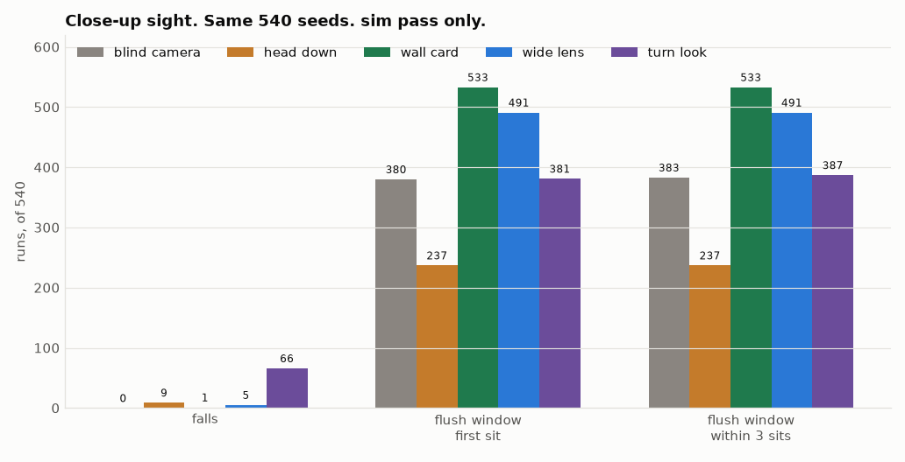

# Keeping the nest in view for the last stretch

2026-11-12 ET. Simulation only. Nothing was built or bought. The approved sun distance stays 190 mm. The cute sit stays: torque off, the nest sit path, head in the sit pose. This folder does not edit the camera twin, the flush study, the nest sim, the nest CAD, or DECISIONS.md D61.

Every count from the runs below is **sim pass only** unless it says **calc only**, **CAD check only**, or **cited**. A sim is not hardware. 0 crashed runs in every file. Source: `score.py` on the run files in this folder.

## Plain summary

The blind walk-in (PR 45) loses the sun at a median 0.584 m and puts the first seat in the flush window in 380 of 540 runs (sim pass only, that report). The same walk with the true pose puts every first seat in that window, 540 of 540 (calc only on the archived seats, below). Four changes were run on the same seeds.

| sim pass only | Falls | Flush window, first sit | Flush window, within 3 sits |
|---|---|---|---|
| Blind camera, merged run file | 0 | 380 of 540 | 383 of 540 |
| (a) Head down on the approach | 9 | 237 of 540 | 237 of 540 |
| (b) 40 mm card on the wall | 1 | 533 of 540 | 533 of 540 |
| (c) Wider lens | 5 | 491 of 540 | 491 of 540 |
| (d) Look down at the start of the turn | 66 | 381 of 540 | 387 of 540 |
| True pose, same walk law | 0 | 540 of 540 | 540 of 540 |

**Recommend the wall card.** It is the only change that gets close to the true-pose window. It does add one fall the merged blind walk does not have (seed 211019, below). The head-down walk is worse than doing nothing. The wide lens helps and still loses the sun around 0.31 m. The turn look adds falls and does not move the window count.

The card is one 40 mm square, felt or printed, on the wall. No electronics. It is not on the BOM, so no price is stated. The duck is unchanged. The nest gains one small mark at about the walking camera height.

`F1_closeup.png`

## 1. The same sim

The walk law is the mixed one from the nest sim (PR 42): steering at 6.0 V, a straight crossing at 7.2 V, two 1 mm steps, aim 20 mm right at 7.2 V, sun 190 mm from the wall. Same 540 seeds (3 pose noise levels, 2 voltages, 3 mat frictions, 30 seeds).

Perception is the blind walk-in's rule. A pose fix arrives only while a target point is inside the camera field. The noise on that fix is the nest schedule, not a measured detector. After the target leaves the field, the duck walks at the speed measured on the fixes. The sit is blind, as in the camera twin (PR 38, section 5).

The blind row is re-scored from the merged run file, not from a second 540 in this folder. That file is the one behind the merged blind report: 0 falls, first sit 380 of 540, within 3 sits 383 of 540 (sim pass only). An earlier copy of that file, before the re-sit heading correction, had 1 fall and 386 within 3 sits. First sit was already 380. The 0.584 m last-fix median is unchanged.

The flush window is the belly field from the flush study (PR 41, section 6, calc only): the seat centre may sit anywhere inside +/-254 mm along the wall and +/-161 mm deep. "Within 3 sits" means any of the up to three sits has its seat centre in that box. The old sun-and-ring pin test is secondary and is not the headline.

The true-pose row is not a new MuJoCo run. The 6.0 V half is the stepped-edge file and the 7.2 V half is the aim-20 file from the nest sim (PR 42). Every first seat in those 540 runs is inside the flush box (calc only on those archived seats). The 531 of 540 quoted with the true pose is the old pin test on that same combo (sim pass only, that report), not the flush box. On the flush box the true pose is 540 of 540.

## 2. The four changes

**(a) Head down.** The software stop on head pitch is -22 deg and the printed stop is -25 deg (cited, altaay_lab/software/servo_limits.json). The neck soft stop is -17 to +22 deg, printed stop -20 to +25 deg (same file). Holding the head at the -22 stop, or holding the neck at 0 as well, was tried on one seed. The duck walked off the line (sim pass only, that seed, not the 540). The 540 holds head pitch at -8 deg, and only after a sun fix inside 0.75 m, so the search still uses the policy head. The neck, yaw, and roll stay with the walk. The command is inside the soft stop. The worst measured head pitch in the 540 is -12.0 deg (sim pass only), still inside -22 and short of the printed -25. The walk's own head, in the runs that do not command a pitch, also reaches -12.2 deg.

**(b) Wall card.** A 40 mm square on the centre line, 4 mm room-side of the wall, centre 350 mm off the floor. The test uses the centre, the same point test the blind walk uses for the sun. The walking camera in these runs has median height 0.36 m (sim pass only). Felt or a printed card. No code on it, no electronics. While the centre is in the field it counts as a fix, with the same noise schedule. The sun is still there.

**(c) Wider lens.** Raspberry Pi Camera Module 3 Wide, infrared cut filter fitted, not the NoIR. Cited from Raspberry Pi Ltd, Camera Module 3 product brief, June 2024, RP-008151-DS-1, page 5, wide column:

https://datasheets.raspberrypi.com/camera/camera-module-3-product-brief.pdf

| Item | Number | Label |
|---|---|---|
| Focal length | 2.75 mm | cited, page 5, wide column |
| Diagonal field | 120 deg | cited, page 5 |
| Horizontal field | 102 deg | cited, page 5 |
| Vertical field | 67 deg | cited, page 5 |
| Focal ratio | F2.2 | cited, page 5 |
| Focus | 5 cm to infinity | cited, page 5 |
| Board height | 12.4 mm for the wide variants, 11.5 mm for the standard | cited, product page |

Product page: https://www.raspberrypi.com/products/camera-module-3/

The standard module on this head has the 66 deg axis up and down (PR 38). The wide module uses the same board, so this sim puts the 102 deg axis up and down and the 67 deg axis left and right. The pupil stays the blind walk's 40 mm stand-in. The part was not bought. It is not on the BOM, so no price is stated. BOM line E6 remains the standard module.

The head opening clears a 50.4 deg half angle from a pupil on the PCB front (calc only, PR 38). The wide up-down half is 51 deg (cited). The shell may clip about 0.6 deg. That changes the close floor distance by about 2 percent (calc only, tan 51 deg over tan 50.4 deg). Not a second 540. Whether the wide lens passes the 7.74 mm opening is BLOCKER: the wide mechanical drawing (RP-008155-DS-1) was opened and the text extract does not label the lens diameter. How the extra 0.9 mm of height sits in the head is the same depth-split BLOCKER the camera twin already has for the 11.5 mm module.

**(d) The turn.** The approach is the blind walk. At the turn spot, before the calibrated turn, the neck command goes to -12 deg and the head pitch command to -19 deg, with yaw and roll held at 0. Both commands are inside the software stops. The body yaws a short way each side so the 41 deg left-right field can cross the sun. If a new sun fix arrives, the duck creeps with the nest's own fine moves, then the head comes back up and the calibrated turn runs. The sit is the cute sit. A card on the mat edge was not used: after the turn the duck faces the room, and on a short arrival that edge is behind the camera (sim pass only, one seed, not the 540).

The worst head pitch recorded in the turn runs is -21.4 deg, inside the -22 software stop (sim pass only). The worst neck recorded during the look is -17.2 deg, on 6 of 540 looks (sim pass only). That is 0.2 deg past the -17 software stop and 2.8 deg short of the printed -20. The actuator target is clipped to the software range. The joint still passed it by that 0.2 deg. The command itself was -12 deg.

## 3. Results

Last fix is the horizontal range at the last pose fix. For the card, that fix is the card in 534 of 540 runs and the sun in 6 (sim pass only).

| sim pass only | Falls | First sit in the window | Within 3 sits | Last fix, median | Old pins, first / within 3 |
|---|---|---|---|---|---|
| Blind camera | 0 | 380 | 383 | 0.584 m | 35 / 43 |
| Head down | 9 | 237 | 237 | 0.479 m | 45 / 72 |
| Wall card | 1 | 533 | 533 | 0.146 m | 501 / 508 |
| Wide lens | 5 | 491 | 491 | 0.308 m | 103 / 254 |
| Turn look | 66 | 381 | 387 | 0.575 m | 11 / 89 |

By voltage, falls and first sit in the window, of 270. sim pass only.

| | 6.0 V falls | 6.0 V first sit | 7.2 V falls | 7.2 V first sit |
|---|---|---|---|---|
| Blind camera | 0 | 183 | 0 | 197 |
| Head down | 9 | 56 | 0 | 181 |
| Wall card | 0 | 270 | 1 | 263 |
| Wide lens | 4 | 234 | 1 | 257 |
| Turn look | 27 | 193 | 39 | 188 |

The head-down run does see the sun a little closer (median 0.479 m against 0.584 m) and the seats get worse, mostly at 6.0 V (56 of 270 against 183). Holding the head down changes the walk. The turn look re-sights the sun in 70 of 540 runs and the window count stays 381, with 66 falls. The wide lens ends the last fix at a median 0.308 m. The card ends it at 0.146 m, which is the standing spot, not a long blind stretch.

Three re-sits add no seats to the window for the head-down run, the card, or the wide lens. The turn look adds 6. The merged blind walk adds 3 (380 to 383).

The card's one fall is new. The merged baseline has 0 falls. Seed 211019 (7.2 V, high pose noise, mat friction 0.8) does not fall in that file. It sits three times, all outside the window. The first seat is 108 mm toward the wall and 481 mm to the side (sim pass only). The card run of the same seed falls at 27.7 s, during the stand at the start of the fine moves, before the turn and before any sit (sim pass only, re-run of that seed). The two walks match through the first sun fixes. At 0.72 s the sun is below the field and the card is in it, so the card run takes one pose fix the baseline does not. That fix is 1.23 m from the card, with the trunk still about 1.09 m short of the sun. The approach then diverges. The duck reaches the fine stand at about x=-0.25 m, y=0.38 m and tips while standing. This seed was already a miss on the baseline, not one of the 380. The card turns that miss into a fall. It does not trade away a window hit.

## 4. Cost and looks

| Change | Parts | Looks | Window, first sit | Falls |
|---|---|---|---|---|
| Head down | none | the head nods on the way in, then the cute sit | 237 of 540 | 9 |
| Wall card | one 40 mm square, felt or printed, no electronics | one small mark on the wall, the duck unchanged | 533 of 540 | 1 |
| Wide lens | swap the camera for Camera Module 3 Wide, not bought | the lens is the wide one, 0.9 mm taller | 491 of 540 | 5 |
| Turn look | none | a deep nod at the turn, then the cute sit | 381 of 540 | 66 |

D61 says finding the nest is by camera only, no tags or markers. D61 was not edited. The card is a plain square, not a coded tag. It is still a mark. That is the look cost. It is smaller than a lens swap, and it is the one that lands the seat.

## 5. What this does not say

- No real frame, no detector, no light. The noise while a target is in the field is the nest schedule (BLOCKER, the same one as the blind walk and the camera twin).
- The entrance pupil is still unmarked (BLOCKER, PR 38). The pupil here is the 40 mm stand-in.
- The wide lens fit in the head opening, and the extra 0.9 mm of height, are BLOCKER.
- The card's colour and how a real detector would see felt against the wall are not measured.
- The 0.2 deg neck overshoot on 6 turn looks is a sim joint, not a servo trace.
- Nothing here is a hardware dock rate.
