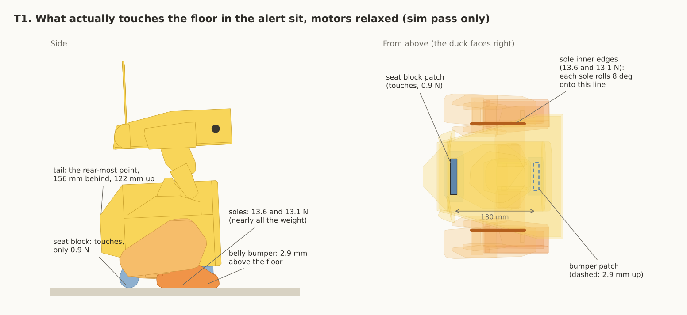
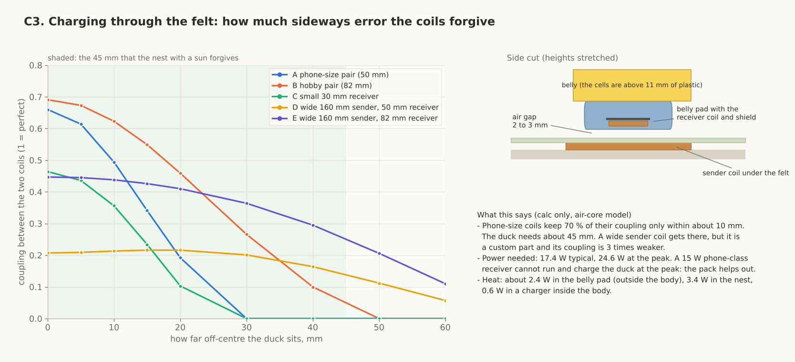
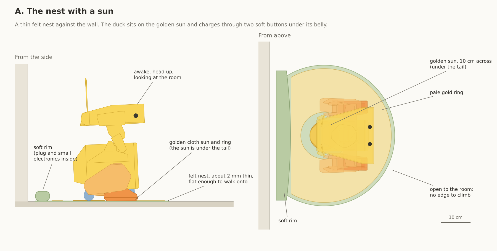
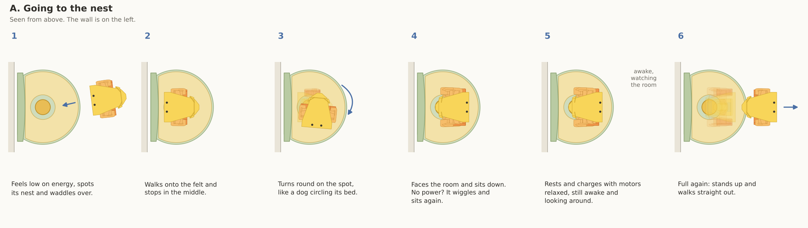
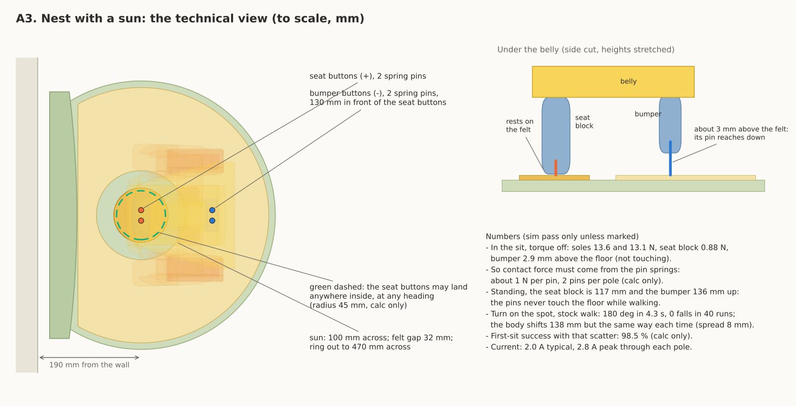
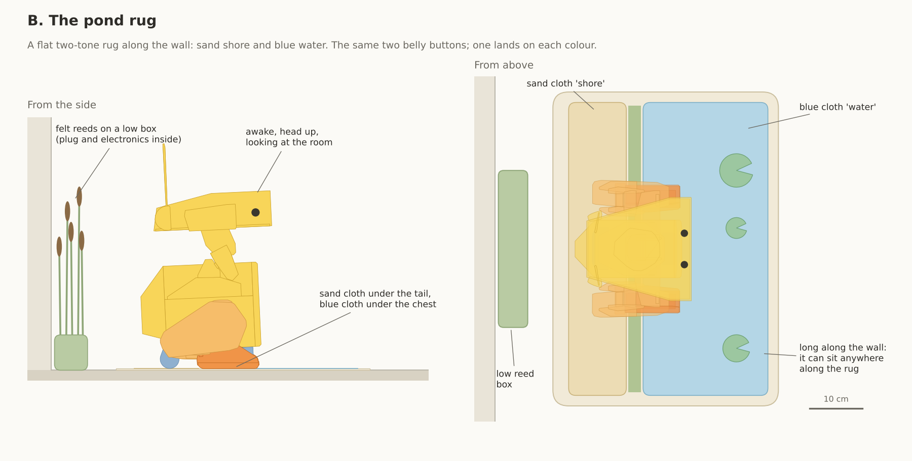
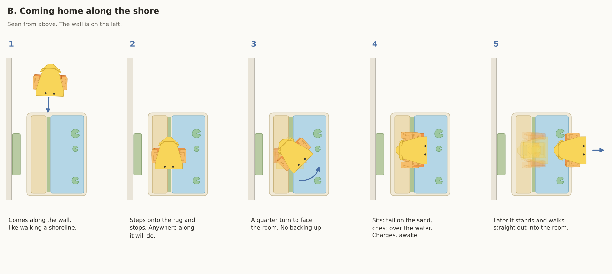
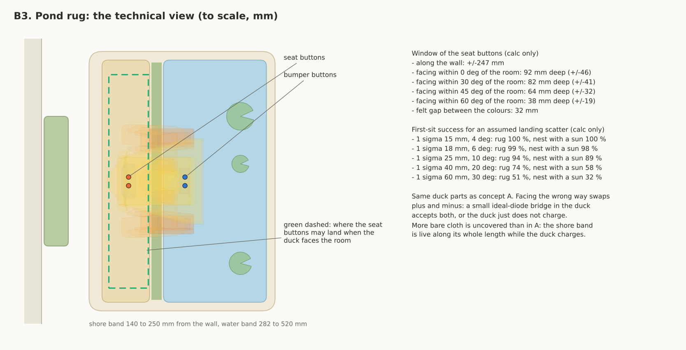
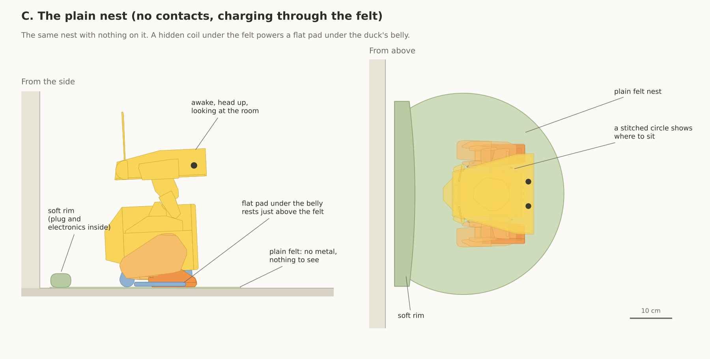
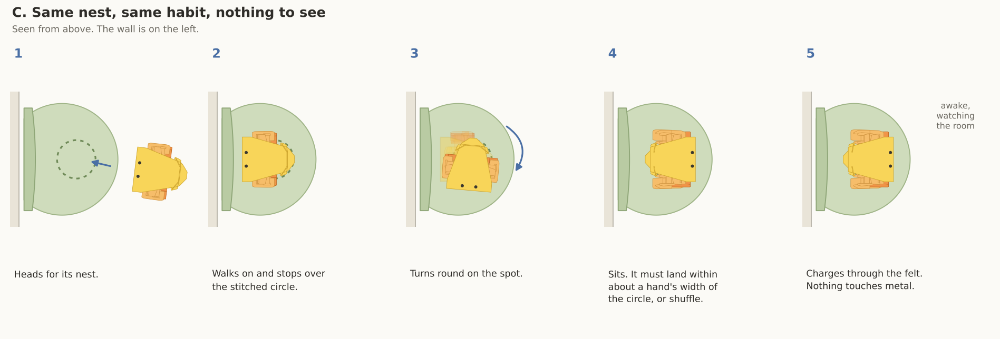

# NATURAL_DOCK_IDEAS: a charging place that feels like a nest, not like lab equipment (Duckie, Open Duck Mini v2 lab build)

Repo copy note (2026-11-11 ET, for DECISIONS.md D61): this is the study as written, copied into the repo with local folder paths removed. The figures are beside this file. The scripts, JSON results and video clips it names are kept outside the repo (not copied), so the runs cannot be repeated from the repo alone: BLOCKER for a re-run. The earlier studies it cites by name (DOCK_RESEARCH, FEET_DOCK, DEEP_ANALYSIS) are not in the repo either; DOCK_TWIN and DOCK_INTERFACE are in twin/dock/. The stripe study is in stripes/ and the sequence sim it asks for (Sim N3) is in sim/NEST_SIM.md. Labels: "est" marks an estimate with no source in hand and "index" a web fact read from search results only; treat both as BLOCKER until sourced. The decision record and its open BLOCKERs are in altaay_lab/DECISIONS.md D61; the folder guide is twin/dock/nest/README.md. Update 2026-11-11 evening ET: the scripts, JSON results and video clips are now in the repo beside this file (moved, paths made relative, syntax-checked, not re-run after the move); the lines below that say they are kept outside the repo are out of date. See README.md and HANDOVER.md in this folder.

2026-11-11. Concept study on paper: sketches, sims and arithmetic only. No CAD, nothing bought, nothing built, no repo edits, no messages sent.

## Plain-language summary (for a non-engineer)

1. Pick: **a thin felt nest against the wall with a golden cloth "sun" in the middle.** The duck walks on, turns round like a dog circling its bed, sits facing the room, and charges through two small soft buttons under its belly.
2. Nothing goes in the feet any more: no wires down the legs, no metal on the soles. The buttons sit high off the floor while it walks, so they stay clean.
3. It forgives a lot: the duck may sit up to 4.5 cm off in any direction and facing any way. Today's design needs about 2 cm and 4 degrees.
4. New in this study: in the simulator the duck can turn round on the spot. 40 turns, 0 falls, a half turn in about 4 seconds, and it ends in the same place each time within about 1 cm.
5. Also new: when it sits, almost all its weight is on its feet. The seat block barely touches (0.9 of 27.5 newtons) and the belly bumper hangs 3 mm above the floor. So the buttons must be spring loaded.
6. Runner-up: **the pond rug**, a flat two-tone rug (sand and blue). Same duck parts, only the rug differs, so both can be tried with one duck.
7. Wireless (no metal or cloth contacts at all) looks the nicest but does not fit yet. Shop-bought coils forgive only about 1 cm, and a coil pad under the felt is thick enough to trip the walk.
8. What changes on the duck: 4 small spring pins, a small charger board moved inside, about 15 to 20 grams, all in the body.
9. Safety: the nest is off until it recognises the duck, at most about 10 volts (toy limit 24), and the "plus" part is under the duck's tail while it charges. That recognition circuit is new and untested.
10. Not proven: the pins on cloth, the recognition circuit, about 2 to 3 watts more heat in the body, finding the nest by camera alone, carpet.
11. Cheapest next test: a simulator run of "walk on, turn, sit" on the nest. It costs nothing.
12. Many web pages could not be opened here, so several facts are marked "index" (read from search results only) or BLOCKER.

Labels: **sim pass only** (MuJoCo 3.17.0, the repo's own models, read only), **calc only** (arithmetic and the scripts here), **est** (estimate, no source in hand), **BLOCKER** (data missing). Web: this session could not open pages (hosts not allowed: helpguide.sony.net, core-electronics.com.au, www.dfrobot.com and others), so every web fact below was read from the search index only and is marked "index".

---

## 1. What the sit really gives us (new measurements)

Ahmed's brief assumed the seat block and belly bumper carry the weight in the sit. The sim says otherwise.

| Surface | Touches the floor? | Where (trunk frame, x forward, mm) | Force, torque off | Label |
|---|---|---|---|---|
| Left sole | yes, on its inner edge (rolled about 8 deg) | centre of pressure x -37.5, y +91.8 | 13.6 N | sim pass only |
| Right sole | yes, same | x -37.7, y -93.4 | 13.1 N | sim pass only |
| TPU seat block (rear belly) | yes, lightly | patch x -113 to -103, y +/-28 | **0.88 N** (3 % of the weight) | sim pass only |
| TPU belly bumper (front) | **no** | patch x +18 to +27, y +/-22 | 0 N; it hangs **2.9 mm** above the floor | sim pass only |
| Total | | | 27.5 N (2.8078 kg) | sim pass only |

- The folded legs lock on their hard stops and hold the trunk like a stool. The seat block only steadies it.
- Seat button to bumper button spacing: **130 mm** on the centre line.
- Standing and walking, the seat block is 117 mm and the bumper 136 mm above the floor. Anything mounted there never touches the floor during a walk.
- A raised spot under the belly changes this. With a disc 3 to 8 mm high under the seat and bumper (between the soles), the seat takes 8.5 to 11.0 N, the bumper 10.1 to 12.7 N and each sole about 4 N (sim pass only). So a low "pebble" would load belly contacts by weight, but any bump over 2 mm trips the walk (DEEP_ANALYSIS section 3), so this study does not rely on it.
- The rear-most point is the tail, 156 mm behind the trunk origin and 122 mm up. At floor level the rear-most point is the seat block, 124 mm behind.
- Sitting size: 222 mm long, 262 mm wide, 382 mm tall. Head 259 mm up.
- Head turn: the real limits are -105 and +79 deg (CAD contact, `software/servo_limits.json`; the URDF says +/-160). With the 66 deg camera view the duck can see about 138 deg to one side and 112 deg to the other. It cannot look straight behind.

### 1.1 Turning on the spot: measured in sim for the first time (sim pass only)

Earlier studies listed the half turn as an unknown (STRIPE_MAT_STUDY section 6, "BLOCKER (sim N2)"). `turn_probe.py` ran it: the repo sit model, the stock walk policy, 10 seeds per command, the default floor.

| Turn command | Rate | Time for 180 deg | Falls | Where the body ends after 180 deg | Spread between seeds |
|---|---|---|---|---|---|
| left, 1.0 | 44.5 deg/s | 4.3 s | 0 of 10 | 138 mm from the start | 8 mm at most |
| right, 1.0 | 40.0 deg/s | 4.8 s | 0 of 10 | 118 mm | 8 mm |
| left, 0.5 | 18.2 deg/s | 9.9 s | 0 of 10 | 148 mm | 8 mm |
| right, 0.5 | 13.3 deg/s | 12.8 s | 0 of 10 | 168 mm | 11 mm |

- The body does shift 12 to 17 cm, but **the same way every time**: the duck pivots about a point roughly 68 mm behind its trunk origin. A fixed offset can be planned for. What matters for the dock is the spread: about 1 cm.
- Limits: open loop, one floor (friction 0.6), no stop at the end (the walk coasts 10 to 35 mm after a forward stop, DOCK_TWIN 4.3), sim only. The real robot is not tested.

---

## 2. How real companion robots do it (all "index": read from search results, pages not opened)

| Robot | What it does | What makes it forgiving or natural | Source |
|---|---|---|---|
| Sony aibo ERS-1000 | "walks around looking for the station. Once it finds the charging station, it lies down on it". Charging pins on the torso meet the station | The act is a dog going to its bed. Sony warns a similar-looking object can be mistaken for the station and asks for a bright room | https://helpguide.sony.net/aibo/ers1000/v1/en/contents/TP0001970110.html ; https://helpguide.sony.net/aibo/ers1000/v1/en/contents/TP0001970108.html |
| Sony aibo ERS-7 | reverses onto its station and sits; "foot stoppers" help it sit in the right place | a physical stop for the last centimetre | DOCK_RESEARCH [W1] |
| GROOVE X LOVOT | returns to its "Nest" by itself; the Nest stands against a wall; needs 1 m clear in front | The charger is called a nest and is the robot's home. Charging "starts when the terminals line up"; support pages list misaligned terminals as a common fault | https://lovot.life/en/technology/ ; https://lovot.freshdesk.com/support/solutions/articles/47001260775-08-when-i-place-lovot-in-the-nest-for-charging-it-doesn-t-charge-properly |
| SwitchBot KATA Friends | returns to its "nest"; if the nest is against a wall the robot may bump it and shift it, so SwitchBot says to tape the nest to the wall | lesson: fix the dock down | https://support.switch-bot.com/hc/en-us/articles/41938013934743-What-Should-I-Do-if-SwitchBot-Kata-Friends-Can-Not-Return-to-the-Nest-to-Charge |
| Anki Vector | must see its charger; contacts under the robot touch contacts on the charger; first fix for "not charging" is poor contact | wheels in grooves guide it | https://support.anki.bot/article/100-troubleshooting-charging-issues |
| Amazon Astro | docks backwards: the manual fix is to set it in front "with the screen facing away, then gently roll it backward onto the dock" | ends facing the room | https://digprjsurvey.amazon.com/csad/help/node/GKEJZCGWY48CJPN5 |
| KEYi Loona | saved routes to the dock; the maker claims up to 95 % success; owners report misses | route memory, not precision | https://keyirobot.com/blogs/loona-tutorials/can-loona-self-charge-loona-auto-recharge-2-0-route-setup-tutorial |
| Enabot EBO X | infrared docking; dock against a wall, 1.5 m clear in front | beacon | https://www.manualslib.com/manual/3672660/Enabot-Ebo-X.html |
| Living.ai EMO (small desktop biped) | stands on a "skateboard" that is a wireless charging pad; the owner places it; "place his left foot on the magnetic charging circle mark"; users say it sometimes needs a nudge | The charger is a toy the robot owns. But it is placed by hand because the coil must line up | https://forums.living.ai/t/skateboard-charger-explanation/2556/7 ; https://forums.living.ai/t/emo-charging-problem-issue/3907 |
| Unitree Go2 | "self-charging board": the dog lies down on a board with contacts; sold for the lidar versions | lie down on a flat board | https://www.maverickdrone.com/collections/all/products/go2-selfcharing-board |
| Robot vacuums | drive in forward onto wide sprung contacts; makers tell owners to wipe the contacts | wide contacts, spring travel | DOCK_RESEARCH [W4], [W16] |
| Disney BDX droids | nothing public on charging | | BLOCKER (search found nothing) |
| Petoi | no self-docking found | | BLOCKER (not searched further) |

What carries over:
- The loved ones turn charging into a habit with a name: bed, nest, skateboard. The object belongs to the robot.
- Every self-docking one uses metal contacts. The only wireless one (EMO) is placed by hand.
- Wheeled robots are guided by their wheels. A biped with grippy soles is not: a bowl will not slide it to the centre (it would need a slope over 39 deg at friction 0.8, 22 deg at 0.4; calc only). So forgiveness must come from a wide contact area, not from a funnel.
- Fix the dock to the wall or floor.

---

## 3. The idea round (19 concepts)

Each line set: **On** (how the duck gets on), **Needs / forgives**, **Power** (where it crosses), **Duck** (what changes), **Safe**, **Look**, **Cost**, **Unknown**. Forces and positions are from section 1. "Gate" means the nest stays off until it recognises the duck (STRIPE_MAT_STUDY section 3: a signature handshake plus a leak check; untested).

**1. Nest with a sun (pick).** Thin felt nest, a golden cloth disc in the middle, a pale gold ring around it.
- On: walk in forward, stop in the middle, turn on the spot (any amount from 100 to 180 deg), sit. No backing.
- Needs / forgives: seat buttons within 45 mm of the sun's centre, any heading (calc only).
- Power: 2 spring pins in the seat block (plus) on the disc, 2 in the bumper (minus) on the ring, 130 mm apart. Force from the pin springs, about 1 N each (seat load is only 0.9 N).
- Duck: 4 pins, 2 small holes in the belly floor, the charger board moved inside; about +15 to 20 g, all in the trunk (est). No leg wires, plain soles.
- Safe: gated; about 10 V at most; the plus disc is 10 cm across and under the tail while charging; a coin cannot span the 32 mm felt gap (US quarter 24.3 mm, https://usmint.gov/learn/coin-specifications, index).
- Look: a felt pet bed with a sun on it. Cloth, not striped metal.
- Cost: pins (price: BLOCKER, not recorded here; DOCK_RESEARCH [W6]); charger board already in the BOM; step-down (https://www.pololu.com/product/4875, index; price: BLOCKER, not recorded here); felt, cloth, rim: BLOCKER.
- Unknown: pin on cloth contact resistance and wear.

**2. Pond rug (runner-up).** Flat two-tone rug along the wall: sand band near the wall, blue band toward the room.
- On: come along the wall, stop anywhere on the rug, quarter turn to face the room, sit. Or walk in and half turn as in 1.
- Needs / forgives: +/-247 mm along the wall; +/-46 mm deep facing the room, +/-41 at 30 deg, +/-32 at 45 deg (calc only).
- Power: the same 4 pins; seat on sand, bumper on blue.
- Duck: as 1, plus an ideal-diode bridge if both facing directions should charge (Analog Devices LT4320, 9 to 72 V, https://www.analog.com/en/products/lt4320.html, index; price BLOCKER).
- Safe: gated, but the whole sand band (11 x 56 cm) is live while charging and mostly uncovered.
- Look: a small rug. Cost: as 1. Unknown: as 1.

**3. Two lily leaves (yesterday's two-zone mat, restyled).** One big leaf per foot.
- On: as 1. Needs / forgives: +/-69 mm sideways, +/-72 mm deep, +/-30 deg (STRIPE_MAT_STUDY 1.5).
- Power: an edge strip on each sole (13.6 and 13.1 N), one wire down each leg.
- Duck: 2 sole strips (+1.5 g per foot, est), wires through 5 joints per leg and the 150 deg knee fold.
- Safe: gated; 40 mm gap. Look: nice. Cost: low.
- Unknown: wire flex life (BLOCKER since D58), sole contacts walk through dust on every step, the sole rests on an edge.

**4. Brood patch on a warm stone (wireless, phone-size coils).** A flat pad under the belly holds a receiver coil; a sender coil sits in the nest.
- On: as 1. Needs / forgives: about 10 mm (calc only, section 4). Does not match the walk.
- Power: coil in a new belly pad between seat block and bumper, 2 to 3 mm above the felt.
- Duck: pad, coil, receiver board, a charger with power path inside; about +40 to 60 g (est).
- Safe: no metal. A Qi sender has foreign object detection.
- Look: the best: nothing to see. Cost: sender board (https://abra-electronics.com/wireless/wireless-charging-modules/wl-371-15w-type-c-wireless-charger-transmitter-module.html, index; price: BLOCKER, not recorded here); 15 W receiver board, one listing that may not be a receiver (price: BLOCKER, not recorded here; https://www.desertcart.sn/products/359601335-15w-qi-wireless-charger-pcba-circuit-board-with-coil-pad, index); BLOCKER.
- Unknown: landing within 1 cm.

**5. Plain nest with a hidden wide coil (wireless, custom).** As 4 but with a 160 mm sender coil.
- Needs / forgives: about 40 mm, any heading (calc only).
- Safe: hobby drivers have no foreign object detection (BLOCKER); a metal toy on the nest could heat.
- Cost: custom coil and driver, BLOCKER. Unknown: everything electrical; the coil pad is 3 to 6 mm thick, which trips the stock walk.

**6. Shop-bought multi-coil phone pad under felt.** For example the Zens Liberty: 16 overlapping coils, 2 x 15 W, a phone charges "anywhere on the pad" (price: BLOCKER, not recorded here; https://9to5mac.com/2020/01/03/zens-liberty/ ; https://www.androidpolice.com/2019/08/23/this-140-wireless-charging-pad-has-16-coils-and-can-fast-charge-two-phones-at-once/, index).
- Needs / forgives: the pad's surface; its size is BLOCKER (not in the index).
- Safe: a certified product with foreign object detection. Duck: as 4.
- Unknown: 15 W cannot run and charge the duck at the peak; the pad is thick, so the duck must step up onto it; whether it accepts a non-phone receiver.

**7. Tail snap.** A magnetic spring-pin connector on the rump clicks onto a cushion on the wall.
- On: turn, then back up blind until it clicks. Needs: about 5 to 10 mm (est).
- Power: at the tail, 122 mm up. Magnetic pogo connectors: 2 A, mating force over 400 g (https://promaxpogopin.com/magnetic-cable-connectors/usb-c-to-2-pin/, index).
- Honest: backing drifts 39 mm sideways per 110 mm (DOCK_TWIN 4.3); the duck must break about 4 N to leave; a magnet 8 cm from the IMU. **Does not work with this walk.**

**8. Back rest.** A padded wall rest with contact strips; the duck sits back against it.
- On: turn, back until the tail touches. Forgives: sideways by strip length; depth by touch.
- Honest: with torque off the duck does not lean, so the rest needs its own sprung paddle (the old dock turned round), and it needs the backing move.

**9. Bowl or dish.** A shallow dish that should centre the sitting duck by gravity.
- Honest: **does not centre.** TPU soles hold on any slope under 39 deg (calc only), and the walk is untrained on slopes.

**10. Deep soft pet bed.** A real cushion the duck sinks into.
- Look: the most natural of all.
- Honest: the stock walk fell 20 of 20 at a rigid edge on the soft-floor model (DEEP_ANALYSIS section 3); walking and standing up on a cushion are untested. Keep the soft part to the rim, where the duck does not step.

**11. Reed that reaches.** A sprung or motorised arm on the wall finds the duck.
- Forgives: the most. Honest: a motor, a sensor and a moving part at child height. Fails "simplest and cheapest" (D45).

**12. Turntable lily pad.** The duck walks on forward and the pad turns it.
- Honest: a motor and bearing in the dock for a turn the duck can already do itself (section 1.1). Not needed.

**13. Walk-through along the wall, no turn.** Enter from the left, sit, leave to the right.
- Honest: the body then faces along the wall, with only the head (up to 79 or 105 deg) toward the room. It breaks "back to the wall". The quarter-turn version is concept 2.

**14. Drinking or feeding.** Contacts on the beak, charging while it "drinks".
- Look: lovely as an act. Honest: it cannot hold. In the sit the head rests on its stops with torque off; a beak in a bowl needs the neck powered for hours and the head still, which breaks "awake and looking around" (D50, D47). **Does not work as the main charger.** A short "sip" could be an animation on top of any dock.

**15. Capacitive plates.** Power through insulation with no coil.
- Honest: the seat block face gives about 68 pF through 1 mm of TPU. Carrying 2 A would need thousands of volts at 1 MHz (calc only). **Not a home product.**

**16. Egg or toy the duck sits on.** A raised object between the feet touches the belly.
- Honest: the belly is 35 to 50 mm up in the sit. An object that tall between the feet is a trip hazard for a duck that lands within several cm. This is the old cradle again.

**17. Walk in forward and just sit (no turn), looking back.** 
- Honest: the head cannot turn 180 deg, so the duck stares at the wall. Breaks the facing rule. But concept 1 gives this for free as a fallback: if the turn ever fails, the duck still charges where it sits.

**18. Willow curtain.** Conductive tassels hang from a wall shelf and drape over two bands on the duck's back.
- Forgives: wide. Honest: live tassels hang at child height and their contact force is tiny.

**19. Battery swap.** Ruled out by D45.

---

## 4. Wireless: a serious fresh look

### 4.1 What the sit changes
| D43's reason against wireless (DOCK_RESEARCH section 3) | Still true with the sit? |
|---|---|
| Gap: the belly floor is 11.2 mm thick, a coil inside sits 11 to 12 mm from the sender | **Changed.** The sit brings the belly to the floor. A coil in a pad under the belly can rest 2 to 3 mm above the felt |
| Heat next to the cells: 1.0 to 1.7 W inside the trunk | **Partly changed.** The coil and its rectifier can sit in the pad under the belly, outside the trunk, below 11 mm of plastic. But the charger must now be inside (about 0.6 W with a switching charger, more with the linear one) |
| Slow: 5 W gives 0.58 A | **Changed.** 15 W boards and 36 W hobby pairs exist (below) |
| Alignment tighter than the walk | **Still true, and now measured:** about 10 mm for phone-size coils against the 45 mm the nest with a sun forgives |
| Foreign objects heat up | Still true for hobby pairs (no detection found, BLOCKER). Qi senders have it |
| Magnets near the IMU | Not needed if there are no alignment magnets |
| Cost of evaluation boards (price: BLOCKER, not recorded here) | Changed: module-level parts cost much less (prices BLOCKER) |
| No shipping self-docking robot uses it | Still true in this search (EMO is placed by hand) |

### 4.2 Power: what "awake while docked" (D50) needs (calc only)
- Charge: 8.4 V x 1.0 A = 8.4 W.
- Running the duck: 5.2 W in the twin's docked load (0.62 A), 9.0 W typical and 16.2 W peak in DOCK_INTERFACE.
- Total: **13.6 to 17.4 W typical, 24.6 W peak.**
- A 15 W phone-class receiver covers the typical case with no margin and not the peak. **What bends:** D50's "the dock runs the duck and the pack only charges" becomes "the pack helps at peaks", which needs a charger with a power path inside the duck. Candidate: TI BQ25883, 2-cell, 2 A, power path, 93.4 % at 1 A (https://www.ti.com/product/BQ25883, index); price and input limits BLOCKER.
- A 36 W hobby pair covers the peak. Example: DFRobot FIT0703, 24 V in, 12 V 3 A out, coil 82 mm outer and 30 mm inner, discontinued (https://www.digikey.de/en/products/detail/dfrobot/FIT0703/13166305, index). Similar XKT801 boards: 12 V 3 A (price: BLOCKER, not recorded here; https://electronics.alibaba.com/product/xkt-335, index). No data sheet, no foreign object detection found: BLOCKER.
- Or charge only at night with the duck off: about 8.4 W, any 15 W part does it. **That bends D50 itself** (awake while docked).

### 4.3 Coil size, gap and sideways tolerance (calc only, `coverage.py`, air-core model)
No maker publishes sideways tolerance (search found only blogs and one patent example: "substantially stopped at an offset of 10 mm or more", https://image-ppubs.uspto.gov/dirsearch-public/print/downloadPdf/11201510, index). So it was computed.

| Coil pair | Coupling centred | Offset that keeps 70 % of it | Offset that keeps 50 % |
|---|---|---|---|
| A phone-size, 50 mm sender, 45 mm receiver, 4 mm gap | 0.66 | 10 mm | 15 mm |
| B hobby pair, 82 mm both, 6 mm gap | 0.69 | 15 mm | 20 mm |
| C small 30 mm receiver (fits the seat block) on a 50 mm sender | 0.46 | 10 mm | 15 mm |
| D wide 160 mm sender, 50 mm receiver | 0.21 | 40 mm | 50 mm |
| E wide 160 mm sender, 82 mm receiver | 0.45 | 30 mm | 40 mm |

- Where a coil fits: the seat block's floor face is 32 x 80 mm, so only a coil of about 30 mm fits it. A real receiver module is larger: the QST QPR-0108 coil and shield are 50 x 40 x 1.0 mm, board 32 x 17 x 1.5 mm, outputs 5, 9 or 12 V (https://wmsc.lcsc.com/wmsc/upload/file/pdf/v2/lcsc/2404071525_QST-QPR-0108_C3606576.pdf, index; price BLOCKER). So wireless needs a new flat pad under the belly between the seat block and the bumper (about 110 x 60 mm fits there in the sit, CAD sweep against the legs: BLOCKER).
- Gap through TPU: 1 mm of pad skin, 1 mm of felt, 0.5 to 1 mm of air: 2 to 3 mm.
- Only the wide sender (D, E) comes near the 45 mm the duck needs, and it is a custom coil with a custom driver.

### 4.4 Heat, mass, thickness (calc only and est)
- At 17.4 W delivered: about 2.4 W lost in the receiver coil and rectifier (in the belly pad, outside the trunk), about 3.4 W in the nest, 0.6 W in a switching charger inside the trunk. Assumptions: receiver 88 %, end to end 75 %, charger 93 %. Contacts today put 0.11 W in the duck (DOCK_TWIN section 5).
- Mass on the duck: about +40 to 60 g (pad, coil, shield, boards; est; coil and shield masses BLOCKER).
- **Thickness of the nest: the new problem.** A wound sender coil with its shield is about 5 to 6 mm thick. The stock walk crossed a 2 mm mat 6 of 6 times, a 3 mm mat 5 of 6, and a 7 mm mat 0 of 6 (DEEP_ANALYSIS section 3, sim pass only). A printed-circuit coil could keep it near 3 mm at lower efficiency (est).

### 4.5 Verdict on wireless
The sit removes two of D43's reasons (gap, and most of the heat next to the cells). It does not remove the two that matter most for a sloppy walker in a home with children: sideways tolerance (10 mm against 45 mm needed) and metal objects on a sender with no detection. It adds one: the nest gets thick. **D43 (contacts) should stand for V1.** The plain nest (concept 5) is drawn below so the feel can be judged, and because the nest shape and the habit are identical: if a bench test of a wide coil works, the sun can be swapped for a coil later without changing the behaviour.

---

## 5. Scores

1 = poor, 5 = good. "Parts" = few changes on the duck. "Risk" = low risk scores high. Equal weights.

| # | Concept | Natural feel | Forgiveness | Safety | Simplicity | Parts on the duck | Cost | Risk | Total /35 |
|---|---|---|---|---|---|---|---|---|---|
| 1 | **Nest with a sun (belly buttons)** | 4 | 4 | 4 | 4 | 4 | 4 | 3 | **27** |
| 2 | **Pond rug (belly buttons)** | 4 | 4 | 3 | 4 | 4 | 4 | 3 | **26** |
| 13 | Walk-through, no turn (breaks "back to the wall") | 3 | 4 | 3 | 4 | 4 | 4 | 3 | 25 |
| 3 | Two lily leaves (feet) | 4 | 4 | 4 | 3 | 2 | 4 | 2 | 23 |
| 10 | Deep soft pet bed | 5 | 2 | 4 | 3 | 4 | 4 | 1 | 23 |
| 6 | Multi-coil phone pad under felt | 5 | 3 | 5 | 3 | 3 | 2 | 1 | 22 |
| 16 | Egg or toy to sit on | 4 | 2 | 3 | 3 | 4 | 4 | 2 | 22 |
| 8 | Back rest | 3 | 2 | 3 | 3 | 4 | 4 | 2 | 21 |
| 18 | Willow curtain | 4 | 4 | 2 | 3 | 3 | 3 | 2 | 21 |
| 4 | Brood patch, phone-size coils | 5 | 1 | 4 | 2 | 3 | 3 | 2 | 20 |
| 5 | Plain nest, hidden wide coil | 5 | 4 | 2 | 2 | 3 | 2 | 1 | 19 |
| 14 | Drinking or feeding | 5 | 2 | 3 | 2 | 2 | 4 | 1 | 19 |
| 9 | Bowl or dish | 4 | 1 | 4 | 4 | 4 | 4 | 1 | 22 (but it does not centre) |
| 7 | Tail snap | 3 | 1 | 3 | 3 | 3 | 4 | 1 | 18 |
| 11 | Reed that reaches | 3 | 5 | 2 | 1 | 3 | 2 | 2 | 18 |
| 12 | Turntable | 3 | 3 | 2 | 1 | 4 | 2 | 2 | 17 |
| 15 | Capacitive | 5 | 3 | 1 | 1 | 2 | 1 | 1 | 14 |
| 17 | Sit without turning | fallback mode of 1, breaks the facing rule | | | | | | | not ranked |
| 19 | Battery swap | ruled out by D45 | | | | | | | not ranked |

Developed below: 1 and 2 (the top two), and 5 as the third. Concept 5 is not third by score. It is developed on purpose, because the brief asked for a serious look at wireless and it is the only concept with nothing to see. The concepts it jumps were either a variant of 2 (13), fully studied yesterday (3), or do not work (10, 9).

---

## 6. The top three

### A. The nest with a sun (pick)

**The object.** A round felt nest about 49 cm across with its back cut flat against the wall, about 2 mm thick, edges thinned to nothing. A soft rim 3 cm high along the wall only; the plug and a small electronics box are inside the rim. In the felt: a golden cloth disc 10 cm across (the sun), a 32 mm felt gap, then a pale gold cloth ring out to 47 cm. The rim is fixed to the wall (the KATA Friends lesson).

**The act.** Walk to the nest, step on, stop in the middle, turn round on the spot, sit, settle. If there is no power within a second: stand, shuffle, sit again (a real duck wiggles onto its nest too). Rest awake, head free to look around. When full or called: stand and walk straight out.

**Numbers.**
- Window: the seat buttons may land within **45 mm** of the sun's centre at **any heading** (calc only; best disc radius 50 mm with a 32 mm gap).
- First-sit success for an assumed landing scatter (calc only; scatter is assumed normal, not a walk-on sim): 99.6 % for the straight walk-in scatter of DEEP_ANALYSIS 2.2; **98.5 %** with the turn's spread added (1 sigma 18 mm, 6 deg); 89 % at 25 mm and 10 deg; 58 % at 40 mm and 20 deg (93 % within three sits).
- Layout from the wall: sun centre 190 mm; the duck turns about a spot 249 mm out; sitting trunk origin 298 mm; tail 141 mm from the wall. Feet sweep 140 mm and the body about 185 mm around the turn spot, so the rim and the wall are clear (calc only).
- Contacts: 2 gold spring pins per pole, 20 mm apart. Mill-Max 0906 class: 2 A continuous, 3 A peak, 20 milliohm per pin (DOCK_RESEARCH [W6]). Need: 2.0 A typical, 2.8 A peak per pole (STRIPE_MAT_STUDY section 2).
- The bumper pin must bridge 2.9 mm (2.9 to 3.3 mm across the sim cases) plus tolerance: a long-travel pin, or a bumper block 2 mm taller. BLOCKER (part and CAD check).
- Cloth: nickel over copper polyester taffeta is rated under 0.07 ohm per square (Laird Flectron 3035-535 data sheet, https://static6.arrow.com/aropdfconversion/835065de4a7ec138226a1aa7ce8c1c38c1fcb877/7emi-ds-fof-3035-535_051315.pdf, index). One pin tip feeding it spreads through about 0.044 ohm, 0.17 W at 2 A (calc only). That cloth is silver-grey; a gold colour, its wear under pin tips and its contact resistance are BLOCKERs. Fallback: thin brass or stainless inlays in the same shapes.

**Electrical (inherits yesterday's 2-wire design, STRIPE_MAT_STUDY sections 2 and 3).**
- 2 nets only. The charger (MCP73213, 8.40 V, 1.0 A, 6 h timer) moves from the dock into the duck; the nest is a gated supply of about 9.5 V. No rectifier diodes: the seat is always plus.
- D50 stays in spirit: the nest runs the duck through the ideal diode DK6, and the pack only charges.
- Extra heat in the trunk: about 1.9 to 3.2 W with the linear charger (STRIPE_MAT_STUDY 2.5). BLOCKER: thermal twin re-run. A switching charger would cut it; part choice BLOCKER.

**Safety.**
- Off until the duck's signature is seen; idle probe 5 V, 1 mA. Live voltage about 9.5 V against the 24 V toy limit (EU Directive 2009/48/EC Annex II, https://www.legislation.gov.uk/eudr/2009/48/annex/II, as cited in DEEP_ANALYSIS 4.2).
- While charging the plus disc is under the duck's tail and mostly covered; a child's finger on the ring touches the minus side only.
- A spill or foil across the 32 mm gap: the gate refuses or the current limit trips (untested).
- No pins or holes in the nest; nothing to trap a finger; the rim is foam.
- The duck's own pins are dead off the nest (behind DK6 and the charger).
- A pet lying on the nest: nothing happens, it is off.

**What is fragile, honestly.**
- Four spring pins on the belly. They are protected while walking, but in a belly-down fall or the get-up roll (D60) they are pushed fully in. They must sit in pockets so the TPU takes the load. Not designed.
- The cloth will wear and collect hair. It is a flat surface that wipes clean, but its life is unknown.
- Carpet: the nest needs a thin stiff base and the approach edge stays unsolved on soft floors (DEEP_ANALYSIS section 3).

### B. The pond rug (runner-up)

- The same duck parts as A. Only the top of the mat differs: a sand band 140 to 250 mm from the wall and a blue band 282 to 520 mm, each 56 cm long. Lily pads printed on the blue are decoration.
- Better than A: far more room along the wall (+/-247 mm), so a side approach with only a quarter turn works. In the sloppy cases it wins: 74 % against 58 % first sit at 40 mm and 20 deg (calc only).
- Worse than A: it cares about heading (window halves by 50 deg); the live sand band is long and mostly uncovered; facing the wall swaps plus and minus, so it needs the bridge chip or it simply does not charge that way round; it takes more wall.
- Because the duck side is identical, A and B can be compared with one duck and two cheap mats.

### C. The plain nest, charging through the felt (wireless, for comparison)

- Same nest, same habit. No sun: a stitched circle shows the spot. A flat pad under the belly carries the receiver coil.
- With shop-bought coils the duck must land within about 1 to 2 cm. With a custom 160 mm sender coil, about 4 cm.
- Costs and risks are in section 4: custom coil and driver, no foreign object detection in hobby parts, a 3 to 6 mm thick nest that trips the stock walk, 2 to 3 W of heat under the belly, 15 W parts that cannot cover the D50 peak.
- When it would become the pick: if Ahmed puts "nothing to see" above everything else and accepts a bench project first (wide coil, driver with object detection, walk retrained on small steps).

---

## 7. Recommendation

**Pick: A, the nest with a sun. Runner-up: B, the pond rug.**

Why, in plain words:
1. It is a nest. The duck goes to it, circles, sits and settles, the way a pet goes to bed. The object is felt and cloth.
2. It forgives the walk instead of fighting it: 4.5 cm any way, any heading, with a wiggle as the retry.
3. It takes everything out of the legs. Yesterday's best option still needed wires through 10 joints and metal on soles that walk through dust. This needs 4 pins that never touch the floor.
4. It is the simplest thing that fits the real sit: the seat block already rests on the floor and the bumper is 3 mm above it.
5. It keeps Ahmed's contacts decision (D43) and "awake while docked" (D50).
6. The turn it depends on worked in sim: 40 of 40, repeatable to about 1 cm.

What bends in earlier decisions:
- **D58 (feet are the contacts): bends.** The belly becomes the contact; the feet stay plain. The mat idea and the torque-off sit stay.
- **D50: bends as in yesterday's study.** 4 nets become 2; the charger moves from the dock into the duck (about +2 to 3 W of heat inside, or a new switching charger). "Awake while docked" and "the pack only charges" stay.
- **D43: stands** (contacts). Its tags are dropped in favour of camera only, as the brief asks; unproven.
- **D59 (the sit): unchanged**, except the bumper block may grow 2 mm or get a pocket for a long pin.
- **D46 (precision):** the need drops from about 2 cm and 4 deg to 4.5 cm and any heading.

What is unproven:
- Walk on, turn and sit as one sequence, with a stop at the end of the turn, on several floors (only the open-loop turn was run).
- Pin on cloth: contact resistance, wear, hair and dust.
- The recognition gate and its leak check (inherited, untested).
- Heat with the charger inside the duck.
- Finding the nest and its centre by camera alone. The round nest with a gold centre is a strong shape, and the duck can look back over its shoulder up to about 138 deg, but nothing was tested.
- Pins surviving a belly-down fall and the get-up roll.
- Carpet.

### BLOCKERs
| # | BLOCKER | Closes it |
|---|---|---|
| 1 | Walk on, turn, stop, sit on a 2 mm nest: landing scatter of the seat buttons | Sim N3 (below) |
| 2 | Pin on conductive cloth: resistance new and after wear; gold-coloured cloth source | Bench P1: one printed seat block with 2 pins on a cloth coupon and on a brass coupon, 1 N per pin, 500 sits; pass 50 milliohm |
| 3 | Bumper pin travel (2.9 to 3.3 mm gap plus tolerance): part, or a taller bumper | Part drawing; CAD check of the sit sweep |
| 4 | Pin pockets so a belly-down fall loads the TPU, not the pins | CAD |
| 5 | Signature gate, leak check, current-limit trip time | Bench S3 of STRIPE_MAT_STUDY |
| 6 | 2 to 3 W in the trunk from the linear charger; switching charger choice | Thermal twin re-run; data sheets |
| 7 | MCP73213 dropout, so the nest voltage can be fixed | Microchip DS22190 |
| 8 | Camera-only nest finding | Perception test on recorded frames |
| 9 | Carpet | Walk retrain on small steps (track 10) or a stiff base under nest and apron |
| 10 | Prices: felt, cloth, rim foam, adapter, pins at today's price | Sourcing pass with the hosts allowed |
| 11 | Wireless: sideways tolerance data, foreign object detection in hobby drivers, coil and shield mass, Zens pad size, receiver prices | Data sheets; bench W1 only if wireless is reopened |
| 12 | Standards text (IEC 62368-1, IEC 62115, ASTM F963) | Not bought, by instruction |
| 13 | Web pages not opened in this session (all web facts are "index") | Allow the hosts and re-read |
| 14 | Disney BDX and Petoi charging | Nothing public found |

### Cheapest next test
**Sim N3, no hardware, in the shared lab gym (overlay gym/overlays/duck):** a 2 mm felt-friction disc with the sun drawn on it. The duck starts 1 m out with +/-40 mm and +/-6 deg of start error, walks to the turn spot with the camera stand-in (truth plus 4 mm and 1 deg noise, as DEEP_ANALYSIS 2.1), turns left until the IMU says 180 deg, stops, sits with torque off. Log where the seat buttons and bumper buttons land. 20 seeds on 3 floors. Pass: 95 % inside the 45 mm ring at the first sit. Repeat with a 90 deg side entry on the pond rug bands. Everything needed is already in `turn_probe.py`, `sit_contacts.py` and the walk-on harness of `feet/deep/`.

Then **bench P1** (BLOCKER 2): one printed TPU seat block, two spring pins, two coupons. Few parts, to be bought only when buying is allowed (price: BLOCKER, not recorded here).

---

## 8. Files (the report and figures are in this folder; the rest is kept outside the repo)
- `NATURAL_DOCK_IDEAS.md`: this study.
- `sit_contacts.py`, `sit_contacts.json`: what touches the floor in the sit, forces, clearances, the raised-disc cases (sim pass only). `duck_outline.json`: the real duck outline, sitting and standing.
- `turn_probe.py`, `turn_probe.json`: the turn on the spot, 40 runs (sim pass only).
- `coverage.py`, `coverage.json`: the contact windows, the landing Monte Carlo, coil coupling against offset, the wireless power and heat budget, the capacitive and cloth checks (calc only).
- `ducklib.py`, `figs.py`: the drawing code.
- Feel sketches: `A1_nest_sun_side_top.png`, `A2_nest_sun_approach.png`, `B1_pond_rug_side_top.png`, `B2_pond_rug_approach.png`, `C1_plain_nest_side_top.png`, `C2_plain_nest_approach.png`.
- Technical figures: `T1_sit_contacts.png`, `A3_nest_sun_technical.png`, `B3_pond_rug_technical.png`, `C3_plain_nest_technical.png`.

Commands: `twin/sit/sit_model.py --out <scratch>/model` (scratch folder outside the repo), then `python3 sit_contacts.py <scratch>/model`, `python3 turn_probe.py <scratch>/model`, `python3 coverage.py`, `python3 figs.py`.
