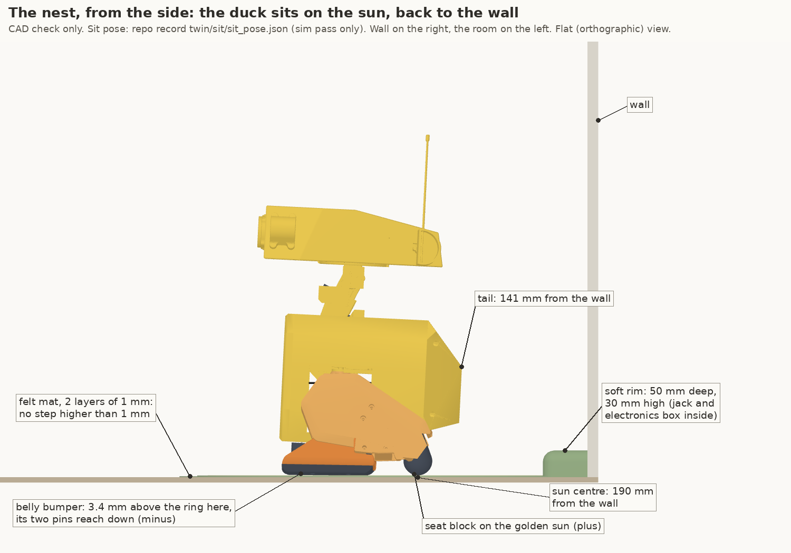
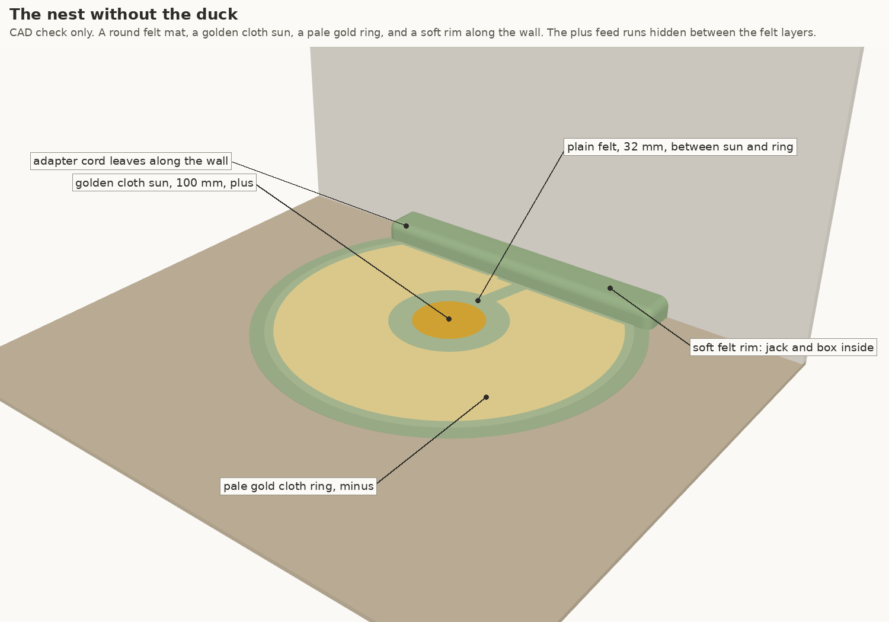
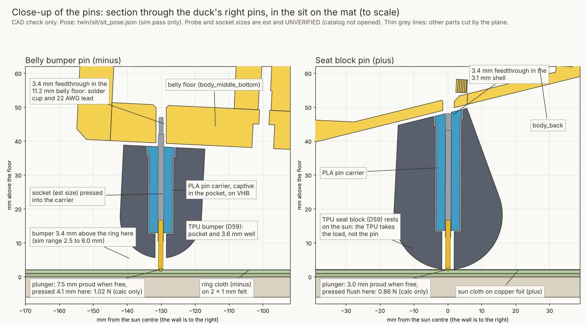
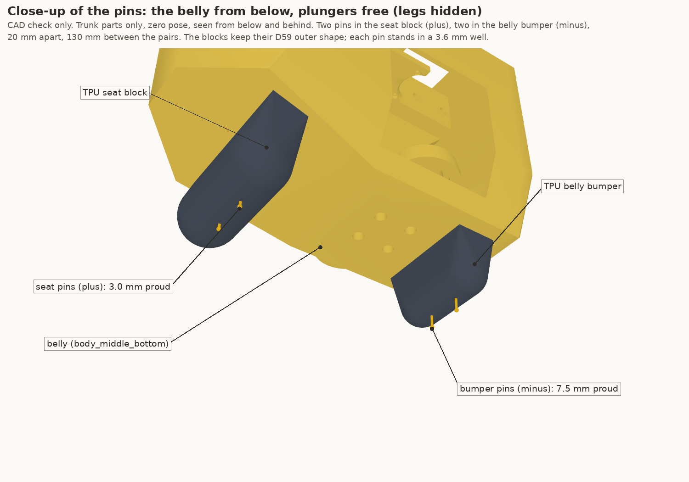
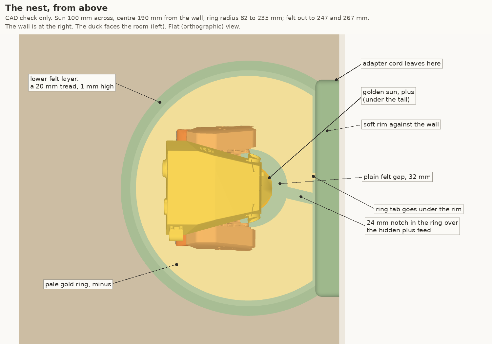
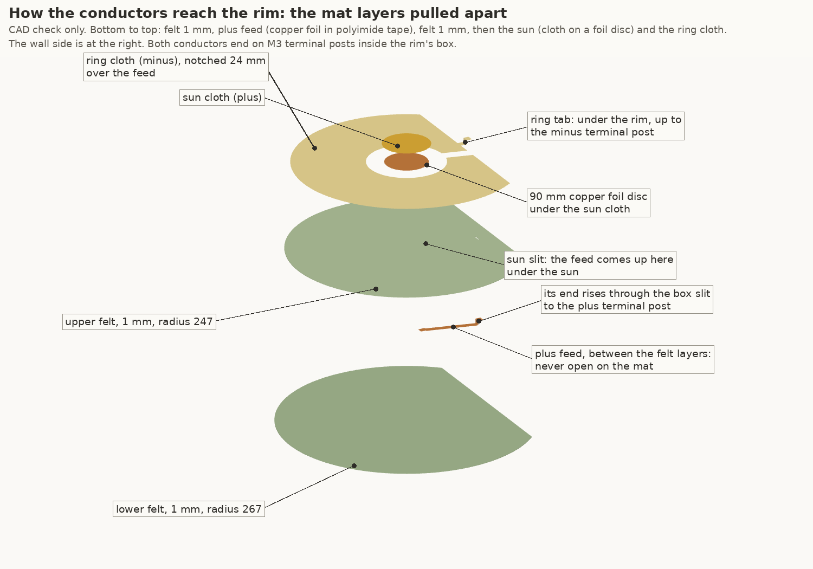
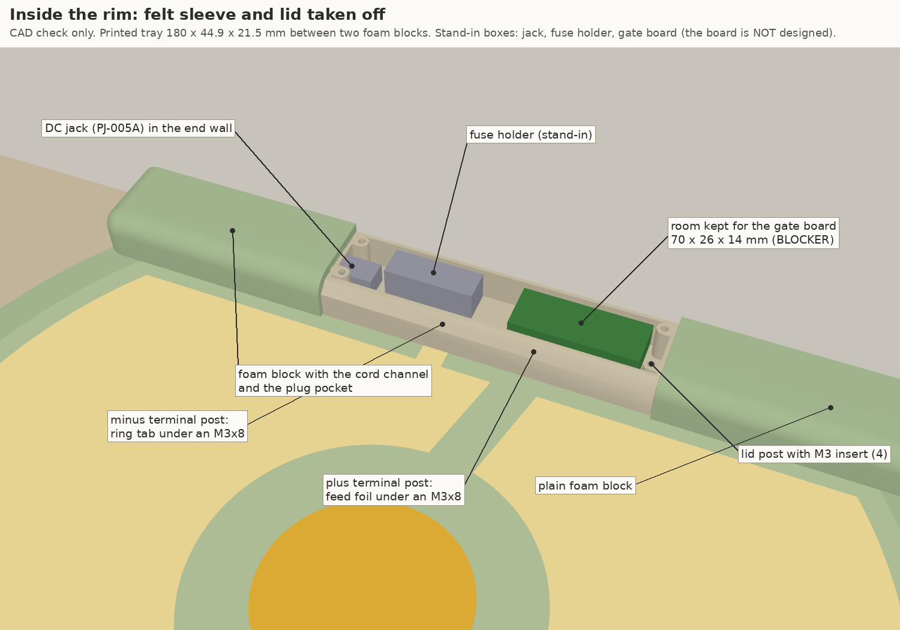
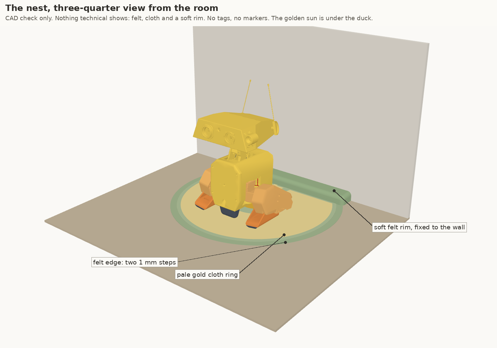

# NEST_CAD: the CAD of the nest, the new charging place for Duckie (Open Duck Mini v2 lab build)

2026-11-11. CAD and checks only. Nothing bought, nothing printed, nobody contacted. The repo was only read. Everything is in this folder.

Repo copy note (2026-11-11 ET): this is the report as written, copied into the repo as an archive of work in progress, with local folder paths and prices removed. Nothing in it is installed: print/, the URDF, the netlist, the BOM and the viewer are unchanged (section 7 is the landing plan, not done). The scripts beside it were moved here and their paths made relative; they were syntax-checked and not re-run after the move. Where the text says `dock/natural/`, read this repo's `altaay_lab/twin/dock/nest/`. Four large STEP files were left out to keep the archive small (`sit_seat.step`, `sit_bumper.step`, `body_middle_bottom_feedthroughs.step`, `nest_box_tray.step`); `step_export.py` makes them again from the STLs in `stl/`. The owner has seen the renders and has not yet said the look is approved. Index: ../README.md. Status: ../HANDOVER.md.

Labels used on every number: **CAD check only** (measured on the meshes), **calc only** (arithmetic), **sim pass only** (from a MuJoCo run), **index** (read from a web search result, the page itself could not be opened), **est** (an estimate, no source in hand, UNVERIFIED).

## Plain summary

1. The duck gets four spring pins under its body: two in the seat block (plus) and two in the belly bumper (minus). The blocks keep their outer shape. No new screw on the duck.
2. The reach problem is fixed by a long pin. The bumper pins stand 7.5 mm out and can be pushed in 10 mm. They touch the mat for any bumper gap up to 7.5 mm. The sim range is 2.5 to 6.0 mm.
3. In a sim of the sit with these pins, all four pins touched in 22 of 22 sits, the legs stayed on their stops, and the duck stood up every time (sim pass only).
4. The pins are high off the floor when the duck stands (115 mm, CAD check only) and when it walks and turns (77 mm at the lowest, sim pass only).
5. The duck gets 14.4 g heavier (calc only). The charger board that must move into the duck is not counted and not designed.
6. The mat is two layers of 1 mm felt. The lower layer is 20 mm wider, so the duck never meets a step higher than 1 mm.
7. The golden sun is cloth on a copper foil disc. Its feed runs hidden between the two felt layers to the rim. The ring cloth has a tab that goes under the rim.
8. The rim is 50 mm deep (the sim used 72 mm). That lifts the worst foot to rim gap from 9.5 to 31.5 mm. The head to wall gap stays 23.5 mm, because the brief fixes the sun at 190 mm.
9. The pin part is a real catalog part (QA Technology 100-40 series test probe), but its data sheet could not be opened here. Several of its sizes are estimates. That is the main BLOCKER.
10. The gate board inside the rim and the charger board inside the duck are not designed. The CAD keeps room for them.





---

## 1. CAD tool and conventions

Same as the existing twin parts (`altaay_lab/twin/dock/dock_parts.py`, `altaay_lab/twin/sit/sit_cad.py`): mesh CAD in Python with `trimesh` and `manifold3d`, units mm, one STL per part as the master file, a JSON record next to the meshes, a check script that prints PASS or FAIL. The duck parts are built on the repo scene (`sitlib.scene()`: `robot.urdf` plus `print/*.stl`), in the trunk frame. Every written part passes the repo's watertight test (`sitlib.stl_roundtrip_ok`).

STEP: the project has no STEP export, so `step_export.py` adds one with OCP (pip package `cadquery-ocp`, installed outside the repo). The STEP files are the same solids as the STLs, written as **faceted** solids (flat faces, coplanar triangles merged). They are not analytic CAD: a hole is a 24-sided prism, not a cylinder. STEP volume is checked against the mesh volume for every part (CAD check only).

Frames:
- **Trunk frame**: the `robot.urdf` base frame at the zero pose, x forward, y left, z up, mm.
- **Nest frame** (as `sim/nestlib.py`): the sun centre on the floor is the origin, x toward the wall (wall face at x = 190), y along the wall, z up, mm.

---

## 2. What was designed

### 2.1 Duck side





| Part | New or changed | What | Numbers (CAD check only unless marked) |
|---|---|---|---|
| `sit_seat` | changed, TPU 95A | The D59 seat block with a pocket from its glue face and two 3.6 mm plunger wells down to its floor face. Outer shape unchanged | volume 88,292 to 82,951 mm3; 11.5 mm of TPU under the carrier |
| `sit_bumper` | changed, TPU 95A | The D59 belly bumper, the same way. Outer shape unchanged | volume 40,885 to 36,921 mm3; 7.5 mm of TPU under the carrier |
| `pin_carrier_seat` | new, PLA | Rigid holder for two probe sockets: two 7 mm columns, a 3 mm web, a 2.5 mm flange (8 x 29 mm) that lies on VHB against the body. The top follows the sloped shell | 16.0 x 29.0 x 34.5 mm, 4,169 mm3, 5.2 g (calc only) |
| `pin_carrier_bumper` | new, PLA | The same for the bumper, flat top | 8.6 x 29.0 x 25.4 mm, 3,116 mm3, 3.9 g (calc only) |
| `body_middle_bottom` | changed, PLA | Four 3.4 mm feedthroughs on the pin axes, each with a 0.8 mm 45 degree mouth inside. Through the 3.1 mm shell at the seat and the 11.2 mm floor at the bumper | volume 151,525 to 151,249 mm3 |
| `pin_gauge` | new, PLA, a tool | Two pads with a slot: 3.0 mm deep (seat) and 7.5 mm deep (bumper). The pad lies on the block, the socket is pressed in until the tips touch the slot floor | 60 x 14 x 9.5 mm |
| spring pin and socket | bought, 4 of each | See section 3 | sizes est |

How it goes together:
- The pins stand along the floor normal of the torque-off sit, 2.6 degrees from trunk z (`sim/calib.json`, sim pass only), on the lowest line of each block, at y +10 and -10 mm. Pair to pair: 130.2 mm along the floor (CAD check only; the sim used 130.5).
- Seat pins stand **3.0 mm** proud, bumper pins **7.5 mm** proud (design choice, plunger free).
- Each pin sits in a well, so when a block is pressed flat on the floor the plunger is level with the TPU and the TPU takes the load (a fall, the get-up roll of D60, the rock onto the bumper in the stand-up).
- Each carrier is **held captive**: it sits in its block's pocket (0.3 mm fit), VHB 4950 on its flange against the body, and its two sockets pass into the body feedthroughs. No screw (D39: a printed seat holds the part).
- Wire exit: each socket's solder cup points up into its own feedthrough. One 22 AWG silicone lead per pin goes up into the trunk.

Leads inside the trunk (names are proposals; trunk frame; lengths calc only):

| Lead | From, to | Gauge | Length | Nearest thing, clearance (CAD check only) |
|---|---|---|---|---|
| NP1 | seat pin left to splice JNP at (-101, 10, -6) | 22 AWG | 17.5 mm | belly shell, 3.8 mm |
| NP2 | seat pin right to JNP | 22 AWG | 30.4 mm | belly shell, 2.3 mm |
| NP3 | JNP to DK6.VIN at (-104, -4.5, 43), the dock supply diode of D50 | 20 AWG | 62.9 mm | 1.8 mm or more to every part and placed board |
| NM1 | bumper pin left, up the gap in front of `trunk_bottom`, to splice JNM at (24, -4, 31), where JGD was | 22 AWG | 65.9 mm | cliff sensor box, 3.3 mm |
| NM2 | bumper pin right to JNM | 22 AWG | 60.5 mm | cliff sensor box, 3.3 mm |
| NM3 | JNM to BMS.P-: the old cable DC2's second leg, kept as routed | 20 AWG | 157.4 mm | not re-checked: repo route (`twin/dock/dock_routes.json`, self check PASS) |

The charger board that the nest concept moves into the duck has no seat and no part choice yet. Its input would tap JNP. BLOCKER 3.

### 2.2 The mat





All flat cut parts. Nothing printed. Bottom to top (CAD check only):

| Part | Material | Shape |
|---|---|---|
| `nest_felt_base` | felt, 1.0 mm | radius 267 mm round the sun centre, back cut flat 6 mm from the wall. 451 x 534 mm |
| `nest_feed` | 12 mm copper foil tape wrapped in polyimide tape, about 0.07 mm (est) | lies **between** the felt layers, from under the sun to the box. Never open on the mat |
| `nest_felt_top` | felt, 1.0 mm | radius 247 mm. Two slits: the sun slit (14 x 1.5 mm, 43 mm from the centre, under the sun cloth) and the box slit (16 x 2.5 mm, under the box) |
| `nest_sun_foil` | copper foil with conductive adhesive (est: 3M 1181 class, UNVERIFIED) | 90 mm disc under the sun cloth, so the plus current spreads in copper |
| `nest_sun` | golden conductive cloth, about 0.1 mm (est) | 100 mm disc, centre 190 mm from the wall. Plus |
| `nest_ring` | pale gold conductive cloth, about 0.1 mm (est) | radius 82 to 235 mm, cut 56 mm from the wall, a 24 mm notch over the feed, a 14 mm tab that runs under the rim into the box. Minus |

- Thickness: 2.0 mm of felt, 2.10 mm at the ring, 2.17 mm at the sun (CAD check only).
- Edge: two steps of 1.0 mm, 20 mm apart. The sim tripped on one 2 mm rise while steering (29 of 270 at 7.2 V, NEST_SIM.md, sim pass only). Two 1 mm rises are **not simulated yet**: BLOCKER 5.
- Plain felt between sun and ring: 32 mm. A US quarter is 24.26 mm (study, index), so a coin cannot bridge it.
- How the conductors reach the rim: the plus feed is stuck to the foil disc under the sun, dives through the sun slit, runs between the felt layers (hidden, insulated by tape and by felt above and below), comes up through the box slit and a slot in the tray floor, and is clamped under an M3 screw on the plus terminal post. The ring's own cloth tab runs on top of the felt under the rim, up through the second floor slot, and is clamped on the minus terminal post. Each post takes an M3 ring lug for the lead to the gate board.
- Landing window (calc only, the cut shapes scored with the study's rule: at least one seat pin on the sun, at least one bumper pin on the ring, no pin on the other pole): the seat pin pair may land anywhere within **45 mm** of the sun centre, for any heading up to **134 degrees** either side of facing the room. All **four** pins land inside a **36 mm** window. Bumper pins fall at radius 85.6 to 175.6 mm; the ring band less the 3 mm tip margin is 85 to 232 mm.
- Facing the wall (more than 134 degrees off) the bumper pins land past the ring's cut or on the notch. The duck does not charge there and nothing is shorted (wrong pole share 0 in every heading, calc only).
- Cloth resistance, order of magnitude (calc only, cloth 0.07 ohm per square from the study, index; contact resistance not included): one bumper pin to the tab about 0.10 ohm, so 0.21 V and 0.42 W at 2 A. The sun side is copper backed: about 0.002 ohm.

### 2.3 The rim



| Part | Material | What (CAD check only) |
|---|---|---|
| `nest_box_tray` | PLA, printed | 180 x 44.9 x 21.5 mm. Inside clear 176 x 40.9 x 19.5 mm. 8.0 mm jack hole in the left end wall, 4 lid posts and 2 terminal posts with M3 insert bores, 2 floor slots (16 x 2.5 mm) for the feed and the ring tab. Front top edge chamfered so the sleeve stays round |
| `nest_box_lid` | PLA, printed | 2 mm plate, 4 holes |
| `nest_bolster_left` | soft foam, cut | carries the rim on to the left end; a 12 x 12 mm channel along the wall for the adapter cord and a pocket for the plug |
| `nest_bolster_right` | soft foam, cut | plain |
| `nest_rim_cover` | 2 mm felt, sewn sleeve | 454 x 50 x 30 mm with 13 mm rounded edges: the only thing you see. Envelope only, not a sewing pattern |

- The rim stands on the back strip of the mat and pins it down. It is fixed to the wall or skirting board with VHB (the KATA Friends lesson of the study).
- In the box (stand-in boxes, est): the DC jack (Same Sky PJ-005A, dock BOM K6b), a fuse holder (Littelfuse FHAC0001ZXJ, 50 x 17.2 x 17.2 mm, repo), and **room for a gate board of 70 x 26 x 14 mm**. The gate board is not designed: BLOCKER 4.
- Felt over the box: 2.0 mm at the thinnest place; 2.85 mm over the lid screw heads (CAD check only).
- It looks like a felt bolster. No tags, no markers, no visible plastic.



---

## 3. The spring pin

**Choice: QA Technology 100-40 series test probe, standard spring force, with a rounded tip, in a 100-SDN250S solder cup socket. 4 of each.**

| Value | Number | Label and source |
|---|---|---|
| Full stroke | 10.16 mm (0.400 in) | index: "0.100 [2.54] Centers, 0.400 [10.16] Full Stroke", https://www.qatech.com/downloads/100-40_Catalog.pdf ; https://www.testequity.com/product/QA-100-PRP4070S-100-PRP4070S |
| Spring force, standard | 0.42 N preload (1.5 oz), 1.58 N (5.7 oz) at 8.05 mm | index, same catalog (copy: https://assets.testequity.com/te1/Documents/pdf/qa-technology/QA-Technology_100-40_Catalog_1123.pdf) |
| Life | 500,000 cycles | index, same |
| Probe tube diameter | 1.367 mm (0.0538 in) | index, same |
| Socket | 100-SDN250S, solder cup, nickel silver | index: https://www.neobits.com/qa_technology_100_sdn250s_qa_technology_100_sdn250s_p24325072.html . That it is the socket for the 100-40 probe: UNVERIFIED (the 100-40 catalog names the 100-SDN250 family in the index) |
| Socket outside diameter, mounting hole | 1.68 mm, 1.75 mm | **est, UNVERIFIED**. The carrier bore is printed 1.5 mm and reamed to the catalog hole with the part in hand |
| Lengths | tip to socket mouth 12.5 mm, socket 31.5 mm, solder cup 5 mm | **est, UNVERIFIED**. The design does not depend on them: the socket is pressed to height with `pin_gauge`. It needs about 49 mm above the tip; the CAD has it (the solder cup ends inside the feedthrough) |
| Tip style | a spherical radius tip, head about 2.3 mm | **est, UNVERIFIED**. The tip number is not known. A pointed or crown tip would catch the cloth |
| Current | 3 A or more per pin needed | **UNVERIFIED**: the index shows 3.1 A in one catalog and 10.2 A in another for this family. Need: 2.0 A typical, 2.8 A peak per pole (study), and one pin may carry a pole alone |
| Price | not looked up | BLOCKER |

Why this part: the bumper gap range (2.5 to 6.0 mm, sim pass only) plus a flush stop needs a stroke of about 8 mm or more. Mill-Max, the maker used on the old dock, tops out at 3 mm of stroke (index: https://www.digikey.com/en/product-highlight/m/millmax/3-mm-stroke-spring-loaded-connectors). A test probe has the stroke, a plunger that can be pulled out and replaced from below, and a socket with a solder cup.

**BLOCKER 1**: the hosts `www.qatech.com` and `assets.testequity.com` are outside this session's allowed network, so the catalog was not opened. If the part does not hold up, the required specs for a substitute are: stroke 9.5 mm or more; 0.4 to 0.6 N at first touch and no more than 1.2 N at 5 mm; a rounded tip 2 mm or more across; 3 A continuous; a replaceable plunger in a press-fit socket with a solder cup; socket no thicker than 2.0 mm (calc only).

---

## 4. Check results

`python3 nest_checks.py` prints one line per check and writes `nest_checks.json`. All pass.

| # | Check | Result | Label |
|---|---|---|---|
| A | Interference of the new duck parts against the trunk | Overlap 0.000 mm3 against 31 trunk parts and 17 placed boards (`audit/placements.json`). Closest unchanged trunk part: 2.12 mm (seat carrier to `body_back`). Carrier to block 0.30 mm (the fit), carrier to body 1.10 mm (the VHB), socket in its feedthrough 0.85 mm all round. Leads clear by 1.83 mm or more. Nearest trunk fastener F027 at 12.7 mm | CAD check only |
| B | Pins against the legs and feet | Closest leg or foot part to a free pin: 33.9 mm (standing, hip yaw 30 degrees). 83 poses: the sit, the sit and stand path, the stand, the hip yaw, roll and pitch ranges | CAD check only |
| C | Pin reach across the gap range | See the table below | calc only on index pin data and sim pass only gaps |
| C2 | The sit with the chosen pins in the sim harness | Plane model: all 4 pins touch in 11 of 11 sits, 8 of 8 loaded joints on their stops, seat block lift 0.24 mm at most, stood up 11 of 11. Height field model: all 4 touch in 11 of 11 (the assumed 5 mm pin: 8 of 11), bumper gap up to 5.57 mm, least bumper pin compression 1.85 mm | sim pass only |
| D | Ground clearance | Standing: seat tips 114.8 mm, bumper tips 130.0 mm above the floor. Walking and turning: lowest tip 77.4 mm | CAD check only; sim pass only |
| E | Mass added to the duck | 14.4 g | calc only, pin mass est |
| F | Print orientation | All 8 printed parts fit a 220 mm bed, no support needed | CAD check only, not sliced |
| G | Mat and rim | Window, margins, steps, the box: see sections 2.2, 2.3 and below | calc only, CAD check only |
| H | Fasteners and holes | 6 screws in 2 sizes already in the BOM, lid pattern mirror-symmetric about both centre lines, no screw on the duck, every hole has a named job | CAD check only |

### 4.1 Pin reach (check C)

Force law (index data, calc only): 0.42 N at first touch, plus 0.144 N per mm.

| Bumper gap above the mat | Bumper pin pressed in | Force per pin |
|---|---|---|
| 2.5 mm (smallest in the sim) | 5.0 mm | 1.14 N |
| 2.9 mm (the usual sit) | 4.6 mm | 1.08 N |
| 4.0 mm | 3.5 mm | 0.92 N |
| 5.0 mm | 2.5 mm | 0.78 N |
| 6.0 mm (largest in the sim) | 1.5 mm | 0.64 N |
| 7.5 mm | 0 mm: the pin just touches | 0 |

- Margin at the 6.0 mm gap: 1.5 mm of compression. With 0.67 mm against it (0.5 mm print and tape tolerance, est, plus the 0.17 mm sun stack): 0.83 mm, 0.54 N (calc only).
- Seat pins: pressed 3.0 mm with the block on the felt (0.85 N), 2.1 mm if the block floats 0.87 mm (0.73 N) (calc only; 0.87 mm is the largest lift in NEST_SIM.md, sim pass only).
- Flush stop: bumper pin pressed 7.5 mm when the bumper is flat on the floor, 2.66 mm of stroke left. Seat pin 3.0 mm, 7.16 mm left (calc only on the index stroke).
- For a bumper plunger to bottom, the TPU round the wells would have to squash 2.66 mm. With a solid ring round each well that takes about 1,900 N (calc only, TPU modulus 26 MPa est from `sitlib.E_TPU`). So the print needs a solid ring 4.2 mm wide round each well, like the insert rings of `body_middle_bottom`.
- Not lifting the duck: all four pins together push 3.87 N in the usual sit and 3.99 N at the smallest gap (calc only). NEST_SIM.md found all 8 loaded joints on their stops at 4.62 N and at 9.24 N (sim pass only). The re-run with these pins (C2) agrees: 8 of 8, and the seat block keeps 0.85 N on the felt.

### 4.2 Ground clearance (check D)

| Pose | Seat pin tips | Bumper pin tips | Label |
|---|---|---|---|
| Standing, the stand pose of `sit_sim.STAND` | 114.8 mm | 130.0 mm | CAD check only (blocks 117.8 and 137.4 mm; the study's sim gave 117.1 and 136.4) |
| Standing still under the walk policy | 90.9 mm | 85.8 mm | sim pass only |
| Walking forward at 0.15 | 89.9 mm | 77.6 mm | sim pass only |
| Turning left and right at 1.0 | 86.3 mm | 77.4 mm | sim pass only |

The walk carries the trunk at 155 to 170 mm, lower than the 202 mm stand pose. 4 runs, 0 falls, flat floor (`walk_clearance.py`). Nothing to drag or catch: the lowest pin tip is 77 mm up, and the mat is 2 mm thick.

### 4.3 Mass (check E, calc only)

| Item | g |
|---|---|
| Two PLA carriers, solid | 9.0 |
| 4 probes and 4 sockets (est 0.3 g each) | 2.4 |
| New leads NP1 to NP3, NM1, NM2 | 1.2 |
| TPU: pockets and wells out (-2.6), solid rings in (+3.7) | 1.1 |
| VHB, splices, body holes | 0.7 |
| **Total added** | **14.4** |

Not counted: the charger board for the duck (not designed). Comes off with the wall dock: the chest pad and its short leads, about 13 g (`DOCK_INTERFACE.md`). All of the new mass is low in the trunk.

### 4.4 Rim and wall margins (check G)

| Margin | NEST_SIM.md (sim pass only) | This CAD | Label |
|---|---|---|---|
| Foot to rim, worst run | 9.5 mm with the 72 mm rim | **31.5 mm** with the 50 mm rim | the sim number plus the 22 mm the rim gives back (calc only). Not re-run |
| Head to wall, worst run | 23.5 mm | 23.5 mm, unchanged | the brief fixes the sun at 190 mm. Each mm the sun moves out adds one: 48.5 mm at 215 mm (calc only, needs a re-run). One number to change: `WALL_X` in `nestcad_lib.py` |
| Tail to wall, sitting on the centre | 141 mm (study) | 141 mm | CAD check only |
| Sitting duck to rim | | 124 mm | CAD check only |

### 4.5 Print orientation (check F, CAD check only, not sliced)

| Part | Orientation | Notes |
|---|---|---|
| `pin_carrier_seat` | flange face on the bed | columns lean 14 degrees, no overhang over 45 degrees. PLA, solid. Ream the two bores to the socket's mounting hole |
| `pin_carrier_bumper` | flange face on the bed | bores vertical. PLA, solid |
| `sit_seat` | as today: the sloped glue face on the bed (`print/parts.csv`: up vector -0.2873 0 -0.9578) | the pocket opens on the bed face. Its roof is a bridge 8.6 mm wide (238 mm2). TPU, 2 walls, 10 % infill, plus a solid ring 4.2 mm wide round each well |
| `sit_bumper` | as today: -z up, glue face on the bed | the same (235 mm2 of bridge) |
| `body_middle_bottom` | as today (+z up) | the four feedthroughs are near vertical |
| `nest_box_tray` | floor on the bed | 180 mm long. The 45 degree chamfer and the jack hole need no support (12 mm2 over 45 degrees at the hole top) |
| `nest_box_lid`, `pin_gauge` | flat | |

---

## 5. Parts list with fasteners

| # | Part | Qty | Made how | Held by |
|---|---|---|---|---|
| 1 | `sit_seat` (changed) | 1 | TPU print | VHB 4950 (BOM 29), as today. Glue face 1,670 mm2 before, 1,408 mm2 now: 16 % gone to the pocket (CAD check only) |
| 2 | `sit_bumper` (changed) | 1 | TPU print | VHB 4950, as today. Glue face 1,440 mm2 before, 1,185 mm2 now: 18 % gone (CAD check only) |
| 3 | `pin_carrier_seat` | 1 | PLA print | captive in the seat's pocket, VHB 4950 on its flange (232 mm2) |
| 4 | `pin_carrier_bumper` | 1 | PLA print | captive in the bumper's pocket, VHB 4950 on its flange |
| 5 | `body_middle_bottom` (changed) | 1 | PLA print | as today |
| 6 | Probe, QA Technology 100-40 series, standard force, rounded tip | 4 | bought | pushes into its socket, pulls out for a swap |
| 7 | Socket 100-SDN250S | 4 | bought | press fit in the carrier bore |
| 8 | Leads NP1, NP2, NM1, NM2 (22 AWG silicone), NP3 (20 AWG); NM3 is the old DC2 leg | | cut | soldered; two heat shrink splices JNP, JNM |
| 9 | `pin_gauge` | 1 | PLA print | a tool, not on the robot |
| 10 | `nest_felt_base`, `nest_felt_top` | 1 each | cut from 1 mm felt | bonded to each other (fusible web or spray glue, est) |
| 11 | `nest_sun`, `nest_ring` | 1 each | cut from conductive cloth | bonded and stitched to the top felt (est) |
| 12 | `nest_sun_foil`, `nest_feed` | 1 each | cut from copper foil tape; the feed wrapped in polyimide tape | own adhesive |
| 13 | `nest_box_tray`, `nest_box_lid` | 1 each | PLA print | lid: **NL1 to NL4, 4 x M3x6 button head (BOM 17j)** into M3 heat-set inserts (BOM 16), on the lid's 4 corners, 6 mm in |
| 14 | Mat terminals | 2 | | **NT1, NT2, 2 x M3x8 SHCS (BOM 17a)** into M3 heat-set inserts (BOM 16) in the terminal posts, a mirror pair at y +25 and -25 mm; an M3 ring lug under each head |
| 15 | M3 heat-set inserts (BOM 16) | 6 | bought, in the BOM | 4 lid posts, 2 terminal posts |
| 16 | DC jack PJ-005A (dock BOM K6b) | 1 | bought | its own nut, in the 8.0 mm hole |
| 17 | `nest_bolster_left`, `nest_bolster_right` | 1 each | cut foam | held by the sleeve |
| 18 | `nest_rim_cover` | 1 | sewn from 2 mm felt | slides over box and foam |
| 19 | Rim to wall | | | VHB 4950, 2 strips of 170 mm on the tray's back face |

D42: the only screw groups are the 4 lid screws (mirror-symmetric about both centre lines, checked) and the 2 terminal screws (a mirror pair). No new screw size. D39: every hole has a job (table in `nest_checks.json`, check H): 4 feedthroughs (socket tail and lead), 4 wells (plunger travel), 4 socket bores, 6 insert bores, 4 lid holes, 2 floor slots, 2 felt slits, 1 jack hole.

One hole in the repo becomes empty when the wall dock goes: the 6 mm chest lead hole in `print/body_front.stl` (D50, `twin/dock/chest_hole.py`). It must be closed (D39). See section 7.

---

## 6. Open BLOCKERs

| # | BLOCKER | What closes it |
|---|---|---|
| 1 | The pin's data sheet was not opened (hosts not allowed). Unverified: socket diameter and mounting hole, lengths, tip style number, current rating, solder cup wire size, price, whether 100-SDN250S is the 100-40 socket | Allow `www.qatech.com` and `assets.testequity.com`, read the 100-40 catalog, put the real numbers in `nestcad_lib.PIN`, re-run all scripts |
| 2 | Pin on cloth: contact resistance, wear, whether a round tip snags, how far a 1 N tip sinks into felt. Gold coloured cloth source | Bench P1 of the study |
| 3 | The duck-side charger board: part, seat, heat (study BLOCKERs 6 and 7). The leads end at JNP, DK6.VIN and JNM | A duck-side electronics job; then route the last lead |
| 4 | The gate board in the rim: not designed. The box keeps 70 x 26 x 14 mm. Heat inside a felt sleeve not checked | The electronics job (study BLOCKER 5) |
| 5 | The two 1 mm steps at the mat edge are not simulated. Real felt (how it squashes, how it grips), a non-slip underside | Re-run `sim/nest_run.py` with the new edge; bench |
| 6 | Head to wall stays 23.5 mm (worst sim run) because the sun is fixed at 190 mm | Decide if the sun may move to about 215 mm; re-run the sim |
| 7 | Sources and prices: felt, cloth, foil tape, polyimide tape, foam, the pins | A sourcing pass |
| 8 | A belly-down fall and the get-up roll with the pins in place: the flush stop is calc only | Add the pins to the get-up sim; bench |
| 9 | The blocks lose 16 % (seat) and 18 % (bumper) of their VHB area to the pocket (the carrier brings 232 mm2 of its own). The sit stress checks were not re-run | Re-run `twin/sit/sit_stress.py` with the new areas |
| 10 | The sim has no pin tip friction and a rigid mat. The pins are forces on the trunk, not parts | Bench sit on real felt with a feeler gauge |
| 11 | Mass and centre of mass: +14.4 g is not in the sim model (2.8078 kg) | Add to `twin/sit/sit_model.py` when the charger board is known |
| 12 | The STEP files are faceted. No STEP of the whole `body_middle_bottom` (59 MB as facets); only the four cut volumes | Accept, or redraw the new parts in an analytic CAD tool |
| 13 | The nest replaces the feet contacts of D58. That needs Ahmed's decision in `DECISIONS.md` before anything lands | Ahmed |

---

## 7. What must change in the repo to land this (file by file)

Nothing below was done. Paths are from the repo root.

**A. New folder `altaay_lab/twin/nest/` (the nest CAD)**
1. Copy `nestcad_lib.py`, `duck_pins.py`, `nest_parts.py`, `nest_assembly.py`, `nest_checks.py`, `nest_render.py`, `walk_clearance.py`, `pins_sit_check.py`, `step_export.py`, the JSON records and `NEST_CAD.md` (as `NEST_TWIN.md`). In `nestcad_lib.py` set `REPO` from the file's own path (as `sitlib.py` does) and write STLs to `twin/nest/stl/`. Renders go to a folder outside the repo, as the other twin scripts do (`sit_pose.py render --img`).
2. `pins_sit_check.py` and `walk_clearance.py` import `dock/natural/sim/nestlib.py` and the scratch model. Either land `nestlib.py` too (as `twin/nest/nestlib.py`) or keep these two as records with their JSON.
3. Add `test_nest_checks.py` (pytest, fail closed, as `twin/dock/test_dock_checks.py`) and a verify entry `altaay_lab/verify/c13_nest.py`, with a row in `altaay_lab/VERIFICATION.md`.

**B. Duck parts**
4. `print/sit_seat.stl`, `print/sit_bumper.stl`: replace with `stl/sit_seat.stl`, `stl/sit_bumper.stl` (same part frames). Best done in the builder: add the pocket and wells to `seat_and_bumper()` in `altaay_lab/twin/sit/sit_cad.py`, so a re-run of `sit_cad.py --write` does not undo them. `sit_cad.py --write` also refreshes the URDF mesh copies `mini_bdx/robots/open_duck_mini_v2/sit_seat.stl` and `sit_bumper.stl` (in m).
5. `print/body_middle_bottom.stl`: replace with `stl/body_middle_bottom.stl` (same frame), or apply the four cuts with a script like `twin/dock/chest_hole.py` (volume guard 151,525.2 to 151,248.9 mm3). Refresh its URDF mesh copy in `mini_bdx/robots/open_duck_mini_v2/` the same way.
6. `print/pin_carrier_seat.stl`, `print/pin_carrier_bumper.stl`, `print/pin_gauge.stl`: new files.
7. `mini_bdx/robots/open_duck_mini_v2/robot.urdf` (and `robot.xml`): two new fixed links `pin_carrier_seat` and `pin_carrier_bumper` on `trunk_assembly`, placed by `duck_pins.json` `placements` (the pattern of the `sit_seat` link). Do it in `altaay_lab/twin/sit/sit_urdf.py`; raise `N_SIT_VISUALS` in `altaay_lab/twin/sit/sitlib.py` from 16 to 18 and add the two keys to `SIT_LINKS`; `twin/sit/sit_records.py` checks that count.
8. `altaay_lab/twin/sit/sit_model.py`: no collision change (the blocks keep their outer shape). Add the 14.4 g to the trunk when BLOCKER 11 closes. Optional: add the four pins as sprung sites, with the numbers of `nestcad_lib.PIN`.
9. `altaay_lab/print/parts.csv`: new rows for the two carriers (PLA, heavy or 100 % infill, up = part z) and the gauge; change the `sit_seat` and `sit_bumper` rows to add the solid ring round each well (the `rings` column, as the insert rings). Then `altaay_lab/PRINT_CHECK.md` and `altaay_lab/print/PRINT_PLAN.md` by their generator (`twin/sit/sit_print.py`).
10. `print/body_front.stl`: close the 6 mm chest lead hole again (the pre-D50 file has volume 142,628.4 mm3, see `twin/dock/chest_hole.py`), and its URDF mesh copy. Update `altaay_lab/twin/holes/data/*` by re-running `twin/holes/checks.py` and `inventory.py` so the hole audit lists the 4 new feedthroughs as holes with a job and no longer lists the chest hole.

**C. Wiring and placed parts**
11. `altaay_lab/wiring/netlist.yaml`: remove the chest pad J9 (DKP) and DK2, cables DC1, DC3, DC4 and the first leg of DC2; add the pin pairs, splices JNP and JNM, and cables NP1 to NP3 and NM1 to NM3 (NM3 is the old DC2 leg). The nets shrink from 4 to 2 as the study says; the charger board enters here when it is chosen. Then `altaay_lab/WIRING.md`, `CABLE_MAP.md`, `HARNESS_BUILD.md` by their generators.
12. `altaay_lab/cables3d/` (and `twin/dock/dock_cables3d.py`, which routes DC1 to DC4 into `cables3d.json` today): route the six new leads with the points of `nest_assembly.routes()`; drop the old runs.
13. `altaay_lab/audit/placements.json`: remove `dock_pad` and `dock_dk2`; keep `dock_dk6`, `dock_dk7`; `dock_f2` goes if the charge fuse moves with the charger. Add the 4 probes with sockets as small placed parts if the viewer should show them.
14. `altaay_lab/BOM.md`, `bom.json`, `BOM_FULL.md`, `bom_full.csv`: retire DK1 (chest pad) and DK2; add the 4 probes, 4 sockets, the leads. The dock lines K1 to K12 (`twin/dock/dock_bom.py`, `DOCK_BOM_FULL.md`) are replaced by the nest list of section 5: felt, cloth, foil, polyimide tape, foam, PLA, 4 x 17j, 2 x 17a, 6 x BOM 16, the jack K6b, the adapter K6.
15. `altaay_lab/MOUNTING.md`: rows for the two carriers (VHB, captive), the feedthroughs, the splices; remove the chest pad and DK2 rows.
16. `altaay_lab/fasteners/`: no new duck fastener. The nest's 6 screws and 6 inserts go in a `twin/nest/nest_fasteners.json` in the schema of `twin/dock/dock_fasteners.json`.

**D. The 3D viewer: swap the wall dock for the nest**
17. `altaay_lab/viewer/make_viewer_data.py`:
   - line 98 map: add `"pin_carrier_seat": "trunk", "pin_carrier_bumper": "trunk"` next to `sit_seat` and `sit_bumper`;
   - lines 215 to 224 (the placeholder list): drop `dock_pad` and `dock_dk2`, add the probes;
   - line 331 (BOM line to nodes): drop `DK1`, `DK2`, add the new BOM lines;
   - `--scene` choices (line 1042): `duck`, `nest`, `nested` in place of `duck`, `dock`, `docked`; call a new `nest_scene.build`.
18. New `altaay_lab/viewer/nest_scene.py`, in the shape of `viewer/dock_scene.py`: `nest` = every nest part of `twin/nest/nest_parts.json` (STLs in the nest frame), the 6 screws and inserts, the stand-in boxes, the parts panel from the nest BOM; `nested` = the nest plus the duck of the duck scene, each duck node moved by `T_nest(link) x T_zero(link)^-1`, with the link poses from `nest_assembly.trunk_in_nest()` and `twin/sit/sit_pose.json` (the job `dock_assembly.docked_duck_links()` does today). Categories: felt, cloth, foil, foam, printed PLA, electronics, screw, insert.
19. `altaay_lab/viewer/index.html`: lines 309 to 311, the buttons become Duck, Nest, Nested with `data-scene` `nest` and `nested`; lines 420 to 430, the scene table: `nest_manifest.json` + `nest.glb.txt`, `nested_manifest.json` + `nested.glb.txt`, new titles and lede text.
20. `altaay_lab/viewer/test_viewer.js` and `viewer/README.md`: the scene argument becomes `nest` or `nested`.
21. `altaay_lab/viewer/dock_scene.py` and `altaay_lab/twin/dock/*`: the old wall dock. D58 says its CAD stays until a new dock CAD replaces it. When the nest lands, move `twin/dock/` to `altaay_lab/history/` or delete it, and drop check C12 (`verify/c12_dock.py`) in favour of C13.

**E. Records**
22. `altaay_lab/DECISIONS.md`: a new decision for the nest (it bends D58 and D50 as the study lists). Ahmed's words only.
23. `altaay_lab/twin/sit/SIT.md` section 1 (the seat and bumper rows), `STATE.md`, `V1_PLAN.md`, `TEST_PLAN.md` (bench P1 pin on cloth; the sit on felt with a feeler gauge), `GAPS.md` (the BLOCKERs of section 6).
24. Outside this repo: the dock course of the shared lab gym (overlay gym/overlays/duck; `dock/dock_course.py`) still models the wall dock; `sim/nestlib.py` is the nest world to port there. The dock behaviour code (`altaay_lab/software/dock`, the autodock port of D43) needs the walk on, turn, sit sequence of NEST_SIM.md instead.

---

## 8. Files

All in this folder. Largest file 4.6 MB.

| File | What |
|---|---|
| `NEST_CAD.md` | this report |
| `nestcad_lib.py` | shared numbers (pin, proud heights, mat and rim sizes), frames, the render and write helpers |
| `duck_pins.py`, `duck_pins.json` | the duck parts; pin positions, placements, part records |
| `nest_parts.py`, `nest_parts.json` | the mat and rim parts; sizes, terminals, stand-ins |
| `nest_assembly.py`, `nest_assembly.json`, `nest_assembly.glb` (4.6 MB), `nest_assembly_new_parts.stl` (3.4 MB) | the duck in its sit on the mat against the wall. The GLB holds everything (the repo's duck meshes cut to 1,000 faces each to stay under 5 MB; the nest and the new parts exact). The STL holds the nest and the new or changed duck parts only. The JSON lists every node with its 4x4 placement and the lead routes |
| `nest_checks.py`, `nest_checks.json` | checks A to H |
| `walk_clearance.py`, `walk_clearance.json` | pin tip heights while standing, walking, turning (sim pass only) |
| `pins_sit_check.py`, `pins_sit_check.json` | the sit with the chosen pins, 22 sits (sim pass only) |
| `nest_render.py` | the renders |
| `step_export.py` | mesh to faceted STEP (needs OCP) |
| `stl/` | `sit_seat`, `sit_bumper`, `pin_carrier_seat`, `pin_carrier_bumper`, `body_middle_bottom`, `body_middle_bottom_feedthroughs` (the four cut volumes), `pin_gauge`, `spring_pin_ref` (stand-in), `nest_felt_base`, `nest_felt_top`, `nest_feed`, `nest_sun_foil`, `nest_sun`, `nest_ring`, `nest_box_tray`, `nest_box_lid`, `nest_bolster_left`, `nest_bolster_right`, `nest_rim_cover` |
| `step/` | the same parts as STEP, except the whole `body_middle_bottom` (BLOCKER 12). Duck parts in their part frames (placements in `duck_pins.json`); nest parts in the nest frame, so they load as an assembly |
| `renders/` | `nest_side.png`, `nest_top.png`, `nest_three_quarter.png`, `nest_alone.png`, `pins_section.png`, `pins_underside.png`, `mat_layers.png`, `rim_open.png` |

Commands (scratch folders outside the repo; `PYTHONDONTWRITEBYTECODE=1` on every line):
```
pip install --target <ocp> cadquery-ocp                      # once, for STEP
export NEST_OCP=<ocp>
python3 duck_pins.py && python3 nest_parts.py && python3 nest_assembly.py
python3 altaay_lab/twin/sit/sit_model.py --out <scratch>/model
python3 walk_clearance.py <scratch>/model
NEST_SCRATCH=<scratch> python3 pins_sit_check.py
python3 nest_checks.py
MUJOCO_GL=egl python3 nest_render.py
```
