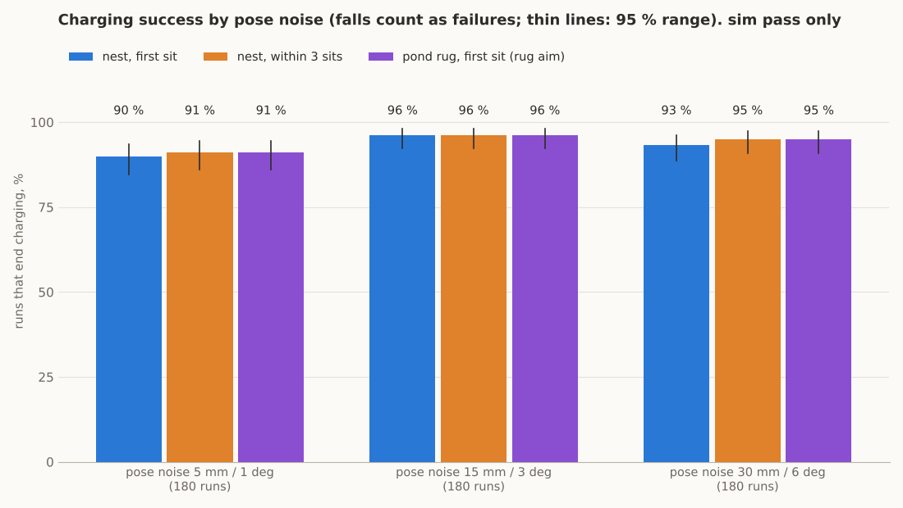
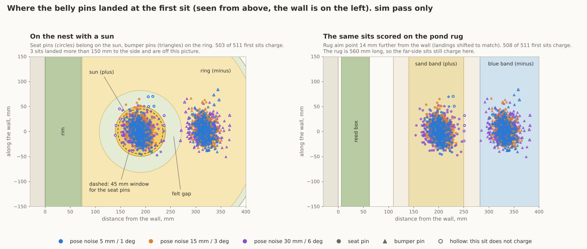
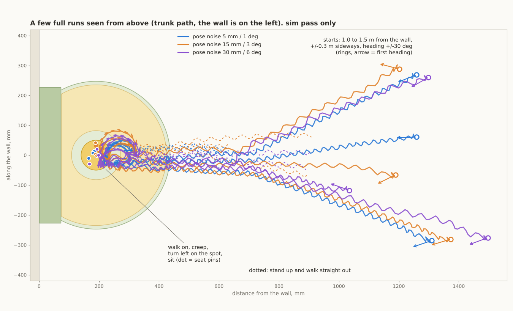

# NEST_SIM: "go to the nest" in MuJoCo (Sim N3 of NATURAL_DOCK_IDEAS.md). sim pass only

Repo copy note (2026-11-11 ET, for DECISIONS.md D61): this is the study as written, copied into the repo with local folder paths removed. The figures are beside this file. The scripts, JSON results and video clips it names are kept outside the repo (not copied), so the runs cannot be repeated from the repo alone: BLOCKER for a re-run. The study it follows is ../NATURAL_DOCK_IDEAS.md. Section 5 BLOCKER 1 names a fix (line up before the mat, cross straight); that re-run was in progress when this copy was made and its result is not in this file. Labels: "est" marks an estimate with no source in hand and "index" a web fact read from search results only; treat both as BLOCKER until sourced. The decision record and its open BLOCKERs are in altaay_lab/DECISIONS.md D61; the folder guide is twin/dock/nest/README.md.

2026-11-11. Duckie, Open Duck Mini v2 lab build. Simulation only: no CAD, no repo edits, nothing bought, nothing sent. Every number below is **sim pass only** unless it says **est** (an assumption I had to make) or **calc only**.

## Plain summary

1. The whole sequence works in sim: walk to the nest, creep to the turn spot, turn left on the spot, stop, sit, torque off. 540 runs, 180 per noise level.
2. Charging on the nest at the first sit: **93 %** of all runs (503 of 540). Within 3 sits: **94 %** (508 of 540). The pond rug scores the same (94 %).
3. Almost every failure is a fall, not a miss. 29 runs fell, all at 7.2 V, all while stepping onto the 2 mm mat edge during the steered walk-on (11 % of the 7.2 V runs, 0 at 6.0 V). With the mat taken away the same 29 runs do not fall.
4. Of the 511 runs that reached the sit, 503 charged at the first sit (98.4 %). Pose noise up to 30 mm and 6 deg barely matters: 90 / 96 / 93 % for low / mid / high noise.
5. Where accuracy is lost: the walk-on and creep (22 mm RMS, mostly sideways) and the turn (15 mm RMS). The sit itself adds 1 mm.
6. The stock walk cannot make small moves: it does not step at all below a forward command of 0.10, cannot step back at 0.10, cannot side-step right at any command, and its move size changes with battery voltage. This goes to the walk retrain list.
7. Good news on stopping: the stock walk stands still 0.4 s after a zero command with its feet 1 to 7 mm apart fore and aft. No settle step was needed in 511 sits.
8. The 4 spring pins (est: 0.6 to 1.4 N each) all touch in 510 of 511 first sits. They lift the seat block 0.1 to 0.3 mm off the felt but the legs stay on their stops. The bumper pin reach is fragile: one contact model gives a 2.7 mm gap, another 4 to 6 mm.
9. No part touched the wall or the rim in 511 runs (closest: head 23 mm from the wall, a foot 10 mm from the rim). Stand up and walk out: 511 tries, 0 falls. Whole sequence to torque off: 43 s on average.
10. Not proven: the real robot, real felt, a camera (pose is a stand-in), seeing the nest after the turn, the spring pin part. See BLOCKERs.



---

## 1. What was simulated

| Item | How | Label |
|---|---|---|
| Robot | The repo sit model (`twin/sit/sit_model.py`, 2.8078 kg), stock `BEST_WALK_ONNX_2` through the unmodified upstream `MjInfer` loop, as `turn_probe.py` and `sim/added_mass_sim.py` | sim pass only |
| Voltage | 6.0 and 7.2 V: servo gain and torque limit both scaled by V / 7.4, the model of `sim/power_fix.py` option 7 | sim pass only |
| World | Floor (friction 0.5 to 1.0, drawn per run), wall 190 mm behind the sun centre, rim block 72 mm deep and 30 mm high along the wall, nest mat 2 mm thick, 494 mm across, mat friction 0.6 / 0.8 / 1.0 | sim pass only |
| Mat edge | A height field with 5 mm cells: the 2 mm rise is one cell wide (2 mm over 5 mm, a steep chamfer, not a knife edge). Rigid: felt softness is not modelled | sim pass only |
| Start | Trunk 1.0 to 1.5 m from the wall, +/-0.3 m sideways, heading +/-30 deg | |
| Pose stand-in | True trunk pose + Gaussian noise: 5 mm / 1 deg, 15 mm / 3 deg, 30 mm / 6 deg (1 sigma). Sampled at 5 to 10 Hz (drawn per run), delivered 70 to 170 ms late (drawn per run) | stand-in, not perception |
| Turn sensing | Simulated IMU yaw only: gyro about the vertical, integrated at 50 Hz, with a bias (0.2 deg/s, 1 sigma) and a scale error (1 %, 1 sigma) | est |
| After the turn | Nothing is sensed between the turn start and the first sit | |
| Sit | `sit_sim.DOWN` and `SIT` (SIT.md section 5 path), 0.5 s, torque off, 3 s rest | sim pass only |
| Pins | 4 sprung contacts on the trunk, 2 in the seat block and 2 in the bumper, 20 mm apart, 130.5 mm between the pairs. Force 0.6 N at first touch to 1.4 N at full travel (1.0 N mid stroke). Seat pins stand 2 mm proud, bumper pins 5 mm ("long-travel pin" of the study). No tip friction | est (no part chosen) |
| Zone rule | `coverage.py`: a pin counts when it is compressed and 3 mm inside its zone. Charging = at least one seat pin on the sun, at least one bumper pin on the ring, no pin on the other pole's zone. Strict = all 4 pins on their own zones | calc only rule on sim positions |
| Retry | No contact: stand up (`sit_sim.rise` path), look (pose stand-in, averaged 0.6 s), creep so the seat pins would land on the sun, sit again. Up to 3 sits | |
| Walk-off | After the last sit: stand up, walk policy on, command 0.15 straight for 7 s | |

Runs: 3 noise levels x 2 voltages x 3 mat frictions x 30 seeds = 540. 9.2 hours of simulated time.

### The controller (all in `nest_run.py`)
1. **Approach:** steer to a line-up point 0.40 m in front of the turn spot (forward 0.15, yaw up to 0.8).
2. **Walk on:** forward 0.15, steering toward the line right up to the stop. The line is aimed 20 mm to the right on purpose, because the stock walk can only side-step left. Stop 40 mm short.
3. **Fine moves:** stand, average the pose for 0.6 s, make one open-loop creep move sized from `burst_probe.json` for this voltage, look again. Up to 6 moves. Tolerances: 10 mm forward, 15 mm back, 12 mm left, 8 deg.
4. **Turn:** left, command +1.0, until the IMU yaw reaches 180 deg minus the heading error minus the coast (-0.2 deg at 6.0 V, +2.8 deg at 7.2 V).
5. **Pre-compensation:** the turn spot is placed so that the measured shift "standing at the turn start to seat pins after torque off" ends on the sun centre. The shift is read from `calib_turn.json` for the bus voltage (the servos report it).
6. **Stop and settle:** zero command 1 s, wait for both feet loaded and the trunk at rest, one side-step and a new stop if the feet are more than 15 mm apart fore and aft (never needed), then freeze into the SIT.md stance.

Turn direction: **left**. Measured on the mat (30 turns per row, `calib_turn.json`):

| Turn | V | Time for 180 deg | Seat pins end, forward / left of the turn start (mean, 1 sigma) | Falls |
|---|---|---|---|---|
| left +1.0 | 6.0 | 5.9 s | +44.1 mm (9.5) / +18.9 mm (10.0) | 0 |
| left +1.0 | 7.2 | 4.2 s | +7.1 mm (3.1) / +5.6 mm (6.6) | 0 |
| right -1.0 | 6.0 | 7.1 s | +57.2 mm (6.8) / -105.6 mm (6.8) | 0 |
| right -1.0 | 7.2 | 4.9 s | +41.2 mm (8.6) / -78.0 mm (11.1) | 0 |

- The left turn moves the duck less and has the smaller spread at 7.2 V. The right turn carries it about 80 to 105 mm sideways.
- The shift depends on voltage: 37 mm between 6.0 and 7.2 V for the left turn. A single fixed offset (as `turn_probe.json` suggests: 136 mm back, 22 mm left on a bare floor at 7.4 V) would not do. The trunk itself moves back 82 mm at 6.0 V and 120 mm at 7.2 V on the mat.
- The sit moves the seat pins 126.4 mm behind the standing trunk origin, 1 sigma 1.6 mm. Very repeatable.

---

## 2. Results

### 2.1 Success

| Pose noise (1 sigma) | Runs | Nest, first sit | 95 % range | Nest, within 3 sits | Nest strict (all 4 pins), first sit | Rug, first sit, nest aim | Rug, first sit, rug aim | Falls in the sequence | Trips at the mat edge |
|---|---|---|---|---|---|---|---|---|---|
| 5 mm / 1 deg | 180 | 90.0 % (162) | 84.7 to 93.6 | 91.1 % (164) | 88.9 % (160) | 91.1 % (164) | 91.1 % (164) | 15 | 15 |
| 15 mm / 3 deg | 180 | 96.1 % (173) | 92.2 to 98.1 | 96.1 % (173) | 92.2 % (166) | 96.1 % (173) | 96.1 % (173) | 7 | 7 |
| 30 mm / 6 deg | 180 | 93.3 % (168) | 88.7 to 96.1 | 95.0 % (171) | 90.0 % (162) | 93.9 % (169) | 95.0 % (171) | 7 | 7 |
| all | 540 | 93.1 % (503) | 90.7 to 95.0 | 94.1 % (508) | 90.4 % (488) | 93.7 % (506) | 94.1 % (508) | 29 | 29 |

- A fall counts as a failure. Of the 511 runs that reached the sit: 98.4 % charge at the first sit, 99.4 % within 3 sits.
- The low-noise row is the worst only because it drew more edge falls (15 against 7 and 7). With 90 runs at 7.2 V per row that difference is weak evidence, not a finding.
- **Rug:** the same sits re-scored on the rug bands (seat on sand, bumper on blue, no bridge chip). The rug's best aim point is 204 mm from the wall against 190 mm for the sun (`coverage.json`), so "rug aim" shifts every landing 14.2 mm. The rug forgives the three far-side landings that the nest does not (it is 560 mm long). The rug was not simulated as its own mat.

| Slice | Runs | Nest, first sit | Nest, within 3 | Falls | Time to torque off, mean | 160 mm across the mat edge, mean |
|---|---|---|---|---|---|---|
| 6.0 V | 270 | 97.4 % (263) | 98.9 % (267) | 0 | 48.8 s | 4.7 s |
| 7.2 V | 270 | 88.9 % (240) | 89.3 % (241) | 29 | 36.2 s | 2.2 s |
| mat friction 0.6 | 180 | 90.6 % (163) | 92.2 % (166) | 12 | 43.3 s | 3.8 s |
| mat friction 0.8 | 180 | 93.3 % (168) | 93.9 % (169) | 11 | 42.9 s | 3.5 s |
| mat friction 1.0 | 180 | 95.6 % (172) | 96.1 % (173) | 6 | 42.5 s | 3.3 s |



### 2.2 Falls and trips

| Stage | Falls |
|---|---|
| Approach (on the floor) | 0 of 540 |
| Walk on (crossing the 2 mm mat edge while steering) | **29 of 540**, all at 7.2 V (10.7 % of 270), 0 at 6.0 V |
| Fine moves, turn, stop | 0 of 511 |
| Sit and torque off | 0 of 522 sits |
| Stand up for a re-sit, shuffle | 0 of 11 |
| Walk-off: stand up, walk out over the edge | 0 of 511 |

- What a trip looks like: the trunk stalls about 190 mm before the sun centre with a toe on the edge, then the duck goes over backwards. See `run_failed.mp4` (not in the repo).
- **Control (`edge_control.json`):** the same 29 seeds with the mat removed and everything else the same: 0 falls, 29 of 29 reach the sit. The edge is the cause.
- **Straight walks, no steering (`edge_probe_*.json`):** 20 walks per row onto the mat at command 0.15, heading +/-10 deg.

| Edge shape (2 mm rise over) | 7.2 V: onto the mat | 6.0 V: onto the mat within 12 s | Off the mat, 6.0 V | Off the mat, 7.2 V |
|---|---|---|---|---|
| 2.5 mm | 20 of 20, 0 falls | 11 of 20, 0 falls | 17 of 17 | 17 of 17 |
| 5 mm (the main runs) | 20 of 20, 0 falls | 7 of 20, 0 falls | 17 of 17 | 17 of 17 |
| 10 mm | 20 of 20, 0 falls | 18 of 20, 0 falls | 18 of 19, 1 fall | 18 of 19, 1 fall |
| 20 mm | 20 of 20, 0 falls | 20 of 20, 0 falls | 20 of 20 | 20 of 20 |

- So a straight walk at 7.2 V crosses every edge shape (80 of 80). The falls in the main runs come from **steering while a foot is on the edge**. Fix to try first: line up before the mat, then cross with no yaw command.
- At 6.0 V the duck does not fall but it is slow: 36 of 270 main runs needed more than 6 s for the 160 mm across the edge, the worst 27 s. In the straight probe several 6.0 V walks did not reach the mat in 12 s.
- The two "off the mat" falls at the 10 mm edge start on the mat, where the start pose sometimes throws the duck (see limits). I would not read them as edge trips without a closer look.

### 2.3 Rim and wall

| | Closest approach, worst run | 5th percentile | Mean | Collisions |
|---|---|---|---|---|
| Wall (head, during the turn) | 23.5 mm | 46.9 mm | 76.1 mm | 0 of 511 |
| Rim block (a foot) | 9.5 mm | 39.8 mm | 65.9 mm | 0 of 511 |

- The tail never comes near: the head is the closest part to the wall while turning. At 7.2 V the duck stands closer (wall 23.5 mm, rim 9.5 mm at worst) than at 6.0 V (51.7 and 37.7 mm), because the 7.2 V turn spot is nearer the wall.
- Margins are small. Moving the sun 20 to 30 mm further from the wall would cost nothing in the sim.

### 2.4 Landing scatter (first sit; mm and deg; mean / 1 sigma)

| Pose noise | Before the sit (standing trunk): x | y | yaw | After torque off (seat pins): x | y | yaw | Radial: mean / 95th / worst | Inside 45 mm |
|---|---|---|---|---|---|---|---|---|
| 5 mm / 1 deg | 2.4 / 11.0 | 3.1 / 20.8 | -1.1 / 3.0 | 2.6 / 11.1 | 0.7 / 20.3 | -1.2 / 2.9 | 17.5 / 34.0 / 175.5 | 98.2 % |
| 15 mm / 3 deg | 1.0 / 12.1 | 5.0 / 16.0 | -1.1 / 3.3 | 1.1 / 12.2 | 2.6 / 15.0 | -1.1 / 3.2 | 17.2 / 33.3 / 55.6 | 98.3 % |
| 30 mm / 6 deg | 2.8 / 18.3 | 7.8 / 28.8 | -1.1 / 3.9 | 2.9 / 18.4 | 5.5 / 29.0 | -1.2 / 3.8 | 23.9 / 44.2 / 249.8 | 94.8 % |

x is toward the wall, y along the wall. The y sigma of the low and high rows is inflated by 3 runs that landed 175 to 250 mm to the side (below).

By voltage: 6.0 V x -2.3 / 14.1, y 4.2 / 27.9 (95th radial 40.4 mm); 7.2 V x 7.3 / 12.9, y 1.6 / 13.4 (95th radial 35.8 mm, worst 49.7 mm).

### 2.5 Which stage loses the accuracy (first sit, mm)

| Pose noise | Walk-on and fine moves | of which the pose stand-in's own error | Turn and stop | Sit down | Total at the seat pins |
|---|---|---|---|---|---|
| 5 mm / 1 deg | x 0.0 / 6.6, y 4.9 / 15.3, RMS 17.4 | RMS 3.7 | x 2.2 / 9.4, y -4.3 / 11.2, RMS 15.4 | RMS 1.5 | RMS 23.3 |
| 15 mm / 3 deg | x -0.9 / 7.8, y 6.6 / 11.7, RMS 15.6 | RMS 9.2 | x 1.6 / 9.1, y -4.1 / 10.9, RMS 14.9 | RMS 0.9 | RMS 19.5 |
| 30 mm / 6 deg | x 0.2 / 13.9, y 10.8 / 25.7, RMS 31.1 | RMS 20.1 | x 2.3 / 9.7, y -5.5 / 11.1, RMS 15.9 | RMS 1.5 | RMS 34.9 |
| all | x -0.2 / 10.0, y 7.5 / 18.8, RMS 22.5 | RMS 13.0 | x 2.0 / 9.4, y -4.6 / 11.1, RMS 15.4 | RMS 1.3 | RMS 26.8 |

- **The walk-on and creep stage loses the most**, and mostly sideways. Even with almost perfect pose (5 mm noise) it leaves 15 mm (1 sigma) sideways, because the walk cannot side-step right and its smallest moves are coarse.
- The turn and stop is second: about 15 mm RMS at every noise level. It does not depend on perception.
- The sit is not a problem: 1 mm.
- The IMU stand-in was 1.5 deg off (2.3 deg sigma) at the end of the turn. Heading after torque off: -1.2 deg mean, 3 to 4 deg sigma, worst 10.5 deg. The nest does not care.

### 2.6 Retries

| | Count |
|---|---|
| First sit missed (duck still upright) | 8 of 511 |
| Why: seat pins off the sun / a pin on the wrong zone / in place but a bumper pin does not touch | 5 / 2 / 1 |
| Fixed by the second sit | 5 |
| Fixed by the third sit | 0 |
| Never charged | 3 |

- The 3 that never charged are all at 6.0 V. The walk-on left them 150 to 230 mm to the left of the line (a long stall on the mat edge while steering), and the creep moves could not bring them back: no right side-step, and about 2 cm per left burst.
- A re-sit costs about 30 s (stand up 13.6 s, look and shuffle, sit 12 s).
- The shuffle uses the pose stand-in while the duck faces away from the nest. A real camera may not give that (BLOCKER 3).

### 2.7 The pins and the sit

First sits of the main runs (511, mat as a plane, 3 s after torque off):

| | Seat pins | Bumper pins |
|---|---|---|
| Force per pin | 1.38 N (0.69 to 1.40) | 0.93 N (0 to 1.20) |
| Compression | 1.94 mm of 2.0 | 2.07 mm of 5.0 |
| Pin not touching | 0 | 1 sit (both bumper pins) |

Do the pins change the sit? `pins_effect.json`: 11 sits per case, 10 s after torque off, mean (min to max):

| Case | Seat block on the felt | Both soles | Seat block lifted | Bumper base above the felt | Trunk pitch | Joints on their stops | Stood up after |
|---|---|---|---|---|---|---|---|
| Pins off | 0.93 N (0.83 to 1.35) | 26.8 N | 0.01 mm | 2.88 mm (2.60 to 3.19) | 2.50 deg | 8 of 8 | 11 of 11 |
| Pins on (est force) | 0.00 N | 23.1 N | 0.32 mm (0.25 to 0.74) | 2.70 mm (2.47 to 2.97) | 2.29 deg | 8 of 8 | 11 of 11 |
| Pins at twice the force | 0.00 N | 19.2 N | 0.87 mm (0.78 to 1.17) | 2.35 mm (2.15 to 2.58) | 1.89 deg | 8 of 8 | 11 of 11 |

- **The pins do not hold the duck off its leg stops.** All 8 loaded joints (knees, ankles, hip roll, neck, head) stay on their stops.
- **They do take the seat block off the felt.** The seat rests with only 0.9 N, less than the two seat pins push (2.5 to 2.8 N). The block floats 0.1 mm after 3 s and 0.3 mm after 10 s, and the pins carry the trunk's rear. The soles give up 3.7 N to the pins.
- Trunk height changes by 0.1 mm and pitch by 0.2 deg. The sit position shifts 1.4 mm. Standing up is not affected.
- Pins without tip friction: real pins on cloth will also resist sliding a little. Not modelled.

**Bumper reach is fragile.** With the mat kept as the height field instead of a plane, the same sits end differently:

| Mat contact model | Bumper base above the felt | All 4 pins touch |
|---|---|---|
| Plane, pins on | 2.70 mm (2.47 to 2.97) | 11 of 11 |
| Height field (5 mm cells), pins on | 4.21 mm (2.71 to 6.00) | 8 of 11 |
| Height field, pins off | 6.38 mm (3.04 to 8.74) | 4 of 11 |

The difference is whether the folded legs settle fully onto the hip roll stops. I trust the plane more (it is the repo's own sit model and reproduces `sit_contacts.json`: seat 0.88 N, bumper 2.9 mm), and the height field result changes with its cell size, which marks it as a contact artefact. But the lesson stands: **a fraction of a millimetre at the feet moves the bumper by millimetres.** A 5 mm bumper pin is not clearly enough. This widens BLOCKER 3 of the study.

### 2.8 Time and current

| Stage | Mean time, 6.0 V | Mean time, 7.2 V | Bus current mean (A) | 20 ms peak, typical / worst (A) |
|---|---|---|---|---|
| Approach | 10.4 s | 6.6 s | 2.3 | 4.8 / 6.4 |
| Walk on | 10.4 s | 5.4 s | 2.3 | 5.0 / 7.9 (10.7 in a run that fell) |
| Fine moves | 5.9 s | 3.7 s | 1.1 | 4.2 / 6.1 |
| Turn | 5.9 s | 4.2 s | 2.3 | 5.4 / 6.3 |
| Stop and settle | 3.7 s | 3.5 s | 0.6 | 3.7 / 5.7 |
| Sit down | 12.3 s | 11.9 s | 0.6 | 1.4 / 1.6 |
| Torque off | | | 0 | 0 |
| Stand up | 13.6 s | 13.6 s | 0.9 | 1.6 / 1.8 |
| Walk out | 7.0 s (0.34 m) | 7.0 s (0.61 m) | 2.4 | 5.1 / 6.3 |

- Whole sequence to torque off: **42.9 s mean** (30.9 to 78.7 s). 48.8 s at 6.0 V, 36.2 s at 7.2 V.
- Mean bus current over the sequence 1.5 A; about 18 mAh per docking (calc only from the sim currents).
- Peak single-servo current 3.1 A. Currents use the BAM motor model of `sim/current_budget.py` (kt 1.148) at the run's bus voltage. They are servo currents only (no Pi, no losses).



### 2.9 Walk-off

511 times: stand up from the torque-off sit on the mat, walk policy on, straight out for 7 s. **0 falls**, standing up or walking, at both voltages, over the 2 mm step down.

---

## 3. What the stock walk cannot do (for the walk retrain list)

From `burst_probe.json` (one command burst from a standing stop on the mat, then zero; 12 bursts per cell) and the main runs:

| Wanted | What the stock walk does |
|---|---|
| Creep forward slowly | Command 0.05: **no step at all**, even for 1.2 s. Command 0.10: nothing for 0.4 s, then 13 mm (6.0 V) or 21 mm (7.2 V) in 1.2 s. Command 0.15 for 1.2 s: 25 mm (6.0 V) or 70 mm (7.2 V) |
| Step back | Command -0.10: **no step**. Command -0.15 for 1.2 s: 7 mm (6.0 V) or 24 mm (7.2 V), with 3 to 8 mm of side drift and 1 to 3 deg of yaw |
| Side-step left | Command 0.10: **no step**. Command 0.20 for 1.2 s: 21 mm |
| Side-step right | **No step at any command** (0.10 and 0.20, up to 1.2 s) |
| Small yaw | +0.6 for 0.4 s: 2.5 or 4.2 deg. -0.6: irregular (0.4 s gives 5.6 or 9.0 deg, 0.6 s gives less) and it carries the trunk 8 to 13 mm |
| Same move at any battery level | Move sizes differ by a factor 1.6 to 3.3 between 6.0 and 7.2 V. The 180 deg turn takes 5.9 s against 4.2 s and shifts the seat by 44 mm against 7 mm |
| Cross a 2 mm edge while turning | 29 falls in 270 at 7.2 V. At 6.0 V no falls but stalls up to 27 s |
| Walk a straight line | Sideways drift: after the walk-on and the creep moves the duck stands 7.5 mm left of the turn spot on average (1 sigma 18.8 mm), although the line was aimed 20 mm right |

What it can do, and did here without a fall: stand still after a zero command (stop in 0.4 s, feet 1 to 7 mm apart fore and aft in 511 sits), turn 180 deg on the spot on the mat (629 of 629 counting the calibration turns), and walk off the mat (511 of 511).

These dead zones are the same ones `train/TRAIN.md` section 16.1 (in the shared lab gym (overlay gym/overlays/duck)) lists on the bare floor. This study shows what they cost at the nest: about 15 mm of sideways error that cannot be removed, and long creeping at 6.0 V.

Nothing was trained.

---

## 4. Limits of the sim

1. **Pose is a stand-in.** No camera, no nest finding. The noise is white Gaussian; a real estimator has biases that averaging does not remove.
2. **The mat is rigid.** Felt compresses; the pins, soles and edge would behave differently. Friction is one number per run.
3. **The mat is two models.** A height field for walking (it gives the feet many contact points and an edge) and a plane while the duck sits wholly on it (507 of 511 first sits; the other 4 sat partly over the mat edge, stayed on the height field, and all 4 missed). On the height field the resting sit pose depends on the cell size (section 2.7).
4. **The edge is a 5 mm chamfer**, not the tapered felt of the concept and not a square step. The straight-walk probe shows little difference between 2.5 and 20 mm, but only 20 walks per case.
5. **Wall and rim:** the soles, seat block and bumper collide with them by physics. All other parts are checked by geometry at 50 Hz (hull points), so a real bump would not push the duck in this sim. It never came to that: the smallest gap was 9.5 mm.
6. **Only the soles, seat block and bumper touch the floor and mat**, as in the walk model. Checked once on a flat floor: no other part comes within 5 mm of the floor in a sit and stand cycle.
7. **Pin values are assumptions** (force, travel, no tip friction, no pockets).
8. **Servo voltage** is fixed per run. No sag under load, no brownout. Only 6.0 and 7.2 V.
9. **No joint zero errors, no backlash model, no pushes.** SIT.md shows the stand-up is sensitive to zero error (19 of 20 at 1 deg); here the stand-up was 522 of 522 at zero error.
10. **Start artefact:** when a run starts with the duck already on the mat, the start pose sometimes throws it over in the first second (2 of 120 calibration turns, 1 of 12 seeds in the pin study, dropped and counted in the JSON). The main runs start on the floor and do not have this.
11. **IMU** bias and scale are guesses. The gyro is ideal otherwise.
12. **The compensation table was measured in the same sim** it is used in. On the robot it must be measured again, per voltage and per floor.
13. One controller, hand-tuned in an afternoon. A better approach law could cut the sideways error; a worse perception could add to it.

Two things I found in the earlier scripts while reusing them (read only, nothing changed there):
- `sit_sim.model()` and `sit_contacts.model_with_dome()` switch on floor contact for every printed part at run time. In MuJoCo 3.17 that has **no effect** (parts that were non-colliding at compile time are skipped by the mid-phase). The published sit numbers are still right, because nothing but the soles and the seat block comes near the floor.
- `feet/deep/harness.py` put the mat in the world body, so the policy's foot-contact input read "no contact" on the mat, and its foot reference point moved with the start jitter (its stagger numbers carry up to about 50 mm of offset). Here the mat is in the floor body and the foot reference is the sole centre.

---

## 5. BLOCKERs

| # | BLOCKER | What would close it |
|---|---|---|
| 1 | **Mat edge trips: 11 % of walk-ons at 7.2 V when steering across the 2 mm edge.** | Sim: line up before the mat and cross with no yaw command (straight crossings were 80 of 80). Then a real felt edge on the bench. Walk retrain on small steps (track 10) |
| 2 | **No right side-step, no slow creep, moves change with voltage.** Leaves about 15 mm sideways error and 3 runs in 540 stuck far to the side | Walk retrain (TRAIN.md targets P1, P2, P6). Until then: aim right and correct left only, as done here |
| 3 | **Nothing is sensed after the turn.** The first sit is blind; the re-sit shuffle assumed a pose estimate while facing the room | Perception study: can the duck see the nest over its shoulder, or the room well enough? Otherwise the re-sit must be a blind wiggle (not simulated) |
| 4 | **Bumper pin reach.** Gap 2.5 to 3.0 mm on the plane, 2.7 to 6.0 mm on the other contact model. A 5 mm pin missed in 3 of 11 there | CAD check of the sit on real felt thickness; a taller bumper block; bench sit on felt with a feeler gauge |
| 5 | **Pin force, travel and part are assumed.** Two seat pins that together push more than the seat's 0.9 N lift the seat block (calc only: about 0.45 N each) | Part choice, then re-run `pins_effect.py` with its numbers. Decide if a floating seat block is acceptable |
| 6 | **Compensation table per voltage and floor** exists only in sim | Measure the turn shift on the robot at two battery levels |
| 7 | Real felt (compression, friction, wear), carpet under the nest | Bench |
| 8 | Rim and wall margins are 10 and 23 mm at worst | Move the sun 20 to 30 mm out, or thin the rim; re-run |
| 9 | Joint zero error, backlash, voltage sag, pushes during the sequence | Add to this harness (the hooks are in `nestlib.py`) |
| 10 | The rug was scored on the nest runs, not simulated with its own mat and side entry | A rug world in `nestlib.py` and a quarter-turn sequence |

---

## 6. Files (the report and figures are in this folder; the rest is kept outside the repo)

| File | What |
|---|---|
| `NEST_SIM.md` | this report |
| `nestlib.py` | the world (floor, wall, rim, mat), the 50 Hz walk loop, pins, sit and stand moves, zone scoring |
| `nest_run.py`, `nest_runs_main.json` | the Monte Carlo and every run (540) |
| `analyze.py`, `nest_results.json` | the tables |
| `calib.py`, `calib.json`, `calib_turn.json` | pin positions on the trunk; the turn, stop and sit shifts (120 turns) |
| `burst_probe.py`, `burst_probe.json` | how small a move the stock walk can make |
| `pins_effect.py`, `pins_effect.json` | the sit with and without pins, and on both mat contact models |
| `edge_probe.py`, `edge_probe_2p5.json`, `edge_probe_5.json`, `edge_probe_10.json`, `edge_probe_20.json` | straight walks over the mat edge, four edge shapes |
| `edge_control.py`, `edge_control.json` | the 29 fallen runs again without the mat |
| `figs.py`, `F1_pin_landing.png`, `F2_run_traces.png`, `F3_success.png` | figures |
| `render.py`, `render.json`, `run_good.mp4` (0.2 MB), `run_failed.mp4` (0.06 MB) | clips of one good run and one edge trip, 2 x real time, offscreen EGL |

Commands (scratch folder outside the repos; `PYTHONDONTWRITEBYTECODE=1` on every line):
```
python3 altaay_lab/twin/sit/sit_model.py --out <scratch>/model
export NEST_SCRATCH=<scratch>
python3 calib.py pins && python3 calib.py turn && python3 burst_probe.py
python3 nest_run.py 30 main && python3 analyze.py main && python3 figs.py main
python3 pins_effect.py && python3 edge_control.py
for c in 0.0025 0.005 0.01 0.02; do NEST_CELL=$c python3 edge_probe.py; done
MUJOCO_GL=egl python3 render.py main
```

Repos were only read.
