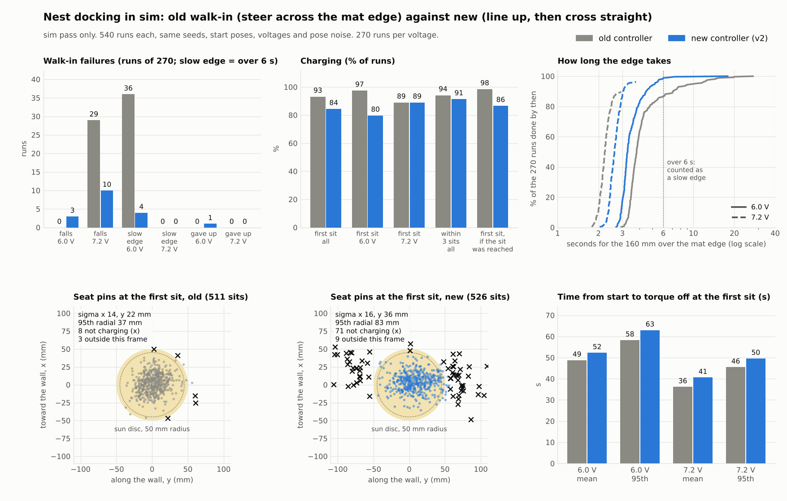

# NEST_SIM_V2: "line up before the mat, then cross the edge straight". sim pass only

2026-11-12. Duckie, Open Duck Mini v2. Simulation only. Nothing in the parent folder or in any repo was changed; everything new is in this folder (`v2/`). Every number below is **sim pass only** unless it says **calc only** or **est**.

Repo copy note (2026-11-11 ET): this is the report as written, copied into the repo as an archive of work in progress, with local folder paths and prices removed. The scripts, JSON results, logs and the clip are beside it; the scripts were syntax-checked and not re-run after the move. This result came after DECISIONS.md D61 was written: D61 names the straight crossing as the fix to try first, and this report finds that it does not work overall. D61 is kept as written. Index: ../../README.md. Status: ../../HANDOVER.md.

## Plain summary

1. **The fix does not work as hoped. The old controller is still the better one.** Charge at the first sit fell from 93.1 % (503 of 540) to 84.3 % (455 of 540). sim pass only.
2. Falls did drop: 29 to 13. At 7.2 V from 29 to 10 of 270. But the 10 that remain fall **while walking straight over the edge with zero turn and zero lateral command**. So steering on the edge is not the only cause of the trips. At 6.0 V there are now 3 falls where there were none.
3. The edge stalls at 6.0 V dropped from 36 to 4 of 270 (with a forward command of 0.18 instead of 0.15). One run never got over the edge in 40 s and gave up.
4. The price is accuracy. With no steering allowed across the edge the duck arrives up to 100 mm and more to the side, and it cannot side-step right to repair that. Sideways landing scatter went from 22 mm to 36 mm (1 sigma). 71 first sits missed (old: 8). At 6.0 V 32 runs never charged in 3 sits (old: 3).
5. The whole gain and the whole loss cancel at 7.2 V: 240 of 270 charge at the first sit, the same count as before. After re-sits 7.2 V is better (259 against 241 of 270). At 6.0 V the new controller is clearly worse (215 against 263 of 270).
6. Margins to the wall and the rim got worse: 5 runs touched the wall plane or the rim (old: 0).
7. What I would keep: the 6.0 V finding that 0.18 gets over the edge where 0.15 stalls, and the staging idea for 7.2 V only if the sideways error can be repaired (it cannot with the stock walk). The real fix is still on the walk retrain list: lift the foot over a 2 mm edge, and side-step right.



`V2_compare.png`

## 1. What changed in the controller (`nest_run_v2.py`)

Only the walk-in is new. The fine moves, the turn, the sit, the re-sit and the walk-off are the original code, imported.

| Stage | What the duck does | Commands allowed |
|---|---|---|
| approach | steer to a run-up point 0.30 m before the staging point, then along the line to the staging point. All on the floor | forward and turn |
| stage | stand with the toes a few cm before the mat edge. Look (pose stand-in averaged over 0.6 s). Turn on the spot until the heading points at the turn spot within the tolerance. Up to 5 moves | turn only (a step back if the toes are closer than 15 mm) |
| cross | walk until the pose stand-in says both heels are 20 mm inside the mat | forward only. Turn 0, lateral 0 |
| walk_on | what is left of the old steered walk-on, now on the mat. Usually nothing (0.2 s mean) | forward and turn |
| fine | as before: stand, look, creep moves, up to 6 | as before |

Lateral error at the staging point is not side-stepped away (the stock walk has no right side-step). The duck turns to point at the turn spot instead, so a sideways offset becomes a small heading offset, and the 180 deg turn takes that out.

Check that the rule was kept (truth, from the sole outlines): in 540 runs there was **no** turn or lateral command with a sole on the edge in the approach, stage, cross or walk_on stages. sim pass only. It did happen later in 12 runs that had drifted far to the side: 2 in the fine moves and 11 in the re-sit shuffle. In 4 runs at 6.0 V the pose stand-in said "both feet on" while a heel was still up to 20 mm outside.

## 2. Sweeps and what I chose

All sweep runs stop before the turn. Subset: seeds 0 to 2 of each of the 18 cells plus all 29 seeds that fell in the original (53 runs at 7.2 V, 27 at 6.0 V). The 7.2 V subset is loaded with old fallers on purpose, so its fall counts are not rates. sim pass only.

### 2.1 Staging distance (`sweep_stage.json`, `sweep_stage2.json`, `sweep_cross7.json`)

| Toes to edge, set / measured mean | 7.2 V: falls of 53 | 7.2 V: sideways error at the turn spot, mean / sigma (mm) | 7.2 V: RMS error (mm) | 6.0 V: falls of 27 | 6.0 V: RMS error (mm) |
|---|---|---|---|---|---|
| 30 mm / 53 mm | 1 | 22 / 19 | 31 | 1 | 40 |
| 60 mm / 74 mm | 7 | 21 / 22 | 32 | not run | not run |
| 80 mm / 92 mm | 4 | 23 / 23 | 34 | 0 | 58 |
| 160 mm / 173 mm | 7 | 34 / 26 | 44 | 1 (and 1 not across) | 48 |
| 250 mm / 263 mm | 3 | 50 / 32 | 60 | 1 | 60 |
| 350 mm / 361 mm | 5 | 58 / 38 | 70 | 0 (and 1 not across) | 71 |

The measured gap is larger than the set value because the walk stops 30 mm short for coast and latency.

**Chosen: 30 mm set (about 50 to 65 mm real).** Why: the sideways error grows steadily with the open-loop distance, and the shortest distance also had the fewest falls. The fall counts jump around between rows (1, 7, 4, 7, 3, 5) with no trend, so I read them as noise around roughly 5 of 53, not as an effect of distance. A longer run-up does not help.

### 2.2 Heading tolerance

| Tolerance at 80 mm | Turn moves at the staging point, mean | 7.2 V: falls of 53 | 7.2 V: RMS error (mm) | 6.0 V: RMS error (mm) |
|---|---|---|---|---|
| 4 deg | 1.2 | 4 | 34 | 58 |
| 8 deg | 0.3 | 5 | 40 | 63 |

**Chosen: 4 deg.** The averaged pose stand-in is no better than about 3 deg at the high noise level, so a tighter value would chase noise. 8 deg saves about one move (about 2 s) and costs 5 to 6 mm.

### 2.3 Tried and dropped: aim to the right to allow for the left drift (`sweep_final.json`)

Aiming 30 mm right at 7.2 V cut the turn spot error from 31 to 16.5 mm RMS, but falls in the crossing went from 1 to 7 of 53 and the staging took 2.5 turn moves instead of 1.4. Dropped because falls cost more than millimetres. With hindsight (section 3) the 1 of 53 was probably luck and this choice deserves a second look. A gap trim (creep forward if the toes are more than 60 mm from the edge) changed almost nothing and was dropped.

### 2.4 The 6.0 V edge stall: forward command and retries

Straight walks onto the mat, zero turn and lateral, 20 s limit (`cross_probe.py`, `cross_probe.json`). 60 walks per row at 6.0 V. 7.2 V rows have 180 walks where marked, else 60. sim pass only.

| Variant | 6.0 V: over the edge | 6.0 V: falls | 6.0 V: not over in 20 s | 7.2 V: over | 7.2 V: falls |
|---|---|---|---|---|---|
| 0.10 | 0 | 0 | 60 | 31 of 60 | 0 |
| 0.12 | 0 | 0 | 60 | 59 of 60 | 1 |
| 0.15 (the old command) | 42 | 0 | 18 | 175 of 180 | 5 |
| 0.17 | 50 | 0 | 10 | 58 of 60 | 2 |
| **0.18** | **55** | **0** | **5** | 59 of 60 | 1 |
| 0.20 | 45 | 10 | 5 | 167 of 180 | 13 |
| 0.25 | 11 | 37 | 12 | 162 of 180 | 14 |
| 0.30 | 0 | 34 | 26 | 179 of 180 | 1 |
| 0.15, on a stall stand 1 s and go again | 44 | 0 | 16 | same as 0.15 | |
| 0.15, on a stall step back and go again | 41 | 0 | 19 | same as 0.15 | |
| 0.15, on a stall raise to 0.18 | 48 | 0 | 12 | not run | |
| 0.15, on a stall raise to 0.25 | 37 | 12 | 11 | same as 0.15 | |
| 0.15, on a stall raise to 0.30 | 35 | 14 | 11 | same as 0.15 | |
| 0.15, on a stall add a turn command 0.3 or 0.6 for 1 s | 42 / 42 | 0 | 18 / 18 | same as 0.15 | |
| 0.15, on a stall turn only for 1 s | 43 | 0 | 17 | same as 0.15 | |
| 0.15, on a stall left side-step 0.8 s | 48 | 0 | 12 | same as 0.15 | |

What works at 6.0 V:
- **A slightly higher command from the start works: 0.18 gets 55 of 60 over with no fall.** But the window is narrow: 0.20 already gives 10 falls in 60, 0.25 gives 37.
- **No retry works.** Standing and going again, stepping back, a turn wiggle: none is better than doing nothing. Raising the command after the stall helps a little (48 of 60); arriving with the higher command helps more.
- Inside the full controller (`sweep_cross6.json`, 45 runs at 6.0 V): 0.15 gave 0 falls, 1 run not across in 40 s, 5 slow; 0.18 gave 1 fall, 0 not across, 1 slow. So 0.18 is not free of falls once the walk starts from a stop near the edge.
- **Chosen for the matrix: 0.18 at 6.0 V, 0.15 at 7.2 V, no retry.**
- 0.15 is the largest forward command used in the earlier work; I assume it is the edge of the trained range (est). 0.18 and above are outside it.

Side finding at 7.2 V: 0.30 crossed 179 of 180 with 1 fall, better than 0.15 (5 falls in 180). In the full controller (`sweep_cross7.json`) it gave 1 fall of 53 against 7, but it overshoots the turn spot (3.9 fine moves against 1.1) because the pose stand-in lags. Not used: far outside the trained range, and it is the worst choice at 6.0 V, so it would need a hard voltage switch.

## 3. The 540 runs, old against new

Same 540 seeds, start poses, voltages, mat frictions, pose noise, rate and latency. Old: `../nest_runs_main.json`. New: `nest_runs_v2.json`. 0 crashed runs. Table from `compare.py` (`compare_table.md`, `compare.json`). All rows sim pass only; the 95 % range is calc only on the sim counts.

| sim pass only | Old: all | Old: 6.0 V | Old: 7.2 V | New: all | New: 6.0 V | New: 7.2 V |
| --- | --- | --- | --- | --- | --- | --- |
| Runs | 540 | 270 | 270 | 540 | 270 | 270 |
| Falls, whole run | 29 | 0 | 29 | 13 | 3 | 10 |
| Where the falls are | steering over the edge, 29 | none | steering over the edge, 29 | straight over the edge, 13 | straight over the edge, 3 | straight over the edge, 10 |
| Stalls: 160 mm edge window slower than 6 s | 36 | 36 | 0 | 4 | 4 | 0 |
| Edge window time, mean / 95th / worst (s) | 3.54 / 7.19 / 27.46 | 4.72 / 10.2 / 27.46 | 2.22 / 2.56 / 2.94 | 3.12 / 4.5 / 17.86 | 3.58 / 5.21 / 17.86 | 2.64 / 3.08 / 3.78 |
| Gave up at the edge (40 s), no fall | 0 | 0 | 0 | 1 | 1 | 0 |
| Reached the first sit | 511 | 270 | 241 | 526 | 266 | 260 |
| **Charge at the first sit** | **93.1 % (503 of 540)** | 97.4 % (263 of 270) | 88.9 % (240 of 270) | **84.3 % (455 of 540)** | 79.6 % (215 of 270) | 88.9 % (240 of 270) |
| 95 % range of that (calc only) | 90.7 to 95.0 | 94.7 to 98.7 | 84.6 to 92.1 | 80.9 to 87.1 | 74.4 to 84.0 | 84.6 to 92.1 |
| **Charge within 3 sits** | **94.1 % (508 of 540)** | 98.9 % (267 of 270) | 89.3 % (241 of 270) | **91.3 % (493 of 540)** | 86.7 % (234 of 270) | 95.9 % (259 of 270) |
| Charge at the first sit, given the sit was reached | 98.4 % (503 of 511) | 97.4 % (263 of 270) | 99.6 % (240 of 241) | 86.5 % (455 of 526) | 80.8 % (215 of 266) | 92.3 % (240 of 260) |
| Charge within 3 sits, given the sit was reached | 99.4 % (508 of 511) | 98.9 % (267 of 270) | 100.0 % (241 of 241) | 93.7 % (493 of 526) | 88.0 % (234 of 266) | 99.6 % (259 of 260) |
| Seat pins after torque off, x mean / sigma (mm) | 2.2 / 14.3 | -2.3 / 14.1 | 7.3 / 12.9 | 5.8 / 15.6 | 3.8 / 17.6 | 7.8 / 13.0 |
| Seat pins after torque off, y mean / sigma (mm) | 3.0 / 22.3 | 4.2 / 27.9 | 1.6 / 13.4 | 6.7 / 36.1 | -1.4 / 43.7 | 14.9 / 23.4 |
| Radial miss mean / median / 95th / worst (mm) | 19.5 / 17.0 / 37.3 / 249.8 | 21.2 / 17.4 / 40.4 / 249.8 | 17.7 / 16.6 / 35.8 / 49.7 | 30.5 / 22.8 / 82.8 / 158.9 | 34.3 / 22.1 / 105.4 / 158.9 | 26.6 / 23.8 / 59.2 / 87.4 |
| Inside 45 mm | 97.1 % | 95.2 % | 99.2 % | 81.0 % | 75.9 % | 86.2 % |
| Landings more than 100 mm out | 3 | 3 | 0 | 15 | 15 | 0 |
| Error at the turn spot before the turn, y mean / sigma (mm) | 7.5 / 18.8 | 6.8 / 23.9 | 8.3 / 10.3 | 14.3 / 34.7 | 6.5 / 42.6 | 22.3 / 21.4 |
| Error at the turn spot, RMS (mm) | 22.5 | 27.0 | 16.2 | 39.8 | 45.8 | 32.6 |
| Fine-move rounds on the mat, mean | 1.72 | 2.14 | 1.25 | 2.28 | 3.12 | 1.42 |
| Time to torque off at the first sit, mean / 95th / worst (s) | 42.9 / 56.2 / 78.7 | 48.8 / 58.3 / 78.7 | 36.2 / 45.5 / 49.4 | 46.5 / 60.3 / 76.7 | 52.3 / 63.0 / 76.7 | 40.6 / 49.6 / 56.1 |
| Closest to the wall: worst / 5th percentile / mean (mm) | 23.5 / 46.9 / 76.1 | 51.7 / 70.7 / 89.3 | 23.5 / 42.6 / 61.3 | -3.8 / 37.7 / 70.5 | -3.8 / 26.6 / 78.9 | 8.4 / 42.9 / 62.0 |
| Closest to the rim: worst / 5th percentile / mean (mm) | 9.5 / 39.8 / 65.9 | 37.7 / 56.4 / 77.2 | 9.5 / 34.7 / 53.2 | -3.0 / 34.4 / 62.2 | -3.0 / 35.5 / 70.9 | -0.1 / 32.2 / 53.2 |
| Runs that touched the wall plane or the rim | 0 | 0 | 0 | 5 | 4 | 1 |
| Walk-off after the sit: falls | 0 of 511 | | | 0 of 526 | | |

A negative clearance means the part was inside the wall plane or the rim block. The head against the wall is checked by geometry only (as in the original), so the sim did not push the duck back.

By pose noise, charge at the first sit, old / new: low 90.0 / 86.1 %, mid 96.1 / 86.7 %, high 93.3 / 80.0 %. By mat friction: 0.6: 90.6 / 77.2 %, 0.8: 93.3 / 90.6 %, 1.0: 95.6 / 85.0 %. sim pass only, 180 runs each.

Same seed, old outcome to new outcome: 426 charged at the first sit both times. Of the 29 old falls, 27 now charge at the first sit and 2 after a re-sit. But 13 runs that used to dock now fall, 1 gives up, 34 need a re-sit and 31 never charge.

### How to read the falls
- The 29 seeds that fell before do not fall now, and 13 other seeds fall instead. That pattern is what chance looks like: a trip depends on where a toe happens to meet the edge, and any change to the walk-in reshuffles it.
- The straight-crossing fall rate at 7.2 V is 10 of 270 (3.7 %) in the matrix and 5 of 180 (2.8 %) in the probe. Steered it was 29 of 270 (10.7 %). So going straight roughly removes two thirds of the falls at 7.2 V. It does not remove them.
- The original probe showed 80 of 80 straight crossings at 7.2 V. With 20 walks per edge shape and a floor friction fixed at 0.6 that was too small a sample to see a 3 % rate.
- In the sweep data the straight-crossing falls sit mostly on grippy floor (floor friction 0.8 and up) with a slippery mat (0.6). The sweeps reuse the same 53 seeds, so this is a lead, not a finding.

## 4. New failures the change brings

1. **Sideways error at the sit, as feared.** No correction is possible from the staging point until both feet are on the mat, and by then the duck is at the turn spot. At 7.2 V the duck ends 22 mm left of the turn spot on average (old: 8 mm); "left" is the side it cannot repair. At 6.0 V it is worse: while a foot hangs on the edge the duck pivots, and the spread is 43 mm (1 sigma) with 15 landings more than 100 mm out.
2. **First-sit misses: 71 (old: 8).** 52 have a pin on the wrong zone, 19 have the seat pins off the sun. Re-sits fix 38 of them (29 at the second sit, 9 at the third). At 7.2 V the re-sit almost always works (259 of 260). At 6.0 V 32 runs never charge.
3. **Falls at 6.0 V: 3 (old: 0).** All in the straight crossing at command 0.18, after 11 to 16 s on the edge.
4. **One run gives up** at the edge (6.0 V, 40 s limit).
5. **Wall and rim.** 4 runs at 6.0 V put the head 0 to 4 mm through the wall plane during the fine moves or the turn, 2 runs had a foot at or in the rim (one ran both). The old worst cases were 23.5 and 9.5 mm clear. Cause: the duck stands askew and off to the side after a bad crossing.
6. **More creep moves on the mat and at the staging point:** 731 right-turn bursts against 126, 526 back steps against 154. The right-turn burst is the irregular one and carries the trunk 8 to 13 mm.
7. **Slower:** 46.5 s against 42.9 s to torque off (the staging stop costs about 3 s, the extra fine moves about 1 s).
8. **The re-sit shuffle now sometimes works at the mat edge** (11 runs with a turn or side command while a sole was on the edge). No fall came of it in these runs.

## 5. What remains failing

| Problem | Count, new controller, sim pass only | What would close it |
|---|---|---|
| Trips on the 2 mm edge at 7.2 V, also when walking straight | 10 of 270 | A walk that lifts its toes over a 2 mm edge (retrain), or a tapered edge on the bench. Not a controller matter |
| Stalls and pivots on the edge at 6.0 V | 4 slow, 1 gave up, 3 falls of 270 | The same. 0.18 helps but sits next to a cliff at 0.20 |
| Sideways error that cannot be repaired | 71 first-sit misses, 33 never charge | A right side-step (retrain). Or allow steering again once the first foot is on the mat |
| Wall and rim margins | 5 touches | Move the sun out 20 to 30 mm (already BLOCKER 8 of the first report) |

Controller ideas I did not have time to test, most promising first:
1. A mix: steer as the old controller does at 6.0 V (it had 0 falls and all 270 across there) and line up and go straight only at 7.2 V. From the two tables that would give about 263 + 240 = 503 of 540 at the first sit, no better than the old controller, and about 263 + 259 = 522 of 540 within 3 sits against 508. calc only, not run.
2. At 7.2 V aim 10 to 20 mm right at the staging point so the leftover error falls on the side the duck can repair (section 2.3 used 30 mm).
3. Allow the turn command again as soon as the leading foot is wholly on the mat instead of both feet.

## 6. Limits

1. **Perception is still a stand-in:** true pose plus white Gaussian noise, 5 to 10 Hz, 70 to 170 ms late. No camera, no nest finding. The staging step leans on it harder than the old walk-in did (toe gap to a few cm, heading to 4 deg).
2. **The mat is rigid** and its edge is a 2 mm rise over one 5 mm cell. Real felt gives and has a softer edge. The trips and stalls may be better or worse on the bench. Only this one edge shape was run here.
3. The falls are few (13) and look chaotic. Differences of a few falls between settings in the sweeps are not reliable.
4. Sweeps were small (53 and 27 runs per setting, stopped before the turn) and the 7.2 V subset was loaded with old fallers. The final setting was not tuned on the full matrix, and one choice (no aim to the right) looks wrong afterwards.
5. Only 6.0 and 7.2 V. The crossing command is switched by voltage; nothing in between was run.
6. Forward commands above 0.15 are outside what the earlier work used (est: outside the trained range). The sim result for them may not carry to the robot.
7. "Both feet on the mat" is judged from the pose stand-in and fixed foot sizes, not from a foot sensor. It was wrong by up to 20 mm in 4 runs.
8. Head to wall is a geometry check, not a collision. A real touch would push the duck.
9. All limits of the first report still hold (pin values assumed, no joint zero error, no voltage sag, compensation table measured in the same sim).
10. No walk policy was retrained. Nothing was run on the robot.

## 7. Files (all in this folder)

| File | What |
|---|---|
| `NEST_SIM_V2.md` | this report |
| `nest_run_v2.py` | the new walk-in; the rest of the sequence is the original, imported |
| `v2lib.py` | sole outline helpers ("is a foot on the edge") |
| `nest_runs_v2.json`, `nest_run_v2.log` | the 540 runs with the new controller |
| `compare.py`, `compare.json`, `compare_table.md`, `compare.log` | old against new, the table above, every run that did not charge at the first sit |
| `V2_compare.png` | the figure |
| `cross_probe.py`, `cross_probe.json`, `cross_probe*.log` | straight edge crossings: forward commands and retries (2,700 walks) |
| `sweep.py`, `sweep_print.py`, `sweep_stage.json`, `sweep_stage2.json`, `sweep_cross6.json`, `sweep_cross7.json`, `sweep_final.json`, `sweep_*.log` | the sweeps |
| `render_v2.py`, `render_v2.json`, `run_v2_pass.mp4` (0.8 MB) | clip: seed 12002, 7.2 V. It fell at the edge with the old controller (9.2 s) and docks with the new one. 640 x 480, the camera follows the duck at 0.95 m (old clips: fixed camera at 2.2 m), 2 x real time |

Commands, run from this folder (`PYTHONDONTWRITEBYTECODE=1` on every line; `NEST_SCRATCH` as in the first report):
```
python3 cross_probe.py
SEEDS=20:60 VOLTS=7.2 python3 cross_probe.py v0.15 v0.20 v0.25 v0.30
python3 sweep.py cross6 && python3 sweep.py cross7 && python3 sweep.py stage && python3 sweep.py stage2 && python3 sweep.py final
python3 nest_run_v2.py 30 v2
python3 compare.py v2
MUJOCO_GL=egl python3 render_v2.py v2
```
The matrix is complete (540 of 540). To run it again: `python3 nest_run_v2.py 30 v2` (about 1 hour on 4 cores; it overwrites `nest_runs_v2.json`, so use another tag to keep the old file).
