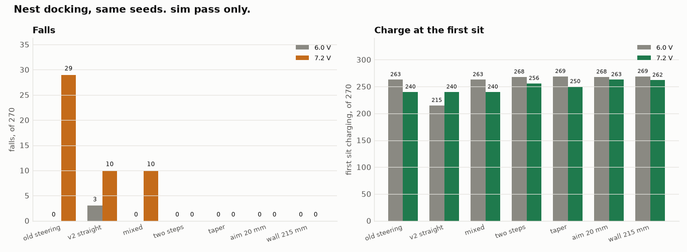
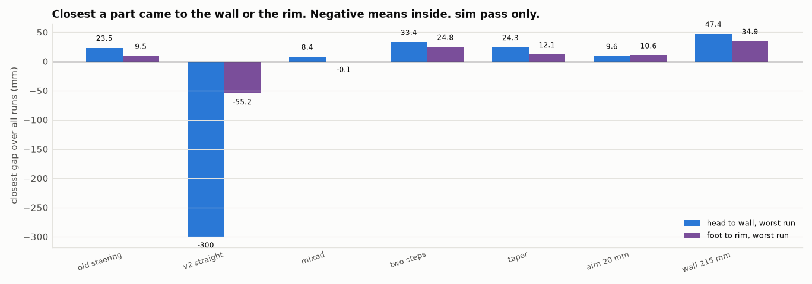
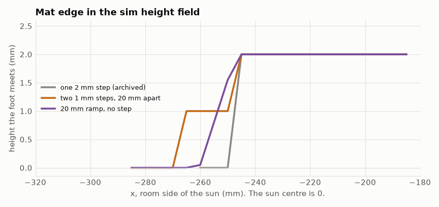

# NEST_SIM_V3: mixed walk-in, the CAD mat edge, and a wall study. sim pass only

2026-11-11 ET. Duckie, Open Duck Mini v2. Simulation only. Nothing was built, bought, or run on hardware.
The approved sun-to-wall distance is still 190 mm. The 215 mm run below is a study only. Ahmed has not approved it.
DECISIONS.md D61 was not edited. The CAD was not installed.

Every number is **sim pass only** unless it says **calc only**. Source of the new numbers: the run files in this
folder, summarized by `summarize.py`. The old steering numbers and the straight-crossing numbers are
`../NEST_SIM.md` and `../v2/NEST_SIM_V2.md` section 3, checked again here on the same seeds.

Engine: MuJoCo 3.17.0, onnxruntime 1.31.1, the repo sit model, the stock walk policy in this repo, Playground pin
b9be205. Same 540 seeds as the earlier matrices (3 pose noise levels, 2 voltages, 3 mat frictions, 30 seeds).
0 crashed runs in every file below.

## Plain summary

1. **The mixed controller does what the two old tables said it would.** Steering at 6.0 V and a straight crossing at
   7.2 V charges at the first sit in 503 of 540 runs, the same as the old steering controller, and within 3 sits in
   526 of 540. The calc-only guess was about 503 and about 522. The 522 used 263 + 259. The within-3 count at 6.0 V
   is 267, and 267 + 259 = 526 (calc only). The re-run matched the archived runs seed by seed. Falls: 10, all at
   7.2 V, against 29 (old) and 13 (straight everywhere).
2. **The two 1 mm steps help.** With the mixed controller, falls go to 0 of 540. First sit 524 of 540. Within 3 sits
   536 of 540. Worst head-to-wall gap 33.4 mm, worst foot-to-rim gap 24.8 mm, 0 runs inside either. This is the
   change that removes the trips.
3. **A 20 mm ramp also removes the trips, and it is a little worse on the first sit.** 0 falls, 519 of 540 at the
   first sit, 539 of 540 within 3 sits. Worst head gap 24.3 mm.
4. **Aiming 20 mm right at 7.2 V, on the two steps, raises the 7.2 V charge and spends some of the wall gap.**
   First sit at 7.2 V goes from 256 to 263 of 270. Within 3 sits goes from 266 to 270 of 270. Falls stay 0.
   Worst head gap on that combo is 9.6 mm (it was 33.4 mm with no extra aim). Aiming 10 mm, on 45 runs, did not
   change the charge count.
5. **Moving the sun to 215 mm from the wall, on that combo, gives the gap back and does not raise the charge count.**
   Worst head gap 47.4 mm, worst rim gap 34.9 mm, 0 of 540 inside the wall plane or the rim. First sit still 531 of
   540. Within 3 sits 538 of 540, two fewer than at 190 mm. This is a study. 190 mm stays the approved distance.

`V3_compare.png`

`V3_clearance.png`

## 1. What was run

| Run file | What | Runs |
|---|---|---|
| `nest_runs_mix.json` | Old steering at 6.0 V. Straight crossing at 7.2 V. Archived 2 mm step. Wall at 190 mm. | 540 |
| `nest_runs_steps.json` | Same controller. Two 1 mm steps, 20 mm apart. | 540 |
| `nest_runs_taper.json` | Same controller. A straight ramp over that 20 mm. | 540 |
| `nest_runs_aim10.json`, `nest_runs_aim20.json` | Two steps, 7.2 V only, seeds k = 0 to 4 of each cell. Aim 10 mm and 20 mm right. | 45 each |
| `nest_runs_aim20full.json` | Two steps, 7.2 V, all 30 seeds, aim 20 mm right. | 270 |
| `nest_runs_wall215.json` | Two steps, aim 20 mm at 7.2 V, sun centre 215 mm from the wall. Both voltages. | 540 |

The 6.0 V half of the "aim 20 mm" row in the table below is the 6.0 V half of `nest_runs_steps.json`, not a second
sim. The aim is applied only at 7.2 V, and the 6.0 V controller does not read it. The 215 mm file is a full re-run
of both voltages.

## 2. The edge in the height field

`V3_edge_profile.png`

`sim/nestlib.py` still builds the archived field unless `NEST_EDGE` is set, so the old scripts are unchanged.

- `one` (the default): one 2 mm rise over one 5 mm cell, as in the archived runs.
- `steps`: lower felt 1 mm out to 267 mm from the sun, upper felt another 1 mm inside 247 mm. Same radii as
  `cad/nestcad_lib.py` `BASE_R` and `TOP_R` (CAD check only on those radii). Each rise is still one 5 mm cell.
  The field is widened so the 267 mm radius is on the grid. The back cut stays where the sim mat already cut it.
- `taper`: height rises linearly from the floor at 267 mm to 2 mm at 247 mm. No step.

The foot still stands on the floor plane wherever the field is below the floor. The sit, when it is wholly on the
mat, still uses the flat 2 mm plane, as before.

## 3. Results against the old tables

All rows sim pass only. "Inside" is runs with a part beyond the wall plane or inside the rim block, counted over
every run, including falls. A negative gap is inside.

| sim pass only | First sit | Within 3 sits | Falls 6.0 / 7.2 | Worst wall (mm) | Worst rim (mm) | Inside |
|---|---|---|---|---|---|---|
| Old steering | 503 of 540 | 508 of 540 | 0 / 29 | 23.5 | 9.5 | 0 |
| Straight crossing | 455 of 540 | 493 of 540 | 3 / 10 | -300.3 | -55.2 | 9 |
| Mixed, one 2 mm step | 503 of 540 | 526 of 540 | 0 / 10 | 8.4 | -0.1 | 1 |
| Mixed, two 1 mm steps | 524 of 540 | 536 of 540 | 0 / 0 | 33.4 | 24.8 | 0 |
| Mixed, 20 mm ramp | 519 of 540 | 539 of 540 | 0 / 0 | 24.3 | 12.1 | 0 |
| Two steps, aim 20 mm at 7.2 V | 531 of 540 | 540 of 540 | 0 / 0 | 9.6 | 10.6 | 0 |
| That combo, wall at 215 mm | 531 of 540 | 538 of 540 | 0 / 0 | 47.4 | 34.9 | 0 |

By voltage, first sit and within 3 sits (of 270). sim pass only.

| | 6.0 V first | 6.0 V within 3 | 7.2 V first | 7.2 V within 3 |
|---|---|---|---|---|
| Old steering | 263 | 267 | 240 | 241 |
| Straight crossing | 215 | 234 | 240 | 259 |
| Mixed, one step | 263 | 267 | 240 | 259 |
| Two steps | 268 | 270 | 256 | 266 |
| Ramp | 269 | 270 | 250 | 269 |
| Aim 20 mm at 7.2 V | 268 (not re-run) | 270 (not re-run) | 263 | 270 |
| Wall at 215 mm | 269 | 270 | 262 | 268 |

### 3.1 The mix, checked against the calc

The mix is not a new walk law. At 6.0 V it is the old `nest_run.py` approach. At 7.2 V it is `v2/nest_run_v2.py`.
Re-running it matched the archived file for every seed on fall, fall stage, first-sit charge, within-3 charge, time
to the first sit, and the worst wall gap (0 mismatches of 540). So 503 and 526 are the spliced tables, confirmed in
this MuJoCo, not a hidden interaction.

The one run inside the rim is the same 7.2 V run as in the straight-crossing file: seed 210010, high pose noise,
mat friction 0.6, no fall, head 8.4 mm clear during the turn, a foot 0.1 mm inside the rim block during the turn.

### 3.2 The two steps

Of the 10 runs that fell on the one-step mix, all 10 now charge at the first sit. Another 19 runs that had missed
the first sit without falling now charge at the first sit. 16 runs still miss the first sit (14 at 7.2 V, 2 at
6.0 V). In every one of those the seat pins missed the sun. 12 of the 16 are on the slippery mat (friction 0.6).
4 of them still miss after 3 sits, all at 7.2 V with high pose noise.

Worst gaps, both on runs that did not fall: head 33.4 mm (seed 210022, during the fine moves), foot to rim 24.8 mm
(seed 212008, during the turn).

### 3.3 The ramp

0 falls. First sit is 5 runs below the two steps (519 against 524). Within 3 sits is 3 runs above (539 against 536).
One run never charges (7.2 V, high noise, mat friction 0.6, three sits). Worst head gap 24.3 mm and worst rim gap
12.1 mm, both during the turn, both on a run that did not fall. Kept as a comparison. The two steps are the better
first-sit edge.

### 3.4 Aiming right at 7.2 V

Small sweep, two steps, 7.2 V, 45 seeds (k = 0 to 4 of each cell). sim pass only.

| Aim right | First sit | Within 3 | Falls | Worst wall (mm) | Worst rim (mm) | Turn-spot error, y mean / rms (mm) |
|---|---|---|---|---|---|---|
| 0 (the stepped run) | 42 of 45 | 45 of 45 | 0 | 36.3 | 26.9 | 25.3 / 33.7 |
| 10 mm | 42 of 45 | 45 of 45 | 0 | 28.5 | 16.0 | 19.5 / 30.8 |
| 20 mm | 43 of 45 | 45 of 45 | 0 | 9.6 | 10.6 | 11.5 / 21.6 |

10 mm did not change the charge count. 20 mm was the better of the two on charge and on sideways error, so the full
7.2 V set was run. On all 270 runs at 7.2 V: first sit 263 against 256, within 3 sits 270 against 266, falls 0.
Eleven runs gained a first-sit charge and four lost one. Sideways error at the turn spot: y mean 11.1 mm against
23.3 mm, rms 22.7 mm against 32.5 mm. The worst head gap on those 270 runs is 9.6 mm (it was 33.4 mm with no extra
aim). Nothing went inside the wall or the rim.

Counted with the 6.0 V stepped runs, that combo is 531 of 540 at the first sit and 540 of 540 within 3 sits, 0 falls,
worst head gap 9.6 mm, worst rim gap 10.6 mm.

### 3.5 Sun at 215 mm (study only)

`NEST_WALL_X=0.215` moves the wall, the rim, and the mat's back cut with the wall. The sun stays at the origin.
The duck's start, which is measured from the wall, moves 25 mm farther from the sun. `cad/nestcad_lib.py` is still
190 mm. Nothing in a design record was changed.

On the two-step edge with the 20 mm aim, both voltages re-run (540 runs): first sit 531 of 540, within 3 sits 538 of
540, 0 falls, 0 inside. Worst head gap 47.4 mm, 5th percentile 72.6 mm, mean 99.8 mm. Worst rim gap 34.9 mm, 5th
percentile 63.6 mm, mean 89.4 mm. The worst head and the worst rim are the same run (seed 210026, 7.2 V, the head
and a foot during the turn, no fall).

By voltage: 6.0 V first sit 269 of 270 and within 3 sits 270 of 270, worst head 64.0 mm. 7.2 V first sit 262 of 270
and within 3 sits 268 of 270, worst head 47.4 mm.

The first-sit total is the same 531 as at 190 mm, but 14 seeds changed outcome. Two runs that charged within 3 sits
at 190 mm did not at 215 mm.

The arithmetic "23.5 mm plus 25 mm is 48.5 mm" (calc only; `cad/NEST_CAD.md` section 4.4) was about the old
controller's worst run, with no re-run. This re-run's worst head gap is 47.4 mm, on a different controller. Do not
read 48.5 mm as a sim result.

## 4. What helped, and what did not

Helped:

- Two 1 mm steps instead of one 2 mm step. This is the trip fix. Falls 10 to 0, first sit 503 to 524, and the rim
  contact goes away.
- Aiming 20 mm right at 7.2 V, after the steps are in. It picks up 7 more first sits at 7.2 V and finishes the
  within-3 column at 270 of 270. It costs wall gap (33.4 mm down to 9.6 mm).
- The 215 mm study, if the tighter gap is not acceptable. It puts the worst head at 47.4 mm on the best charging
  combo. It is not approved.

Did not help, or helped less:

- The mix, as a charge-rate upgrade over old steering. First sit stays 503 of 540. It is worth having only because
  the falls drop from 29 to 10 and the within-3 count rises from 508 to 526, and because 6.0 V stays on the
  controller that does not fall.
- Aiming 10 mm, on the 45-run sweep. Same first-sit count as no aim.
- The ramp, if the goal is the first sit. 519 against 524. It does win within 3 sits by 3 runs (539 against 536)
  and it also has 0 falls.
- Moving the wall, if the goal is more ducks charging. The first-sit count did not rise, and 2 runs lost the
  within-3 charge.

## 5. Limits

1. Perception is still a stand-in: true pose plus noise. No camera.
2. The mat is rigid. Real felt gives. Each step in the sim is a 5 mm cell, not a sharp cut.
3. The 20 mm aim row's 6.0 V half was not re-simulated. The 215 mm run was.
4. Head to wall is a geometry check. The sim does not push the duck back.
5. Forward command 0.18 is used only by the straight crossing, and the mix does not use that crossing at 6.0 V.
   The 6.0 V half of the mix is the old 0.15 steering walk-in.
6. No walk was retrained. Nothing ran on the robot.
7. 190 mm remains the approved concept. 215 mm is a study number only.
