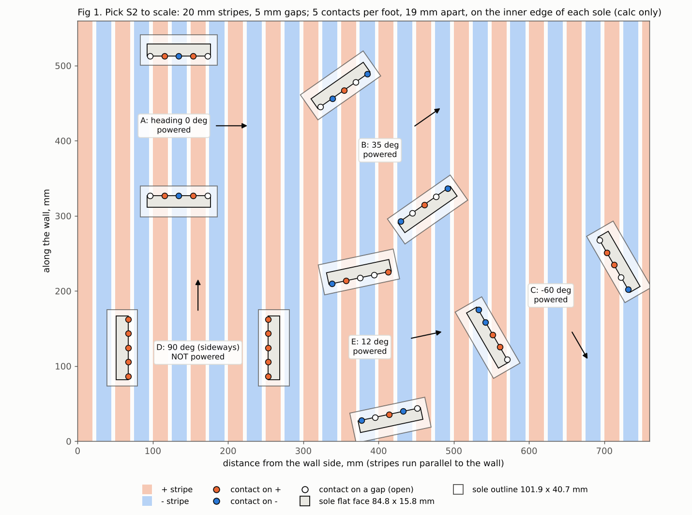
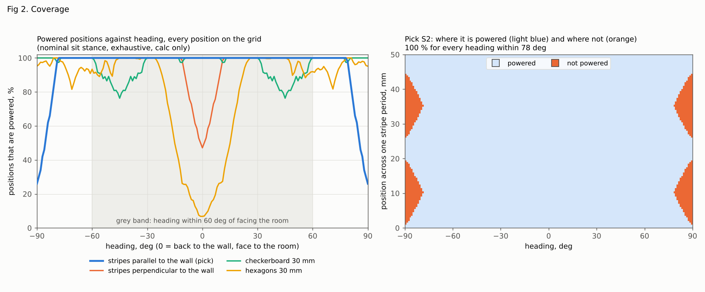
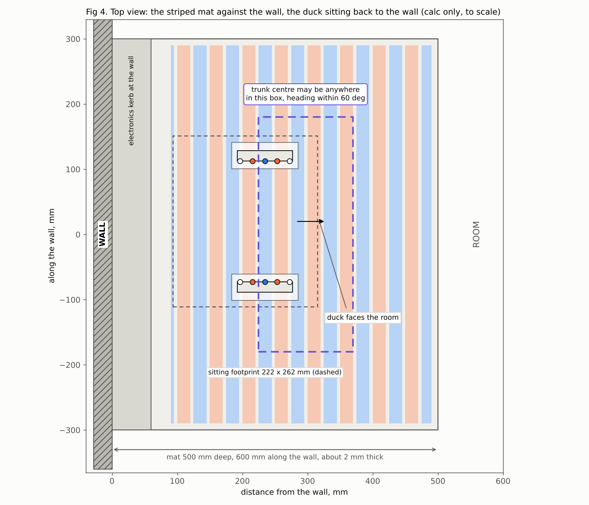
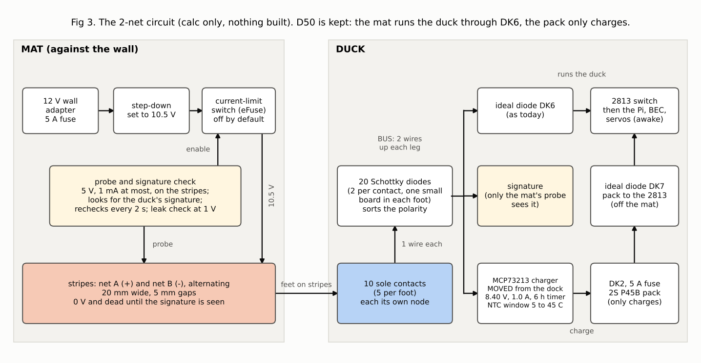

# STRIPE_MAT_STUDY: can Duckie charge on a "forgiving" striped mat? (Open Duck Mini v2, lab fork)

Repo copy note (2026-11-11 ET, for DECISIONS.md D61): this is the study as written, copied into the repo with local folder paths removed. The figures are beside this file. The scripts, JSON results and video clips it names are kept outside the repo (not copied), so the runs cannot be repeated from the repo alone: BLOCKER for a re-run. The earlier studies it cites by name (FEET_DOCK, DEEP_ANALYSIS) are not in the repo; DOCK_TWIN and DOCK_INTERFACE are in twin/dock/. Its own pick (the two-zone mat) was not taken: the next study, ../NATURAL_DOCK_IDEAS.md, moved the contacts from the feet to the belly. Labels: "est" marks an estimate with no source in hand and "index" a web fact read from search results only; treat both as BLOCKER until sourced. The decision record and its open BLOCKERs are in altaay_lab/DECISIONS.md D61; the folder guide is twin/dock/nest/README.md. Update 2026-11-11 evening ET: the scripts, JSON results and video clips are now in the repo beside this file (moved, paths made relative, syntax-checked, not re-run after the move); the lines below that say they are kept outside the repo are out of date. See ../README.md and ../HANDOVER.md.

2026-11-11. Paper study only: no CAD, nothing bought, nothing built, no repo writes, no messages sent.

## Plain-language summary (for a non-engineer)

1. Yes on paper: a mat covered in + and - stripes lets the duck charge almost anywhere it sits. In the calculation it gets power in 100 % of positions as long as it faces within about 60 degrees of "back to the wall".
2. Best pattern: straight stripes that run along the wall, 20 mm wide with 5 mm gaps. Checkerboard and hexagon tiles were worse.
3. Each foot needs 5 small contacts in a row, and the duck needs 20 small diodes to sort + from -.
4. The landing target grows from about 2 cm and 4 degrees today to about 14 cm deep, 36 cm wide and 60 degrees either way.
5. Surprise found here: when the duck sits with its motors off, its soles do not lie flat. They tilt 8 degrees and rest on their inner edge. So the contacts must sit on that edge and must be springy. This is unproven.
6. The price: the charger moves from the mat into the duck, and the duck gets about 2 to 4 watts warmer while charging.
7. Safety is weaker than today's design: the mat is a large sheet of bare metal, and any coin or spill bridges + and -. It stays off until it recognises the duck, at 10.5 V at most (toy limit is 24 V), but that check is new and untested.
8. A simpler middle way exists: one big + zone under the left foot and one big - zone under the right foot. No diodes, a coin cannot bridge the 40 mm gap, and the target is still about 14 cm sideways, any depth, 30 degrees either way.
9. Recommendation: go to 2 wires on the mat, build the two-zone mat first, and keep the striped mat as the upgrade if the walk tests show the duck drifts more than 7 cm sideways.
10. Either mat can be about 2 mm thin (no spring pins inside), which matters because the 7 mm mat tripped the walk in the earlier sim.
11. Not proven: springy edge contacts, contact resistance after dirt, the "is it the duck" check, heat in the duck, and whether the camera alone can find the mat.
12. Many web pages could not be opened from this session, so several facts are marked BLOCKER.

Labels used: **sim pass only** (MuJoCo 3.17.0, the repo's own sit model), **calc only** (arithmetic and the Python sweeps here), **est** (estimate, no source in hand), **BLOCKER** (data missing). Web sources were read through the search index only: this session could not open the pages themselves (hosts not allowed: patents.google.com, arts.units.it, robohub.org, en.wikipedia.org, image-ppubs.uspto.gov, robotics.northwestern.edu). Each source line below says "index".

---

## 1. Geometry

### 1.1 What the feet really offer (inputs)

| Item | Value | Where from | Label |
|---|---|---|---|
| Sole outline | 101.9 x 40.7 x 8 mm | `print/foot_bottom_tpu.stl`, measured here | CAD check only |
| Sole flat bottom face | **84.8 x 15.8 mm, 1,268 mm2**. The rest of the underside is a slope of about 35 to 38 deg up to the outline | same STL, measured here (area by face normal) | CAD check only |
| Sit pose | D59 alert sit, torque off: knees 150, ankles -95, hip roll on its 8 deg outward stop | `twin/sit/sit_pose.json`, DECISIONS D59 | sim pass only |
| Both soles on the mat? | Yes. Contacts in the sit are the left sole, the right sole and the TPU seat | `twin/sit/sit_balance.json` (contacts), `sit_soles.json` here | sim pass only |
| Soles flat? | **No. Each sole is rolled 7.9 to 8.2 deg about its long axis and rests on the inner long edge of the flat face.** The outer edge of the flat face is 2.2 mm up. Pitch is 0.0 to 0.3 deg, so the edge line is level within 0.4 mm heel to toe | `sit_soles.py`, `sit_soles.json` (8 cases) | sim pass only |
| Load, torque off | Left sole 13.5 to 13.7 N, right sole 12.9 to 13.8 N, seat 0.6 to 1.3 N (weight 27.54 N) | `sit_soles.json`, mean over 2 s at rest, no dock pins | sim pass only |
| Lower bound on sole load | 11.2 N per foot if the sole pressure were even along its length (lever: CoM 17.6 mm behind the sole centres, seat 93.5 mm behind them, so the seat takes 19 %) | CoM and polygon in `sit_balance.json` | calc only |
| Sole centres apart | 201.5 to 201.9 mm sitting; 183.8 to 185.2 mm in the tall stance; 178.7 mm walking | `sit_soles.json`; DEEP_ANALYSIS 2.1 | sim pass only |
| Stagger (one foot ahead) | -2.0 to +3.2 mm sitting; mean 14, max 52 mm at a walking stop | `sit_soles.json`; DEEP_ANALYSIS 2.2 | sim pass only |
| Sole yaw against the trunk | -1.9 to +1.2 deg | `sit_soles.json` | sim pass only |
| Slide while sitting down | each sole moves 8.0 to 10.2 mm (the legs splay), a useful wipe | `sit_soles.json` | sim pass only |
| Sitting footprint | 222 mm long (156.5 behind, 65.4 ahead of the trunk origin), 262 mm wide | `sit_soles.json` | sim pass only |

Two consequences:
- **Contact pressure.** With torque off each foot presses with 11.2 to 13.7 N. Shared by 5 springy contacts that is 2.2 to 2.7 N each (calc only), 5 to 6 times the 0.44 N of the Mill-Max 0933 pin in DOCK_INTERFACE section 2. The force is there.
- **Shape.** The only part of a sole that touches a flat mat in the sit is one 85 mm line. All contacts of a foot must lie on that line. This also matters for D58 as drawn: FEET_DOCK 2.3 puts two 44 x 34 mm pads on a sole it took as flat over 101.9 x 40.7 mm, but the printed sole is flat over only 15.8 mm of its width. **That needs a re-check or a new flat sole part, whatever comes of this study.**

### 1.2 Method (calc only)

`stripe_cov.py`. Each foot has N contacts on its inner edge line, inside a 76 mm span. A contact is a 3 mm disc (touch patch plus tolerance). It counts as made only when the whole disc is on one conductor. Every gap is wider than the disc, so one contact can never join two conductors. Three scores:
- **powered:** at least one contact on + and one on -, both feet as one set;
- **redundant:** at least two on each, so any one contact may fail;
- **per foot:** each foot alone has + and -, so one whole foot may fail.

Two sweeps: an exhaustive grid (every position on a 0.5 to 2 mm grid over one pattern period, every heading in 1 deg steps, nominal sit stance) and a Monte Carlo of 400,000 random poses per case with the stance varied ("sit": width 198.7 to 204.7, stagger +/-5 mm, sole yaw +/-2.5 deg; "any": width 175.7 to 204.7, stagger +/-52 mm, to cover the tall stance and a staggered stop). Heading 0 means back to the wall, face to the room.

### 1.3 Results (calc only; `stripe_cov.json`)

| Id | Pattern | Stripe or tile / gap | Contacts per foot | 100 % heading band, grid (powered / redundant / per foot) | Monte Carlo sit, +/-60 deg (powered / redundant / per foot) | Monte Carlo sit, all headings |
|---|---|---|---|---|---|---|
| **S2 (pick)** | stripes parallel to the wall | 20 / 5 mm | 5, 19 mm apart | **+/-78 / +/-76 / +/-64 deg** | **100 / 100 / 100 %** | 94.9 / 92.5 / 79.5 % |
| S2c | same | 20 / 5 | 6 | +/-78 / 76 / 64 | 100 / 100 / 100 | 94.8 / 93.0 / 79.4 |
| S2b | same | 20 / 5 | 4 | none | 95.9 / 89.5 / 69.8 | 92.2 / 84.1 / 59.5 |
| S1 | same | 30 / 5 | 5 at -38, -25, 0, 25, 38 | +/-78 / 77 / 55 | 100 / 100 / 98.9 | 96.3 / 95.2 / 74.1 |
| S4 | same | 30 / 5 | 3 | none | 97.2 / 77.3 / 71.7 | 94.5 / 75.9 / 56.2 |
| S5 | same | 30 / 8 | 5 | +/-53 / 50 / 50 | 99.1 / 96.4 / 96.0 | 95.6 / 88.5 / 66.0 |
| P1 | stripes perpendicular to the wall | 30 / 5 | 5 | none | 94.5 / 92.9 / 61.3 | 96.3 / 95.3 / 74.1 |
| C1 | checkerboard | 30 / 5 | 5 | +/-9 / none / none | 94.0 / 71.6 / 40.4 | 95.9 / 75.5 / 49.0 |
| C2 | checkerboard | 20 / 5 | 5 | +/-4 / none / none | 84.0 / 44.7 / 26.6 | 87.7 / 50.0 / 31.3 |
| H1 | hexagons, polarity by row | 30 / 5 | 5 | none | 76.4 / 61.6 / 53.7 | 82.6 / 65.6 / 53.8 |
| H2 | hexagons | 20 / 5 | 5 | none | 84.9 / 50.4 / 31.2 | 88.6 / 56.6 / 36.4 |
| R1 | rings about the wall mid point | 30 / 5 | 5 | not gridded | 98.8 / 97.7 / 82.6 | 97.5 / 95.4 / 69.9 |

For the pick S2 with the wide "any" stance: +/-60 deg gives 100 / 100 / 100 % (0 failures in 400,000 poses); +/-75 deg gives 99.5 / 97.8 / 93.7 %.

What this says:
- **Parallel stripes along the wall are best.** At the wanted heading each foot's contact row crosses the stripes, so each foot alone gets both polarities. Checkerboards and hexagons add gaps in two directions and a straight row of contacts falls into them more often. A honeycomb also cannot be coloured so every neighbour differs.
- **The only dead heading is sideways** (within about 12 deg of 90 deg): both contact rows then lie along the stripes. This cannot be removed with contacts on one line per foot, in any pattern. It is the heading Ahmed does not want anyway.
- **Stripe direction matters.** Turn the same mat 90 deg (P1) and it fails at exactly the wanted heading (47 % at heading 0 in Fig 2).
- **5 contacts per foot is the minimum.** 4 fails on this pitch; 6 adds nothing. 19 mm spacing against a 50 mm stripe period is what makes it work.
- **Both feet as one set or each foot alone:** as one set 100 % out to +/-78 deg; each foot alone 100 % out to +/-64 deg. So inside +/-60 deg the duck still charges with one whole foot lifted or dirty.
- **"Never shorts" holds by construction:** 3 mm contact, 5 mm gap. A contact longer than 5 mm along the edge would break this, so no long contact strips on a striped mat.
- **Honest limit: stiff contacts fail.** If the contacts were rigid, a row on a stiff mat rests on 2 points. With only 2 random contacts per foot touching, S2 is powered in **69.5 %** of poses within +/-60 deg (`mc_two_random_contacts_per_foot`). Each contact needs its own spring travel of about 0.5 mm (the heel to toe level error of 0.4 mm above, plus print tolerance; est). See section 5. **BLOCKER (bench S1).**

### 1.4 The forgiving window (calc only)

Mat 600 mm along the wall, 500 mm deep, striped from 90 to 490 mm from the wall (Fig 4). The farthest contact is 107 mm from the trunk origin and the body's farthest corner is 204 mm, so with 10 mm of margin:
- distance of the trunk origin from the wall: **225 to 370 mm (+/-72 mm)**, 225 so the body can turn without touching the wall;
- along the wall: **+/-180 mm**;
- heading: **+/-60 deg** (100 % in every sweep; +/-76 deg at the nominal stance).

"Anywhere on the mat" is true for position. It is not true for heading: sideways does not charge.

### 1.5 The hybrid: two big zones, one per foot (calc only; `twozone.json`)

One + zone under the left foot, one - zone under the right foot, a 40 mm dead gap along the mat's centre line (running away from the wall). All contacts of a foot are one net, so a foot carries one edge strip and a stiff strip is fine. Window, worst of the sit widths:

| Heading within | Sideways window | Depth |
|---|---|---|
| +/-30 deg | +/-69 mm | anywhere on the mat (+/-72 mm on the 500 mm mat) |
| +/-40 deg | +/-64 mm | same |
| +/-50 deg | +/-48 mm | same |
| +/-60 deg | +/-31 mm | same |

Facing the wall instead of the room swaps the polarity: the duck then simply does not charge (its ideal diode and charger block reverse voltage), which also tells it that it sat the wrong way round.

---

## 2. Electrical: 2 nets on the mat

Currents used (DOCK_INTERFACE section 2, DOCK_TWIN 11): SYS about 1.0 A typical and 1.8 A peak at 9 V; charge 1.0 A; so 2.0 A typical and 2.8 A peak through the contacts while charging, about 1.0 A when the pack is full.

### 2.1 Where the charger goes
**Into the duck.** With only + and - there is no separate CHG+ line, and D50 needs the charger to see the pack alone. FEET_DOCK 2.1 already said this is the only way below 4 nets. The MCP73213 (8.40 V, 1.0 A, 6 h timer) moves from the dock into the trunk. The mat becomes a gated DC supply.

### 2.2 How D50 "awake while docked" is kept
Unchanged in principle (Fig 3). The rectified mat voltage (BUS) feeds two things:
- BUS to DK6 (ideal diode, as today) to the 2813 input: the mat runs the duck;
- BUS to the MCP73213 to DK2 to the 5 A fuse to the pack: the pack only charges, and the charger's CC/CV, end of charge and timer see the pack alone.

Three things the missing SENSE net used to do move into the duck:
- **Cell temperature window (5 to 45 C).** The MCP73213 has no thermistor input (DOCK_TWIN 6.1). A window comparator on the existing cell NTC opens the charger's PROG pin; PROG floating puts the chip in standby (datasheet copies, index: https://elcodis.com/parts/5982149/MCP73213_p19.html). Parts as the dock gate uses now: LM393, TL431 (DOCK_TWIN section 7, K4a and K4c).
- **Wake when full.** The charger's STAT pin is now inside the duck and can drive the 2813 ON pad directly. The 555 pulse on SENSE goes away.
- **The 100 k pack-sense resistor** is no longer needed (the mat does not read the pack).

### 2.3 Rectifier (striped mat only)
- Every contact can land on + or -, so each of the 10 contacts needs 2 diodes: **20 Schottky diodes**, 10 on a small board in each foot. Then only 2 wires go up each leg; with the diodes in the trunk it would be 5 wires per leg through the 150 deg knee fold.
- Part: onsemi MBRS540T3G, 40 V 5 A, forward voltage 0.50 V max at 5 A (DigiKey, index: https://www.digikey.sg/en/products/detail/onsemi/MBRS540T3G/918011; price: BLOCKER, not recorded here). Forward voltage at 2 to 3 A: BLOCKER (curve not read); 0.50 V is used as the bound.
- An "ideal diode bridge" chip would cut the loss, but those serve 2 input wires, not 10 independent contacts: BLOCKER (no part found for 10 inputs; 20 MOSFET ideal diodes is not a serious option).
- Drop: two diodes in series, **up to 1.0 V**.
- Heat (calc only, bound): **2.0 W at 2.0 A, 2.8 W at the 2.8 A peak, 1.0 W all night once the pack is full.** Worst single diode 1.4 W if one contact carries everything. The heat is in the feet, away from the cells. PLA near a 1.4 W diode: BLOCKER (thermal check of the foot board).
- The two-zone hybrid needs no rectifier: 0 W.

### 2.4 Voltage headroom
- Path drops at the end of charge (1.1 A): diodes up to 1.0 V, leg wires 2 x 0.45 m of 24 AWG at 0.084 ohm/m = 0.08 V, two contacts at the 50 milliohm pass mark = 0.11 V. Total about 1.2 V (calc only).
- The charger needs BUS above 8.40 V plus its dropout. Dropout of the MCP73213: BLOCKER (not readable in the index).
- **So a 9 V mat cannot finish a charge through diodes:** 8.82 V (adapter low) minus 1.2 V is 7.6 V at the charger, 0.8 V short of 8.40 V.
- **Mat voltage must rise to about 10.5 V** (calc only: 8.4 + 1.2 + dropout and margin). Source: a 12 V adapter and a Pololu D30V30MAS fine-adjust step-down, 4.2 to 15 V out, 3 A (https://www.pololu.com/product/4875, index; price: BLOCKER, not recorded here). 12 V adapter part and price: BLOCKER.
- BUS then sits near 9.2 to 10.2 V depending on load. The netlist's PACK_OR domain tops out at 9.2 V. The 2813, U3 and BEC are rated above that (DOCK_TWIN 11.8; BEC 2S to 4S), and the servos are behind the 7.2 V BEC (`wiring/netlist.yaml` SERVO_7V2), but every part on VSW must be re-checked for 10.2 V: BLOCKER.
- With the two-zone hybrid (no diodes) the drop is about 0.2 V, and a mat at about 9.5 V would do (dropout BLOCKER as above).

### 2.5 Heat that moves into the duck (calc only)
| Item | Today (D50, charger in the dock) | Striped mat | Two-zone hybrid |
|---|---|---|---|
| Rectifier | 0 | up to 2.0 W typical, 2.8 W peak, 1.0 W when full (in the feet) | 0 |
| Linear charger at 1.0 A, (BUS minus pack) | 1.6 to 2.5 W, in the dock (DOCK_TWIN section 5) | about 1.9 W at a 7.2 V pack, about 3.2 W at 6.0 V, in the trunk | about the same, in the trunk |
| Total new heat in the duck while charging | 0.11 W (DOCK_TWIN section 5) | about 3.9 W mid charge, up to about 6 W at the start | about 1.9 to 3.2 W |

The MCP73213 throttles itself at a 110 C die temperature (datasheet copies, index, same link as above), so a hot trunk slows the charge. DOCK_TWIN section 5 notes that 5.7 W of extra heat kept the servos over 40 C for 5 h in a 32 C room. **BLOCKER: re-run the thermal twin with 2 to 4 W in the trunk.** A switching charger would cut this but is a new part choice: BLOCKER.

### 2.6 Parts and mass added to the duck (nothing bought)
| Part | Qty | Mass | Price read | Source |
|---|---|---|---|---|
| Schottky MBRS540T3G (striped mat only) | 20 | package mass BLOCKER; about 0.2 g each est | price: BLOCKER, not recorded here | DigiKey index, link above |
| Foot diode board, about 60 x 12 x 0.8 mm FR4 (striped only) | 2 | 1.1 g each (calc, 1.85 g/cm3) | BLOCKER (custom board) | none |
| Sole edge contacts, sprung, stainless or plated | 10 (striped) or 2 strips (hybrid) | about 0.3 g each est | BLOCKER (no part chosen) | none |
| MCP73213 EV board, moved from the dock | 1 | BLOCKER (board mass not read; about 10 g est) | already in the dock BOM (K1) | https://www.digikey.com/en/products/detail/microchip-technology/MCP73213EV-2SOVP/2170203 (index) |
| NTC window: LM393, TL431, resistors, small FET | 1 set | about 2 g est | in the dock BOM (K4a, K4c); FET BLOCKER | DOCK_TWIN section 7 K4a, K4c |
| Signature part (section 3) | 1 | under 1 g est | BLOCKER | none |
| Leg wires, 2 x 24 AWG x 0.45 m per leg | 2 legs | 3.1 g per leg (FEET_DOCK 2.5 figure) | robot BOM surplus | FEET_DOCK 2.5 |

- **Per foot, striped: about +5.1 g** (5 contacts 1.5 g, 10 diodes 2.0 g, board 1.1 g, solder and leads 0.5 g; est). **Per foot, hybrid: about +1.5 g** (one edge strip; est). The 4-pad design is +6.9 g per foot, and the foot-mass sim at +7 g per foot gave -1.1 % walking speed and 0 falls in 10 seeds (DEEP_ANALYSIS section 8, `res_footmass.json`; sim pass only). Both options stay inside what was simulated.
- **Robot, striped: about +28 g; hybrid: about +21 g** (est; charger board mass is the BLOCKER). The 4-pad design was about +19 g.
- **Mat side:** step-down (price: BLOCKER, not recorded here); current-limit switch, for example TI TPS25940 (2.7 to 18 V, limit adjustable 0.6 to 5.3 A; https://www.ti.com/product/TPS25940, index), price and trip time BLOCKER; probe circuit and stripes BLOCKER.

---

## 3. Safety: bare stripes on the floor of a home

### 3.1 What replaces the SENSE gate
Today the dock needs three things at once: the cell NTC in its window, a real pack voltage of 5.0 to 8.45 V on CHG+, and (D58) a 47 k signature on SYS. With 2 nets none of these exist. Options studied (none built; all calc only or est):

| Option | How it works | Fooled by | Verdict |
|---|---|---|---|
| A. Resistor signature, read at two voltages | as Power over Ethernet: 25 k behind the device's diode bridge, the supply measures the slope between two test voltages of 2.8 to 10 V so the diode offset cancels (https://poepower.smps.us/detection.html and TI TPS2373 data sheet https://www.ti.com/document-viewer/TPS2373/datasheet/detection-resistor-rden-sluscd17216, both index) | a wet floor or damp skin of the right resistance | not enough alone on an open floor |
| B. Voltage-clamp signature | the duck shows a fixed 2.5 V step plus its diode drops behind the bridge. The mat probes at two small currents (0.3 and 1.0 mA from 5 V). A resistor (water, skin) gives voltages in the ratio 3.3 to 1; the clamp gives nearly the same voltage twice; a coin gives 0 V; nothing gives 5 V | an LED or diode string across two stripes | workable, analogue only |
| C. Modulated handshake (recommended) | a tiny oscillator in the duck (a CMOS 555 class timer fed by the probe itself through the bridge) switches a small load at a fixed tone. The mat turns on only when it sees that tone on top of the clamp | another duck signature board | best; needs a tone detector or a small microcontroller in the mat (part BLOCKER) |
| D. Leak check below the clamp | at 1 V the duck draws only diode leakage. Any real current means water, skin or metal is across the stripes: refuse and stay off | Schottky leakage sets the floor (BLOCKER, bench) | add to B or C |
| E. Switching each stripe pair on its own | only stripes that see the signature go live, as the Alstom APS tram rail energises only the 11 m segments under the tram, by a coded signal (https://www.alstom.com/aps-service-proven-catenary-free-tramway-operations, index) | nothing new | cuts the live area about 3 to 4 times; needs about 8 switch channels and a microcontroller; a later hardening |

Recommended set: C + D, whole-mat switching first, E later if wanted.

### 3.2 Behaviour, case by case (design intent, calc only)
- **Idle:** stripes carry only the probe, 5 V open circuit and 1 mA at most. The ES1 class of IEC 62368-1 allows an ordinary person to touch up to 60 V DC or 2 mA DC (Littelfuse paper https://www.littelfuse.com/~/media/electronics/technical_papers/littelfuse_birth_of_a_safety_standard_the_iec_62368_1_technical_paper.pdf.pdf and Delta note https://psu.deltaww.com/uploads_delta/69918fa69bcdcWhatistheDifferenceBetweenSELV,PELVandES1inACDCPowerSupplies.pdf, both index; the standard's own text: BLOCKER).
- **Coin, foil, keys, no duck:** 0 V at the probe, no signature, stays dead. Every US coin is wider than the 5 mm gap (dime 17.91 mm, quarter 24.26 mm; https://usmint.gov/learn/coin-specifications, index), so on stripes any coin near a gap bridges + and -.
- **Wet floor, no duck:** a resistor, fails the two-current test and the leak check, stays dead.
- **Child's hand, pet's paw, tongue, no duck:** sees 5 V at 1 mA at most.
- **Duck sits:** signature seen for 0.5 s, the switch closes, 10.5 V through the current limit.
- **Coin or foil lands while charging:** short; the current limit trips; the mat goes back to probing, reads 0 V and stays off until it is removed. Trip time and let-through energy: BLOCKER (not read).
- **Hand, paw or tongue on live stripes while the duck charges:** this is the weak case. 10.5 V DC is across stripes 5 mm apart over most of a 600 x 400 mm field, and the duck covers only part of it. 10.5 V is under the 24 V toy limit (EU Directive 2009/48/EC Annex II, https://www.legislation.gov.uk/eudr/2009/48/annex/II, as sourced in DEEP_ANALYSIS 4.2) and under ES1. A wet tongue would still feel it, like a 9 V battery (est). Body-current figures: BLOCKER.
- **Spill while charging:** the 2 s re-probe with the leak check should catch it (est, unproven); if not, a few mA flow through the water and the stripes corrode. No shock hazard at 10.5 V.
- **Duck leaves or falls over:** current drops under a floor for 0.3 s or the next re-probe fails; mat off. The 20 ms re-probe gaps are bridged by the pack through DK7 (DOCK_TWIN 11.1).
- **Arcing on stand-up:** contacts would break 2 A at 10.5 V. The duck first switches its signature off, waits one re-probe (2 s), then stands. One small MOSFET, as the SENSE pre-open switch of DEEP_ANALYSIS 4.2.
- **Duck's own contacts when off the mat:** dead. DK6 and the charger block the pack, and the diodes block each contact from the others.
- **Fault limits:** adapter 12 V and its own limit, 5 A fuse, step-down, current-limit switch. A failed step-down puts 12 V on the stripes, still under 24 V.

### 3.3 Honest comparison with the current gate
| | Current 4-net gate (D43, D50, D58) | 2-net striped mat | 2-net two-zone mat |
|---|---|---|---|
| Checks before power | 3 independent, one of them a real battery voltage that an object cannot fake | 1 signature plus a leak check | same as striped |
| Microcontroller or code in the dock | none | tone detector or small MCU likely | same |
| Idle touch voltage | microamp probes | 5 V, 1 mA | same |
| Live voltage | 9 V and 8.4 V | 10.5 V | about 9.5 V |
| Bare metal exposed | 28 small pins, under the feet | about 0.19 m2 of stripes, mostly not covered by the duck | two zones, same area |
| Can a coin bridge + to -? | no, zones 52 mm apart (FEET_DOCK 4.2) | yes, anywhere | no, 40 mm gap |
| Can a spill bridge? | hard | easy, about 9 m of 5 mm gap | harder, one 40 mm gap |
| Proven? | no (bench tests pending) | no | no |

The striped mat is **less safe by design margin** than the current gate, not because of voltage but because of area, the 5 mm gaps and the single check. The two-zone mat sits between.

Standards: only the three citations above. IEC 62115, ASTM F963 and any standard for conductive charging pads: BLOCKER (texts not bought; DEEP_ANALYSIS 4.2 has the earlier secondary sources).

---

## 4. Prior art (all read through the search index; pages not opened)

| System | What it is | What was learned | Source |
|---|---|---|---|
| WildCharge pad, later Duracell myGrid (2007 to 2009) | phone charging pad with metal strips across it; an adapter on the phone carries small ball contacts | Same idea as this study. Reviews describe 4 ball contacts in a "Y" (one review says 3 in a triangle), any position, any angle. A plain piece of metal on the pad does not draw power; the company would not say how the pad recognises an adapter. The pad draws no wall power when empty. The patent family names contacts in a "constellation", contact balls and a diode rectifier on the contacts | https://www.tweaktown.com/reviews/3162/wildcharge_wireless_charging_pad_and_iphone_3g_adapter_case/index.html ; https://uspto.report/patent/app/20090236140 ; https://patents.google.com/patent/US7172196/un ; https://patents.google.com/patent/US7932638 ; https://techcrunch.com/2009/08/20/duracell-announces-mygrid-new-product-offerings/ |
| Powered floors for mobile robots (Trieste group, 2019 to 2023) | floor of conductive strips with narrow insulating strips, alternately + and -; robots carry sliding pin contacts and a rectifier | The exact rule used here: powered when at least one pin is on + and one on -. Pin count and layout are optimised for this (differential evolution). A later version uses a checkerboard and codes the stripe voltages so the robot can also locate itself | https://link.springer.com/chapter/10.1007/978-3-030-16692-2_2 ; https://www.mdpi.com/2079-9292/12/1/234 |
| Droplets swarm robots (CU Boulder) | floor with alternating + and ground stripes; robots take power through their legs | Supercapacitors carry each robot over the gaps and lost contact. Lesson: expect dropouts, keep an energy buffer (the duck has its pack) | https://robohub.org/droplets-a-low-cost-swarm-robotics-platform-for-teaching-and-experimentation/ |
| Swarm powered floors in general | several-hour experiments | "the mechanical connectors get worn out and dirty over time" (search summary; the exact paper among the results was not opened: BLOCKER) | search result set including https://arxiv.org/pdf/2101.00671 |
| Bumper cars, floor pick-up | floor strips with insulating spacers, alternating polarity; brushes under the car | The car always spans at least two strips; the gaps should be wider than a brush so a brush cannot short two strips: the same rule as contact smaller than gap. One patent quotes 50 V | https://en.wikipedia.org/wiki/Bumper_cars ; https://patents.google.com/patent/US3885502 |
| Alstom APS tram power rail | ground rail in 11 m segments | A segment is live only while fully covered by the tram, switched by a coded radio signal: per-segment switching as a safety method | https://www.alstom.com/aps-service-proven-catenary-free-tramway-operations |
| Power over Ethernet | detection before power | Signature read behind a diode bridge with a two-point measurement; power removed when the device stops showing it is there | links in section 3.1 |

Failure modes named in these sources: dirt and wear on sliding contacts; contact loss over gaps. Oxidation and arcing figures for such floors: BLOCKER (nothing read). Strip widths, gap widths and the detection method of WildCharge: BLOCKER (patent text not opened).

---

## 5. Mechanics

- **Mat build.** No spring pins in the mat, so it can be thin: stripes of stainless foil or ENIG copper on a base about 2 mm thick, instead of the 7 mm pin mat. This matters: the 7 mm mat tripped the stock walk 6 of 6 times, a 2 mm mat with a 20 mm bevel was crossed 6 of 6 (DEEP_ANALYSIS section 3, sim pass only). Carpet remains unsolved (20 of 20 fell even at 2 mm there). Electronics go in a box at the wall; if that box is taller than the duck's tail clearance the near-wall limit of the window moves from 225 to about 265 mm (tail height: BLOCKER).
- **Stripe material.** Candidates: 304 stainless foil (no tarnish, harder to make low-resistance contact), nickel or hard-gold plated copper (ENIG board panels; price for a 600 x 500 mm field: BLOCKER). Brass and bare copper tarnish (FEET_DOCK 2.2). Choice: BLOCKER, bench S2.
- **Pins in the sole or in the mat?** Pins through the stripes would need a thick mat again and thousands of pins. Spring pins standing proud of the sole would bottom at every step (about 6,700 steps per walking hour, FEET_DOCK section 3), collect grit and cut grip. So: **small sprung metal contacts set on the inner edge of the sole's flat face, flush with the TPU when the foot is flat.** In the sit the 8 deg roll makes that edge the lowest point, so they touch without standing proud while walking.
- **Springiness is the open point.** Each contact needs about 0.5 mm of give at about 2.5 N (est). A stud bedded in 95A TPU is about 30 times too stiff (calc only: 26 MPa x 30 mm2 / 5 mm is about 150 N/mm, so 0.1 mm of height error takes 15 N). Options: a formed spring finger per contact, or thin foil stripes on a 1 to 2 mm rubber layer in the mat (firm under a whole sole, soft under a 3 mm contact; est). Neither is designed. **BLOCKER, bench S1.**
- **Force.** Available 11.2 to 13.7 N per foot, torque off (section 1.1). Needed: unknown for stainless on stainless; 2.2 to 2.7 N per contact is 5 to 6 times a gold pogo pin's force. Pass mark kept from the repo: 50 milliohm per contact. **BLOCKER, bench S2.**
- **Wear, dirt, lint.** The contacts meet the floor at every step, on the edge of the flat face. They cover about 45 mm2 of 1,268 mm2 (3.5 %), so grip loss is small (calc only), but stainless edges may mark soft floors: BLOCKER (bench). The 8 to 10 mm splay slide in every sit wipes them on the stripes. Lint in 5 mm gaps is harmless electrically; a monthly wipe of the mat.
- **If the legs do not reach the hip roll stop** (unpowered servo friction is a known BLOCKER, TEST_PLAN 19.5) the sole may rest anywhere between flat and 8 deg. Edge contacts flush with the face still touch in both cases if they stand 0.1 to 0.2 mm proud (est).
- **Mass at the foot:** +5.1 g striped, +1.5 g hybrid, against +6.9 g for the 4 pads and the +7 g sim (section 2.6).

---

## 6. Navigation payoff (qualitative; numbers only where an existing sim gives them)

| | Current 4 pads | Striped mat S2 | Two-zone hybrid |
|---|---|---|---|
| Fore-aft (distance from the wall) | +/-2.0 cm | +/-7.2 cm on a 500 mm mat | +/-7.2 cm |
| Sideways (along the wall) | +/-2.7 cm | +/-18 cm | +/-6.9 cm |
| Heading | +/-4 deg | +/-60 deg | +/-30 deg |
| Source | FEET_DOCK 2.3 | section 1.4 | section 1.5 |

- The stock walk's landing scatter in the sim was fore-aft p95 24 to 36 mm, sideways p95 20 to 41 mm, heading p95 4 to 9 deg, and the pad window docked 12 to 16 of 20 first time (DEEP_ANALYSIS 2.2, sim pass only). Both new windows are wider than that scatter on every axis. No sim was run on these mats: BLOCKER (sim N1).
- **The 180 deg turn.** No file gives the drift of a half turn in place. The probes show turning is uneven (16.9 deg left against 10.5 to 14.4 deg right in 1 s) and that backing drifts 39 mm sideways per 110 mm (DOCK_TWIN 4.3). On the striped mat a drift of 10 cm does not matter. On the two-zone mat sideways drift must stay under 7 cm. **BLOCKER (sim N2): measure the half-turn drift.** A way round it: walk in along the wall and turn only 90 deg.
- **Tags.** The need drops from centimetres to a hand's width, which is what colour and shape detection can plausibly give. Whether the camera software reaches it is unproven: BLOCKER. What it must still do: find a mat of known colour and outline, steer onto it, know which side is the wall (the wall edge or the electronics box), and stop. The stripes help: they are parallel lines along the wall, so their direction in the image gives the heading and their count gives the depth.
- **Feedback beats aiming.** After sitting, the duck knows within 1 s whether it has power. If not: stand, shuffle, sit again. With a 100 % window this should rarely be needed.

---

## 7. Verdict

**Recommendation: move to a 2-net mat, and build the two-zone hybrid first.** Keep the striped mat S2 as the next step, to be taken only if sim N2 or the first walk tests show the duck cannot hold +/-7 cm sideways and +/-30 deg.

Why not stripes first: they cost 20 diodes, up to 2 W of extra heat, 10 sprung contacts that must each work, a higher mat voltage and the weakest safety case, to buy sideways and heading freedom the duck may not need. The two-zone mat already frees the axis that was tight (fore-aft, 1 mm of margin in FEET_DOCK 2.3) and widens heading 7 times, with one strip per foot and no diodes. Both use the same duck electronics (charger in the duck, signature), so the step from one to the other is the foot boards and the mat top only.

Why not "keep 4 pads but enlarge them": the sole's flat face is 85 x 16 mm and in the sit only its inner edge touches, so there is no room to enlarge, and 4 nets need two zones per foot along that one line.

If Ahmed wants stripes anyway: **S2, stripes along the wall, 20 mm wide, 5 mm gaps, 5 contacts per foot 19 mm apart on the inner sole edge, both feet as one set, 20 Schottky diodes on two foot boards.**

| | Keep 4 pads (D58) | 4 pads enlarged | Striped mat S2 | Two-zone hybrid (pick) |
|---|---|---|---|---|
| Precision needed | +/-2.0 cm, +/-2.7 cm, +/-4 deg | no gain possible on this sole | +/-7 cm deep, +/-18 cm wide, +/-60 deg | +/-7 cm deep, +/-6.9 cm wide, +/-30 deg |
| Coverage in its window | 61 to 73 % first time in the walk-in sim | n/a | 100 % (calc only), 69.5 % if contacts are stiff | 100 % by construction (calc only) |
| Safety | best: 3 checks, coin cannot bridge, no code | same | weakest: big bare area, 5 mm gaps, 1 check plus leak test | middle: 40 mm gap, same 1 check plus leak test |
| Parts added to the duck | 4 pads, 2 small parts | same | 10 sprung contacts, 20 diodes, 2 boards, charger moved in, NTC window, signature | 2 edge strips, charger moved in, NTC window, signature |
| Grams per foot | +6.9 | more | about +5.1 (est) | about +1.5 (est) |
| Extra heat in the duck while charging | 0.11 W | 0.11 W | about 3.9 W, up to about 6 W | about 1.9 to 3.2 W |
| Cost read so far | in the BOM | n/a | price: BLOCKER, not recorded here | price: BLOCKER, not recorded here |
| Mat thickness | 7 mm (trips the walk in sim) | 7 mm | about 2 mm | about 2 mm |
| Risk | walk cannot hit the window | not buildable | contacts, heat, safety case | sideways drift on the turn |
| Unproven | pad contact, flex wires, pads do not fit the real flat face | all | sprung contacts, signature, heat, contact resistance, camera-only approach | signature, heat, contact resistance, turn drift, camera-only approach |

### BLOCKERs and the tests that close them
| # | BLOCKER | Closes it |
|---|---|---|
| 1 | Sprung edge contacts: do all 5 touch at 11 to 14 N per foot with the sole rolled 0 to 8 deg? | Bench S1: one printed sole with 5 contacts on a striped coupon, load 11 and 14 N, read each contact |
| 2 | Contact resistance and wear of the stripe and contact finish | Bench S2: stainless against plated pairs, new, after a rub rig equal to 10 km and after 500 sits; pass 50 milliohm |
| 3 | The signature and leak check (water, coin, foil, LED, wet hand stand-in, Schottky leakage) | Bench S3: breadboard of the probe and the duck signature behind 20 diodes |
| 4 | Current-limit switch: trip time, let-through, price | Read the data sheet; bench S3 with a shorting coin |
| 5 | MCP73213 dropout, so the mat voltage can be fixed | Read the Microchip data sheet DS22190 |
| 6 | Heat: 2 to 4 W more in the trunk, 1.4 W in a foot diode | Re-run the thermal twin; foot board thermal check |
| 7 | 10.2 V on VSW parts | Read each part's rating; update the PACK_OR domain |
| 8 | Half-turn drift on the mat; walk-on to a 2 mm striped or two-zone mat | Sim N2 and N1 in the shared lab gym (overlay gym/overlays/duck), 20 seeds per floor |
| 9 | Camera-only mat finding to +/-7 cm and +/-30 deg | Perception test on recorded frames |
| 10 | Real sole flat face is 15.8 mm wide: D58's 44 x 34 mm pads do not sit on it | CAD check of FEET_DOCK 2.3 against `print/foot_bottom_tpu.stl` |
| 11 | Legs may stop short of the hip roll stop with torque off | TEST_PLAN 19.5 (already planned) |
| 12 | Prices and masses: contacts, foot boards, 12 V adapter, stripes, charger board mass, diode package mass | Sourcing pass with the blocked sites allowed |
| 13 | Standards text (IEC 62368-1, IEC 62115, ASTM F963), body-current data | Buy or read the standards (not done, by instruction) |
| 14 | Web pages not opened in this session | Allow the hosts listed at the top and re-read |

---

## 8. Files (the report and figures are in this folder; the rest is kept outside the repo)
- `STRIPE_MAT_STUDY.md`: this study.
- `sit_soles.py`, `sit_soles.json`: sole pose and load in the sit (sim pass only; reads the repo's sit model, built into the session scratchpad).
- `stripe_cov.py`: the sweeps (calc only). `designs.json`: the designs compared. Results: `stripe_cov.json` (all patterns), `stripe_search.json` (stripe width, gap and contact count search, worst of 9 sit stances), `stripe_search_rows.json` (uneven contact rows), `stripe_map_S2.json` (the coverage map), `twozone.json` (the hybrid), `final.log` (console output of the final run).
- `figs.py` and `F1_pattern_poses.png`, `F2_coverage.png`, `F3_circuit_2net.png`, `F4_mat_wall_top.png`.

Commands: `python3 sit_soles.py <scratch>/model` (after `twin/sit/sit_model.py --out <scratch>/model`); `python3 stripe_cov.py search | rows | final | twozone`; `python3 figs.py`.
