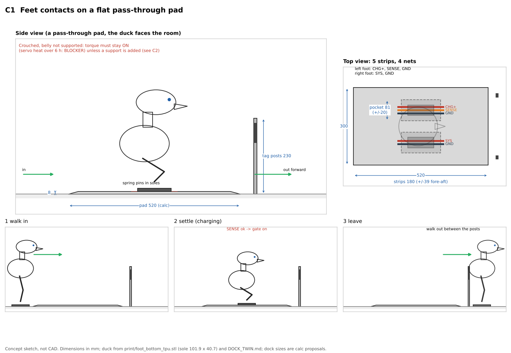
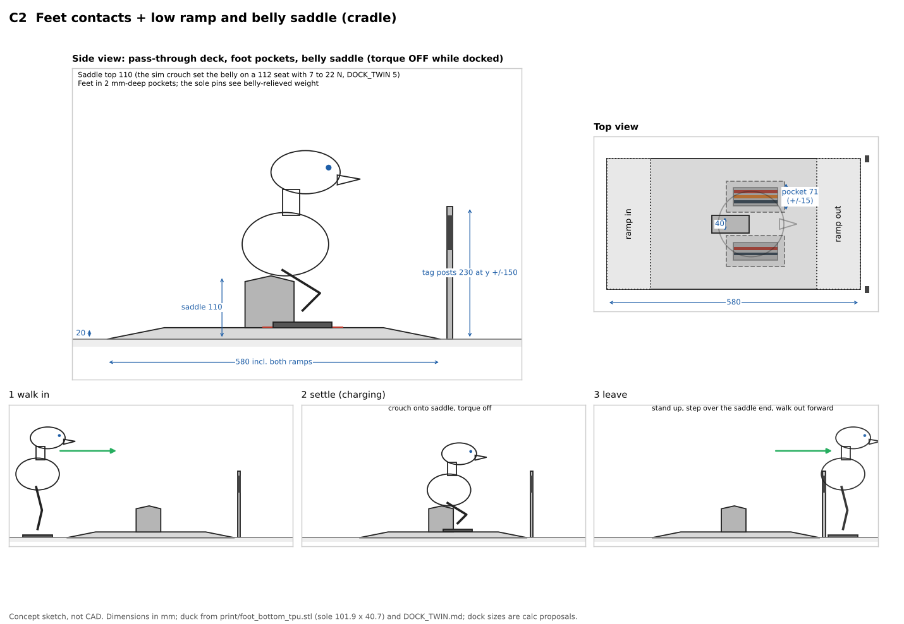
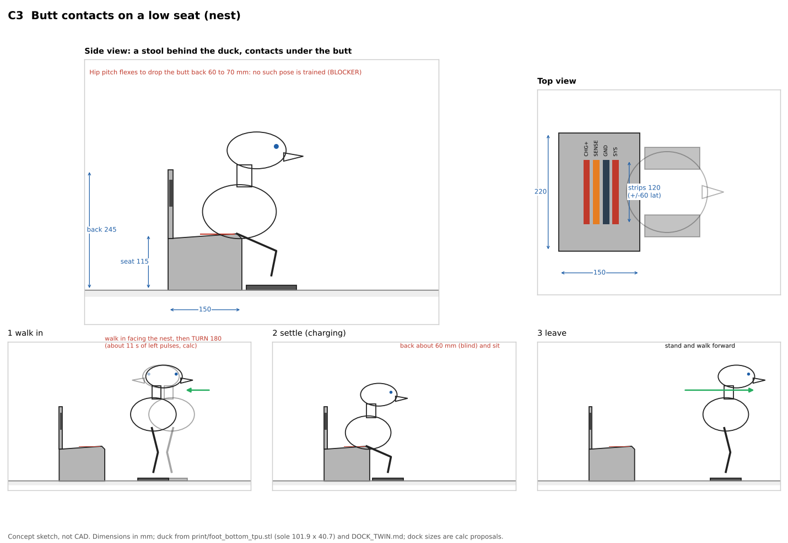
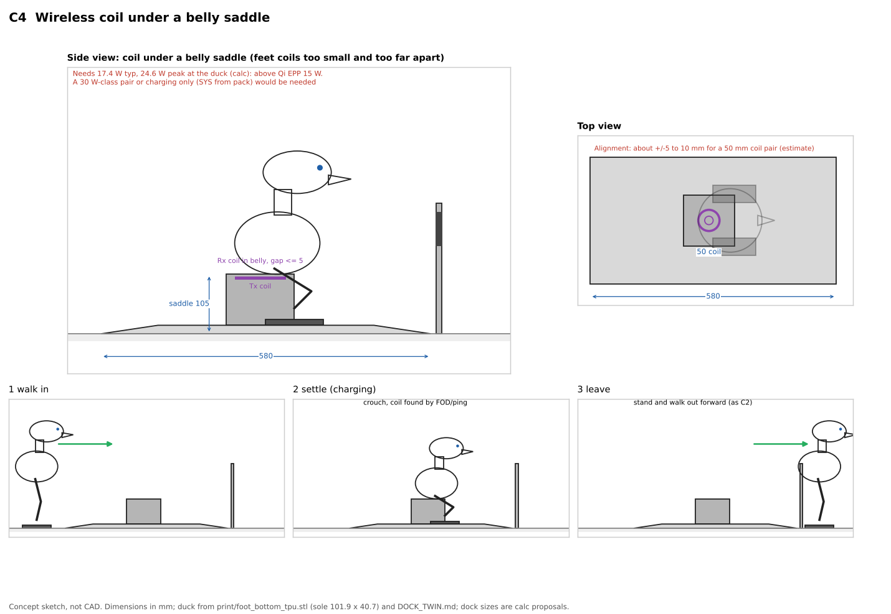
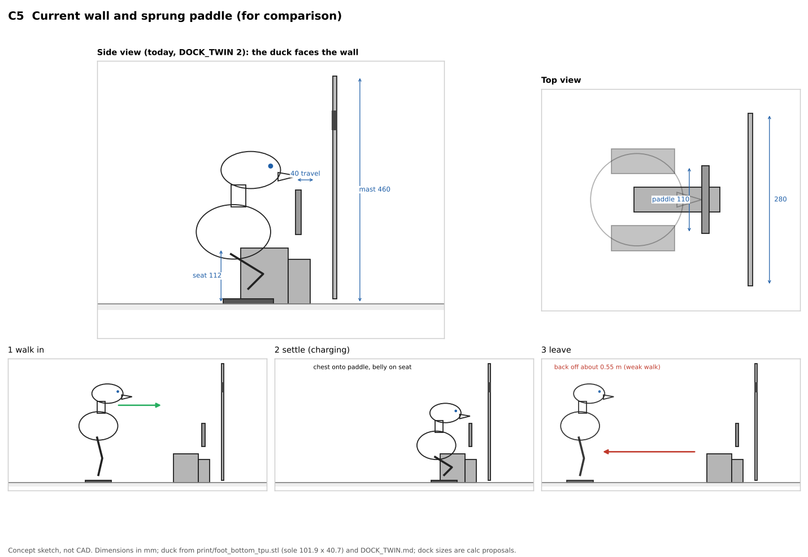

# Dock concepts for Duckie (2D sketches, before CAD)

2026-11-06. Answers Ahmed: "Why don't we just make the feet the contactors? It just looks awkward, staring at a wall. How is it even going to back up? Let's draw some drawings before we go ahead and 3D CAD."

Repo copy note (2026-11-11 ET): this is the report as written, copied into the repo as an archive of work in progress, with local folder paths and prices removed. SUPERSEDED: these are the first dock sketches of 2026-11-06, before D58 and D61. Kept for the record only. Index: ../../README.md.

Labels: **[src]** taken from a lab file (path given), **[calc]** arithmetic shown here, **[est]** engineering estimate with no source in hand, **BLOCKER** data missing. Sketches only: no CAD, nothing bought, no repo writes. Drawings come from `draw_concepts.py` in this folder.

## 0. Facts used

| Fact | Value | Source |
|---|---|---|
| Robot mass, height | 2.75 kg (sim 2.699 kg), about 0.4 m | brief; DOCK_TWIN.md 5 [src] |
| Sole | 101.9 x 40.7 mm (TPU, 8 mm) | print/foot_bottom_tpu.stl, measured with trimesh [src] |
| Foot centres | y +/- 62.5 mm | [calc] the 40 mm seat clears the soles by about 22 mm a side (DOCK_TWIN.md 2): 20 + 22 + 40.7/2 |
| Leg joints the wires must cross | 5 per leg: hip yaw, hip roll, hip pitch, knee, ankle | mini_bdx/robots/open_duck_mini_v2/robot.urdf [src] |
| Last-mile accuracy (sim) | walk-in only within 20 mm lateral and 4 deg; stop on tag range, 10 to 35 mm coast after a zero command | DOCK_TWIN.md 4 [src] |
| Walk limits | vy -0.2: 0 mm (no right step); wz +0.5 for 1 s: +16.9 deg, right turns about half that; vx -0.15 for 3 s: -110 mm with 39 mm right drift and +9 deg | DOCK_TWIN.md 4 table [src] |
| Crouch onto a 112 mm seat | belly load 7 to 22 N | DOCK_TWIN.md 5 [src] |
| Charge | MCP73213, 8.40 V CV, 1.0 A, 6 h timer | DOCK_INTERFACE.md 1 [src] |
| SYS (awake while docked, D50) | 9 V, about 1.0 A typical, 1.8 A peak; torque off while docked | DOCK_INTERFACE.md 1 and 2 [src] |
| Gate | seat microswitch in series, NTC window 5 to 45 C, pin-voltage window 5.0 to 8.45 V, no MCU | DOCK_INTERFACE.md 1 [src] |
| Servo thermal duty curve | none published for STS3215 | DECISIONS.md D2 [src] |
| D43 | contacts, no wireless charging (decided by Ahmed 2026-11-04) | DECISIONS.md D43 [src] |

## 1. Drawings

Each sheet: side view, top view, then a 3-frame strip (walk in, settle, leave). mm.

### C1 Feet contacts on a flat pass-through pad

- Pad 520 x 300 x 8 mm with chamfered edges, two shallow foot pockets (81 mm wide, so +/- 20 mm lateral), two 230 mm tag posts at the far end, y +/- 150 (the duck walks out between them). The 40 mm centre tag goes on a small plate on the far edge, tilted up. [calc]
- **Conductor split (4 nets, 5 strips):** left foot CHG+, SENSE, GND; right foot SYS, GND. GND on both feet splits the 2.1 A return (DOCK_INTERFACE.md 2) and gives two GND contacts. Strips run fore-aft, 180 mm long, so the fore-aft window is +/- 39 mm [calc: (180 - 102)/2].
- **Spring pins in the pad, flat gold pads in the soles.** Pins in the soles would be pressed at every step on every floor (wear, grit) and stick out of a walking foot. The dock side is the one that can be unpowered, so the pins live there.
- **Polarity and shorts when a foot lands wrong:** (1) The pad is dead until the gate closes; the gate needs a 10 k NTC (5 to 45 C) between SENSE and GND, so a sock, coin, wet patch or bare short (0 ohm) and an open (no duck) both keep it off. (2) The lanes are 125 mm apart and the pockets hold +/- 20 mm, so one foot cannot cover the other foot's lanes. (3) A wrong-way duck (turned 180) puts CHG+ under SYS: both are positive rails, both pass ideal diodes on the duck (DK2, DK6, DOCK_INTERFACE.md 3), and SENSE then lands on nothing, so the gate stays off. (4) The flat pad has no seat microswitch, so the presence switch must move to the pockets (a switch under each pocket floor, in series). (5) 9 V and 8.4 V are below the 24 V limit for toys (EN 62115, Electric toys, safety) and the 60 V DC ES1 limit (IEC 62368-1) [src: standards, limits quoted from memory; check the current editions, BLOCKER for a formal claim].
- **Big problem:** with no support the duck must hold a crouch or stand with **torque on for 6 h** to keep the feet pressed. D50 says torque off while docked. No STS3215 thermal curve exists (D2), so 6 h of holding is unknown: **BLOCKER (servo bench thermal run TO1)**. With torque off it folds; then the soles lift or slide off the strips.

### C2 Feet contacts with a low cradle (ramp + belly saddle)

- A 20 mm deck with ramps at both ends (580 mm long), foot pockets (71 mm, +/- 15 mm), a 40 mm wide saddle at 110 mm between the feet (the seat geometry that already works in the sim: the soles clear it by about 22 mm a side, the crouch puts 7 to 22 N on it, DOCK_TWIN.md 2 and 5). Tag posts flank the far end.
- The duck walks in straddling the saddle, crouches onto it, **torque off**, faces the room, and later stands and **walks forward off the far ramp**. No backward step, no turn.
- Contact force on the soles drops when the belly takes load: 27 N body weight minus 7 to 22 N on the saddle leaves 5 to 20 N on the feet [calc], plenty for spring pins (Mill-Max 0933 about 0.44 N each, DOCK_INTERFACE.md 2), but it changes with the crouch, so the force is not set by a spring as on today's paddle.
- **C2b (recommended variant): same cradle, contacts on the belly and the saddle, not the feet.** Pins in the saddle top, a pad on the belly. Gravity gives 7 to 22 N, the saddle already sets the position, and no wire crosses a leg joint. Sketch is the same drawing with the pins moved from the pockets to the saddle top.
- Saddle ends must taper: in acc6 two falls came from a sole hitting the seat end (DOCK_TWIN.md 4.4).

### C3 Butt contacts on a low seat (nest)

- A 150 x 220 mm stool, seat 115 mm, low back 245 mm with tags. Strips 120 mm long across the seat give +/- 60 mm lateral. The duck faces the room while charging and leaves forward, which is good.
- **Turning around, quantified [calc from DOCK_TWIN.md 4]:** 180 deg at +16.9 deg per 1 s left pulse is about 11 pulses, about 11 s of turning plus settles; right turns are about half rate, so always left. After the turn the camera faces away from the tags: the last move is blind.
- **Sitting back:** the butt must end about 60 to 70 mm behind where the camera last saw the dock. Backing at the measured rate drifts 39 mm right and 9 deg per 110 mm; for 60 mm that is about 21 mm and 5 deg [calc, linear], already over the 20 mm and 4 deg walk-in gate the forward approach needs. A sit-back crouch (hips behind the feet) is not trained: **BLOCKER (no such pose in the policy or the phase 1 kinematics)**.
- Turn-in-place position drift is not measured: **BLOCKER**.

### C4 Wireless (inductive) under a belly saddle

- Feet are a poor coil site: 41 mm wide soles 125 mm apart, the coil moving with every step and the ankle, so the coil goes under a belly saddle (same cradle as C2).
- **Power [calc]:** charge 8.4 V x 1.0 A = 8.4 W. Running load per the brief, 0.6 A x 8.4 V = 5.0 W, total **13.4 W**. Per D50's own SYS numbers (9 V x 1.0 A = 9 W typical, 16.2 W peak) the total is **17.4 W typical, 24.6 W peak**.
- Qi Baseline Power Profile is 5 W and the Extended Power Profile up to 15 W [src: Wireless Power Consortium Qi spec v1.3]. 13.4 W fits EPP with no margin; 17.4 W and 24.6 W do not. Either a non-Qi 30 W class pair or the dock charges only and the robot runs off its pack (that breaks D50's "pack only charges").
- **Efficiency and heat [est]:** end-to-end DC to DC about 70 to 80 % for a well-aligned 15 W class pair (typical of vendor EVM reports; no specific part tested, BLOCKER for a real number). At 13.4 W out and 75 %: 17.9 W in, **4.5 W lost**, roughly half in the receiver coil and rectifier inside the belly, next to the cells. That is about 2 W more heat in a closed printed trunk for 6 h, against an NTC window that cuts off at 45 C.
- **Alignment [est]:** about +/- 5 to 10 mm for a 50 mm coil pair before the power falls off; tighter than the 20 mm walk-in gate.
- **Cost [est]:** a 15 W class Tx board plus Rx module (price: BLOCKER, not recorded here); a 30 W class pair more. Prices not checked: **BLOCKER**. Compare: today's contact parts are a few spring pins and an FR4 pad (DOCK_BOM_FULL.md).
- **Worth it for a kids' toy?** The win is no exposed metal. But C2b already has no live metal when empty (gated dock, below 24 V), wireless needs tighter alignment, adds heat by the cells, does not cover D50 at peak, and reverses D43. Not worth it now.

### C5 Today's wall and sprung paddle (for comparison)

- 460 mm mast, 40 mm sprung swivelling paddle, 112 mm seat (DOCK_TWIN.md 2). Works in the sim (acc10: 18/20 hard, 16/20 train, 10/20 soft, DOCK_TWIN.md 4.4) but faces the wall and must back off about 0.55 m; acc7 soft had 7 of 14 falls in the back-off of a retry.

## 2. Comparison

| | C1 feet, flat pad | C2 feet, cradle (C2b: belly on cradle) | C3 butt nest | C4 wireless saddle | C5 wall (today) |
|---|---|---|---|---|---|
| Looks / character | Faces the room, a mat on the floor, very clean | Faces the room, a little "bed"; C2b same | Faces the room, sits like a person, the cutest | Faces the room, as C2 | Stares at a 460 mm wall |
| Alignment needed vs sim (20 mm, 4 deg gate; 10 to 35 mm stop coast) | lateral +/- 20 (pocket), fore-aft +/- 39 [calc]: fits | lateral +/- 15 (pocket) and the saddle straddle (22 mm a side): fits, same as today's seat; C2b fore-aft set by the saddle length | lateral +/- 60 on the seat, but the blind back-in drifts about 21 mm and 5 deg [calc]: marginal | +/- 5 to 10 mm coil [est]: does not fit without a mechanical funnel | lateral +/- 46.5, fore-aft 0 to 40, yaw +/- 10 (DOCK_INTERFACE.md 2): fits |
| How it leaves | forward, between the posts | forward, off the far ramp | forward | forward | backward about 0.55 m (weak) |
| Contact reliability | soles collect dust, carpet fluff, sock lint; sole pads abrade on every step (recess 0.2 to 0.5 mm in the TPU, [est]); force depends on the stance | feet: as C1 but force eased by the saddle. C2b: belly pads never touch the floor, 7 to 22 N by gravity: best | butt pads stay clean, gravity load; only if it lands on the seat | no contacts to dirty; FOD and misalignment instead | chest pads clean, spring-set 3.29 N: good |
| Shock / kid safety | dock pins exposed in pockets, dead until the NTC gate closes; 8.4 / 9 V below the 24 V toy limit | same gating; C2b pins on the saddle top, harder for fingers than a floor pad | same gating | nothing exposed; coil heat by the cells | same gating; pins on a paddle at chest height |
| Robot changes | new soles with 5 pads, 3 wires down the left leg and 2 down the right through 5 joints each (flex life BLOCKER), a few grams per foot [est] where the mass study fought for 10.7 g per foot (print/MASS_STUDY.md); presence switches in the pockets | feet: as C1. C2b: a belly pad and one hole in body_bottom, no leg wiring (the belly pocket tried earlier was reverted for fit, DOCK_TWIN.md 1, so the pad must be flat-mounted) | butt pad; a new sit-back pose (BLOCKER) | Rx coil and module in the belly, about 2 W extra heat [est] | none (built in the sim) |
| Cost (dock side) | low: a printed pad, 5 pins, 2 posts [est] | low: about today's seat plus a ramp [est] | low [est] | highest, modules (price: BLOCKER, not recorded here) | moderate: mast, sprung paddle, constant-force springs (DOCK_BOM_FULL.md) |
| D50 awake while docked | needs torque ON to hold the stance: conflicts with "torque off while docked"; 6 h servo heat BLOCKER | yes, torque off on the saddle | yes, if the sit-back pose holds with torque off (BLOCKER) | only up to about 15 W: 17.4 W typ and 24.6 W peak exceed Qi EPP [calc] | yes |

## 3. Recommendation

**C2b: a low pass-through cradle, the duck crouches onto a belly saddle facing the room and walks out forward; contacts on the belly and the saddle, feet in shallow pockets for alignment only.** Keep C1/C2 feet contacts as the fallback only if Ahmed wants contacts in the feet specifically.

Why:
1. It fixes both complaints: no wall (two 230 mm tag posts and a 20 mm deck), and no backing up (the duck walks out the far end, the one move the walk does well).
2. It reuses what already works in the sim: the 40 mm seat at about 112 mm between the feet, the crouch with 7 to 22 N on the belly, the 20 mm and 4 deg walk-in gate. The saddle carries the robot, so torque goes off as D50 requires.
3. Feet contacts, honestly: they cost wires across 10 moving joints, grams at the worst place for the walk, pads that wear on every step and pick up fluff, and either a 6 h held stance (servo heat unknown) or a saddle anyway. Once there is a saddle, the belly is the better contact site.
4. The nest (C3) looks best but needs a blind 180 turn and back-in the walk cannot do yet. Wireless (C4) cannot carry D50's load in Qi, runs hot by the cells and reverses D43.

What changes from today: the mast and sprung paddle go (simpler, cheaper per D45), the tags move to two side posts, the chest pad moves to the belly. Things to settle before CAD:
- Ahmed's call on feet versus belly contacts (his idea was feet).
- Tag view: the side posts at y +/- 150 and the far-edge centre tag must stay in the camera view down to the stop; re-run the twin with the new tag layout. Sim, not done here.
- The forward exit over the saddle end (taper it) and a deck edge the soft-floor walk does not trip on (mat1: 18 of 20 tripped at a mat edge, DOCK_TWIN.md 4.4): the 20 mm ramp must be tested in the twin. BLOCKER until simulated.
- Belly pad position against the saddle across the 7 to 22 N crouch spread.

## 4. Blockers
- STS3215 thermal behaviour for a 6 h held stance (C1, feet-only C2 without saddle load): no duty curve (D2), needs the TO1 bench run.
- Flex life of 5 wires through 5 leg joints (C1, C2 feet): no data.
- Sit-back pose and turn-in-place drift (C3): not trained, not measured.
- Wireless part choice, efficiency and price (C4): not checked.
- Formal toy and touch-safety claim: confirm current EN 62115 and IEC 62368-1 limits.
- Ramp and tag-post layout in the twin (C2b): not simulated.
