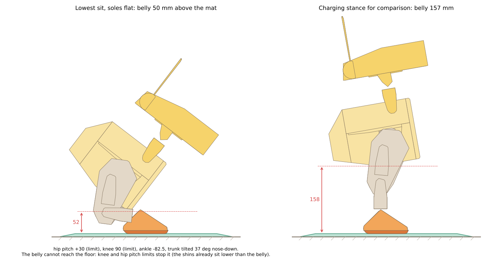
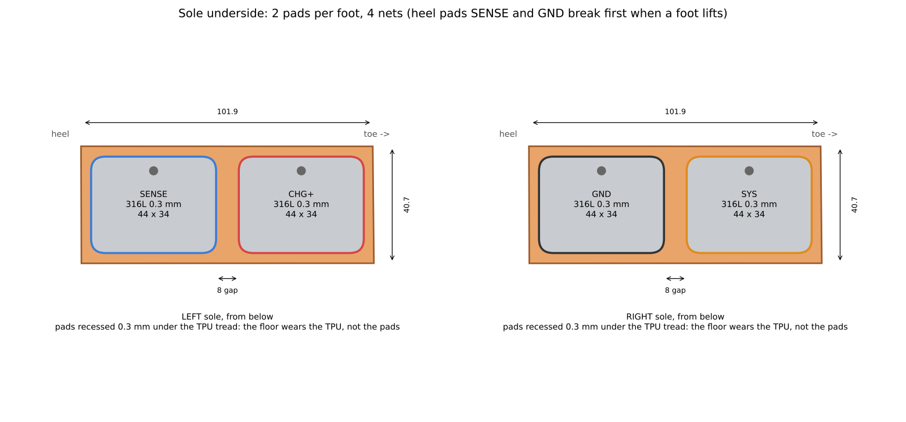
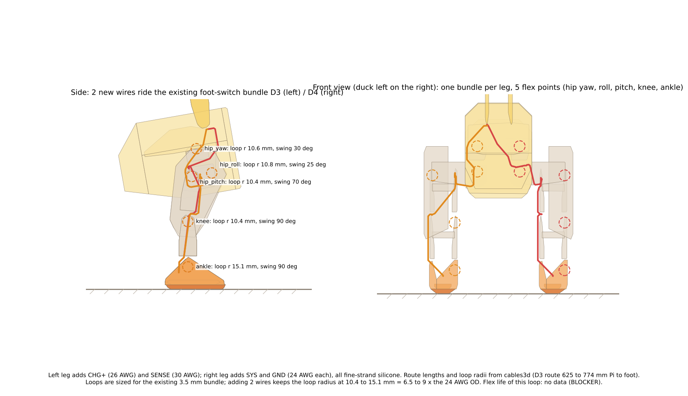
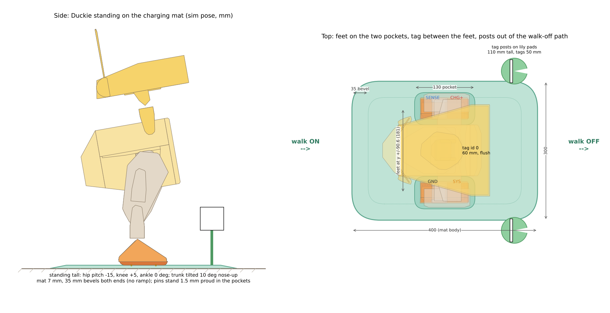
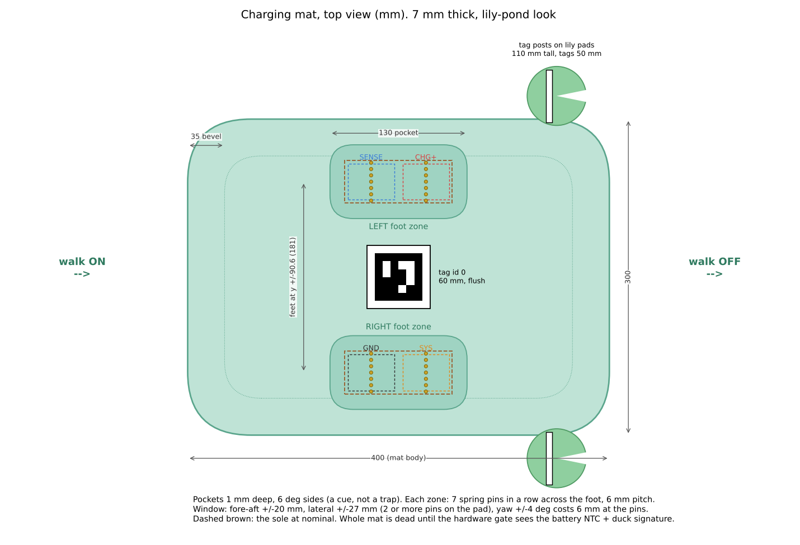
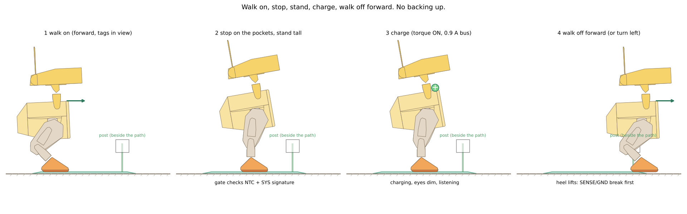

# FEET_DOCK: each foot is a contact (Duckie, Open Duck Mini v2)

2026-11-06. Ahmed: "we can just make each foot a contact... why does it have to look like a toilet". This is the best version of that: no stool, no saddle, no belly contact. The duck stands tall on a thin flat mat. It works with only its soles touching.

Repo copy note (2026-11-11 ET): this is the report as written, copied into the repo as an archive of work in progress, with local folder paths and prices removed. SUPERSEDED: this is the feet-contact dock study behind D58, which D61 (the nest dock) replaced on 2026-11-11 ET. It is kept for the record only. Its labels are the study's own (calc, est). The scripts were syntax-checked and not re-run after the move; they need a model folder that is not in the repo (BLOCKER for a re-run). Known issue: the walk-on harness (`deep/harness.py`, `deep/dock.py`) put the mat in the world body, so its foot stagger numbers are off; do not reuse them. Index: ../../README.md.

Labels: **sim pass only** (MuJoCo 3.17.0, the lab's `ours_b` added-mass model, 2.767 kg, 2 ms step, sts3215 position actuators kp 13.37, forcerange 3.23 Nm); **calc** (arithmetic shown here); **est** (an estimate with no source in hand); **BLOCKER** (data is missing). Sketches and calculations only: no CAD, nothing bought, no repo writes. The scripts are in this folder: `stance.py` (stance scan and holds), `sit2.py` and `sit3.py` (lowest sit and the rise), `therm.py` (current and heat), `draw.py` (all figures). They load a copy of the model from a scratch folder (a scratch folder outside the repo, set by `FEET_SCRATCH` in the repo copy; a copy of the lab's `ours_b` added-mass model with the Playground b9be205 assets; that model folder is not in the repo: BLOCKER for a re-run).

## Verdict (short and honest)

It can work. It is the simplest-looking dock: a 7 mm mat with two foot pockets, and Duckie stands on it like a duck on a lily pad. It is not free, though:

1. **The duck must hold its stance with torque on for the whole charge.** It cannot stand passively. In the sim it collapses within a second from every pose tried with torque off, straight knees included. The best tall stance is cheap: 0.86 A bus (central) and about +4 K at the hottest servo winding (hip roll). That is a small fraction of the crouch (3.4 A, knee winding +31 K central, over the cut in the high corner). This reverses D50's "torque off while docked", so **Ahmed must decide that**.
2. **Four nets are still needed** (CHG+, SENSE, GND, SYS). SYS cannot honestly share CHG+ under D50 (section 2.1). Two pads per foot.
3. **The fore-aft alignment is the tight axis.** Lateral has 7 mm of margin against the sim walk-in. Fore-aft has about 1 mm before the unknown foot stagger at the stop is counted.
4. **Bench first:** (a) a 6 h hold of this stance on a real servo pair with the thermal log (TO1 style); (b) a flex test of the new wires in the knee loop geometry; (c) pad wear and contact resistance after walking on carpet and tile. Then (d) a sim walk-in onto this mat, with its 7 mm bevel and the stop stagger.

If (a) fails, the fallback is C2b from the concepts (belly saddle). It is not a feet design.

---

## 1. Stance while charging

### 1.1 Search (sim pass only)
I scanned the joints (left values, right mirrored): hip pitch -40 to +10 deg, knee 0 to 90 deg, ankle = -(hip + knee) +/- 15 deg, in 5 deg steps. Each pose had the feet flattened by the trunk pitch and the centre of mass inside the soles by at least 10 mm. Each was held 3 s with position control. A pose was kept if it stayed upright (trunk z axis > 0.97) and sank less than 10 mm. The score was the sum of |torque| over all 14 servos, averaged over the last second.

**Best tall stance: hip pitch -15 deg, knee +5 deg, ankle 0 deg, trunk 10 deg nose-up.** Base 201 mm, belly 157 mm above the mat, centre of mass 35 mm inside the sole edges, soles carry 14.1 N and 13.1 N (27.2 N, the full weight).

### 1.2 Torque, current, heat (sim pass only for torque, calc for the rest)
Current is |tau| / kt x the current factor: central kt 1.212 Nm/A (BAM m1); high corner 0.765 Nm/A x 1.25 (THERMAL_TWIN table). Idle is 21 mA per servo (14 servos). Heat is I^2 x 2.63 ohm (central) or 2.93 ohm (high). Winding rise = body rise + I^2 x 2.5 ohm x R_wc, with R_wc 10 K/W (central) or 15 K/W (high) and body to still air 11.6 K/W (bare servo, still air: a docked duck has no walking airflow). The body time constant is about 316 s, so 6 h is steady state from about 30 min on.

| joint | torque Nm | current A central / high |
|---|---|---|
| left hip roll | 0.193 | 0.16 / 0.32 |
| right hip roll | -0.222 | 0.18 / 0.36 |
| left ankle | -0.058 | 0.05 / 0.10 |
| head pitch | 0.047 | 0.04 / 0.08 |
| left knee | -0.046 | 0.04 / 0.08 |
| right knee, right ankle | -0.027, -0.026 | 0.02 / 0.04 each |
| left and right hip pitch | 0.026, -0.019 | 0.02 / 0.04 each |
| hip yaws, neck pitch | under 0.01 | about 0.01 |

| pose | sum |tau| Nm | motor current A (central / high) | bus incl. idle A | hottest servo | 6 h rise, body / winding K (central) | (high) |
|---|---|---|---|---|---|---|
| **best tall stance** | 0.69 | 0.57 / 1.12 | **0.86 / 1.42** | right hip roll | 2.8 / 3.6 | 6.2 / 11.1 |
| straight legs (all 0) | 1.89 | 1.56 / 3.09 | 1.86 / 3.39 | right hip roll | 3.4 / 4.8 | 9.1 / 17.2 |
| home (walk stance) | 2.50 | 2.06 / 4.08 | 2.35 / 4.37 | left knee | 11.2 / 18.9 | 43 / 88.5 |
| crouch (hip -40, knee 80, ankle -40) | 3.76 | 3.11 / 6.15 | 3.40 / 6.44 | left knee | 18.0 / 31.3 | 73 / 151 (cut) |

- At a 25 C room, the best stance keeps the hottest reading near 28 to 31 C. The 70 C cut is far away in both corners. The crouch is fine in the central corner but trips the cut in the high corner. **Stand tall, do not crouch.**
- Straight legs are worse than a slight knee bend: the centre of mass then sits behind the ankle and the ankles and hips work.
- The hip rolls carry most of the load: the legs are splayed (feet at y +/-90.6 mm) and each leg pushes outward. A 1 to 2 deg inward roll may lower it further (not scanned).
- **Power budget (calc):** 0.86 A x 7.2 V = 6.2 W more through SYS. At 9 V and 90 % that is about 0.77 A on top of D50's 1.0 A typical, so about 1.8 A typical. That is D50's peak. **BLOCKER: re-run the SYS budget and the DK6/pin ratings with holding on** (9 V 4 A adapter: fine).
- **BLOCKER (sim only):** the sim position servo has no deadband, no hunting and no backlash. A real STS3215 holding near zero load can buzz and draw more. Bench test 1 below measures this.

### 1.3 Torque off: is passive standing possible?
**No.** With torque off (kp 0, joint friction 0.068 Nm as in the model), the duck falls within the first second from the best stance, from straight legs, and from a 3 deg knee hyperextension (sim pass only). The knee has no mechanical stop at straight: its range is +/-90 deg, so it cannot lock over-centre. Even with the knees locked, the hip pitch and ankle are free and the trunk pitches over. Passive standing would need a mechanical stop (for example a printed knee stop at -3 deg plus an ankle stop). That is a CAD change and a walk change, not proposed here. **Plainly: torque must stay on in the legs while charging.**

### 1.4 Ahmed's question: can it sit fully down on its belly with its feet on the contacts?
**No: the belly cannot touch the floor with both soles flat.** I scanned (kinematics) hip pitch -70 to +30, knee 0 to 90, ankle -90 to +90 in 2.5 deg steps, with the soles flat on the mat, the centre of mass over the soles, and no other part below the mat (sim pass only):

| case | lowest belly above mat | pose (hip pitch, knee, ankle; trunk) | what stops it |
|---|---|---|---|
| any balance (CoM 3 mm from the heel) | 48 mm | +30, 90, -90; trunk 30 deg | hip pitch +30 (limit), knee 90 (limit), ankle -90 (limit) |
| CoM 15 mm or more inside the sole | **50 mm** (F6) | +30, 90, -82.5; trunk 37 deg nose-down | hip pitch +30 limit, knee 90 limit |
| also trunk within +/-15 deg of level | 90.5 mm | -10, 90, -67.5; trunk 12.5 deg | knee 90 limit |

- In the 50 mm pose the shins already sit lower than the belly, so wider joint limits would put the shins on the floor before the belly.
- The feet carry the full weight there: 13.9 N and 13.2 N.
- **Getting up (sim pass only, quasi-static):** in a 6-step rise from the 50 mm sit to the charging stance, the peak is 0.83 Nm at the knee, 20 % into the rise (hip pitch 0.63 Nm). The STS3215 stall torque is about 1.9 Nm at 7.4 V (2.5 A x 0.765 Nm/A, data sheet F1), so the margin is about 2.3x. Yes, it can get up. Dynamic rise was not simulated.
- **Not a charging pose:** in the sim the joint limits carry the knee and hip load, but a real servo has no hard stop at its software limit and would have to hold it. Holding there costs 2.1 to 3.9 A bus even in the sim, with the neck the worst at 0.59 Nm.

## 2. Contacts in the soles

### 2.1 Count: 4 nets, 2 per foot
- **SYS cannot share CHG+.** CHG+ is the MCP73213 output at pack voltage, and the gate's 5.0 to 8.45 V window reads the pack through it (DOCK_INTERFACE 1 and DOCK_TWIN line 235). SYS is a separate gated 9 V supply into the ideal-diode OR. Merging them would either put 9 V on the pack past the charger, or run the duck from the charger output (1.0 A limit, under the 1.8 A peak plus the hold current). It would also make the charger's timer and its 10 % end of charge see the duck's load: exactly what D50 split them to avoid.
- **SENSE cannot share GND.** The gate reads the NTC between SENSE and GND.
- The only way to 3 nets is to move the charger into the duck, so the dock sends only gated 9 V. That redesigns D50 and DOCK_INTERFACE and is out of scope.
- **Split:** LEFT foot has CHG+ (toe) and SENSE (heel). RIGHT foot has SYS (toe) and GND (heel). The heel pads are SENSE and GND, so when either heel lifts, the gate opens before the toe pads leave.

### 2.2 Type: flat pads in the soles, spring pins in the mat
| option | wear (pads hit the floor every step) | dirt and carpet fluff | safety | pick |
|---|---|---|---|---|
| **316L pads in the sole, pins in the mat** | pads recessed 0.3 mm under the TPU tread, so the floor wears the TPU, not the pads; 316L is hard and does not tarnish like brass | pins with crown tips cut through fluff and film; the pads wipe on every step | pins are dead unless gated | **yes** |
| brass pads | soft, tarnishes (contact resistance rises), greens with sweat or wet | same | same | no |
| pins in the feet, pads in the mat | plungers cycle on every step on every floor; grit jams them | pins pick up fluff; mass and height on a walking foot | the mat pads are exposed | no |

**BLOCKER:** 316L forms a passive oxide. Contact resistance with 0.44 N gold crown pins is not measured. Bench test 3 below covers it (an alternative is a nickel or hard-gold plated brass pad).

### 2.3 Layout on the 101.9 x 40.7 mm sole
Two pads per foot, each 44 x 34 mm with 5 mm corner radii, 0.3 mm thick, centres 26 mm fore and aft of the sole centre, an 8 mm gap between them and a 3.3 mm TPU rim. Each pad is riveted or crimped at one 2 mm via to its wire. Mat: per zone, a row of 7 pins across the foot at 6 mm pitch (36 mm row) at the pad centre line.

Window (calc):
- Lateral: at least 2 pins stay on the pad up to **+/-27 mm** offset.
- Fore-aft: the pin row stays on the pad up to **+/-20 mm**. From 20 to 30 mm it sits in the gap (open, safe). Only beyond 30 mm can it reach the other pad. The gate catches that (section 4.2).
- Yaw: 4 deg moves the pins 6.3 mm fore-aft (90.6 mm lever).

| axis | sim walk-in (DOCK_TWIN 4) | window | margin |
|---|---|---|---|
| lateral | +/-20 mm | +/-27 mm | 7 mm |
| fore-aft | stop coast 10 to 35 mm, so +/-12.5 mm aimed at the middle | +/-20 mm | 7.5 mm, less 6.3 mm for yaw = **1.2 mm**, before the foot stagger at the stop |
| yaw | +/-4 deg | uses fore-aft margin | see above |

**BLOCKER:** the foot stagger at the stop (one foot ahead of the other) is not measured. A half step at 0.1 m/s is about 27 mm. A settle step or a policy "feet together" stop is needed, and a walk-in sim onto this mat (track 10 creep).

### 2.4 Contact force
- Body weight per foot: 14.1 N and 13.1 N (sim pass only, best stance).
- Pins: Mill-Max 0933, 45 gf (0.44 N) at mid stroke (DOCK_INTERFACE 2). Two to four pins on a pad give 0.9 to 1.8 N per pad, and 7 pins under the foot give at most 3.1 N.
- So the weight (13 N) bottoms the TPU on the mat and the pins sit at their own spring force: **the contact force is set by the springs, not by how the duck stands.** That is the right way round.
- Rating: 2 A per pin (DOCK_TWIN for the 0932). The GND pad carries 1.0 A charge plus 1.8 A SYS, about 2.8 A peak, over at least 2 pins: 1.4 A each.
- **BLOCKER:** 0933 stroke and rating not confirmed. The pins must stand 1.5 mm proud of the pocket floor and reach a pad 0.3 mm inside the sole while the TPU rests on the mat, so they need at least 1.2 mm working travel with stroke to spare.

### 2.5 Mass per foot and the walk (calc; flagged)
- Pads: 2 x 1496 mm2 x 0.3 mm x 8.0 g/cm3 = 7.2 g. Rivets and wire ends: about 0.8 g (est). Less the TPU removed: 1.1 g. **About +6.9 g at each foot.**
- Wires in the leg: right 2 x 24 AWG silicone x 0.45 m at about 3.4 g/m (est) = 3.1 g; left 26 AWG plus 30 AWG = 1.6 g.
- **Robot: about +19 g (+0.7 %).** The foot body is 89 g in the model, so +8 %. Leg swing inertia about the hip rises about 4 % (calc: 6.9 g at about 0.2 m, against the leg's sum of m r^2).
- The repo's added-mass sim (sim/ADDED_MASS_SIM.md) covers trunk mass and CoM only, up to +0.59 kg with no fall. **It has no foot-mass case. BLOCKER (small):** re-run `added_mass_sim.py` with +7 g on each `foot_assembly`. I expect no change (calc: 0.002 Nm extra ankle gravity torque in swing).

## 3. Wiring down the legs
- **There is a precedent:** D3 and D4 (Pi to the foot switches) already run from the trunk through hip yaw, hip roll, hip pitch, knee and ankle into each foot, with service loops checked in cables3d. SP4 and SP5 (servo power) run beside them to the ankle servo. Two thin wires ride the D3 bundle (left) and the D4 bundle (right) and end at the pads through the foot_top/foot_bottom stack.
- **Flex points (5 per leg), with the loops from cables3d.json (D3):**

| joint | swing | loop radius |
|---|---|---|
| hip yaw | 30 deg | 10.6 mm |
| hip roll | 25 deg | 10.8 mm |
| hip pitch | 70 deg | 10.4 mm |
| knee | 90 deg | 10.4 mm |
| ankle | 90 deg | 15.1 mm |

- **Wires:**
  - Left: CHG+ 26 AWG (1.0 A) and SENSE 30 AWG (microamps).
  - Right: SYS and GND 24 AWG each (1.8 A peak, 2.8 A peak on GND).
  - All are high-strand-count silicone.
  - Length about 0.45 m from the trunk splice to the pad.
  - Drop on GND: 0.084 ohm/m x 0.45 m x 2.8 A = 0.1 V (calc).
- **Bend radius:** 24 AWG silicone OD is about 1.6 mm (est), so the existing 10.4 mm loops are 6.5 x OD. That is under the common 10 x OD rule for continuous flex. Grow the loops at the hip pitch and the knee to 16 mm (about 12 mm more dressed length each) or use 2 x 26 AWG per net.
- **Flex count (calc):** a 0.54 s gait period gives 1 flex per joint per cycle, so about 6,700 per walking hour, or 2.4 million a year at 1 h of walking a day.
- **BLOCKER: no flex-life data for any wire in this loop geometry.** Bench test 2: cycle a bundle (the D3 bundle plus 2 new wires) through the knee loop (90 deg, r 10.4 mm) at 2 to 3 Hz to 1 million cycles, with 4-wire resistance logging. Pass: no rise over 10 % and no broken strand at the cut-open check.

## 4. Mat

### 4.1 Body
- **400 x 300 mm, 7 mm thick, no ramp.** It has a 35 mm bevel at the entry and exit ends (about 11 deg) and rounded corners. The layers are a 2 mm printed base, a 1.6 mm PCB carrying the pins and traces, and a printed top skin.
- **Foot pockets:** 130 x 70 mm, 1 mm deep, with 6 deg sides. They are a cue and a settle, not a trap. Centres are at y +/-90.6 mm, the sim stance foot spacing (the concept sheet's +/-62.5 was derived from the seat clearance and is not the stance; use this).
- **Tags, low and friendly:**
  - A flat 60 mm tag (id 0) is printed flush between the pockets, where the feet straddle it (it clears the soles by 39 mm a side). The camera sees it with the head pitched down over the last 0.3 m.
  - Two 110 mm "reed" posts with 50 mm tags (ids 1 and 2) stand on lily-pad ears at y +/-172 mm, 61 mm outside the soles, so walk-off passes between them.
- Look: pale pond green, darker pockets, lily-pad ears. It reads as a toy, not a fixture.
- **BLOCKER:** the stock policy stumbles on a 0 to 10 mm height field (ADDED_MASS_SIM). A sim of stepping onto and off a 7 mm bevelled mat is needed before printing.

### 4.2 Dead unless a duck is on it: gating (hardware, no MCU, the existing D43/D50 gate extended)
Every output is off by default. The mat enables its outputs only when **all** of these hold for 0.5 s:
1. SENSE pin to GND pin reads the 10 k NTC in its 5 to 45 C window (about 25 k to 4.4 k for a B3435 part), from a probe of 30 uA or less.
2. The CHG+ pin reads 5.0 to 8.45 V, the pack seen through the duck's 100 k (already in DOCK_INTERFACE).
3. **New:** the SYS pin reads a 47 k signature to GND, inside a 30 to 70 k window. This needs one resistor on the duck at the SYS pad.

Each output then passes an eFuse-class current limit: CHG+ 1.5 A, SYS 2.5 A, latching off with a 2 s retry. Comparators drop the gate within 1 ms of any check failing.

| case | what the mat sees | result |
|---|---|---|
| nothing on the mat; a kid, a pet | open everywhere, 0 V on CHG+ | dead (0 V; probe currents in microamps) |
| wet sock or puddle across SENSE and GND | maybe kilohms, in the NTC window | **still dead:** CHG+ reads 0 V (no pack), SYS has no 47 k |
| coin | bridges pins of one zone (one net) at most; zones are 52 mm or more apart | dead |
| fork (180 mm) across zones, no duck | 0 ohm or open, 0 V on CHG+ | dead |
| fork while charging, on exposed pins | short on SYS or CHG+ | the eFuse trips in microseconds to milliseconds and retries; 9 V cannot hurt skin |
| duck turned 180 deg | the CHG+ pins land under the duck's GND heel pad and read 0 V | dead |
| foot 20 to 30 mm fore-aft off | pins in the gap: open | dead (safe) |
| foot over 30 mm off (crossed pads) | at least one check fails (NTC, 47 k or the pack voltage) | dead |

- **Voltages:** 9 V and 8.4 V are under the 24 V toy limit (EN 62115) and the 60 V ES1 limit (IEC 62368-1). **BLOCKER** for a formal claim: the standards were quoted from memory.
- **Break under load:** when a flat foot lifts, the CHG+ and SYS pads can leave under 1.8 A at 9 V, so small arcs could pit the pads. Fix: one duck-side MOSFET in the SENSE line, which the Pi opens 100 ms before any step-off, so the mat gates off first. That is one new part. **BLOCKER (minor):** it needs adding to the duck-side netlist.

## 5. On and off
1. **Walk on forward.** The post tags give range and lateral position from about 1 m. The flat centre tag guides the last 0.3 m. Duckie stops by tag range and dead reckoning.
2. **Stop and stand tall.** From the walk stance (home) to hip -15, knee +5, ankle 0, the base rises 45 mm. Keep the feet where they are.
3. **Charge.** The gate closes, legs torque on (0.9 A), and Duckie is awake on SYS (D50) and listening.
4. **Walk off forward.** The Pi opens the SENSE MOSFET, the dock gates off, Duckie goes back to the walk stance and walks off the far bevel between the reed posts. It may turn left after stepping off. It never backs up.

## 6. Open risks
- **BLOCKER (decision, Ahmed):** this design needs torque ON in the legs while docked, which reverses D50's "torque off while docked".
- **BLOCKER (bench 1, holding heat):** hold the best stance for 6 h on the real robot or a 2-servo rig, logging Present Current and Temperature every 2 s. Pass: the hottest reading stays under 45 C at a 25 C room, and the bus stays under 1.5 A. The sim says 0.86 A and +4 K, but it has no deadband or hunting.
- **BLOCKER (bench 2, flex life):** flex the knee-loop bundle 1 million cycles with resistance logging; no data exists.
- **BLOCKER (bench 3, pad wear and contact):** walk 316L and plated pads 10 km equivalent (or a rub rig) on carpet and tile, then measure contact resistance with 0.44 N crown pins. Pass: under 50 milliohm per pad.
- **BLOCKER (sim):** walk-in onto this mat (7 mm bevel), the fore-aft stop stagger, and a settle step. Fore-aft margin is about 1 mm before stagger.
- **BLOCKER:** the SYS budget with holding on (about 1.8 A typical, which is D50's peak).
- **BLOCKER:** Mill-Max 0933 stroke and rating not confirmed for the 1.5 mm proud plus 0.3 mm recess.
- **BLOCKER (small):** no foot added-mass sim (+7 g per foot); calc says negligible.
- **BLOCKER (minor):** the duck-side SENSE release MOSFET and the 47 k SYS signature resistor are new duck parts, not in the netlist.
- **BLOCKER:** toy and ES1 limits quoted from memory.
- Note: the hip rolls carry most of the hold; a slight inward roll is not yet scanned.

## 7. Numbers in one place
| item | value | label |
|---|---|---|
| charging stance | hip -15, knee +5, ankle 0 deg; belly 157 mm; base 201 mm | sim pass only |
| hold torque (sum, max) | 0.69 Nm, 0.22 Nm (hip roll) | sim pass only |
| bus current holding | 0.86 A central, 1.42 A high | calc |
| hottest winding rise over 6 h | +3.6 K central, +11.1 K high | calc |
| crouch, for comparison | 3.4 A; knee winding +31 K central, +151 K high (cut) | calc |
| torque off | falls in under 1 s; knees cannot lock (no stop) | sim pass only |
| lowest sit with soles flat | belly 50 mm (48 mm marginal); limits: knee 90, hip pitch +30 | sim pass only |
| rise from the lowest sit | peak 0.83 Nm knee, against about 1.9 Nm stall | sim pass only |
| sole load | 14.1 / 13.1 N | sim pass only |
| pads | 2 per foot, 316L 44 x 34 x 0.3 mm, recessed 0.3 mm | design |
| window | lateral +/-27 mm, fore-aft +/-20 mm | calc |
| added mass | +6.9 g per foot, about +19 g robot | calc |
| mat | 400 x 300 x 7 mm, 35 mm bevels, pockets 130 x 70 x 1 mm, feet y +/-90.6 | design |
