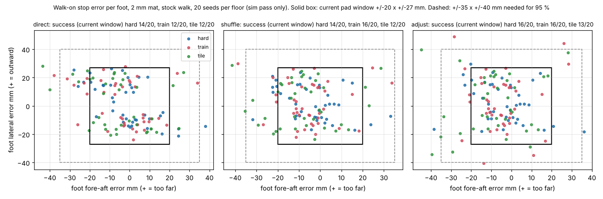
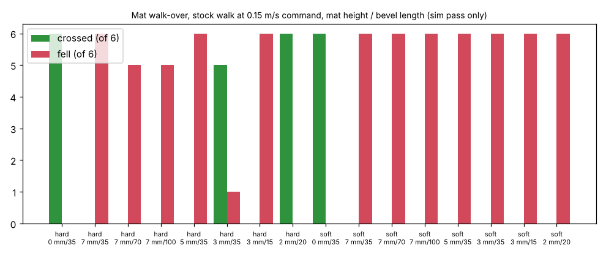
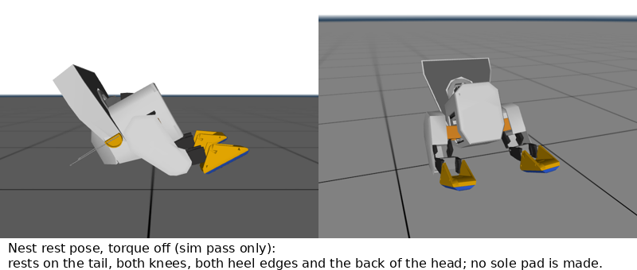
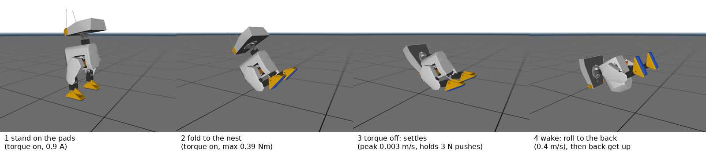

# DEEP_ANALYSIS: the feet-contact dock, failure by failure (Duckie, Open Duck Mini v2)

2026-11-06. Follows FEET_DOCK.md (one folder up). Ahmed: "I would like to go with the feet... Could you do a deeper analysis? Do you see any issues? ...Even if it stays up, why does it need to sit down if there are no issues with it?" Then, during this job: "what if it needs to turn off all equipment or reboot? There has to be a specific position where it reboots safely without falling." and "If we can, we should look for solutions that let us turn off the entire unit while charging... we need to charge, we need the computer to be turned off, or during an update, it needs to position itself."

Repo copy note (2026-11-11 ET): this is the report as written, copied into the repo as an archive of work in progress, with local folder paths and prices removed. SUPERSEDED: this is the feet-contact dock study behind D58, which D61 (the nest dock) replaced on 2026-11-11 ET. It is kept for the record only. Its labels are the study's own (calc, est). The scripts were syntax-checked and not re-run after the move; they need a model folder that is not in the repo (BLOCKER for a re-run). Known issue: the walk-on harness (`deep/harness.py`, `deep/dock.py`) put the mat in the world body, so its foot stagger numbers are off; do not reuse them. Index: ../../../README.md.

Labels: **sim pass only** (MuJoCo 3.17.0, lab model ours_b 2.767 kg, stock BEST_WALK_ONNX_2 through the lab's unmodified MjInfer loop, accelerometer bias fix on); **calc**; **est** (no source in hand); **BLOCKER** (data missing). No CAD, nothing bought, no repo writes. Scripts and raw results are in this folder (section 9).

## 0. Headlines

1. **Off and charging at the same time: NO pose does it with the current pads.** Electrically it would work (the netlist routes CHG+ through DK2 and the 5 A fuse F2 straight to BMS P+ (cable DC1), so the pack charges with the 2813 off). Geometrically, though, no torque-off pose keeps the sole pads on the pins. I ran a 245-pose grid plus 5 targeted nest variants, each with 35 s torque off and 3 N pushes. In 0 of them were CHG+, SENSE and GND all made, and 0 kept all four pads. With torque off the ankles are free, so the feet tip onto their heel edges.
2. **The safe "off and update" position is the nest:** Duckie sits back on its tail with its feet forward. It reaches the nest from standing with torque on (peak 0.39 Nm). When torque is cut it settles at 0.003 m/s and stays put through 3 N pushes (drift 1.0 to 4.4 mm). It does not charge there. It cannot stand straight up from the nest in the sim: 0 of 15 scripted rises worked. Waking is a gentle roll onto its back (0.4 m/s) and then the library's back get-up (19/19 in KNEE_TWIN; I did not re-run it here).
3. **"Computer off while charging" is still possible standing.** If the Pi halts but servo power stays on, every STS3215 keeps its last goal and the duck keeps standing and charging. Use this for Pi reboots and OS updates. Full power off and servo firmware updates must go to the nest first.
4. **The 7 mm mat trips the stock walk.** On a hard floor at 0.15 m/s command, 0 of 6 crossed it and 6 of 6 fell. A 70 or 100 mm bevel does not fix it. A 3 mm mat crossed 5 of 6 (1 fall), and a 2 mm mat with a 20 mm bevel crossed 6 of 6. The step height is the problem, not the slope.
5. **Landing accuracy is the second blocker.** On a 2 mm mat, the current pad window (+/-20 mm fore-aft, +/-27 mm lateral) docked first time on 12 to 14 of 20 seeds. With the best fix in software it reached 16/20 on the hard and training floors and 13/20 on tile. The stock walk's smallest correction is about one step (25 to 30 mm), so it cannot place feet more finely than that. Docking 95 % first time needs a window of about +/-35 x +/-40 mm, which does not fit two pads on a 102 x 41 mm sole.
6. **The frozen standing stance falls when pushed at 8 N for 0.2 s** (fore or aft; 20 N from the side). A child's or dog's bump can do that.

## 1. FMEA table

S = severity (1 cosmetic to 5 hard fall or hazard). L = likelihood (1 rare to 5 expected). RPN = S x L x D, where D (detection) runs from 1 (detected at once) to 5 (not detected).

| # | Failure mode | Effect | S | L | Detection (D) | RPN | Fix | Evidence |
|---|---|---|---|---|---|---|---|---|
| 1a | Duck stops with the pins off the pads (fore-aft) | No charge; retries | 3 | 4 | gate never closes, pack current 0 (2) | 24 | larger window, a retrained creep walk, contact-driven retry (sec 2) | sim pass only: 12 to 16 of 20 docked first time |
| 1b | Stand-up from walk pose slides the feet | Lost alignment after a good stop | 3 | 3 | gate opens (2) | 18 | settle march before the freeze (cuts the slip from 21 to 6 mm max) | sim pass only |
| 1c | Yaw at stop up to 9 deg | 14 mm fore-aft error at the pads | 3 | 4 | tags (2) | 24 | square-up turn before the freeze (yaw p95 from 8.6 to 5 deg) | sim pass only |
| 8a | 7 mm mat edge trips the walk | Hard fall at the mat | 5 | 5 | IMU (1) | 25 | mat 2 mm or less, or retrain on steps (sec 3) | sim pass only: 0/6 crossed, 6/6 fell |
| 8b | Mat on carpet (the mat stays rigid, the floor sinks 5 mm) | Fall at the mat edge | 5 | 4 | IMU (1) | 20 | hard base board under the whole approach, or retrain | sim pass only: 20/20 fell, even at 2 mm |
| 2a | Servo hunts or buzzes while holding all night | Noise, heat, wear | 2 | 3 | Present Current log (3) | 18 | P gain lowered for the hold, deadband registers set; bench B1 | BLOCKER: no holding data |
| 2b | Stance creeps over 6 h | Pads drift off | 3 | 2 | gate opens (2) | 12 | re-square every 30 min from the IMU and present positions | calc; BLOCKER bench |
| 3a | User presses OFF while standing | 2813 cuts all power at once and the duck collapses from 201 mm (trunk 0.77 m/s) | 5 | 3 | none: hardware (5) | 75 | rewire the button to request safe-off (sec 5) | sim pass only: torque-off collapse |
| 3b | Servo brownout reset (power register defaults to torque off) | Collapse | 5 | 1 | bus read fails (3) | 15 | ideal-diode OR holds the bus; battery guard | source: Feetech memory table, torque register in SRAM, default 0 |
| 3c | Pi crash or reboot | Servos keep their last goal: stays up | 2 | 3 | heartbeat (2) | 12 | dock-aware start: read the present positions, no move | Runtime turn_on: kp 2 of 32 for 1 s, sim sag 1 mm |
| 3d | One servo cuts on overheat | That joint goes limp: fall | 5 | 1 | temperature register (2) | 10 | nest at 55 C; hold rise is +3.6 K (sim) | calc |
| 3e | Mat unplugged | SYS drops; DK7 pack diode takes over | 2 | 3 | SENSE and pack monitor (1) | 6 | stay up on the battery; walk off if low | calc; BLOCKER: scope the bus on the bench |
| 4a | Push or bump while charging | Fall at 8 N for 0.2 s fore-aft | 4 | 4 | IMU (1) | 16 | IMU push detect, hand off to the walk policy or to the nest (sec 4) | sim pass only |
| 4b | Lifted off the mat | D55 goes limp; heel pads (SENSE, GND) break first | 2 | 3 | 2 of 3 vote (1) | 6 | Pi opens the SENSE switch on the vote | design |
| 4c | Wet hand or object on the pins | Dead unless pack voltage and 47 k are present | 2 | 2 | gate (1) | 4 | as designed; 9 V is under the 24 V limit | sourced (sec 4) |
| 5a | 316L oxide gives high contact resistance | Charge fails or is slow | 3 | 3 | charge current (2) | 18 | gold-plated pads or ENIG; bench B3 | BLOCKER |
| 5b | Fluff or hair in the pins | Intermittent | 2 | 4 | gate chatter (2) | 16 | crown tips; pins flush with a wipe groove; a monthly brush | est |
| 5c | Steel pads cut the sole grip | Slips on tile | 3 | 2 | falls (1) | 6 | pads take 72 % of the sole, so make them smaller (sec 6) | calc |
| 6a | Pad wires break in the leg flex | Open net | 3 | 3 | gate never closes (2) | 18 | 16 mm loops, inside the servo sleeve; bench B2 | BLOCKER: no flex data |
| 7 | +7 g per foot changes the walk | Slower walk | 1 | 5 | n/a | 5 | none needed | sim pass only: -1.1 % speed, 0 falls |
| 9 | Pin heating at 2.8 A on GND | Mat warms | 1 | 2 | NTC (2) | 4 | at least 2 pins per net; 0.1 W per pin | calc |
| 10a | No torque-off pose keeps contacts | No charge while fully off | 3 | 5 | n/a | n/a | Pi-halt standing for "computer off"; nest for full off | sim pass only |
| 10b | Back get-up after the nest presses the power button on body_back | Unwanted power toggle | 4 | 2 | power event (3) | 24 | check the button face against the back contact patch | BLOCKER: CAD check |
| 10c | Slow (6 s) entry into the nest tipped sideways | Side fall | 3 | 2 | IMU (1) | 6 | 3 s entry with an IMU roll guard | sim pass only: 1 of 5 variants |

## 2. Landing accuracy (item 1)

### 2.1 Method (sim pass only)
- **Model and floors.** The ours_b model walked onto a mat 400 x 300 mm. The mat was 2 mm thick with a 20 mm bevel, because the 7 mm mat cannot be crossed (section 3). Floors: hard (mu 1.0, mat top 0.8), training (0.6, 0.8), tile (0.4, mat top 0.5) and soft (0.8, with a 5 mm sink).
- **Seeds.** 20 seeds per floor. Each started 1.05 m back, with +/-40 mm lateral, +/-6 deg yaw and joint jitter.
- **Approach.** Command 0.15 m/s. Heading and lateral control came from a tag stand-in: the true foot pose plus 4 mm and 1 deg of noise at 10 Hz. The stop lead was 10 mm.
- **Stops.** Three strategies:
  - **direct:** zero command, freeze at the first double support, then a 1 s stand-up to the charging stance;
  - **shuffle (settle shuffle with camera correction):** before the freeze, up to 4 correction pulses (a turn when yaw is over 2.5 deg, a sidestep over 8 mm, forward or back over 6 mm), then 1.5 s of marching in place and a freeze when the feet are within 4 mm of each other;
  - **adjust (contact driven):** the shuffle plus up to 2 retries when the gate does not close, which is what SENSE and the foot switches would report.
- **Success.** All 4 pads see at least 2 of their own pins, and no pin touches the other pad of that foot.
- **Pockets.** I measured the stance spacing at 178.7 mm, so the pockets are at y +/-89.4 (not 90.6).

### 2.2 Results
| floor | strategy | docked first time, current 1 row (of 20) | 2 rows at +/-7 mm | 3 rows at +/-12 mm | per-foot x p95 mm | y p95 mm | yaw p95 deg | stand-up slip max mm | mean time s |
|---|---|---|---|---|---|---|---|---|---|
| hard | direct | 14 | 15 | 14 | 25.9 | 25.1 | 8.6 | 17.4 | 16 |
| hard | shuffle | 14 | **18** | 13 | 24.1 | 19.9 | 5.0 | 5.0 | 23 |
| hard | adjust | **16** | **18** | 14 | 24.7 | 23.0 | 5.0 | 5.0 | 29 |
| train | direct | 12 | 16 | 12 | 31.5 | 24.0 | 9.4 | 21.1 | 16 |
| train | shuffle | 16 | 17 | 14 | 27.1 | 26.8 | 4.3 | 6.1 | 23 |
| train | adjust | 16 | 17 | 14 | 26.1 | 40.6 | 4.4 | 6.1 | 28 |
| tile | direct | 12 | 13 | 11 | 30.4 | 23.9 | 7.7 | 16.9 | 17 |
| tile | shuffle | 12 | 13 | 11 | 32.3 | 24.8 | 5.7 | 12.3 | 24 |
| tile | adjust | 13 | 13 | 12 | 35.8 | 34.8 | 5.1 | 10.8 | 33 |
| soft | all | 0 (20/20 fell at the mat edge) | | | | | | | |

- Tile seed 1 fell in the approach (all 3 strategies, on the floor, before the mat).
- **Walk-off:** 0 falls in 177 docked runs.
- **Foot stagger** in the heading frame: mean 14 mm, max 52 mm. Most of it is yaw (9 deg x 179 mm), plus the stand-up slip of the right foot (mean +5 to +7 mm in direct).
- **Window needed for 95 %** (the worst of the 4 pad rows per run, hard, train and tile, 59 runs): fore-aft p95 33 to 38 mm, lateral p95 27 to 39 mm. Box +/-35 x +/-40 gives 88 to 95 %. The current box gives 61 to 73 %.

### 2.3 The four fixes asked for
- **Longer pad and pin zones.** The pads already fill the sole (2 x 44 mm plus an 8 mm gap). Spreading each zone into 2 rows at +/-7 mm is the one change that helps (hard 18/20, training 17/20) without letting a pin reach the other pad. Three rows reach across the gap and lose. **Adopt 2 rows per zone (14 pins, 28 per mat).**
- **Settle shuffle with camera or tag correction.** It squares the yaw (p95 from 8.6 to 5 deg) and cuts the stand-up slip (17 to 5 mm). But each stock-walk pulse is about a full step, so the fore-aft error does not shrink (p95 stays 24 to 32 mm). **Keep the square-up turn and the settle march; drop the fore-aft pulses until there is a creep walk.**
- **Self-centring pockets.** These are not possible with the stock walk. A 1 mm pocket cannot centre a 13 N foot, and a pocket deep enough to centre one (3 mm or more) is a step, and steps of 3 mm or more trip the walk (section 3). **No.**
- **Contact detection driving a micro-adjust step.** This is worth +2 on hard and +1 on tile. It is limited by the same step quantum. With a retrained creep walk (track 10, steps of 5 to 10 mm) this becomes the main fix: calc says at least 19/20 if the step quantum is 10 mm or less. **BLOCKER: track 10 walk.**
- **Re-measured with the fixes I can make now** (2 rows, square-up, settle march, retries): hard 18/20, training 17/20, tile 13/20, soft 0/20. **The bar of 19/20 is not met.**

## 3. Mat walk-on (item 8): the mat trips the walk

Straight walk-overs at 0.15 and 0.10 m/s command, 6 seeds per case (sim pass only):

| mat height / bevel | hard floor: crossed, fell | soft floor (5 mm sink): crossed, fell |
|---|---|---|
| none | 6, 0 | 6, 0 |
| 7 mm / 35 mm (current) | **0, 6** | 0, 6 |
| 7 mm / 70 mm | 0, 5 | 0, 6 |
| 7 mm / 100 mm (4 deg) | 0, 5 | 0, 6 |
| 5 mm / 35 mm | 0, 6 | 0, 6 |
| 3 mm / 35 mm | 5, 1 | 0, 6 |
| 3 mm / 15 mm | 0, 6 | 0, 6 |
| 2 mm / 20 mm | **6, 0** | 0, 6 |

- At 0.10 m/s command the duck does not fall. It marches in place with its toes on the bevel and never climbs (0 of 6 crossed in every mat case).
- The toe catches the bevel. The stock policy's swing clearance is a few mm and it was never trained on steps (this matches ADDED_MASS_SIM: it stumbles on the 0 to 10 mm height field).
- The soft-floor model sinks 5 mm (measured), so even a 2 mm rigid mat is a 7 mm step there. A real carpet lets a mat sink too. This is the worst case, not a measurement.
- **Can the pins sit flush in a 3 mm mat?** A 3 mm mat does not hold a Mill-Max 0933 with 1.2 mm working stroke plus its press-fit body (est: the body alone is longer; BLOCKER, part drawing). The options, best first:
  1. **Retrain the walk with 2 to 10 mm steps and slopes in the terrain** (track 10 already plans a retrain for creep). This keeps the 7 mm mat. **Recommended.**
  2. **A 2 mm mat with flat contacts and low-profile spring contacts in the soles.** The springs would cycle on every step and pick up grit, which FEET_DOCK rejected. BLOCKER: part and wear.
  3. **A 7 mm "floor tile" approach strip.** The duck walks onto a 400 mm long, 7 mm board from a 2 mm lead-in. This only moves the edge.
- On carpet, any rigid mat needs a hard base under the whole approach, or the retrain.

## 4. Standing all night (item 2) and kids and pets (item 4)

### 4.1 Real servo against the sim
- **Holding current.** The sim gives 0.86 A bus (central) and 1.42 A (high corner) (FEET_DOCK 1.2). Idle is 21 mA per servo (THERMAL_TWIN, used in FEET_DOCK). There is **no measured STS3215 holding current at near-zero load in the repo or online** (search: register docs only, no idle or hold figure). **BLOCKER. Bench B1 spec:**
  - hold the stance on the real duck (or 2 servos with a 1.4 kg dummy leg) for 6 h at a 25 C room;
  - log Present Current, Present Load, Temperature and Present Position every 2 s, and the bus current with a shunt;
  - repeat at P 32 (the Runtime gain) and P 16.
  - Pass: bus under 1.5 A mean; hottest servo under 45 C; position drift under 2 steps; no oscillation over 1 step peak to peak.
- **Deadband hunting and buzz.** The position loop has a dead zone (the CW and CCW dead-band registers in the Feetech STS memory table: aifitlab-wiki.super.site, a third-party table, not verified). Near zero load the motor can dither across it. SERVO_DEEP_DIVE already notes "if the legs buzz on the ground at P 30, try P 20".
  - **Fix:** while docked, drop the leg P to the lowest value that holds. The stance needs only 0.34 Nm at the worst joint, and in the sim even kp/16 held for 1 s with 1 mm of sag. Set the dead band to 2 steps.
  - **Noise in dB:** no data exists. **BLOCKER:** add a 10 min holding recording to the TEST_PLAN 17 ego-noise session (the D49 mics are on the duck). Pass: no tonal buzz over 30 dBA at 1 m (est target for a bedroom).
- **Creep over 6 h.** Position servos do not creep while powered (calc). The drift risks are thermal growth of the printed parts and the pads walking on the pins. **Fix:** every 30 min, read the IMU tilt and the present positions. If the tilt has drifted over 1 deg, re-command the stance at a slow ramp (micro-rebalance, about 2 s).
- **IMU balance while standing.** The frozen stance falls at 8 N for 0.2 s fore or aft and at 20 N from the side (sim pass only, `push.py`).
  - **Fix:** when the tilt rate is over 15 deg/s or the tilt is over 3 deg, the arbiter (D56 layer 1) hands control to the walk policy at zero command. The policy recovers by stepping, which opens the gate first because the heels lift. If the tilt keeps growing, it goes to the nest.
  - BLOCKER: the hand-off from the charging stance into the policy is not simulated, because the stance (knee 5 deg) is far from the policy's home pose (knee 78 deg). A first try should hand off to an ankle-hip PD on the IMU, a simple balance controller, and keep the policy for large pushes.
- **Sleep look.** While standing: head pitch down 20 deg, neck pitch 10 deg forward, ears down (D53 PWM, then the pulses stop). This is a small change in the CoM (calc: the head is about 0.3 kg, so 20 deg moves the CoM about 5 mm forward, well inside the 35 mm margin). It holds a little more torque at the neck (est +0.05 Nm). Have the eye LEDs dim.
- **Ahmed's question: why sit, if standing works?** It does not need to sit to charge. Standing tall is cheap (0.86 A, +3.6 K in the sim) and keeps the contacts. It needs a rest pose only for a full power-off, a servo firmware update, a push it cannot ride out, or a servo fault (section 5).

### 4.2 Kids and pets
- **Pushed or bumped:** the IMU hand-off above. Until it is shown in the sim, a bump can knock the duck over from 201 mm. That is the same height as a walking fall, which the get-ups already cover.
- **Picked up (D55):** the 2-of-3 vote trips in 60 ms. The duck goes limp and the heel pads (SENSE and GND) leave first, which opens the gate. Add: when the vote trips while docked, the Pi opens the duck-side SENSE switch at once, so the mat gates off before the toe pads break under load.
- **Arcing:** with the SENSE switch opened first, the comparators drop the gate within 1 ms (FEET_DOCK 4.2), so the pads break with no current. Without it, a 1.8 A break at 9 V gives small arcs (est). Keep the switch (one MOSFET, a BLOCKER minor netlist add).
- **Hand or wet object on the pins:** the gate needs the NTC window, the pack voltage on CHG+ and the 47 k on SYS, so the pins stay dead.
- **Touch-safe voltage (sourced):**
  - The EU Toy Safety Directive Annex II says toys shall not be powered above 24 V DC and accessible parts shall not exceed 24 V (legislation.gov.uk copy of Directive 2009/48/EC Annex II). EN 62115 sets the same 24 V working-voltage limit between accessible parts (iTeh catalogue of IEC 62115 Amd 2; EN IEC 62115:2020 is the current edition).
  - ASTM F963-23 4.25.2 caps the nominal voltage between accessible points at 24 V DC. That figure comes from test-lab reports that apply the standard, not the standard's own text (ASTM store page; Federal Register 2024-00741 on 4.25).
  - **9 V SYS and 8.4 V CHG+ pass by a factor of 2.7.** BLOCKER only for a formal claim: buy the standard texts (not bought, by instruction).

## 5. Power events, safe off and the rest pose (items 3 and the new headline)

### 5.1 What the robot does, event by event
| event | what happens now | what it should do | falls hard? |
|---|---|---|---|
| Mat loses power or adapter unplugged | SYS drops; DK7 (LM74700 ideal diode, pack side) carries the 2813 input from the pack with no gap (calc: both are ideal diodes at the same node); the servos see 9 V drop to 7.x V | stay standing on the battery; the arbiter (layer 2) sees the dock lost (SENSE gone, no charge current) and walks off or waits | no. BLOCKER: scope the bus during an unplug (B6) |
| Battery full | the MCP73213 ends at 10 % C/10 or the 6 h timer; SYS keeps running the duck | nothing | no |
| OFF pressed while standing | the 2813 cuts the pack and SYS at once. The servos lose power and torque defaults to off: collapse, trunk vz 0.77 m/s (sim pass only) | safe-off sequence first (5.3) | **yes, today** |
| Brownout | the servo resets below its supply limit, and its torque register defaults to 0 after reset (Feetech memory table, SRAM default 0): collapse | the OR diodes make this rare; the battery guard (D16) starts safe-off at its low limit | only if both supplies fail |
| Pi crash or watchdog | servos keep their last goal while powered (torque stays set; no bus timeout is listed in the memory table: BLOCKER, verify on the bench). The Runtime turn_on() then sets kp 2 for 1 s and moves to init_pos (Open_Duck_Mini_Runtime rustypot_position_hwi.py lines 90 to 101). In the sim, kp 2/32 on the stance sagged 1 mm in 1 s. | dock-aware start: when SENSE is present, read the present positions, keep the stance at the hold gain, no low-kp step, no init_pos | no (sim) |
| Servo overheat cut mid-night | that servo goes limp: a hip roll or knee loss collapses the stance | the Pi reads temperature every 10 s; at 55 C (cut 70 C) go to the nest. The hold rise is +3.6 K central (sim), so this is unlikely | yes if missed |
| Servo firmware update | that servo reboots, so torque is off | only in the nest or lying down, never standing | yes if standing |

### 5.2 The torque-off rest pose search (sim pass only)
**Model change for this:** every body mesh is made a floor collider. The stock MJCF lets only the soles collide, so the trunk falls through the floor.

**Grid.** Hip pitch -60 to +30, knee 30 to 90, ankle -90 to +90 (15 to 30 deg steps), 245 poses:
- Entry: from the charging stance with torque on over 3 s, then hold 1 s.
- Then torque off for 35 s, with 3 N pushes (0.2 s) fore, aft, left and right at 10, 15, 20 and 25 s.
- A pad counts as made if 2 or more pins sit under it within 1.0 mm.

Results:
- **216 of 245 entries fell during the torque-on entry.** The duck cannot fold freely: the knee range of +/-90 deg and the CoM behind the feet send most folds over backward.
- **0 of 245 keep CHG+, SENSE and GND made after torque off. 0 keep all four.** The best (3 pads) are fallen, lying poses by chance.
- **The feet tip** because the ankles are free. In every sit the soles rotate toes-up and rest on the heel edge.

**Targeted candidates:**
| candidate | enters from standing? | torque off: stable over 35 s with pushes? | pads made | can it get up? | look |
|---|---|---|---|---|---|
| tall stance, torque off | n/a | no: falls in under 1 s | 0 | get-up program | a fall |
| deep 50 mm squat, soles flat (FEET_DOCK F6) | yes (0.60 Nm) | rolls back into the nest at 0.17 m/s | 0 | as nest | |
| kneel, shins flat | no: the knee range (+/-90) and the foot geometry give no shin-flat pose; entries fall | n/a | n/a | n/a | n/a |
| lie on the belly, head down | entries fell sideways or backward (grid); not reached on purpose | stable once down | 0 | the front program does not load in the get-up library (BATTERY_STUDY 7, 9): BLOCKER | sleeping face down |
| **nest: sit back on the tail, feet forward** (hip +20, knee 70, ankle -75 commanded) | **yes**, peak 0.39 Nm, settles onto the tail during entry | **yes:** peak 0.003 m/s when torque is cut, drift 1.0 mm (model), 1.3 mm (power-off damping 0.05), 4.4 mm (gear friction 0.2), 1.0 mm on a mu 0.4 mat. One of 5 variants (a slow 6 s entry) tipped sideways. | **0** (rests on the tail, both knees, both heel edges and the back of the head) | not straight up: 0 of 15 rises (quasi-static and fast rocks; the CoM is behind the feet and the hip pitch is at its +30 deg limit). Roll onto the back (0.39 m/s trunk, 0.40 m/s head), then the back get-up (19/19 KNEE_TWIN) | a duck settled in its nest, head tipped back |
| lie on the back (after the roll) | yes, from the nest | yes (on the trunk back and the head) | 0 | back get-up 19/19 (KNEE_TWIN, not re-run) | asleep on its back |

### 5.3 Can it charge while fully off? Options weighed
1. **Kneel or fold with the soles flat: no.** No pose found (above).
2. **Move contacts to the nest footprint.** The nest rests on the tail (trunk frame about x -154, y +/-15, z -5 mm, the same in 4 of 5 variants within 2 mm), both heel edges and both knees. Charging off needs only CHG+, SENSE and GND (SYS is not used when off). One 3-point layout: SENSE on a tail skid, CHG+ on the left heel cap, GND on the right heel cap, with a second mat zone wired in parallel behind the foot pockets.
   - **Not recommended now.** The tail lands about 230 mm behind the feet, so the mat grows or the pockets move forward. The heel edge is a line contact. The +/-35 mm landing error carries straight through to the tail. The gate's third check (47 k on SYS) would have to move to CHG+.
   - CAD, a body change and new pads: a BLOCKER-level study.
3. **A tiny passive mat feature (heel cups, a low lip):** this does not work. The ankles are free, so the feet rotate whatever the heels sit in, and a lip of 2 mm or more trips the walk.
4. **What works today:** "computer off" standing. The Pi halts (`systemctl halt`, the 5 V rail stays up), servo power stays on, the legs hold, the dock runs the duck and charges the pack. Pi reboots and OS updates are done this way. A charge with everything off is not available with the feet dock.

**Plain answer to Ahmed:** the duck can switch its computer off and keep charging while it stands. It cannot switch everything off and keep charging, because nothing holds it on the pads with the motors off. For a full off or a motor update it first sits in its nest, beside or on the mat, without charging.

### 5.4 The safe-off sequence (one sequence for OFF, low battery, updates and the watchdog)
1. **Trigger:** the button (rewired, below), the battery guard low limit, an update, or a watchdog escalation that the Pi can still act on. Pi-only reboots and OS updates stop here: halt the Pi, the servos hold.
2. **Stop and stand:** the walk command goes to zero, and the duck stands still in the charging stance or the walk pose.
3. **Open SENSE** (if docked): the mat gates off before anything moves.
4. **Fold to the nest:** 3 s cosine ramp to hip +20, knee 70, ankle -75, neck 30 deg forward, ears down. Guard: if the IMU roll goes over 15 deg during the fold, pause and re-centre (the 6 s variant tipped sideways).
5. **Confirm:** the IMU pitch is 25 to 33 deg nose-up and the roll is under 5 deg for 1 s, and the leg loads are under 20 % of standing.
6. **Torque off:** legs first, then the head with a soft hold for 0.5 s, then all off.
7. **Cut:** Pi `poweroff`. gpio-poweroff drives GPIO26 to the 2813 OFF pin (already wired, D30).
8. **Wake:** the button or the 555 pulse on SENSE (D43) turns the 2813 on. The duck reads its IMU: nest or back.
   - Nest: roll to the back (legs to hip -30, knee 30, ankle 0 over 2 s), then the back get-up, then a floor check (D55 set-down rule).
   - On the mat: walk off, then re-dock if charging is wanted.

**The button must not cut power directly.** Today the button sits on the 2813 A and B pins, so a press toggles power in hardware. That is Pololu's pushbutton design, quoted from memory: **BLOCKER**, because pololu.com could not be reached from this session (allow it in the session network settings). Change, with no new purchase (a diode and resistors from the kits):
- Move the button off A and B. Wire it to the 2813 ON pin through a diode, so a press still turns the duck on.
- Wire it also to a Pi GPIO input through a divider (button node at pack voltage, so divide it to 3.3 V). A press while on asks the Pi for safe-off; the Pi then drives OFF.
- Add a hardware override for a hung Pi: an RC from the button node to OFF that trips after a 6 to 8 s hold, through a second diode. The 2813's own small onboard button (MOUNTING: "its own small pushbutton stays in parallel") stays as a service-only toggle inside the shell.
- BLOCKER: check the ON and OFF pin thresholds against the Pololu page.
- Netlist changes: cable P15 re-pinned, one new GPIO (a free one, for example GPIO5 if it is unused in the netlist; check).

**Check this before using the back pose:** the button plate is in the body_back cutout, and the back get-up rests the duck on its back. If that face meets the floor, the plunger (L type) could be pressed. **BLOCKER, CAD check** against the back contact patch in `res_rollback.json`.

## 6. Contacts (item 5)
- **Contact resistance.** 316L forms a passive oxide. A 0.44 N gold crown pin may not break it reliably (est), and no data exists. **BLOCKER, bench B3.** Use ENIG or hard-gold plated pads as the A/B partner. Pass: under 50 milliohm per pad after 10 km of walking equivalent and 500 dock cycles.
- **Fretting and corrosion.** Gold pin on stainless is a dissimilar pair. Micro-motion from servo dither all night is the fretting driver (est), so the hold-gain and deadband fix of 4.1 also protects the contacts. Gold on gold (plated pads) is the low-risk pair.
- **Fluff and pet hair.** Crown tips cut through, and the heel pads wipe on each dock. Put a 1 mm groove around each pin row so the fluff has somewhere to go (est). Cleaning: a dry brush monthly, and isopropyl on the pads. No liquid on the mat electronics: the pins are press-fit, so seal the top skin.
- **Pad wear.** The pads sit 0.3 mm recessed. Load: 13.5 N on the TPU rim of 1155 mm2 is 12 kPa. TPU deflects microns at that load (calc, E about 25 MPa est), so on hard floors the pads never touch. On carpet the fibres reach them, which is wanted (wiping). The thin rim (3.3 mm) is the wear item: BLOCKER, bench B3.
- **Grip.** The pads take 2 x 1496 = 2992 mm2 of the 4147 mm2 sole, which is 72 % (calc). Coulomb friction does not depend on area, but the TPU now carries 3.5 times the pressure, and its edges peel and wear faster (est). **Fix:** shrink the pads to 38 x 28 mm. That is 51 % of the sole, and the window drops to fore-aft +/-17 and lateral +/-24 mm, so it needs the 2-row zones. Or keep the area and accept this. BLOCKER: a slip test on tile (B4).
- **ESD.** The pads are exposed metal on the feet, wired to the BMS (CHG+) and to the SENSE comparator. Add a TVS on CHG+, SYS and SENSE at the trunk splice (est, small). Carpet ESD reaches 8 to 15 kV on a walker (est, typical).

## 7. Wiring (item 6)
- **Route.** Run the wires inside the existing servo cable sleeve with the D3 and D4 bundles. They then share the loops already checked in cables3d (10.4 to 15.1 mm radius).
- **Bend radius.** 24 AWG silicone has an OD of about 1.6 mm (est), so the 10.4 mm loops are 6.5 x OD. Grow the hip pitch and knee loops to 16 mm (10 x OD, about 12 mm more length each), or use 2 x 26 AWG per net (OD 1.3 mm, 8 x OD).
- **Mass.** About 4.7 g of wire for both legs, plus 6.9 g of pads per foot. Robot about +19 g (FEET_DOCK 2.5).
- **Test spec B2.** Cycle the D3 bundle plus the 2 new wires through the knee loop (90 deg, r 10.4 mm, and again at r 16 mm) at 2 to 3 Hz to 1 million cycles (calc: 6,700 per walking hour, about 5 months at 1 h a day). Log the 4-wire resistance every 1,000 cycles. Pass: rise under 10 % and no broken strand when cut open.

## 8. Walk impact, mat thermal, other findings (items 7, 9, 10)
- **+7 g per foot** (sim pass only, 10 seeds, forward 0.15 then turn 1.0 then sidestep 0.2): forward speed 0.1005 to 0.0994 m/s (-1.1 %), 0 falls against 0. Negligible.
- **Mat thermal (calc).**
  - **Pins:** 2.8 A on GND over 2 pins is 1.4 A each. At 50 milliohm (est, worst) that is 0.1 W per pin, a few K. With 2 rows there are at least 4 pins per net.
  - **Mat electronics:** the gate comparators are microwatts. The eFuse loss is about 25 mOhm x 2.5 A squared = 0.16 W. The charger EV board sits in the mat or the adapter: 1 A at 9 to 8.4 V linear is up to 0.6 W at the end of the charge (est). Fine at 7 mm with a vent.
- **New: SYS current with the hold** is about 1.8 A typical (D50's peak). The 9 V 4 A adapter is fine. BLOCKER: the DK6 and pin current budget re-run (FEET_DOCK).
- **New: the gate's 47 k check is on SYS.** If the off-charge 3-point option is ever built, the ID resistor must move to CHG+.
- **New: the stand-up to the charging stance slides the feet** by up to 21 mm (direct). Always settle-march first.
- **New: the Runtime turn_on() low-kp second** is harmless in the sim on this stance (1 mm sag) but is not dock-aware. Make it dock-aware anyway.

## 9. Ranked top 5 risks and fixes
1. **The 7 mm mat trips the walk (hard fall, every time in the sim).** Fix: retrain the walk with 2 to 10 mm steps (track 10). Until then, a 2 mm mat for tests only, on hard floors.
2. **OFF collapses a standing duck, and no torque-off pose keeps charging.** Fix: the rewired button and one safe-off sequence to the nest. "Computer off" means a Pi halt with the servos holding. A full off means the nest, not charging.
3. **Landing accuracy: 13 to 18 of 20 first time against a bar of 19.** Fix: 2-row pin zones, square-up, settle march, contact retries now. A creep walk (track 10) for the last step.
4. **Pushes at 8 N knock over the frozen stance.** Fix: an IMU push detector that hands off to an ankle-hip balance controller or the walk policy, else the nest. BLOCKER sim.
5. **Unknown real holding behaviour (buzz, current, contact fretting from dither).** Fix: the hold gain and deadband settings. Bench B1 before anything is printed.

## 10. Updated design changes
- Mat: 2 rows of 7 pins per zone at +/-7 mm (28 pins). Pockets at y +/-89.4 mm (measured stance). Thickness: blocked on the walk retrain. A 1 mm wipe groove around each row. Hard base for carpet.
- Feet: pads ENIG or gold plated, 38 x 28 mm if grip testing says so. TVS at the splice. Wires in the servo sleeve, 16 mm loops.
- Duck electronics: the SENSE pre-open MOSFET (Pi controlled). Button rewired (ON through a diode, Pi GPIO input, an RC long-press to OFF). No change to the CHG+ path, which already charges with the 2813 off.
- Software (design only, D47): dock-aware Runtime start; hold gain and deadband while docked; a 30 min micro-rebalance; IMU push hand-off; the safe-off state machine (5.4); nest-to-back-to-get-up wake; sleep look.
- Decision for Ahmed: torque on in the legs while docked (reverses D50 "torque off while docked"). This job confirms there is no torque-off alternative that charges.

## 11. Bench-test plan, in order
1. **B1 hold:** 6 h of the stance on the real servos, with current, temperature, position, buzz and a dBA recording (4.1).
2. **B5 servo behaviour:** stop bus traffic while holding (does it keep its goal, and for how long?); brownout ramp (at what voltage does torque drop?); torque register after reset.
3. **B6 power path:** unplug the adapter while standing on the mat, and scope the 2813 input and the servo bus.
4. **B7 safe-off:** the nest fold, torque off, the 3 N pushes, then roll and back get-up, 20 times. Also the button-face check on the back pose.
5. **B3 contacts:** 316L against ENIG pads with 0933 crown pins: resistance new, after a rub rig equal to 10 km, and after 500 docks.
6. **B2 flex:** 1 million cycles at the knee loop.
7. **B4 grip:** slip angle on tile and on laminate for the pad sole against a plain sole.
8. **B8 mat walk-on:** only after the retrain: 20 walk-ons per floor, bar 19/20.

## 12. Verdict (plain English)
The feet dock can work, but not yet, and not the way it is drawn.
- **Contacts and safety:** the pads, the gate and the voltages are fine. 9 V is far under the 24 V toy limit.
- **The walk is the problem:** the stock walk falls over the 7 mm mat edge every time, and it cannot park its feet accurately enough for the pads.
- **Standing to charge is OK:** it is cheap in power and heat, and it can stay up with the computer switched off. It does not need to sit.
- **It cannot charge with everything switched off:** with the motors off it slumps into a "nest" on its tail and the foot pads lift.
- **Make the nest the safe place for power-off and updates:** rewire the OFF button so it asks the robot to sit first.
- **Do this before printing the mat:** retrain the walk to step over a 7 mm edge and creep in small steps (track 10), and run the 6 h holding test on real servos.

## 13. Files
- Scripts:
  - `harness.py`: scenes, the mat mesh and the policy loop;
  - `dock.py`: walk-on study;
  - `mattrip.py`: mat crossing;
  - `footmass.py`;
  - `push.py`;
  - `lowkp.py`;
  - `rest.py`: the torque-off grid;
  - `nest.py`, `rise.py` and `rollback.py`;
  - `figs.py` and `render.py`: figures.
- Results:
  - `res_main.json`: 240 walk-ons;
  - `res_mattrip.json`;
  - `res_footmass.json`;
  - `res_push.json`;
  - `res_lowkp.json`;
  - `res_rest_grid.json`;
  - `res_nest.json`;
  - `res_rise.json`;
  - `res_rollback.json`;
  - `res_sitgeo.json`.
- Figures: D1 to D4 in this folder.
- Sources:
  - EU Toy Safety Directive 2009/48/EC Annex II (legislation.gov.uk/eudr/2009/48/annex/II);
  - IEC 62115 Amd 2 catalogue (standards.iteh.ai);
  - EN IEC 62115:2020 (evs.ee);
  - ASTM F963 store page (store.astm.org/standards/f963);
  - Federal Register 2024-00741 (govinfo.gov);
  - Feetech STS memory table (docs.rs st3215 crate; aifitlab-wiki.super.site);
  - Open_Duck_Mini_Runtime rustypot_position_hwi.py (local upstream clone).
