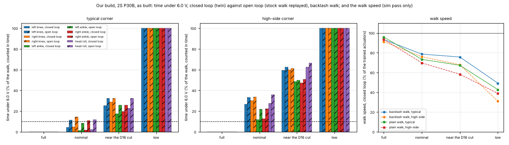
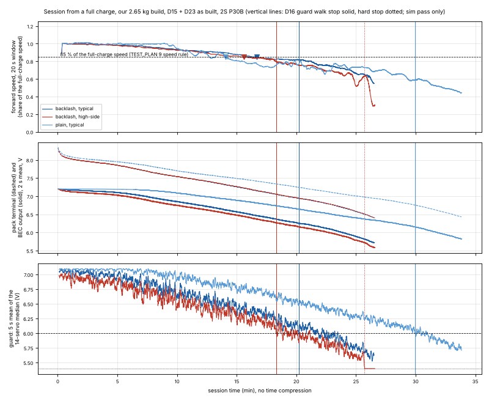

# Electromechanical twin: the walk, the 14 servos and the power path in one loop (sim pass only)

Written 2026-11-03, about 3:25 PM ET, by the electromech twin agent (sub-agent of the lead Claude Code agent, branch claude/digital-twin; the lead commits). Scripts in this folder; heavy outputs in the session scratch folder only (twinEM), not in git. Every number here is sim pass only: nothing has run on real parts.

## Answer (sim pass only)

The twin closes the loop the replays leave open: each of the 14 servos gets its torque and its speed from its own supply volts at every 2 ms step, the as-built power path (the same circuit ngspice solves) is solved at every step with each servo's current, the 2S P30B pack follows its data sheet curves, and the stock policy walks the robot that results. At 7.4 V on every servo the twin is the trained robot exactly. Our 2.65 kg build throughout, unless the trained mass is named.

1. **The sag changes the walk: it slows it, and it does not drop the robot.** Backlash-model walk, closed loop, share of the trained-actuator speed (0.900 of the 0.15 m/s command): full charge 93 % (typical corner) and 91 % (high-side), nominal pack (OCV 3.70 V per cell, 48 % SOC) 79 % and 76 %, near the D16 cut (OCV 3.57 V, 36 % SOC) 76 % and 68 %, at 3.3 V per cell 49 % and 31 %. Plain-model walk (0.698 trained): 96 / 93 %, 73 / 70 %, 67 / 58 %, 43 / 39 %. The torso leans further forward as the volts fall (backlash walk: +4.5 deg at full, +5.9 nominal, +7.0 near D16, +9.0 at 3.3 V per cell, typical corner). At full charge the loss is the 7.2 V BEC set point (every servo at a steady 7.2 V walks at 96 %) plus the wiring drop. The BEC holds 7.2 V only near full charge: in the backlash session its mean output is 7.17 V at 94 % SOC and 6.99 V at 75 %, and from there the walk follows the pack. No fall in any of the 85 closed-loop runs: 32 fixed-state walks, 12 as-built cases, 20 sweep cases, 18 runs with 15 N pushes every 3 s (the trained actuators: 0 of 3 fell) and 3 sessions down to 3.3 V per cell.
2. **Closed loop against the open-loop replay (sim/POWER_PATH_SIM.md 'As built', C8 traces).** The replay holds each servo's commanded power, so it overstates the dips: in the closed loop a servo that gets weaker also draws less. Same network, same lab cells, same 10 to 16 s window, our build, nominal pack, typical corner: right knee under 6.0 V 9.8 % open against 1.9 % closed, ankles 6.4 against 0.3 %, head roll 6.8 against 1.3 %, lowest servo 5.61 against 5.81 V; high-side corner: knees 31.1 / 30.6 against 24.0 / 28.8 %, ankles 21.4 against 11.9 %, head roll 33.5 against 25.3 %, lowest 4.91 against 5.24 V. In those same runs the robot walks at 0.73 and 0.69 of the command against 0.90 with the trained actuators (C8: 0.90), which the replay cannot show. With the P30B data sheet curves the same nominal label sags more than the lab's fixed 15 mOhm cell (pack terminal 7.16 against 7.24 V under the walking current), so the twin's own nominal rows read a little worse than the as-built table. The plain walk makes the point plainly: at a nominal pack no servo is under 6.0 V at all in the typical corner, and it walks at 73 % of its trained speed. So the TEST_PLAN 9 time gate is easier to pass than the replay says, and passing it does not mean the trained walk: the mean servo voltage, not the dips, sets the walk.
3. **Knees and ankles per pack state** (closed loop, backlash walk, typical / high-side corner):
   - Knees: mean volts 7.07 / 6.97 V at full, 6.35 / 6.16 V nominal, 6.13 / 5.93 V near the D16 cut, 5.59 / 5.35 V at 3.3 V per cell; torque limit 3.09, 2.77, 2.67 and 2.44 Nm (typical) of the trained 3.23 Nm; at that limit 19 to 31 % of the time in every state (the policy asks more than the knee can give at any charge); time under 6.0 V 0, 4 to 5, 25 to 29 and 100 % (typical) and 0, 27 to 30, 59 to 60 and 100 % (high-side). The tracking error stays 7.4 to 8.8 deg RMS in every state: the policy keeps the joints on target by walking slower. Knee copper loss falls with the volts: 4.9 to 5.6 W at full, 3.8 to 4.6 W nominal, 3.4 to 4.3 W at 3.3 V per cell (input for twin/thermal).
   - Ankles: mean volts 7.11, 6.38, 6.16, 5.62 V (typical); torque limit 3.10, 2.79, 2.69, 2.46 Nm; at the limit 0 to 7 % of the time; under 6.0 V 0, 2, 20 and 100 % (typical) and 0, 13, 48 and 100 % (high-side). With SP4/SP5 the ankles are no longer the weak point: the knees, farthest from both feeds, and the head yaw and roll at the end of the neck chain (no second feed) are the lowest servos (head roll 5.22 V at nominal, high-side).
4. **When the robot stops walking well in a session, and the D16 guard.** Sessions from a full charge, no time compression, the guard (bench/battery_guard.py, unchanged) in shadow mode; 'walking well' = the 20 s forward speed at 85 % or more of the full-charge speed (the TEST_PLAN 9 speed rule):
   - Backlash walk, typical corner: under 85 % at minute 16.7 (1487 mAh used, SOC 48 %, cell OCV 3.70 V); the guard's walk stop at minute 20.2 (SOC 37 %, OCV 3.58 V, the D16 note's 3.57 V), when the robot walks at 81 % of its full-charge speed; its walking hard stop (5.4 V) not reached by 3.3 V per cell (minute 26.5).
   - Backlash walk, high-side corner: under 85 % at minute 15.6 (SOC 51 %); walk stop at minute 18.3 (SOC 43 %, OCV 3.65 V, 80 % of the full-charge speed); hard stop at minute 25.7 (SOC 20 %).
   - Plain walk, typical corner: under 85 % at minute 14.1 (SOC 66 %); walk stop at minute 30.0 (SOC 27 %), when it walks at 59 % of its full-charge speed.
   - So the walk degrades **before** the guard stops it: 2.7 to 3.5 minutes before in the backlash walk and 16 minutes before in the plain walk, whose lower current keeps the servo volts, and so the guard, higher. No session fell, before or after the guard. The guard protects the cells; it is not a walk-quality stop, and it does not need to be one for safety in sim.
5. **Sweep (nominal and near-D16 packs, backlash walk, closed loop).** The TEST_PLAN 5 hop bands cost little walking: from 28 to 40 mOhm per conductor the speed moves by under 1 % (0.702 to 0.700 of the command; two seeds of one case differ by 0.002 to 0.011) while the knee time under 6.0 V goes from 4.5 / 4.8 to 7.2 / 7.8 % (open loop 11 / 14 to 14 / 17 %). The BEC dropout costs more: 0.10 V walks at 0.752 (+6.5 %), 0.30 V at 0.706, 0.60 V at 0.663 (-6 %) in the typical corner (high-side 0.710, 0.684, 0.595). The largest unknown is the servo firmware: if it compensates for its bus volts (keeps its stiffness, only the torque limit falls), the nominal-pack walk keeps 0.859 of the command (95 % of the trained speed) but the knees spend 16 to 18 % of the walk under 6.0 V, against 0.706 and 4 to 5 % in the BAM model. The cell's pulse model (steady slope against the 8 mOhm AC impedance) changes the speed by 0.1 % and the knee dips by 1.5 points.

What it means:
- TEST_PLAN 9: read 9.speed, not only 9.time6. The twin's ratio of nominal-pack to full-charge speed is 0.84 (backlash) and 0.76 (plain), typical corner; the TEST_PLAN 9 15 % rule fires at about the nominal pack.
- TEST_PLAN 4.1 (the BEC dropout) is the bench number that moves the walk most, after the firmware's response to bus volts, for which a cheap bench test is proposed (TEST_PLAN 7.5, below).
- The 3S plan held by D23 (sim/POWER_FIX.md option 6+3b) would keep the BEC regulating at every charge; the twin's full-charge rows (93 % of the trained speed, backlash walk, typical) are then what the robot would walk at to the end of the charge. Not run in the twin (2S as built only).

## Files
| File | What it is |
|---|---|
| em_twin.py | The twin: MuJoCo walk with the stock policy, servo model, power network, P30B pack and the D16 guard, solved together every 2 ms; steps check, asbuilt, states, session, sweep, pushes, tables, png. |
| servo_sts3215.py | STS3215 model: gain and torque limit from each servo's own supply volts (BAM), supply current, protections, the data sheet check. |
| power_net.py | The as-built power network parsed from the ngspice circuit of sim/power_fix.py option ab, solved by nodal analysis every step; the ngspice same-currents check. |
| p30b.py | Molicel P30B cell: terminal volts against charge used and current, from the data sheet curves. |
| p30b_digitize.py, data/p30b_datasheet.json | Reading of the data sheet figure 'Discharge Rate Characteristics' and its result. |
| out/*.json, out/session_*.csv | Small summaries: check.json (validation), asbuilt_closed_loop.json, states_backlash.json, states_plain.json, sweep_backlash.json, pushes_plain.json, session_<walk>_<corner>.json and .csv (5 s bins for twin/thermal). |
| em_twin_session.png, em_twin_states.png | Figures below. |

## Method

### 1. What the trained robot is, and the servo model
The stock training env (Open_Duck_Playground b9be205) has no supply voltage anywhere. Each joint is a MuJoCo position actuator: torque = clip(kp x (target - angle), -3.23, +3.23) Nm, with kp 13.37 Nm/rad (plain model, open_duck_mini_v2.xml) or 17.11 (backlash model), kv 0, joint damping 0.56 Nm s/rad, frictionloss 0.068 Nm, armature 0.027 kg m2 [U xmls]. The policy loop limits the target speed to 5.24 rad/s per 20 ms (joystick.py max_motor_velocity, mujoco_infer.py) [U]. Domain randomization scales kp by U(0.9, 1.1), frictionloss by U(0.9, 1.1) and armature by U(1.0, 1.05); the torque limit is never randomized (common/randomize.py) [U]. So the policy never saw a weaker servo, only a stiffer or softer one by 10 %.

The voltage behind those limits is 7.4 V: BAM's STS3215 model (Rhoban/bam b9e1111, bam/feetech/actuator.py, identification data by A. Pirrone) uses vin = 7.4 V, firmware kp 32, error_gain 0.166, max_pwm 0.97; duty = clip(kp x error_gain x (target - angle), +-max_pwm), motor volts = vin x duty, torque = kt/R x volts - kt^2/R x speed [U BAM]. Its MuJoCo mapping is kp = vin x kp_fw x error_gain x kt/R and forcerange = vin x kt/R, with the back-EMF term in the joint damping (SERVO_DEEP_DIVE.md E3). The MJCF's 3.23 Nm is 7.4 V x kt/R. BAM's own MuJoCo controller has a 'vin_drop_resistance' option that lowers vin by one resistance times the bus current (bam/mujoco.py) [U BAM]: this twin does the same with the whole as-built network.

The twin's servo (servo_sts3215.py, mode bam): each servo's own supply volts V replace vin. kp(V) = kp x V / 7.4 and the torque limit 3.23 x V / 7.4; damping, friction and armature unchanged. At 7.4 V this is the trained actuator exactly (validation below: 0.0 Nm difference over a 16 s walk). The no-load speed then falls with V by back-EMF, (3.23 V / 7.4 - 0.068) / 0.56: 5.65 rad/s at 7.4 V and 4.56 rad/s at 6.0 V. Electrical side as sim/current_budget.py and sim/power_path_sim.py: kt 1.148 Nm/A (the lab's highest-current value), R = 2.630 ohm, motor volts u = torque x R / kt, motor current (u - kt x speed) / R, supply current max(u x current, 0) / V plus 0.05 A of electronics (ASSUMPTION carried from power_path_sim.py; the C001 spec gives 21 mA idle), no credit for braking. Protection: under 4.0 V the servo switches its torque off (C001 spec item 7-11; timing ASSUMPTION: at once). Over-current (2 A for 2 s) and overload (80 % of stall for 2 s) are only counted: each new goal position clears them (spec 7-11) and the walk sends one every 20 ms.

### 2. The power network, solved every step
power_net.py does not retype the circuit: it parses the ngspice text that sim/power_fix.py netlist_as_built() writes for option ab (D15 star plus the D23 feeds SP4 and SP5, every length and gauge read from wiring/netlist.yaml by sim/power_path_sim.py, data-lead grounds SD1/SD2, adapter, USB ground and P12, netlist sha256 0f4af5bff3 as for the as-built table). So the resistors, nodes and the two resistance corners are the ones VERIFICATION.md E6, E6b and C7 check: cells, holder (10 / 30 mOhm), BMS 25 mOhm (Tenergy max), XT30, fuse 6 mOhm (ASSUMPTION), Pololu 2815 13 mOhm (Pololu max at 4.5 V gate), P1 to P14 from the netlist, P11 plus the BEC leads (2 x 22 AWG x 100 mm, ASSUMPTION), SP1 to SP5, kit hops (cable + 2 contacts + servo board), the 5 V branch (5 W, CABLE_MAP P13 average with margin). The Castle CC BEC Pro regulates 7.2 V (D3) or passes its input minus the dropout; the dropout is 0.30 V, the TEST_PLAN 4.1 pass limit (output at least input minus 0.30 V at 7.0 V in and 6 A out; Castle publishes none); input current = output power / (0.85 x input volts) (ASSUMPTION). Method: modified nodal analysis of the parsed circuit, with the BEC solved in its two modes (regulating, dropout); the response of every output to the 18 nonlinear sources (cell volts, BEC value, BEC input current, 5 V regulator current, 14 servo currents) is computed once, and each 2 ms step solves those 18 values by Newton from the last step (2.9 iterations on average). No reactive parts, as in ngspice.

### 3. The coupled step
Every 2 ms: (1) each servo's duty comes from the robot state and the policy target; (2) the network is solved with each servo drawing its current at its own volts, the pack giving its terminal volts for its charge and current; (3) each servo's gain and torque limit are set from its volts and MuJoCo steps (it computes exactly the torque the solve used); (4) the pack charge counter adds the pack current. The 50 Hz policy loop is the lab's copy of the upstream MjInfer loop (sim/current_budget.py run(), accelerometer bias removed as in all lab runs). The policy does not see any voltage; it sees a robot whose servos are weaker and slower when the bus sags.

### 4. The 2S Molicel P30B pack
p30b.py reads the data sheet's 'Discharge Rate Characteristics' at 23 C (Molicel INR-18650-P30B Product Data Sheet v1.0, the link of sim/runtime_thermal.py): terminal volts against mAh delivered at 0.6, 1.5, 3, 10 and 20 A, digitized from the figure (p30b_digitize.py; against the independent digitization in sim/runtime_thermal.py the largest difference is 13 mV, most under 6 mV). Between the curves the volts are linear in current; the open-circuit voltage is the zero-current end of the 0.6 to 1.5 A line. The curve slope is the internal resistance: 12 to 18 mOhm per cell between 3 and 10 A over the charge the walk uses, 20 to 35 mOhm below 3 A (data sheet: DC 17 mOhm at 50 % SOC, AC 8 mOhm at 30 % SOC). State of charge = 1 - mAh used / 2846 mAh (the 1C capacity to 2.5 V). Default dynamic reading: every current pulse sees the whole steady-state slope (conservative, as the lab's fixed cell resistance). Bracket in the sweep: pulses see only the 8 mOhm AC impedance (10 s filter on the mean, ASSUMPTION). Pack states used: full (0 mAh used, OCV 4.20 V per cell), nominal (OCV 3.70 V, 1481 mAh used, SOC 48 %), near the D16 cut (OCV 3.57 V, the D16 note's walk stop point, 1814 mAh, SOC 36 %), low (OCV 3.30 V, 2357 mAh, SOC 17 %, past the guard). New cells at 23 C; no ageing, no temperature, no cell imbalance.

### 5. The D16 battery guard in the loop
bench/battery_guard.py is imported unchanged with its defaults: one read of the 14 servos per 0.5 s, the reading taken at a random time in that 0.5 s (a servo's volts at that 2 ms step, quantized down to 0.1 V as register 62), the 14-servo median, walk stop when the 5 s mean is at or under 6.0 V while walking, hard stop when the 2 s mean is at or under 5.4 V while walking. In 'shadow' mode the guard's events are recorded and the walk goes on, so one run shows both when the guard would stop the robot and how the walk goes after that.

### 6. Open loop, for comparison
The open loop is what sim/POWER_PATH_SIM.md 'As built' does: the trained robot walks with its actuators unchanged, and its torques and speeds are replayed through the same network and pack state with the ngspice servo law (commanded volts capped at the local bus volts, constant power). Same seed, same window.

### 7. Runs
Our 2.65 kg build (the sim/added_mass_sim.py model at the sim/mass_budget.py inertials, 2.6528 kg, the C8 model) unless the trained mass is named. Walk forward 0.15 m/s on flat ground after a 2 s stand, the backlash model (the as-built table's walk, the highest current) and the plain model. Start seeds (joint start jitter of U(-0.03, 0.03) rad, as the C8 seeds): none and 1 for the pack states, none, 1 and 2 for the pushes, none for the sweep. Statistics 4 to 30 s (the as-built cases: volts 10 to 16 s as the doc table, speed 4 to 16 s). Time under 6.0 V is counted in time on the 2 ms grid; on the same replay this reads 0.1 to 0.8 points above ngspice's count over its own time steps (validation below). Speed is the forward speed in the heading frame (sim/added_mass_sim.py gait_stats); 'share of stock' compares with the trained actuators at the same seed. In a session the speed is taken over 20 s windows (the TEST_PLAN 9 'distance in 20 s'), and the robot 'walks well' while that speed stays at 85 % or more of its full-charge speed (the TEST_PLAN 9 rule: a drop of more than 15 % means the servo voltage limits the walk), the first drop that lasts 60 s counting. A fall is the lab's rule (trunk under 0.10 m or tilted more than 60 degrees). No time compression: the sessions run 1:1 in sim time.

## Validation
The servo model must be the trained actuator at 7.4 V, and the Python network must be the ngspice circuit. Both hold:

| Check | Result |
|---|---|
| Servo model against the C001 data sheet, 6.0 V over 7.4 V | no-load speed 0.807 (data sheet 0.807), stall current 0.811 (0.800), stall torque 0.811 (0.846, +/-10 % tolerance) |
| Twin with every servo at 7.4 V against the trained actuators, trained mass, 16 s backlash walk | largest torque difference 0.0 Nm, largest pose difference 0.0 |
| Stock twin run against the lab loop (sim/added_mass_sim.py run(), the E5 / C8 traces), trained mass | largest torque difference 0.0 Nm, speed 0.0 rad/s |
| Twin with every servo at 7.4 V against the trained actuators, our build, 16 s backlash walk | largest torque difference 0.0 Nm, largest pose difference 0.0 |
| Stock twin run against the lab loop (sim/added_mass_sim.py run(), the E5 / C8 traces), our build | largest torque difference 0.0 Nm, speed 0.0 rad/s |
| Python network against ngspice (sim/power_fix.py option ab), the same open-loop replay, 12 cases (2 masses x full/nominal/low x 2 corners), 3000 points each | largest servo volts difference 3.8 mV (median of the cases 0.6 mV); lowest servo identical in all 12 cases |
| The closed loop's own 14 servo currents fed to ngspice as current sources, our build, nominal (lab cells), typical corner, 3000 points | largest servo volts difference 0.19 mV, BEC output 0.19 mV |
| The closed loop's own 14 servo currents fed to ngspice as current sources, our build, nominal (lab cells), high-side corner, 3000 points | largest servo volts difference 0.25 mV, BEC output 0.25 mV |
| P30B data sheet digitization against sim/runtime_thermal.py, 25 points | largest difference 13 mV |

Replay against ngspice, per case (time under 6.0 V counted on the 2 ms grid here, by ngspice time steps there):

| Trace, pack, corner | ngspice: lowest servo; knees L / R; ankle; head roll | Python: same | largest difference |
|---|---|---|---|
| trained mass, full, typical | left knee 6.522 V; 0.0 / 0.0 %; 0.0 %; 0.0 % | left knee 6.522 V; 0.0 / 0.0 %; 0.0 %; 0.0 % | 1.8 mV |
| trained mass, full, high-side | left knee 5.910 V; 0.2 / 0.0 %; 0.0 %; 0.0 % | left knee 5.910 V; 0.4 / 0.0 %; 0.0 %; 0.0 % | 0.9 mV |
| trained mass, nominal, typical | left knee 5.580 V; 5.6 / 7.9 %; 4.8 %; 5.1 % | left knee 5.580 V; 5.9 / 8.3 %; 5.1 %; 5.7 % | 0.3 mV |
| trained mass, nominal, high-side | head roll 4.880 V; 27.8 / 27.9 %; 19.3 %; 32.6 % | head roll 4.880 V; 28.1 / 28.0 %; 19.6 %; 33.4 % | 0.6 mV |
| trained mass, low, typical | right knee 4.818 V; 100.0 / 99.9 %; 100.0 %; 100.0 % | right knee 4.818 V; 100.0 / 99.8 %; 99.9 %; 100.0 % | 0.5 mV |
| trained mass, low, high-side | head roll 4.193 V; 100.0 / 100.0 %; 100.0 %; 100.0 % | head roll 4.193 V; 100.0 / 100.0 %; 100.0 %; 100.0 % | 0.6 mV |
| our build, full, typical | left knee 6.550 V; 0.0 / 0.0 %; 0.0 %; 0.0 % | left knee 6.550 V; 0.0 / 0.0 %; 0.0 %; 0.0 % | 3.8 mV |
| our build, full, high-side | left knee 5.951 V; 0.2 / 0.0 %; 0.0 %; 0.1 % | left knee 5.951 V; 0.3 / 0.0 %; 0.0 %; 0.1 % | 2.1 mV |
| our build, nominal, typical | left knee 5.605 V; 6.4 / 9.8 %; 6.4 %; 6.8 % | left knee 5.605 V; 6.5 / 10.2 %; 6.6 %; 7.2 % | 0.3 mV |
| our build, nominal, high-side | head roll 4.908 V; 31.1 / 30.6 %; 21.4 %; 33.5 % | head roll 4.908 V; 31.3 / 31.2 %; 21.5 %; 33.9 % | 0.4 mV |
| our build, low, typical | head roll 4.869 V; 100.0 / 100.0 %; 100.0 %; 100.0 % | head roll 4.869 V; 100.0 / 100.0 %; 100.0 %; 100.0 % | 0.5 mV |
| our build, low, high-side | head roll 4.068 V; 100.0 / 100.0 %; 100.0 %; 100.0 % | head roll 4.068 V; 100.0 / 100.0 %; 100.0 %; 100.0 % | 0.6 mV |

## Results
Time under 6.0 V counted in time; 'closed' is the twin, 'open' the stock walk replayed through the same network and pack state. Speeds are forward speed over the command (0.15 m/s). Sim pass only.

### The POWER_PATH_SIM.md 'As built' cases with the loop closed (lab cells, backlash walk 10 to 16 s)

| Trace, pack, corner | Open loop (POWER_PATH_SIM.md): lowest servo; knees L / R; ankles; head roll under 6.0 V | Closed loop (twin): same | Closed loop: forward speed / command (stock walk) | Torso pitch | Falls |
|---|---|---|---|---|---|
| trained mass, full (8.4 V), typical | left knee 6.52 V; 0.0 / 0.0 %; 0.0 %; 0.0 % | right knee 6.74 V; 0.0 / 0.0 %; 0.0 %; 0.0 % | 0.92 (0.94) | +2.9 deg | none |
| trained mass, full (8.4 V), high-side | left knee 5.91 V; 0.2 / 0.0 %; 0.0 %; 0.0 % | head roll 6.19 V; 0.0 / 0.0 %; 0.0 %; 0.0 % | 0.90 (0.94) | +3.1 deg | none |
| trained mass, nominal (7.4 V), typical | left knee 5.58 V; 5.6 / 7.9 %; 4.8 %; 5.1 % | right knee 5.86 V; 1.6 / 1.6 %; 0.4 %; 0.4 % | 0.80 (0.94) | +3.7 deg | none |
| trained mass, nominal (7.4 V), high-side | head roll 4.88 V; 27.8 / 27.9 %; 19.3 %; 32.6 % | head roll 5.25 V; 21.4 / 24.3 %; 10.6 %; 22.2 % | 0.75 (0.94) | +4.1 deg | none |
| trained mass, low (6.6 V), typical | right knee 4.82 V; 100.0 / 99.9 %; 100.0 %; 100.0 % | head roll 5.12 V; 99.1 / 99.1 %; 98.3 %; 99.9 % | 0.65 (0.94) | +5.6 deg | none |
| trained mass, low (6.6 V), high-side | head roll 4.19 V; 100.0 / 100.0 %; 100.0 %; 100.0 % | head roll 4.63 V; 100.0 / 100.0 %; 100.0 %; 100.0 % | 0.57 (0.94) | +6.0 deg | none |
| our build, full (8.4 V), typical | left knee 6.55 V; 0.0 / 0.0 %; 0.0 %; 0.0 % | left knee 6.68 V; 0.0 / 0.0 %; 0.0 %; 0.0 % | 0.85 (0.90) | +4.5 deg | none |
| our build, full (8.4 V), high-side | left knee 5.95 V; 0.2 / 0.0 %; 0.0 %; 0.1 % | head roll 6.08 V; 0.0 / 0.0 %; 0.0 %; 0.0 % | 0.82 (0.90) | +4.9 deg | none |
| our build, nominal (7.4 V), typical | left knee 5.61 V; 6.4 / 9.8 %; 6.4 %; 6.8 % | head roll 5.81 V; 2.0 / 1.9 %; 0.3 %; 1.3 % | 0.73 (0.90) | +5.7 deg | none |
| our build, nominal (7.4 V), high-side | head roll 4.91 V; 31.1 / 30.6 %; 21.4 %; 33.5 % | head roll 5.24 V; 24.0 / 28.8 %; 11.9 %; 25.3 % | 0.69 (0.90) | +6.6 deg | none |
| our build, low (6.6 V), typical | head roll 4.87 V; 100.0 / 100.0 %; 100.0 %; 100.0 % | head roll 5.13 V; 100.0 / 100.0 %; 100.0 %; 100.0 % | 0.49 (0.90) | +8.6 deg | none |
| our build, low (6.6 V), high-side | head roll 4.07 V; 100.0 / 100.0 %; 100.0 %; 100.0 % | head roll 4.63 V; 100.0 / 100.0 %; 100.0 %; 100.0 % | 0.26 (0.90) | +11.3 deg | none |

### Pack states, backlash-model walk, our build, 2S P30B (charge held), mean of 2 start seeds, 4 to 30 s

Reference: trained actuators (no supply effect) 0.900 of the command; every servo at a steady 7.2 V 0.865.

| State | Corner | Pack: terminal mean; BEC out mean | Closed loop: speed / command (share of stock); pitch; falls | Lowest servo, closed / open | Knees L / R under 6 V, closed / open | Ankles (worse) under 6 V, closed / open | Head roll under 6 V, closed / open |
|---|---|---|---|---|---|---|---|
| full (q 0 mAh, OCV 4.20 V/cell) | typical | 8.26 V; 7.20 V | 0.840 (93 %); +4.5 deg; 0 of 2 | 6.74 / 6.64 V | 0.0 / 0.0 %, 0.0 / 0.0 % | 0.0 %, 0.0 % | 0.0 %, 0.0 % |
| full (q 0 mAh, OCV 4.20 V/cell) | high-side | 8.26 V; 7.19 V | 0.821 (91 %); +4.8 deg; 0 of 2 | 6.14 / 6.08 V | 0.0 / 0.0 %, 0.0 / 0.0 % | 0.0 %, 0.0 % | 0.0 %, 0.0 % |
| nominal (OCV 3.70 V/cell) | typical | 7.16 V; 6.47 V | 0.707 (79 %); +5.9 deg; 0 of 2 | 5.71 / 5.54 V | 4.3 / 4.7 %, 11.2 / 14.2 % | 1.8 %, 10.8 % | 2.0 %, 11.9 % |
| nominal (OCV 3.70 V/cell) | high-side | 7.16 V; 6.37 V | 0.683 (76 %); +6.8 deg; 0 of 2 | 5.22 / 4.86 V | 26.8 / 30.3 %, 33.3 / 33.6 % | 12.7 %, 22.0 % | 27.3 %, 36.0 % |
| near the D16 cut (OCV 3.57 V/cell) | typical | 6.93 V; 6.25 V | 0.681 (76 %); +7.0 deg; 0 of 2 | 5.53 / 5.35 V | 25.4 / 28.7 %, 32.5 / 32.4 % | 19.5 %, 25.7 % | 22.7 %, 32.4 % |
| near the D16 cut (OCV 3.57 V/cell) | high-side | 6.93 V; 6.14 V | 0.610 (68 %); +7.6 deg; 0 of 2 | 5.03 / 4.63 V | 59.3 / 59.7 %, 62.6 / 61.2 % | 48.3 %, 50.4 % | 62.3 %, 66.5 % |
| low (OCV 3.30 V/cell, past the guard) | typical | 6.41 V; 5.71 V | 0.443 (49 %); +9.0 deg; 0 of 2 | 5.12 / 4.86 V | 100.0 / 100.0 %, 100.0 / 100.0 % | 100.0 %, 100.0 % | 100.0 %, 100.0 % |
| low (OCV 3.30 V/cell, past the guard) | high-side | 6.40 V; 5.58 V | 0.278 (31 %); +11.0 deg; 0 of 2 | 4.66 / 4.11 V | 100.0 / 100.0 %, 100.0 / 100.0 % | 100.0 %, 100.0 % | 100.0 %, 100.0 % |

Every servo, backlash walk, typical corner, mean of the seeds: lowest volts and time under 6.0 V, closed loop / open loop

| Servo (ID) | full | nominal | near the D16 cut | low |
|---|---|---|---|---|
| left hip yaw (20) | 7.00 / 6.92 V; 0.0 / 0.0 % | 6.02 / 5.78 V; 0.0 / 4.5 % | 5.83 / 5.58 V; 8.9 / 20.4 % | 5.34 / 5.12 V; 100.0 / 100.0 % |
| left hip roll (21) | 6.87 / 6.78 V; 0.0 / 0.0 % | 5.92 / 5.65 V; 0.7 / 7.7 % | 5.78 / 5.46 V; 15.3 / 26.0 % | 5.26 / 5.00 V; 100.0 / 100.0 % |
| left hip pitch (22) | 6.78 / 6.67 V; 0.0 / 0.0 % | 5.85 / 5.57 V; 2.6 / 10.0 % | 5.73 / 5.38 V; 21.7 / 31.3 % | 5.21 / 4.93 V; 100.0 / 100.0 % |
| left knee (23) | 6.75 / 6.64 V; 0.0 / 0.0 % | 5.82 / 5.54 V; 4.3 / 11.2 % | 5.68 / 5.35 V; 25.4 / 32.5 % | 5.18 / 4.90 V; 100.0 / 100.0 % |
| left ankle (24) | 6.88 / 6.78 V; 0.0 / 0.0 % | 5.92 / 5.66 V; 1.0 / 8.0 % | 5.76 / 5.47 V; 17.3 / 25.5 % | 5.24 / 5.00 V; 100.0 / 100.0 % |
| neck pitch (30) | 7.02 / 6.95 V; 0.0 / 0.0 % | 5.98 / 5.81 V; 0.0 / 4.8 % | 5.80 / 5.61 V; 8.6 / 21.2 % | 5.34 / 5.14 V; 100.0 / 100.0 % |
| head pitch (31) | 6.88 / 6.82 V; 0.0 / 0.0 % | 5.85 / 5.74 V; 1.0 / 8.5 % | 5.67 / 5.52 V; 15.1 / 26.4 % | 5.24 / 5.02 V; 100.0 / 100.0 % |
| head yaw (32) | 6.76 / 6.69 V; 0.0 / 0.0 % | 5.73 / 5.62 V; 1.8 / 11.0 % | 5.55 / 5.39 V; 20.2 / 30.0 % | 5.14 / 4.89 V; 100.0 / 100.0 % |
| head roll (33) | 6.75 / 6.68 V; 0.0 / 0.0 % | 5.71 / 5.60 V; 2.0 / 11.9 % | 5.53 / 5.37 V; 22.7 / 32.4 % | 5.12 / 4.86 V; 100.0 / 100.0 % |
| right hip yaw (10) | 7.03 / 6.95 V; 0.0 / 0.0 % | 6.01 / 5.81 V; 0.0 / 5.5 % | 5.82 / 5.61 V; 9.1 / 20.4 % | 5.34 / 5.12 V; 100.0 / 100.0 % |
| right hip roll (11) | 6.93 / 6.88 V; 0.0 / 0.0 % | 5.93 / 5.75 V; 1.3 / 9.6 % | 5.73 / 5.52 V; 17.5 / 24.8 % | 5.28 / 5.00 V; 100.0 / 100.0 % |
| right hip pitch (12) | 6.85 / 6.84 V; 0.0 / 0.0 % | 5.87 / 5.66 V; 2.6 / 12.2 % | 5.67 / 5.42 V; 24.2 / 29.1 % | 5.23 / 4.90 V; 100.0 / 100.0 % |
| right knee (13) | 6.79 / 6.79 V; 0.0 / 0.0 % | 5.82 / 5.63 V; 4.7 / 14.2 % | 5.62 / 5.39 V; 28.7 / 32.4 % | 5.19 / 4.86 V; 100.0 / 100.0 % |
| right ankle (14) | 6.89 / 6.86 V; 0.0 / 0.0 % | 5.91 / 5.74 V; 1.8 / 10.8 % | 5.71 / 5.50 V; 19.5 / 25.7 % | 5.26 / 4.98 V; 100.0 / 100.0 % |

Every servo, backlash walk, high-side corner, mean of the seeds: lowest volts and time under 6.0 V, closed loop / open loop

| Servo (ID) | full | nominal | near the D16 cut | low |
|---|---|---|---|---|
| left hip yaw (20) | 6.79 / 6.65 V; 0.0 / 0.0 % | 5.88 / 5.55 V; 4.8 / 16.4 % | 5.70 / 5.35 V; 37.8 / 41.7 % | 5.11 / 4.89 V; 100.0 / 100.0 % |
| left hip roll (21) | 6.53 / 6.36 V; 0.0 / 0.0 % | 5.73 / 5.29 V; 13.1 / 24.9 % | 5.52 / 5.10 V; 52.3 / 53.6 % | 4.94 / 4.64 V; 100.0 / 100.0 % |
| left hip pitch (22) | 6.35 / 6.18 V; 0.0 / 0.0 % | 5.61 / 5.15 V; 22.1 / 31.7 % | 5.41 / 4.96 V; 60.2 / 61.4 % | 4.82 / 4.53 V; 100.0 / 100.0 % |
| left knee (23) | 6.31 / 6.14 V; 0.0 / 0.0 % | 5.57 / 5.11 V; 26.8 / 33.3 % | 5.38 / 4.92 V; 59.3 / 62.6 % | 4.77 / 4.48 V; 100.0 / 100.0 % |
| left ankle (24) | 6.62 / 6.47 V; 0.0 / 0.0 % | 5.78 / 5.39 V; 11.9 / 21.7 % | 5.59 / 5.19 V; 48.3 / 49.7 % | 4.99 / 4.73 V; 100.0 / 100.0 % |
| neck pitch (30) | 6.81 / 6.71 V; 0.0 / 0.0 % | 5.81 / 5.58 V; 4.0 / 18.0 % | 5.61 / 5.38 V; 38.0 / 43.4 % | 5.11 / 4.92 V; 100.0 / 100.0 % |
| head pitch (31) | 6.48 / 6.39 V; 0.0 / 0.0 % | 5.53 / 5.20 V; 14.0 / 26.1 % | 5.33 / 4.97 V; 52.7 / 57.5 % | 4.91 / 4.46 V; 100.0 / 100.0 % |
| head yaw (32) | 6.18 / 6.11 V; 0.0 / 0.0 % | 5.27 / 4.93 V; 22.7 / 32.6 % | 5.07 / 4.71 V; 59.5 / 64.4 % | 4.70 / 4.20 V; 100.0 / 100.0 % |
| head roll (33) | 6.14 / 6.08 V; 0.0 / 0.0 % | 5.22 / 4.86 V; 27.3 / 36.0 % | 5.03 / 4.63 V; 62.3 / 66.5 % | 4.66 / 4.11 V; 100.0 / 100.0 % |
| right hip yaw (10) | 6.82 / 6.72 V; 0.0 / 0.0 % | 5.85 / 5.57 V; 4.8 / 17.1 % | 5.65 / 5.36 V; 37.5 / 41.5 % | 5.12 / 4.88 V; 100.0 / 100.0 % |
| right hip roll (11) | 6.63 / 6.56 V; 0.0 / 0.0 % | 5.69 / 5.33 V; 14.6 / 23.2 % | 5.49 / 5.11 V; 50.7 / 53.6 % | 5.01 / 4.64 V; 100.0 / 100.0 % |
| right hip pitch (12) | 6.47 / 6.43 V; 0.0 / 0.0 % | 5.56 / 5.13 V; 24.9 / 28.9 % | 5.41 / 4.91 V; 60.3 / 61.3 % | 4.92 / 4.46 V; 100.0 / 100.0 % |
| right knee (13) | 6.37 / 6.36 V; 0.0 / 0.0 % | 5.48 / 5.07 V; 30.3 / 33.6 % | 5.33 / 4.84 V; 59.7 / 61.2 % | 4.85 / 4.39 V; 100.0 / 100.0 % |
| right ankle (14) | 6.63 / 6.57 V; 0.0 / 0.0 % | 5.71 / 5.38 V; 12.7 / 22.0 % | 5.52 / 5.16 V; 47.3 / 50.4 % | 5.03 / 4.69 V; 100.0 / 100.0 % |

Knees and ankles in the closed loop (mean of the seeds):

| State | Corner | Joint | Volts mean / min | Torque limit mean (Nm; 3.23 at 7.4 V) | Time at the limit | Tracking error RMS | Motor current RMS | Copper loss |
|---|---|---|---|---|---|---|---|---|
| full | typical | left knee | 7.07 / 6.75 V | 3.09 | 19.3 % | 7.4 deg | 1.39 A | 5.07 W |
| full | typical | right knee | 7.07 / 6.79 V | 3.08 | 23.4 % | 7.9 deg | 1.46 A | 5.58 W |
| full | typical | left ankle | 7.11 / 6.88 V | 3.10 | 1.7 % | 4.0 deg | 0.79 A | 1.63 W |
| full | typical | right ankle | 7.10 / 6.89 V | 3.10 | 0.0 % | 4.1 deg | 0.80 A | 1.69 W |
| full | high-side | left knee | 6.97 / 6.31 V | 3.04 | 20.8 % | 7.5 deg | 1.36 A | 4.86 W |
| full | high-side | right knee | 6.97 / 6.37 V | 3.04 | 23.5 % | 7.9 deg | 1.43 A | 5.38 W |
| full | high-side | left ankle | 7.07 / 6.62 V | 3.08 | 1.6 % | 4.0 deg | 0.78 A | 1.59 W |
| full | high-side | right ankle | 7.06 / 6.63 V | 3.08 | 0.0 % | 4.0 deg | 0.79 A | 1.65 W |
| nominal | typical | left knee | 6.35 / 5.82 V | 2.77 | 21.0 % | 7.5 deg | 1.23 A | 3.98 W |
| nominal | typical | right knee | 6.34 / 5.82 V | 2.77 | 24.5 % | 8.1 deg | 1.33 A | 4.64 W |
| nominal | typical | left ankle | 6.38 / 5.92 V | 2.79 | 4.7 % | 4.2 deg | 0.74 A | 1.42 W |
| nominal | typical | right ankle | 6.38 / 5.91 V | 2.78 | 0.0 % | 4.1 deg | 0.73 A | 1.40 W |
| nominal | high-side | left knee | 6.16 / 5.57 V | 2.69 | 23.4 % | 7.5 deg | 1.20 A | 3.77 W |
| nominal | high-side | right knee | 6.15 / 5.48 V | 2.68 | 22.5 % | 8.1 deg | 1.29 A | 4.40 W |
| nominal | high-side | left ankle | 6.25 / 5.78 V | 2.73 | 5.6 % | 4.3 deg | 0.74 A | 1.45 W |
| nominal | high-side | right ankle | 6.24 / 5.71 V | 2.73 | 0.0 % | 4.2 deg | 0.71 A | 1.34 W |
| d16 | typical | left knee | 6.13 / 5.68 V | 2.67 | 23.4 % | 7.6 deg | 1.21 A | 3.82 W |
| d16 | typical | right knee | 6.12 / 5.62 V | 2.67 | 22.9 % | 8.1 deg | 1.30 A | 4.45 W |
| d16 | typical | left ankle | 6.16 / 5.76 V | 2.69 | 6.0 % | 4.3 deg | 0.73 A | 1.42 W |
| d16 | typical | right ankle | 6.16 / 5.71 V | 2.69 | 0.0 % | 4.2 deg | 0.71 A | 1.33 W |
| d16 | high-side | left knee | 5.93 / 5.38 V | 2.59 | 22.4 % | 7.6 deg | 1.18 A | 3.64 W |
| d16 | high-side | right knee | 5.92 / 5.33 V | 2.58 | 20.3 % | 8.2 deg | 1.28 A | 4.31 W |
| d16 | high-side | left ankle | 6.02 / 5.59 V | 2.63 | 6.7 % | 4.4 deg | 0.73 A | 1.39 W |
| d16 | high-side | right ankle | 6.01 / 5.52 V | 2.62 | 0.0 % | 4.2 deg | 0.70 A | 1.28 W |
| low | typical | left knee | 5.59 / 5.18 V | 2.44 | 18.8 % | 7.5 deg | 1.14 A | 3.45 W |
| low | typical | right knee | 5.58 / 5.19 V | 2.44 | 27.4 % | 8.5 deg | 1.28 A | 4.29 W |
| low | typical | left ankle | 5.62 / 5.24 V | 2.46 | 7.4 % | 4.8 deg | 0.73 A | 1.41 W |
| low | typical | right ankle | 5.62 / 5.26 V | 2.45 | 0.7 % | 4.4 deg | 0.70 A | 1.28 W |
| low | high-side | left knee | 5.36 / 4.77 V | 2.34 | 18.5 % | 7.7 deg | 1.14 A | 3.44 W |
| low | high-side | right knee | 5.34 / 4.85 V | 2.33 | 30.5 % | 8.8 deg | 1.25 A | 4.14 W |
| low | high-side | left ankle | 5.45 / 4.99 V | 2.38 | 7.4 % | 5.0 deg | 0.77 A | 1.55 W |
| low | high-side | right ankle | 5.44 / 5.03 V | 2.38 | 1.4 % | 4.5 deg | 0.71 A | 1.34 W |

### Pack states, plain-model walk, our build, 2S P30B (charge held), mean of 2 start seeds, 4 to 30 s

Reference: trained actuators (no supply effect) 0.698 of the command; every servo at a steady 7.2 V 0.673.

| State | Corner | Pack: terminal mean; BEC out mean | Closed loop: speed / command (share of stock); pitch; falls | Lowest servo, closed / open | Knees L / R under 6 V, closed / open | Ankles (worse) under 6 V, closed / open | Head roll under 6 V, closed / open |
|---|---|---|---|---|---|---|---|
| full (q 0 mAh, OCV 4.20 V/cell) | typical | 8.28 V; 7.20 V | 0.669 (96 %); +3.3 deg; 0 of 2 | 6.90 / 6.94 V | 0.0 / 0.0 %, 0.0 / 0.0 % | 0.0 %, 0.0 % | 0.0 %, 0.0 % |
| full (q 0 mAh, OCV 4.20 V/cell) | high-side | 8.28 V; 7.20 V | 0.652 (93 %); +3.4 deg; 0 of 2 | 6.60 / 6.67 V | 0.0 / 0.0 %, 0.0 / 0.0 % | 0.0 %, 0.0 % | 0.0 %, 0.0 % |
| nominal (OCV 3.70 V/cell) | typical | 7.19 V; 6.58 V | 0.511 (73 %); +4.4 deg; 0 of 2 | 6.09 / 5.87 V | 0.0 / 0.0 %, 1.6 / 1.8 % | 0.0 %, 0.7 % | 0.0 %, 0.7 % |
| nominal (OCV 3.70 V/cell) | high-side | 7.19 V; 6.50 V | 0.486 (70 %); +5.1 deg; 0 of 2 | 5.73 / 5.41 V | 2.1 / 3.8 %, 17.7 / 20.1 % | 0.0 %, 7.9 % | 3.1 %, 15.9 % |
| near the D16 cut (OCV 3.57 V/cell) | typical | 6.96 V; 6.36 V | 0.469 (67 %); +5.3 deg; 0 of 2 | 5.89 / 5.67 V | 1.0 / 2.2 %, 15.3 / 16.9 % | 0.1 %, 10.9 % | 1.5 %, 11.3 % |
| near the D16 cut (OCV 3.57 V/cell) | high-side | 6.96 V; 6.27 V | 0.406 (58 %); +5.1 deg; 0 of 2 | 5.53 / 5.15 V | 24.4 / 27.0 %, 39.3 / 41.6 % | 11.3 %, 32.4 % | 23.9 %, 50.1 % |
| low (OCV 3.30 V/cell, past the guard) | typical | 6.43 V; 5.82 V | 0.298 (43 %); +6.1 deg; 0 of 2 | 5.39 / 5.15 V | 100.0 / 100.0 %, 100.0 / 100.0 % | 100.0 %, 100.0 % | 100.0 %, 100.0 % |
| low (OCV 3.30 V/cell, past the guard) | high-side | 6.42 V; 5.72 V | 0.271 (39 %); +7.7 deg; 0 of 2 | 5.07 / 4.61 V | 100.0 / 100.0 %, 100.0 / 100.0 % | 100.0 %, 100.0 % | 100.0 %, 100.0 % |

### Session backlash, typical

Full-charge speed 0.1253 m/s (0.835 of the command). Ran 26.5 min of walking, stopped by: ['charge limit', 1591.25]. Falls: none.
- walk under 85 % of the full-charge speed (20 s windows, held 60 s): minute 16.7, 1487 mAh, SOC 48 %, cell OCV 3.697 V, pack 7.18 V under load, speed 0.85 of full
- D16 guard walk stop: minute 20.2, 1800 mAh, SOC 37 %, cell OCV 3.579 V, pack 6.94 V under load, speed 0.81 of full
- D16 guard hard stop (walking floor 5.4 V): not reached

| Minute | Charge used (mAh) | SOC | Speed (m/s) | Pack V | Pack A | BEC out V | Servo median V | Knee min V | Ankle min V | Head roll min V | Knee at limit |
|---|---|---|---|---|---|---|---|---|---|---|---|
| 2 | 176 | 94 % | 0.125 | 8.01 | 5.36 | 7.17 | 7.07 | 6.46 | 6.58 | 6.42 | 22 % |
| 4 | 355 | 88 % | 0.124 | 7.92 | 5.38 | 7.13 | 7.04 | 6.40 | 6.51 | 6.35 | 22 % |
| 6 | 535 | 81 % | 0.123 | 7.82 | 5.39 | 7.08 | 6.99 | 6.27 | 6.39 | 6.25 | 23 % |
| 8 | 714 | 75 % | 0.121 | 7.68 | 5.39 | 6.99 | 6.90 | 6.22 | 6.32 | 6.14 | 23 % |
| 10 | 893 | 69 % | 0.118 | 7.57 | 5.36 | 6.88 | 6.78 | 6.10 | 6.22 | 6.05 | 23 % |
| 12 | 1072 | 62 % | 0.115 | 7.46 | 5.36 | 6.77 | 6.68 | 6.01 | 6.13 | 5.95 | 24 % |
| 14 | 1251 | 56 % | 0.113 | 7.35 | 5.36 | 6.66 | 6.57 | 5.93 | 6.03 | 5.84 | 24 % |
| 16 | 1429 | 50 % | 0.109 | 7.23 | 5.33 | 6.54 | 6.45 | 5.86 | 5.95 | 5.75 | 23 % |
| 18 | 1605 | 44 % | 0.104 | 7.10 | 5.27 | 6.42 | 6.33 | 5.77 | 5.86 | 5.66 | 23 % |
| 20 | 1781 | 37 % | 0.102 | 6.98 | 5.27 | 6.30 | 6.21 | 5.66 | 5.75 | 5.54 | 23 % |
| 22 | 1957 | 31 % | 0.098 | 6.87 | 5.27 | 6.18 | 6.10 | 5.57 | 5.62 | 5.44 | 22 % |
| 24 | 2133 | 25 % | 0.091 | 6.72 | 5.33 | 6.03 | 5.94 | 5.46 | 5.51 | 5.33 | 21 % |
| 26 | 2311 | 19 % | 0.082 | 6.52 | 5.31 | 5.84 | 5.75 | 5.25 | 5.30 | 5.16 | 22 % |
| 27 | 2357 | 17 % | 0.075 | 6.44 | 5.36 | 5.75 | 5.66 | 5.18 | 5.27 | 5.15 | 23 % |

### Session backlash, high-side

Full-charge speed 0.1219 m/s (0.812 of the command). Ran 26.6 min of walking, stopped by: ['charge limit', 1595.1]. Falls: none.
- walk under 85 % of the full-charge speed (20 s windows, held 60 s): minute 15.6, 1386 mAh, SOC 51 %, cell OCV 3.735 V, pack 7.25 V under load, speed 0.85 of full
- D16 guard walk stop: minute 18.3, 1624 mAh, SOC 43 %, cell OCV 3.648 V, pack 7.05 V under load, speed 0.80 of full
- D16 guard hard stop (walking floor 5.4 V): minute 25.7, 2273 mAh, SOC 20 %, cell OCV 3.350 V, pack 6.53 V under load, speed 0.62 of full

| Minute | Charge used (mAh) | SOC | Speed (m/s) | Pack V | Pack A | BEC out V | Servo median V | Knee min V | Ankle min V | Head roll min V | Knee at limit |
|---|---|---|---|---|---|---|---|---|---|---|---|
| 2 | 176 | 94 % | 0.121 | 8.01 | 5.34 | 7.12 | 6.96 | 6.07 | 6.35 | 5.84 | 23 % |
| 4 | 354 | 88 % | 0.120 | 7.92 | 5.36 | 7.07 | 6.92 | 6.01 | 6.28 | 5.75 | 23 % |
| 6 | 533 | 81 % | 0.119 | 7.82 | 5.36 | 7.01 | 6.86 | 5.92 | 6.17 | 5.68 | 23 % |
| 8 | 712 | 75 % | 0.116 | 7.69 | 5.36 | 6.89 | 6.74 | 5.83 | 6.09 | 5.59 | 24 % |
| 10 | 890 | 69 % | 0.114 | 7.57 | 5.35 | 6.77 | 6.62 | 5.75 | 6.01 | 5.47 | 24 % |
| 12 | 1068 | 62 % | 0.111 | 7.47 | 5.33 | 6.67 | 6.52 | 5.70 | 5.93 | 5.41 | 24 % |
| 14 | 1244 | 56 % | 0.106 | 7.36 | 5.29 | 6.57 | 6.42 | 5.62 | 5.85 | 5.33 | 23 % |
| 16 | 1420 | 50 % | 0.104 | 7.24 | 5.25 | 6.45 | 6.30 | 5.54 | 5.75 | 5.24 | 23 % |
| 18 | 1595 | 44 % | 0.101 | 7.11 | 5.27 | 6.32 | 6.18 | 5.46 | 5.65 | 5.20 | 23 % |
| 20 | 1770 | 38 % | 0.094 | 6.99 | 5.26 | 6.20 | 6.05 | 5.35 | 5.55 | 5.07 | 22 % |
| 22 | 1948 | 32 % | 0.090 | 6.87 | 5.33 | 6.08 | 5.94 | 5.30 | 5.45 | 5.01 | 22 % |
| 24 | 2125 | 25 % | 0.082 | 6.73 | 5.31 | 5.94 | 5.79 | 5.12 | 5.25 | 4.89 | 22 % |
| 26 | 2302 | 19 % | 0.072 | 6.53 | 5.33 | 5.74 | 5.60 | 4.92 | 5.12 | 4.74 | 23 % |
| 27 | 2357 | 17 % | 0.048 | 6.44 | 5.63 | 5.62 | 5.46 | 4.75 | 4.97 | 4.68 | 24 % |

### Session plain, typical

Full-charge speed 0.1001 m/s (0.667 of the command). Ran 33.8 min of walking, stopped by: ['charge limit', 2030.85]. Falls: none.
- walk under 85 % of the full-charge speed (20 s windows, held 60 s): minute 14.1, 978 mAh, SOC 66 %, cell OCV 3.858 V, pack 7.50 V under load, speed 0.85 of full
- D16 guard walk stop: minute 30.0, 2082 mAh, SOC 27 %, cell OCV 3.465 V, pack 6.74 V under load, speed 0.59 of full
- D16 guard hard stop (walking floor 5.4 V): not reached

| Minute | Charge used (mAh) | SOC | Speed (m/s) | Pack V | Pack A | BEC out V | Servo median V | Knee min V | Ankle min V | Head roll min V | Knee at limit |
|---|---|---|---|---|---|---|---|---|---|---|---|
| 2 | 135 | 95 % | 0.101 | 8.07 | 4.12 | 7.20 | 7.13 | 6.85 | 6.92 | 6.80 | 1 % |
| 4 | 273 | 90 % | 0.099 | 8.00 | 4.15 | 7.20 | 7.13 | 6.79 | 6.86 | 6.74 | 1 % |
| 6 | 413 | 86 % | 0.100 | 7.93 | 4.18 | 7.19 | 7.12 | 6.73 | 6.80 | 6.68 | 1 % |
| 8 | 553 | 81 % | 0.100 | 7.84 | 4.21 | 7.17 | 7.09 | 6.65 | 6.72 | 6.60 | 1 % |
| 10 | 694 | 76 % | 0.098 | 7.73 | 4.22 | 7.11 | 7.04 | 6.57 | 6.63 | 6.52 | 1 % |
| 12 | 833 | 71 % | 0.089 | 7.63 | 4.19 | 7.03 | 6.96 | 6.47 | 6.53 | 6.43 | 0 % |
| 14 | 973 | 66 % | 0.088 | 7.55 | 4.18 | 6.95 | 6.88 | 6.42 | 6.48 | 6.39 | 1 % |
| 16 | 1112 | 61 % | 0.080 | 7.47 | 4.17 | 6.87 | 6.80 | 6.36 | 6.44 | 6.34 | 1 % |
| 18 | 1251 | 56 % | 0.074 | 7.38 | 4.17 | 6.78 | 6.71 | 6.28 | 6.36 | 6.25 | 1 % |
| 20 | 1389 | 51 % | 0.078 | 7.28 | 4.16 | 6.68 | 6.61 | 6.20 | 6.26 | 6.15 | 1 % |
| 22 | 1528 | 46 % | 0.072 | 7.18 | 4.15 | 6.58 | 6.51 | 6.10 | 6.17 | 6.07 | 1 % |
| 24 | 1667 | 41 % | 0.076 | 7.08 | 4.19 | 6.47 | 6.41 | 6.01 | 6.07 | 5.97 | 1 % |
| 26 | 1807 | 36 % | 0.073 | 6.99 | 4.20 | 6.38 | 6.32 | 5.94 | 6.00 | 5.90 | 2 % |
| 28 | 1946 | 32 % | 0.069 | 6.90 | 4.19 | 6.29 | 6.23 | 5.88 | 5.92 | 5.83 | 2 % |
| 30 | 2085 | 27 % | 0.060 | 6.79 | 4.17 | 6.18 | 6.12 | 5.63 | 5.69 | 5.71 | 2 % |
| 32 | 2226 | 22 % | 0.053 | 6.63 | 4.26 | 6.03 | 5.96 | 5.51 | 5.57 | 5.58 | 4 % |
| 34 | 2357 | 17 % | 0.046 | 6.47 | 4.24 | 5.86 | 5.79 | 5.39 | 5.45 | 5.45 | 4 % |

### 15 N pushes every 3 s (the C8 push case, plain walk), our build, P30B, closed loop, 3 seeds

Trained actuators: falls in 0 of 3 runs, speed / command 0.622.

| State | Corner | Runs that fell | Speed / command (mean) | Lowest servo (mean of the runs) |
|---|---|---|---|---|
| full (q 0 mAh, OCV 4.20 V/cell) | typical | 0 of 3 | 0.597 | 6.90 V |
| full (q 0 mAh, OCV 4.20 V/cell) | high-side | 0 of 3 | 0.568 | 6.60 V |
| nominal (OCV 3.70 V/cell) | typical | 0 of 3 | 0.498 | 5.98 V |
| nominal (OCV 3.70 V/cell) | high-side | 0 of 3 | 0.477 | 5.65 V |
| near the D16 cut (OCV 3.57 V/cell) | typical | 0 of 3 | 0.461 | 5.77 V |
| near the D16 cut (OCV 3.57 V/cell) | high-side | 0 of 3 | 0.413 | 5.38 V |

### Sweep, backlash walk, our build, P30B, closed loop (open loop in brackets)

| Case | State | Speed / command | Falls | Lowest servo | Knees L / R under 6 V | Ankles (worse) | Head roll | Bus mean |
|---|---|---|---|---|---|---|---|---|
| baseline (typical corner, hop 27.6 mOhm, dropout 0.30 V) | nominal | 0.706 | none | 5.71 (5.54) V | 4.3 / 4.7 (11.2 / 14.2) % | 1.8 (10.8) % | 2.0 (11.7) % | 6.79 V |
| hop 28 mOhm per conductor (TEST_PLAN 5 pass limit) | nominal | 0.702 | none | 5.72 (5.54) V | 4.5 / 4.8 (11.2 / 14.3) % | 1.7 (10.8) % | 2.0 (11.9) % | 6.79 V |
| hop 40 mOhm per conductor (TEST_PLAN 5 warn limit) | nominal | 0.700 | none | 5.59 (5.43) V | 7.2 / 7.8 (14.2 / 17.3) % | 2.4 (12.2) % | 4.1 (15.6) % | 6.79 V |
| BEC dropout 0.10 V | nominal | 0.752 | none | 5.83 (5.70) V | 0.5 / 0.4 (2.9 / 5.5) % | 0.0 (2.2) % | 0.7 (4.2) % | 6.77 V |
| BEC dropout 0.60 V | nominal | 0.663 | none | 5.50 (5.32) V | 37.4 / 36.9 (39.7 / 40.7) % | 28.8 (34.1) % | 33.8 (40.8) % | 6.81 V |
| high-side corner, dropout 0.10 V | nominal | 0.710 | none | 5.32 (5.03) V | 11.5 / 12.8 (17.8 / 20.2) % | 2.9 (13.7) % | 10.2 (20.8) % | 6.66 V |
| high-side corner, dropout 0.30 V | nominal | 0.684 | none | 5.21 (4.85) V | 26.9 / 30.3 (33.4 / 33.6) % | 12.8 (22.1) % | 27.4 (36.1) % | 6.69 V |
| high-side corner, dropout 0.60 V | nominal | 0.595 | none | 5.02 (4.58) V | 66.2 / 67.1 (70.2 / 68.0) % | 55.3 (58.4) % | 68.8 (72.8) % | 6.71 V |
| servo firmware compensates the bus volts (mode comp) | nominal | 0.859 | none | 5.46 (5.54) V | 15.9 / 17.5 (11.2 / 14.2) % | 13.5 (10.8) % | 15.5 (11.7) % | 6.72 V |
| cell pulses see only the 8 mOhm AC impedance (cell mode ac) | nominal | 0.707 | none | 5.77 (5.60) V | 2.9 / 2.8 (8.5 / 12.2) % | 0.8 (8.3) % | 1.8 (8.9) % | 6.79 V |
| baseline (typical corner, hop 27.6 mOhm, dropout 0.30 V) | d16 | 0.683 | none | 5.53 (5.35) V | 25.4 / 28.6 (32.6 / 32.5) % | 19.5 (25.8) % | 22.8 (32.5) % | 6.56 V |
| hop 28 mOhm per conductor (TEST_PLAN 5 pass limit) | d16 | 0.680 | none | 5.53 (5.35) V | 25.5 / 28.9 (32.8 / 32.7) % | 19.5 (25.8) % | 23.2 (32.6) % | 6.56 V |
| hop 40 mOhm per conductor (TEST_PLAN 5 warn limit) | d16 | 0.671 | none | 5.42 (5.20) V | 34.2 / 35.1 (37.1 / 38.4) % | 22.9 (28.1) % | 31.3 (39.4) % | 6.56 V |
| BEC dropout 0.10 V | d16 | 0.696 | none | 5.68 (5.50) V | 6.1 / 6.8 (14.1 / 16.6) % | 2.9 (13.1) % | 3.1 (14.8) % | 6.55 V |
| BEC dropout 0.60 V | d16 | 0.585 | none | 5.35 (5.10) V | 79.1 / 80.2 (83.3 / 80.7) % | 76.5 (79.3) % | 79.4 (83.0) % | 6.58 V |
| high-side corner, dropout 0.10 V | d16 | 0.676 | none | 5.17 (4.80) V | 34.7 / 35.6 (37.5 / 39.1) % | 19.3 (25.5) % | 33.3 (41.7) % | 6.44 V |
| high-side corner, dropout 0.30 V | d16 | 0.605 | none | 5.03 (4.62) V | 59.1 / 59.4 (62.6 / 61.3) % | 48.0 (50.5) % | 62.2 (66.5) % | 6.46 V |
| high-side corner, dropout 0.60 V | d16 | 0.518 | none | 4.88 (4.36) V | 95.8 / 97.9 (98.3 / 95.5) % | 94.6 (95.2) % | 97.5 (99.4) % | 6.48 V |
| servo firmware compensates the bus volts (mode comp) | d16 | 0.852 | none | 5.25 (5.35) V | 44.2 / 45.7 (32.6 / 32.5) % | 35.7 (25.8) % | 42.9 (32.5) % | 6.49 V |
| cell pulses see only the 8 mOhm AC impedance (cell mode ac) | d16 | 0.680 | none | 5.55 (5.40) V | 22.8 / 26.4 (29.9 / 29.9) % | 16.5 (23.6) % | 20.3 (30.3) % | 6.57 V |

## Trace format (for twin/thermal and the shared gym)
Servo order and IDs: left leg 20 to 24 (hip yaw, hip roll, hip pitch, knee, ankle), neck 30 to 33 (neck pitch, head pitch, head yaw, head roll), right leg 10 to 14 (as the left). Volts are at each servo's BUS port (V+ to G), so they include every drop to that servo. Current sign: positive drawn from the bus. Copper loss uses the BAM winding resistance 2.630 ohm (the C001 spec gives 2.5 ohm terminal resistance).

In git, out/session_<walk>_<corner>.csv, one row per 5 s of session time (a comment line, then the header):
- t_s end of the bin (s, no compression); q_mAh charge used since the full charge; soc = 1 - q_mAh / 2846
- v_pack cell stack terminal (V, mean); i_pack pack current (A, mean); v_bus switched bus after the Pololu 2815 (V, mean); v_bec_out, i_bec_out BEC output volts and current (mean)
- speed_20s forward speed over the last 20 s (m/s); fallen 1 if fallen in the bin
- per servo, suffix = servo ID: v_<id> mean volts, vmin_<id> lowest 2 ms volts, isup_<id> mean supply current (A), im_rms_<id> RMS winding current over the bin (A), pcu_<id> mean copper loss (W), sat_<id> share of the time at the torque limit

In the scratch folder (twinEM, not in git; numpy .npz, float32):
- session/session_<tag>.npz: bins_<k> 0.1 s bins, shape (n, 14), k in V_mean, V_min, Isup_mean, Im_rms, Pcu_mean, Pel_mean (electrical power into the winding, W), absF_mean (torque, Nm), sat_frac, w_rms (joint speed, rad/s); binsp_<k> shape (n,): t_end, q_mAh, v_pack_mean, v_pack_min, i_pack_mean, i_pack_max, v_bus_mean, v_bec_out_mean, v_bec_out_min, i_bec_out_mean, x, y, z, yaw, fallen; win_<t0>-<t1>_<k> full 500 Hz windows of 20 s (at 60 s and every 300 s): t, V, Isup, Im, F, w (n, 14) and pack (n, 6: v_pack, i_pack, v_bus, v_bec_out, i_bec_out, q_mAh); log 50 Hz base pose (t, x, y, z, yaw, pitch, roll, 0, 0, 0, fallen); guard_medians (t, 14-servo median as the guard read it); names, servo_ids.
- states/closed_<walk>_<state>_<corner>_s<seed>.npz: the same bins plus full_<k> at 500 Hz (V, Isup, Im, F, w; shape (n, 14)) and fullp_<k> (v_pack, i_pack, v_bus, v_bin, v_out, i_bout, q).
- json/*.json: the full result of every step (the out/ files are copies).

## Assumptions, open items and BLOCKERs
Every value that is not measured or published is listed here with what the twin did with it.

| Item | Value used | Source or status | Swept or bracketed |
|---|---|---|---|
| Servo firmware response to its bus volts | duty from the position error only, motor volts = bus x duty (BAM) | BAM model; Feetech does not publish it: BLOCKER for the walk speed | 'comp' bracket (firmware keeps its stiffness): nominal-pack walk 0.859 against 0.706 of the command, knees 3 to 4 x longer under 6 V. Bench test proposed (TEST_PLAN 7.5 below) |
| Voltage behind the trained servo | 7.4 V | BAM STS3215Actuator vin; MJCF forcerange 3.23 Nm = 7.4 V x kt/R; BAM's record script logs input volts per sample but the logs are not published | ASSUMPTION |
| Servo torque to current | kt 1.148 Nm/A, R 2.630 ohm | sim/current_budget.py (highest-current BAM value, fv from BAM m1.json) | not swept here (CURRENT_BUDGET.md runs 3 values) |
| Servo electronics current | 0.05 A per servo | sim/power_path_sim.py ASSUMPTION (C001 spec idle 21 mA) | not swept here (POWER_FIX.md: 0.15 A) |
| Braking energy | no credit (a braking servo draws only its electronics current) | as the ngspice model; BAM's own vin_drop model credits it across joints | conservative |
| Under-voltage cut | torque off under 4.0 V, at once | C001 spec 7-11 (4 V); its timing is not published | never reached in a walk the guard allows |
| BEC set point, dropout, efficiency | 7.2 V; 0.30 V constant; 0.85 | D3; TEST_PLAN 4.1 pass limit (Castle publishes no dropout); ASSUMPTION | dropout 0.10 and 0.60 V in both corners |
| BEC below its minimum input | passes the input through (minus dropout) | D16(b): Castle does not publish the minimum input; BLOCKER until TEST_PLAN 4.1 | not swept |
| Holder, contacts, kit cable gauge, fuse, XT30, adapter, BEC leads, USB ground | the two corners of sim/power_path_sim.py | ASSUMPTION there; the netlist gives every length and gauge | both corners; hop 28 and 40 mOhm (TEST_PLAN 5 bands) |
| Cell | P30B data sheet curves at 23 C, new cells | data sheet (digitized, 13 mV check) | pulse response: steady slope (default) against the 8 mOhm AC impedance |
| Cell OCV | the zero-current end of the 0.6 to 1.5 A line | extrapolation of the data sheet curves (no rest curve published) | the states are fixed by charge used; OCV is their label |
| Present Voltage reading | the 2 ms value at a random time in each 0.5 s, floored to 0.1 V | bench/battery_guard.py (the floor is UNVERIFIED there) | not swept |
| Bus capacitance | none | as ngspice | real dips are a little shorter |
| Temperature | none in the twin (winding resistance fixed) | twin/thermal's job; the knee copper loss here (3.4 to 5.6 W) is its input | open |
| Runtime differences from the training env | the twin is the training env | Runtime 376de65 sets P 30 on the legs and 8 on the head (scripts/v2_rl_walk_mujoco.py start()), and does not clip the targets at 5.24 rad/s (lines 292 to 297 commented out); the sim has one gain for all 14 | open: the real head draws less, the real legs are about 6 % softer than BAM's P 32 |

BLOCKERs (no number can be found from here):
1. The Feetech firmware's response to bus volts (above). It sets most of the walk's speed loss in the twin. Bench test proposed.
2. The Castle CC BEC Pro dropout and minimum input (TEST_PLAN 4.1 measures both).
3. The real hop and holder resistances (TEST_PLAN 5 and 3.2 measure them).
4. The real servos track worse than the BAM model in issue 48 (UPSTREAM_ISSUES.md G1); the twin is the sim servo.

Open items (not blockers):
- The 3S plan (sim/POWER_FIX.md option 6+3b) is not in the twin: the twin runs the as-built 2S network only. With 3S the BEC would regulate at every charge, so the twin's full-charge row (93 % of the trained speed, backlash walk, typical corner) is the best a 7.2 V bus gives.
- The plain-walk session in the high-side corner was not run (CPU time); the backlash walk is the conservative case.
- Cell ageing (the data sheet: about 93 % capacity after 300 cycles at 1C) and temperature are not in the pack model.

## How to run
From altaay_lab/twin/electromech, with TWIN_EM_SCRATCH set to a folder outside the repo (MuJoCo 3.17.0, onnxruntime 1.31.1, ngspice 42; the Playground at b9be205 in ODM_PLAYGROUND or /home/user/upstream):
- `python3 em_twin.py check` (validation), `asbuilt`, `states backlash`, `states plain`, `session backlash typical` (also `session backlash high-side`, `session plain typical`), `sweep backlash`, `pushes`, then `tables` and `png`. On this shared 4-core machine a 26 min session took 31 min of wall time; the others 5 to 25 min.
- `python3 p30b_digitize.py <P30B data sheet PDF>` rebuilds data/p30b_datasheet.json.
